# R1 flow diagrams (Bijak SPM, practice and tests)

Generated from the R1 PRD and development plan on branch `docs/r1-prd-devplan` (source commit `cfd4eb69`, 2026-11-04). This file is part of the PRD: it draws every flow that the module files (10, 20, 30, 40, 45, 46, 48) and the plan cards specify. If this file and a module file ever disagree, the module file and the card win and this file is regenerated; report the difference as a doc defect (R1-START-HERE).

Colours and the Status column show the state in the V3 code (`feature/v3-bijak-r1`): **Exists in V3** = reuse, do not rebuild; **Change** = fix existing code; **Build** = absent in V3. UI and layout of V3 are kept; these flows describe function only (D114(f)).

## Contents

- **A. Question intake, authoring, review and lifecycle**
  - A1 Manual single question (Studio wizard)
  - A2 Stimulus group 1..n (group-first entry, members, publish as one unit)
  - A3 Paper PDF upload -> OCR/extraction job -> Semak Ekstrak -> accept/reject -> draft
  - A4 CSV import of questions
  - A5 Guru Sumbang Soalan / teacher uploads -> admin review
  - A6 Review and publish gate (Bab before Terbit, SP/TP only where DSKP exists, gate codes)
  - A7 Question lifecycle states and servability flags per surface
  - A8 Maintain published content: edit-as-draft, group draft copy, move, merge, retire, Sunting Pantas
  - A9 Legacy data work-lists: Regroup work-list, Soalan tanpa Bab, Audit Rajah
- **B. Bijak SPM papers (admin content)**
  - B1 Kontrak Simulasi (blueprint/JSU) to Disahkan
  - B2 Set Builder -> Semak Kertas Simulasi -> Terbit
  - B3 Accepted batch becomes a draft paper (batch-to-paper, S1-T10)
  - B4 Kertas Subjektif admin (Kertas 2/3/4 percubaan negeri)
  - B5 Databank / lanes hub (6 lanes) and lane lists
  - B6 UAT dry-run tooling and Terbit pipeline (U-OP tasks)
  - B7 Tracking A set editor (admin)
- **C. Pupil (and teacher-assigned) practice and test activities**
  - C0 SPM hub /spm and Sejarah Kuiz SPM (entry to Bijak, Databank, Latih Tubi SPM, Tracking A, Subjektif, Kertas Subjektif)
  - C1 Latih Tubi drill
  - C2 Soalan by Chapter
  - C3 Bijak SPM sitting (Simulasi paper): Mod Peperiksaan / Mod Latihan
  - C4 Soalan Aku Salah / Ulang Kaji (revision drill)
  - C5 Misi Harian (teacher creates, pupil completes)
  - C6 Set Soalan Guru (assign -> pupil answers -> teacher report)
  - C7 PKSK (grant -> practice sets of 10 -> full exam 30/70/1; batch pages)
  - C8 Remedial (auto cards + teacher-assigned tests)
  - C9 Soalan Berstruktur / Subjektif practice (B5)
  - C10 Audio KBAT (Ujian Mendengar)
  - C11 Heatmap, Topik, Peta Belajar and Dashboard practice entry points
  - C12 Simulasi — Kuiz (random Kuiz and per-paper Kuiz)
  - C13 Databank Soalan SPM
  - C14 Tracking A (Objektif drill and Bahasa sitting)
  - C15 Kertas Subjektif sitting (B6)
  - C16 Lapor Soalan (report a question)
  - C17 Games answer writes (Battle, room games, solo games)
  - C18 Kertas Peperiksaan (guru) create and share
- **D. After answering: answer store, rewards, reports, end-to-end chains**
  - D1 Single answer store practice_answers with mode (AnswerLogPort writer, sweepers, backfill)
  - D2 Coins per correct and rewards ledger (Syiling, XP, caps, self-mark delta)
  - D3 Reports reading the one store (Prestasi, Analisa Item, Headcount, Laporan, Laporan Mingguan, Kirkpatrick, Command Center, Heatmap, Analitik)
  - D4 AC-CHAIN-1 and AC-CHAIN-2 end to end (subject-agnostic; Sains T4 in specs, Sejarah Kertas 1 in Slice 0)
  - D5 Other end-to-end chains touching practice/test activities (AC-CHAIN-3, 4, 6, 10)

## A. Question intake, authoring, review and lifecycle

### A1 Manual single question (Studio wizard)

- Actors: admin
- Trigger: Admin Pusat presses Cipta baharu on /admin/studio and picks Soalan tunggal (also reached from Tulis Soalan Manual, Q-10, and from the old flat-form URLs that now redirect)
- Cards: S2-T01, S2-T10, S2-T05, S1-T02, S1-T07, S1-T09a, S1-T09b
- Acceptance criteria: AC-ADM-Q04.1, AC-ADM-Q04.2, AC-ADM-Q04.3, AC-ADM-QE3.1, AC-ADM-QE3.2, AC-ADM-QE3.3, AC-ADM-QE4.1, AC-QA-16, AC-QA-19, AC-QA-26, AC-QA-31, AC-QA-42

```mermaid
flowchart TD
  classDef ex fill:#d7efe0,stroke:#2f7a4f,color:#123;
  classDef ch fill:#fbe7c2,stroke:#a86b00,color:#321;
  classDef bu fill:#d6e4fb,stroke:#2b5cb8,color:#123;
  classDef dc fill:#f2f2f2,stroke:#666,color:#222;
  classDef en fill:#e9e9e9,stroke:#888,color:#222;
  START(["Admin Pusat presses<br/>Cipta baharu on<br/>/admin/studio and picks<br/>Soalan tunggal (also<br/>reached from Tulis<br/>Soalan Manual, Q-10, and<br/>from the old flat-form<br/>URLs that now redirect)"]):::en
  S1["1. Open Bank Soalan<br/>(Studio)<br/><i>admin</i>"]:::ch
  S2["2. Cipta baharu, pick<br/>Soalan tunggal<br/><i>admin</i>"]:::ch
  S3["3. Step 1 Tag & pengelasan<br/>(DSKP first)<br/><i>admin</i>"]:::ch
  S4["4. Step 2 Kertas & bahagian<br/><i>admin</i>"]:::ex
  S5["5. Step 3 Rangsangan<br/>(optional)<br/><i>admin</i>"]:::ch
  S6["6. Step 4 Sub-bahagian,<br/>leaves, scheme<br/><i>admin</i>"]:::bu
  S7["7. Autosave and Simpan draf<br/><i>system</i>"]:::ex
  S8["8. Read completeness panel<br/><i>admin</i>"]:::ch
  S9["9. Pratonton as pupil<br/><i>admin</i>"]:::ex
  S10["10. Hantar untuk semakan<br/><i>admin</i>"]:::ch
  S11["11. Terbitkan<br/><i>admin</i>"]:::ch
  S12["12. Show Dilihat murid di n<br/>daripada 6<br/><i>system</i>"]:::ch
  END(["Tamat"]):::en
  START --> S1
  S1 --> S2
  S2 --> S3
  D3_0{"Does the<br/>Subjek+Tingkatan have<br/>DSKP nodes?"}:::dc
  S3 --> D3_0
  D3_0 -->|"Yes"| S4
  D3_0 -->|"No (subject not loaded)"| S4
  S4 --> S5
  S5 --> S6
  S6 --> S7
  D7_0{"Another admin saved the<br/>same draft<br/>(expectedUpdatedAt<br/>mismatch)?"}:::dc
  S7 --> D7_0
  D7_0 -->|"No"| S8
  D7_0 -->|"Yes"| S7
  S8 --> S9
  S9 --> S10
  D10_0{"Submit gate passes<br/>(bilingual English<br/>present, scheme sum ok,<br/>flags clear)?"}:::dc
  S10 --> D10_0
  D10_0 -->|"Yes"| S11
  D10_0 -->|"No"| S8
  D11_0{"Approve gate passes?"}:::dc
  S11 --> D11_0
  D11_0 -->|"Yes"| S12
  D11_0 -->|"No"| S8
  D11_0 -->|"Question is already<br/>approved"| END
  S12 --> END
```

States:

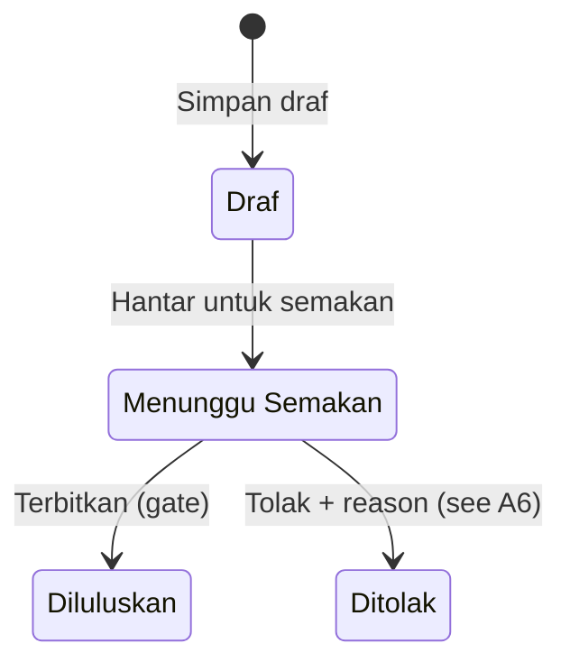

| # | Status | Actor | Step | Screen | API | Data | Notes |
|---|---|---|---|---|---|---|---|
| 1 | Change | admin | Open Bank Soalan (Studio) | /admin/studio | API-Q-01 GET /api/questions (+/summary) | questions, question_versions (read) | One canonical list. Filters Subjek, Tingkatan, Bab (value Belum dipautkan = chapter=none), Penandaan DSKP (Ada DSKP Tag / Belum Ditag), Status, Sumber, Jenis kertas, Kertas, Tahun, Negeri added by S2-T01; KPI strip copied from BankPage; header buttons Import PDF, Import CSV, Cipta baharu. /admin/spm/soalan redirects to /admin/spm/databank. |
| 2 | Change | admin | Cipta baharu, pick Soalan tunggal | /admin/studio/questions/create | - | - | Choice dialog Soalan tunggal (default) / Kumpulan rangsangan is NEW (S2-T01). Old /admin/questions/create and /admin/questions/:id/edit redirect here with toast: Borang soalan lama telah dipindahkan ke Studio. Sila cipta soalan baharu di sini. Alias /admin/studio/questions/:id/edit -> /sunting. |
| 3 | Change | admin | Step 1 Tag & pengelasan (DSKP first) | wizard tab 1 Tag | API-Q-09 GET /api/questions/studio/dskp | curriculum_nodes, chapters (read); question_versions.subject_id/education_level_id/unit_node_id/chapter_id/difficulty_level | T-01 Subjek, T-02 Tingkatan (clears T-03..T-09), T-03 Tajuk DSKP, T-04 SP 1..3, T-05 SK read-only, T-06 TP, T-07 Aras, T-08 KBAT derived, T-09 Bab (ChapterSelect), T-10 Topik, T-11 Rujukan buku teks, T-12 Tahap kesukaran 1..5 (default min(5,TP), 3 when no TP, until touched), T-13 Bahasa soalan, T-14 Jenis tulisan, T-15 Asal tingkatan, T-16 Sumber badge. No tag is free text. Rule R-DSKP: unit/SP/TP/aras required only when curriculum_nodes exist for Subjek+Tingkatan; Bab required when that Subjek+Tingkatan has chapters; Kesukaran always. Owners S1-T02 (gate), S2-T01 (UI), S2-T10 (Tag-step prefill). Language token: ms, en, ms+en on the wire and in CSV; stored ms, en, ms_en (V3 check not widened). |
| 4 | Exists in V3 | admin | Step 2 Kertas & bahagian | wizard tab 2 Kertas | - | question_versions.paper_code/section_label/number_label | K-01 Kertas 1..4 (required if SPM-bound; auto-filled when set chosen), K-02 Set kertas (optional, is_test papers excluded), K-03 Bahagian (read-only rule Jawab semua / Jawab satu and mark budget from contract), K-04 Nombor soalan (unique in paper; pattern ^[0-9]{1,3}[A-Za-z]?$). |
| 5 | Change | admin | Step 3 Rangsangan (optional) | wizard tab 3 Rangsangan | API-Q-08 stimulus-groups | stimulus_groups, stimuli (read) | Options: Tiada rangsangan / Pilih kumpulan (same Subjek, label {kapsyen} · {n} soalan; a group with a served member is not joined here) / Kumpulan baharu (goes to flow A2). Question never holds its own re-uploaded figure copy. A single question with its own stimulus creates a 1-member group. Stem warns live: Teks ini menyebut {Rajah 3}. Letakkan rajah dalam rangsangan kumpulan. |
| 6 | Build | admin | Step 4 Sub-bahagian, leaves, scheme | wizard tab 4 Sub-bahagian | API-Q-30 POST /api/questions/:id/parts/:partId/scheme/validate | question_parts (mode_config DM-55), part_options, answer_keys (scheme_v:2), question_versions.scheme_rules (DM-54) | Jenis soalan (11 types) builds template; leaf modes mcq, match_letter, short_text, numeric, working, essay, essay_choice, drawing, table_fill. V3 Studio edits only mcq, short_text, numeric today; S2-T10 adds the other six; S1-T09a/b build backend. Depth max 3; only leaves carry marks (1..100; 0 only for Contoh leaf), answer mode, key, scheme. Scheme chip n markah skema / m markah bahagian; sum must match. |
| 7 | Exists in V3 | system | Autosave and Simpan draf | wizard save bar | API-Q-03 POST/PUT /api/questions | questions, question_versions (status draft) | Browser-storage autosave every 10 s (7 days) with banner Terdapat kerja yang belum disimpan daripada sesi sebelum ini. (Pulihkan / Buang). Flash: Soalan draf disimpan. Terbitkan melalui semakan apabila sedia. Simpan draf always saves (even ms+en with English empty). |
| 8 | Change | admin | Read completeness panel | wizard save bar / bottom sheet | API-Q-05 GET /api/questions/:id/gate-check?gate=submit\|approve | - | Panel lists issues[{path,code,message,step}] with jump links; empty: Semua medan wajib telah lengkap.; loading: Memeriksa kelengkapan…. New StudioCompletenessPanel.vue (S2-T01) replaces the bare '{n} belum lengkap' text. |
| 9 | Exists in V3 | admin | Pratonton as pupil | /admin/studio/questions/{id}/preview | - | - | SULIT header, 'Pratonton — Draft.', 'Soalan ini belum diterbitkan; pelajar tidak dapat melihatnya lagi.' |
| 10 | Change | admin | Hantar untuk semakan | wizard status bar | API-Q-06 POST /api/questions/:id/status {to:'review'} | question_versions.status draft->review; rejection_reason cleared | Runs submit gate (rows marked S). Flash: Soalan dihantar untuk semakan. Group member: button disabled, title Hantar melalui kumpulan. |
| 11 | Change | admin | Terbitkan | wizard status bar | API-Q-06 POST /api/questions/:id/status {to:'approved'} | question_versions.status review->approved; servability recomputed | Approve gate (all 30 checks, see A6). Flash: Soalan diterbitkan — kini boleh dijawab oleh pelajar. Admin Pusat only. Group member: Terbitkan disabled, title Terbitkan melalui kumpulan. |
| 12 | Change | system | Show Dilihat murid di n daripada 6 | Studio list / wizard status bar | API-Q-11 servability | question_versions flags, served-rule | Six pupil surfaces (jana_kertas stays enum value for admin only). Reasons in BM per surface (see A7). |

Decisions:

- Step 3: Does the Subjek+Tingkatan have DSKP nodes?
  - Yes → 4: "Unit, SP, TP, aras required to publish"
  - No (subject not loaded) → 4: "DSKP belum dimuatkan untuk subjek ini. (link Kurikulum > DSKP; unit/SP/TP/aras not required; other fields still required)"
- Step 7: Another admin saved the same draft (expectedUpdatedAt mismatch)?
  - No → 8
  - Yes → 7: "Draf ini telah dikemas kini oleh pengguna lain. Muat semula untuk melihat versi terkini. (409 STALE_VERSION, ERR-CON-02b; button Muat Semula Versi Terkini; edits copied to recovery store first)"
- Step 10: Submit gate passes (bilingual English present, scheme sum ok, flags clear)?
  - Yes → 11
  - No → 8: "422 details.gate[]: e.g. Teks English diperlukan untuk soalan dwibahasa.; Jumlah skema ({n}) mesti sama dengan markah bahagian ({m}).; Sila pilih tahap kesukaran."
- Step 11: Approve gate passes?
  - Yes → 12: "Diluluskan"
  - No → 8: "422 with the same list as the panel, e.g. Sila pilih Bab.; Sila pilih unit DSKP.; Bahagian (a) belum ada TP."
  - Question is already approved → end: "Soalan ini telah diterbitkan. Gunakan Edit sebagai draf untuk menyuntingnya. (flow A8)"

Resolved points (how the docs settle them):

- Resolved: bilingual token is `ms+en` on the wire and in CSV, `ms_en` in the database; the V3 language check is not widened (docs/prd/r1/50-data-model-erd.md:DM-50; docs/prd/r1/45-question-authoring-flow.md:DM-50; docs/plan/r1-development-plan.md:S1-T09b)
- Wizard has 4 tabs (1 Tag, 2 Kertas, 3 Rangsangan, 4 Sub-bahagian) but 45 1.7 / AC-CHAIN-2 call the DSKP fields 'Tag step'; consistent, noted for diagram naming.

### A2 Stimulus group 1..n (group-first entry, members, publish as one unit)

- Actors: admin
- Trigger: Admin presses Cipta baharu > Kumpulan rangsangan (or 'Kumpulan baharu' in wizard step 3)
- Cards: S1-T01, S1-T02, S1-T07, S2-T01
- Acceptance criteria: AC-ADM-QE1.2, AC-ADM-QE2.1, AC-ADM-QE2.2, AC-ADM-Q05.1, AC-ADM-G5.2, AC-QA-01, AC-QA-02, AC-QA-03, AC-QA-10, AC-QA-50, AC-QA-51

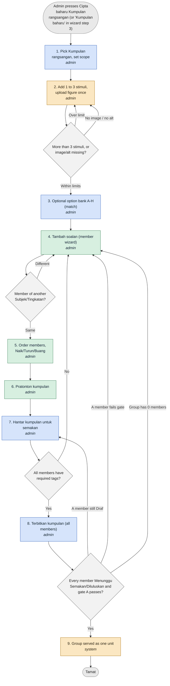

States:

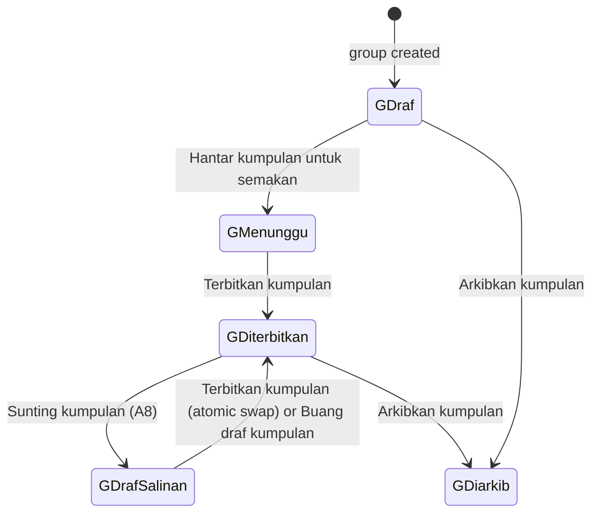

| # | Status | Actor | Step | Screen | API | Data | Notes |
|---|---|---|---|---|---|---|---|
| 1 | Build | admin | Pick Kumpulan rangsangan, set scope | /admin/studio (modal) -> /admin/studio/groups/:id | API-Q-08 POST /api/stimulus-groups | stimulus_groups (subject_id, education_level_id, kertas - DM-51) | G-00 asks Subjek, Tingkatan (required) and Kertas (optional); stored on the group row so an empty group is scoped; scope editable only while group has no member. Buttons Cipta kumpulan / Batal. Errors: Sila pilih subjek.; Sila pilih tahap pendidikan. Mixed-level legacy groups: migration 0130 sets group level to NULL (no level restriction). |
| 2 | Change | admin | Add 1 to 3 stimuli, upload figure once | /admin/studio/groups/:id (StudioGroupPage) | API-Q-07 POST /api/stimuli; API-FILE-01 upload | stimuli (kind, label, caption, body, image, alt, source_citation DM-52), stimulus_group_stimuli | G-01 Label (Rajah 3 / Bahan 2 / Sumber A), G-02 Jenis (Petikan, Rajah, Jadual, Graf, Peta, Carta / Infografik, Imej / Gambar), G-03 Kapsyen, G-04 rich-text editor, G-05 Imej JPG/PNG/WebP <=2 MB, G-06 Teks alternatif, G-07 Sumber petikan. 7 kinds exactly; Audio/Video not offered. Stimulus has no marks, number or key and is never a row in a list. |
| 3 | Build | admin | Optional option bank A-H (match) | group screen | API-Q-08 | stimulus_group_options (body, image_file_id, is_distractor) | G-09 2 to 8 rows for match questions (BI Part 4/5). Leaves reference the bank, never copy it. |
| 4 | Exists in V3 | admin | Tambah soalan (member wizard) | group screen -> wizard with group attached read-only | API-Q-08 POST /api/stimulus-groups/:id/questions | questions.group_id, group position | Each member goes through A1 steps 1,2,4 (Tag, Kertas, Sub-bahagian); group screen has no Bab/SP/TP/Kesukaran. Member Subjek+Tingkatan must equal group's. Also Lampirkan soalan sedia ada (same Subjek/Kertas, in no group). |
| 5 | Exists in V3 | admin | Order members, Naik/Turun/Buang | group screen | API-Q-08 PUT /members/order; DELETE /members/:qid | questions.group_position | Max 40 members; label max 100; Buang confirm: Keluarkan soalan daripada kumpulan? (Batal / Ya, Keluarkan). Removing a member whose text names a figure sets stimulus_missing (after S1-T07). |
| 6 | Exists in V3 | admin | Pratonton kumpulan | group screen | - | - | Stimuli shown once above all members, as pupil sees it. |
| 7 | Build | admin | Hantar kumpulan untuk semakan | group screen action bar | API-Q-04 POST /api/questions/bulk-action {groupId} | question_versions.status draft->review for every Draf member (one transaction) | Visible while any member is Draf. groupId and ids never sent together (422 ERR-REQ-01). Flash: Kumpulan dihantar untuk semakan. |
| 8 | Build | admin | Terbitkan kumpulan (all members) | group screen | API-Q-31 POST /api/stimulus-groups/:id/publish | question_versions.status review->approved for all members; audit STIMULUS_GROUP_PUBLISHED | One transaction: every member Menunggu Semakan or Diluluskan, gate A for every member, then approve all. Any failure = rollback. |
| 9 | Change | system | Group served as one unit | pupil surfaces | served-rule / API-Q-11 | servability | Servable only if >=1 member, all approved, no open stimulus flag. Until then members show Tidak boleh dilihat: Kumpulan belum lengkap - {n} soalan belum diluluskan. |

Decisions:

- Step 4: Member of another Subjek/Tingkatan?
  - Same → 5
  - Different → 4: "Subjek dan Tingkatan ahli mesti sama dengan kumpulan. (422); mixed kertas: Soalan dalam satu kumpulan mesti sama kertas."
- Step 2: More than 3 stimuli, or image/alt missing?
  - Within limits → 3
  - Over limit → 2: "Satu kumpulan mesti mempunyai 1 hingga 3 rangsangan."
  - No image / no alt → 2: "Sila muat naik imej untuk rangsangan ini.; Sila isi teks alternatif untuk imej ini.; Sila isi label rangsangan."
- Step 7: All members have required tags?
  - Yes → 8
  - No → 4: "Per-member submit gate lines; per-member Hantar disabled with title Hantar melalui kumpulan."
- Step 8: Every member Menunggu Semakan/Diluluskan and gate A passes?
  - Yes → 9: "200 StimulusGroupDetail state Diterbitkan"
  - A member still Draf → 7: "Semua soalan dalam kumpulan mesti dihantar untuk semakan dahulu. (409, nothing changes)"
  - A member fails gate → 4: "Soalan {no}: {mesej} (422 details.gate[], MEMBER_NOT_READY, rollback)"
  - Group has 0 members → 4: "Kumpulan perlu sekurang-kurangnya 1 soalan. (group of 1 is valid, D108(1))"

Resolved points (how the docs settle them):

- Group state is derived (not stored): Draf = any member Draf or 0 members; Menunggu Semakan = no Draf and >=1 Menunggu; Diterbitkan = >=1 member all approved; Diarkibkan = all archived.
- S1-T01 migrations 0120/0122/0130/0131 and routes API-Q-31..35 are Missing-Build; until merged S2-T01 buttons show the API error in a DsCallout.

### A3 Paper PDF upload -> OCR/extraction job -> Semak Ekstrak -> accept/reject -> draft

- Actors: admin, worker (system)
- Trigger: Admin presses Muat Naik Kertas on Import & Semakan (/admin/spm/soalan/ekstrak) or Import PDF on the Studio header
- Cards: S0-T03, S1-T03, S1-T04, S1-T10, S2-T02, S4-T08
- Acceptance criteria: AC-ADM-QE5.1, AC-ADM-QE5.2, AC-ADM-QE5.3, AC-ADM-Q07.1, AC-ADM-Q08.1, AC-ADM-Q09.1, AC-QA-12, AC-QA-35, AC-QA-36, AC-QA-37, AC-QA-38, AC-QA-43, AC-CHAIN-2

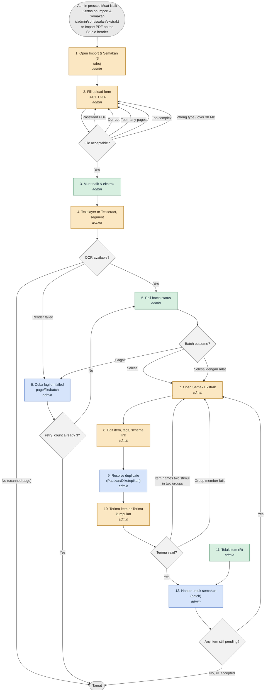

States:

```mermaid
stateDiagram-v2
  state "Dihantar" as s0
  state "Sedang diproses" as s1
  state "Selesai" as s2
  state "Selesai dengan ralat" as s3
  state "Gagal" as s4
  state "Dihantar Sedang diproses" as s5
  state "Dibatalkan" as s6
  state "item pending (generated, needs_review or duplicate)" as s7
  state "accepted" as s8
  state "item pending (open)" as s9
  state "rejected (shown Ditolak)" as s10
  s0 --> s1 : worker picks first file
  s1 --> s2 : all pages ok (ready_for_review)
  s1 --> s3 : =1 page failed and =1 item
  s1 --> s4 : 0 items or OCR_BATCH_TIMEOUT
  s5 --> s6 : Batalkan kelompok ini? (Batal / Ya, Batalkan)
  s7 --> s8 : Terima
  s9 --> s10 : Tolak + reject_reason; final, no undo
```

| # | Status | Actor | Step | Screen | API | Data | Notes |
|---|---|---|---|---|---|---|---|
| 1 | Change | admin | Open Import & Semakan (3 tabs) | /admin/spm/soalan/ekstrak (alias /admin/studio/imports) | API-Q-14 GET /api/intake/batches | intake_batches (read) | Title Import & Semakan; buttons Muat Naik Kertas, Tulis Soalan Manual, Import CSV; tabs Kelompok Item / Kertas Diimport (?tab=kertas-diimport) / Kiriman Guru (/admin/question-submissions). ImportTabs.vue NEW (S2-T02). Columns Fail Sumber, Subjek, Bilangan Soalan, Disemak, Status, Semak. |
| 2 | Change | admin | Fill upload form U-01..U-14 | /admin/spm/soalan/muat-naik | API-Q-14 POST /api/intake/batches, POST /batches/:id/files | intake_batches (subject, education_level_id DM-09, kertas 1..4 DM-08, year, paper_code, source), intake_files | U-01 Subjek, U-02 Tingkatan, U-03 Kertas 1..4, U-04 Bahagian (default), U-05 Tahun, U-06 Negeri/badan, U-07 Jenis, U-08 Set, U-09 Kod kertas (^[0-9]{4}/[0-9]$, blank=K{kertas}), U-10 Sumber, U-11 Status hak cipta, U-12 declaration checkbox, U-13 Fail kertas PDF <=30 MB, U-14 Skema PDF optional. Provenance declared once per batch (D99). Notice: Kertas diimport sebagai DRAF — tiada apa-apa diterbitkan kepada pelajar sehingga anda menerbitkannya. Limits: 10 files/batch, 5 active batches, 500 pages/day. Fix: chosen Kertas now carried (E2E F2); all subjects selectable (S1-T03). |
| 3 | Exists in V3 | admin | Muat naik & ekstrak | upload form | API-Q-15 POST /api/intake/batches/:id/extract | intake_batches.status Dihantar | extract has EMPTY body in V3; optional pages[] is NEW (S1-T04). Progress: Memuat naik… {x}%. |
| 4 | Change | worker | Text layer or Tesseract, segment | - | jobs worker (JOBS_WORKER_ENABLED, OCR_ENGINE=tesseract msa+eng) | intake_pages, intake_items, intake_stimuli (figure crops stored once) | Digital PDF: text layer first; scanned: Tesseract. Rule-based detection of Bahagian headers/rules, numbers, [n markah], options A-H, banks, Sumber lines, word ranges, bilingual repeats. Figure = stimulus object, never an item. Linking by figure-links.ts: numbered refs auto-link; item naming 2 stimuli links to both; unnumbered refs only SUGGESTED with confidence. DSKP pre-fill = deterministic keyword matcher (bands Tinggi >=0.8, Sederhana 0.5-0.79, Rendah <0.5), nothing auto-accepted. No external AI in R1; mock never on UAT. Batch status Sedang diproses. |
| 5 | Exists in V3 | admin | Poll batch status | batch list | API-Q-14 GET /batches/:id (3 s first minute, then 10 s) | intake_batches.status | Ends: Selesai (ready_for_review) / Selesai dengan ralat (>=1 page failed and >=1 item) / Gagal (0 items or OCR_BATCH_TIMEOUT) / Dibatalkan. 90 s per page (OCR_TIMEOUT), 15 min per batch (OCR_BATCH_TIMEOUT); never an endless Sedang diproses. selesai_dengan_ralat is NEW (migration 0136). |
| 6 | Build | admin | Cuba lagi on failed page/file/batch | batch list / review | API-Q-15 extract {pages[]}; API-Q-26 POST /intake/files/:id/retry, /batches/:id/retry | intake_files.retry_count (DM-71) | 3 retries per file after the first run; 4th = 409 ERR-INT-11. Shown only for Gagal and Selesai dengan ralat. Banner: {n} halaman tidak dapat dibaca; semak secara manual. |
| 7 | Change | admin | Open Semak Ekstrak | /admin/spm/soalan/ekstrak/:batchId (IntakeReviewPage) | API-Q-15 GET /batches/:id/review, GET /items | intake_items, intake_stimuli | Title Studio — Semak Import; Item {i} / {n}; left Sumber PDF, right editor; below 1024 px tabs; keys A Terima, R Tolak, E Simpan Sunting. Group header first: Rajah 3 -> soalan 5-8 with range edit, Pisahkan, Lampirkan, Gabungkan kumpulan (API-Q-38), Muat naik imej for imageless stimulus (GroupRangeEditor.vue NEW, S2-T02). |
| 8 | Change | admin | Edit item, tags, scheme link | Semak Ekstrak item editor | API-Q-15 PATCH /api/intake/items/:id | intake_items | All fields of A1 steps 1-4 prefilled from extraction (incl. Bahagian per item, Bab, Kesukaran). Skema PDF attached by question number; unmatched blocks under Skema tidak dipadankan (drag to link); ambiguous number match stays unlinked; item without scheme shows tiada skema and cannot be sent (non-MCQ). Typed SP not in list refused on blur (INTAKE_GATE_MESSAGES.spNotInTaxonomy). |
| 9 | Build | admin | Resolve duplicate (Pautkan/Diketepikan) | Semak Ekstrak | API-Q-15 POST /items/:id/duplicate | intake_items duplicate kind Sama/Hampir sama/Varian | Open duplicate blocks Terima until Pautkan (link to existing question, no new draft) or Diketepikan. |
| 10 | Change | admin | Terima item or Terima kumpulan | Semak Ekstrak | API-Q-15 POST /items/:id/accept; API-Q-37 POST /intake/stimuli/:id/accept-group | questions + question_versions (Draf), stimulus_groups (created from extracted stimulus first) | Terima validates only what a Draf needs (draftIssues: stem not empty, not needsManual, subject+level known, named stimulus exists, free-text SP, Bab outside Subjek+Tingkatan, MCQ stem <10, option/key/scheme sum, open duplicate, two-group citation) and answers 422 at once with Soalan {no}: {mesej}. Never requires unit/SP/TP/aras/Bab/Kesukaran. match_letter and table_fill items now acceptable. Terima kumpulan = stimulus + all pending members in one transaction. Terima semua yang belum disemak: confirm Terima {n} item yang belum disemak?; result {ok} diterima, {gagal} gagal. |
| 11 | Exists in V3 | admin | Tolak item (R) | Semak Ekstrak | API-Q-15 POST /items/:id/reject | intake_items.review_state rejected (+reject_reason) | Sebab tolak optional <=200 (admin paper); source=guru: required 5..500. Tolak on a stimulus discards the group and keeps members pending with stimulus_missing. A rejected item is final (V3 locks it); no undo. |
| 12 | Build | admin | Hantar untuk semakan (batch) | Semak Ekstrak / Kelompok Item | API-Q-25 POST /api/intake/batches/:id/paper (or API-BIJAK-14 apply) | papers (see B3) | Enabled when no item is pending (generated, needs_review or duplicate) and >=1 accepted; S2-T02 picks the route by batch.targetPaperId. Continues in flow B3. |

Decisions:

- Step 5: Batch outcome?
  - Selesai → 7
  - Selesai dengan ralat → 7: "{n} halaman tidak dapat dibaca; semak secara manual."
  - Gagal → 6: "Pengekstrakan gagal: {sebab}. (ERR-INT-10); timeouts: Pengecaman teks mengambil masa terlalu lama. (ERR-INT-05) / Pengecaman teks gagal. (ERR-INT-06)"
- Step 2: File acceptable?
  - Yes → 3
  - Password PDF → 2: "Fail dilindungi kata laluan. Buang perlindungan dan muat naik semula. (ERR-INT-01)"
  - Corrupt → 2: "Fail rosak atau tidak dapat dibaca. (ERR-INT-02)"
  - Too many pages → 2: "Fail mempunyai terlalu banyak halaman (maksimum {n}). Bahagikan fail dan muat naik semula. (ERR-INT-03)"
  - Too complex → 2: "Fail terlalu kompleks untuk diproses. Cuba fail yang lebih ringkas. (ERR-INT-04)"
  - Wrong type / over 30 MB → 2: "Format fail tidak sah. Gunakan .pdf.; Fail melebihi had 30 MB."
- Step 4: OCR available?
  - Yes → 5
  - No (scanned page) → end: "Halaman imbasan tidak dapat dibaca kerana pengecaman teks tidak tersedia. Taip soalan secara manual. (ERR-INT-07) -> button Tulis Soalan Manual (flow A1)"
  - Render failed → 6: "Halaman tidak dapat dipaparkan. (ERR-INT-08)"
- Step 6: retry_count already 3?
  - No → 5
  - Yes → end: "Fail ini gagal diproses berulang kali. Sila hubungi sokongan. (ERR-INT-11, buttons disabled)"
- Step 10: Terima valid?
  - Yes → 12: "Draf created in its group"
  - Item names two stimuli in two groups → 7: "Soalan merujuk dua rangsangan dalam kumpulan berbeza. Gabungkan kumpulan atau pilih satu."
  - Group member fails → 7: "Soalan {no}: {mesej} (none created)"
- Step 12: Any item still pending?
  - No, >=1 accepted → end: "Draft paper created (B3)"
  - Yes → 7: "{n} item belum diputuskan. (409)"

Resolved points (how the docs settle them):

- Resolved: stored item states are the V3 review_state values generated, needs_review, accepted, rejected, duplicate (+reject_reason); pending, approved and draft are display names (docs/prd/r1/40-cross-cutting.md:OPT-KIRIMAN-STATUS; docs/prd/r1/45-question-authoring-flow.md:3.3.4)
- Plan S1-T04 says 'retry_count 0 to 3' while 45 says a file is allowed 3 retries (original not counted): consistent, but the 4th retry is refused in both.
- The Header list for CSV/intake field-level limits is in 30 R1-ADM-Q-08/Q-09 (not re-verified here).

### A4 CSV import of questions

- Actors: admin
- Trigger: Admin presses Import CSV (Senarai Soalan, Studio or Import & Semakan header)
- Cards: S1-T05, S2-T05
- Acceptance criteria: AC-ADM-QE6.1, AC-ADM-QE6.2, AC-ADM-Q11.1, AC-QA-33, AC-QA-34

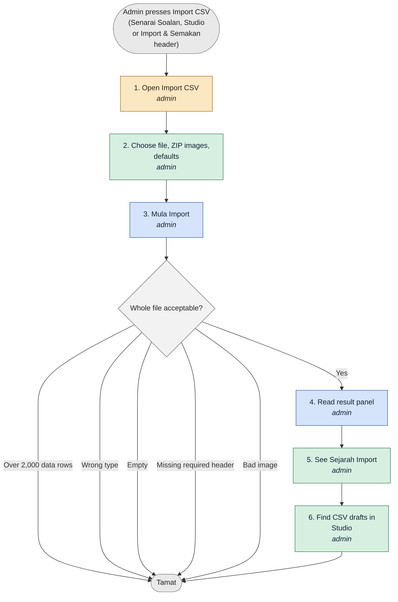

States:

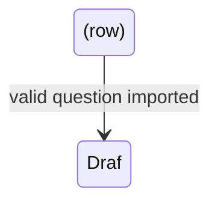

| # | Status | Actor | Step | Screen | API | Data | Notes |
|---|---|---|---|---|---|---|---|
| 1 | Change | admin | Open Import CSV | /admin/questions/import | API-Q-17 GET /api/question-imports/template | - | Buttons Muat Turun Templat CSV and Mula Import. Template = new human-readable header (codes, not ids) + one example per type + one group of 2 with one stimulus. The one header list is in 30 R1-ADM-Q-11 (not repeated in 45). Legacy positional MCQ header still accepted (detected by first cell question_text). |
| 2 | Exists in V3 | admin | Choose file, ZIP images, defaults | /admin/questions/import | - | - | Fail CSV .csv/.txt UTF-8, <=5 MB; optional ZIP images (<=20 MB, images <=2 MB JPG/PNG/WebP); Tetapan Lalai: Subjek Lalai, Tahap Pendidikan, Kesukaran. Note: Soalan akan disimpan sebagai draf. One row = one LEAF; same consecutive question_key = one question; same group_key = one stimulus group (stimulus columns on first row). |
| 3 | Build | admin | Mula Import | /admin/questions/import | API-Q-17 POST /api/question-imports | question_imports (failures jsonb), questions, question_versions, question_parts, answer_keys, stimuli, stimulus_groups | Loading text Mengimport…. Whole-file refusals first, then per-question validation; invalid question skipped whole; a group is imported only if all members valid. Rate-limited (ERR-RATE-01). |
| 4 | Build | admin | Read result panel | /admin/questions/import | - | - | Import selesai: {n} soalan diimport, {m} gagal. Button Muat turun laporan ralat (CSV) with columns baris, question_key, medan, kod_ralat, mesej (row errors prefixed Baris {n}: ). Re-upload creates again and warns {n} soalan sama dengan soalan sedia ada. |
| 5 | Exists in V3 | admin | See Sejarah Import | /admin/questions/import-history | API-Q-17 GET /api/question-imports | question_imports | Columns Fail, Tarikh, Diimport, Gagal, Oleh; empty Tiada sejarah import. |
| 6 | Exists in V3 | admin | Find CSV drafts in Studio | /admin/studio (source badge CSV) | API-Q-01 | question_versions.status draft | A question with every required column can be Hantar+Terbitkan without opening the wizard (QE6.3); otherwise continues in A1/A6. |

Decisions:

- Step 3: Whole file acceptable?
  - Yes → 4
  - Over 2,000 data rows → end: "Fail melebihi 2,000 baris. Pecahkan fail kepada beberapa bahagian. (422)"
  - Wrong type → end: "Format fail tidak sah. Gunakan .csv atau .txt."
  - Empty → end: "Fail kosong."
  - Missing required header → end: "Fail CSV mesti mempunyai kolum {senarai}."
  - Bad image → end: "Gambar mesti jenis JPG, PNG atau WebP dan tidak melebihi 2MB."

Resolved points (how the docs settle them):

- Guru CSV import (API-GUR-19, <=500 rows, 2 MB) is a separate path that also creates source=guru intake items (A5); admin cap is 2,000 rows.

### A5 Guru Sumbang Soalan / teacher uploads -> admin review

- Actors: guru, admin
- Trigger: Teacher submits via Sumbang Soalan (/guru/soalan): single MCQ, CSV, Soalan Berstruktur, paper PDF/DOCX/XLSX, or Soalan Gambar Rajah figure
- Cards: S1-T08, S2-T02, S6-T06, S6-T17, S6-T18, S6-T16, S1-T02, S4-T03
- Acceptance criteria: AC-GUR-44-1, AC-GUR-44-2, AC-GUR-44-5, AC-GUR-44-9, AC-GUR-44-10, AC-GUR-44-11, AC-ADM-Q12.1, AC-ADM-Q12.2, AC-ADM-Q12.3, AC-QA-39, AC-CHAIN-6

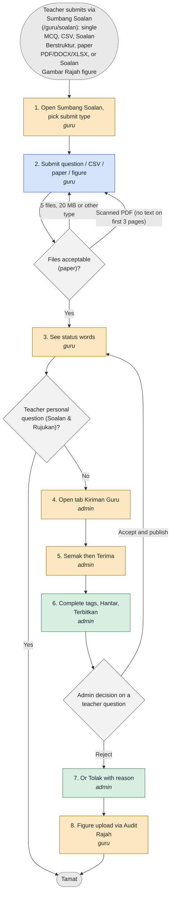

States:

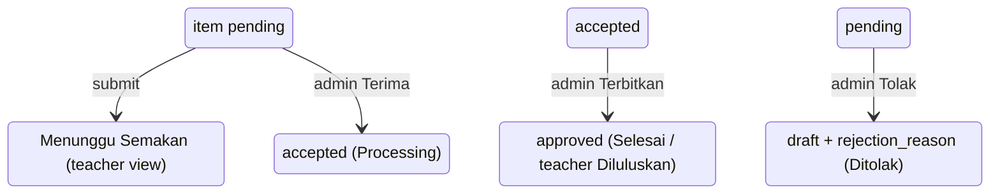

| # | Status | Actor | Step | Screen | API | Data | Notes |
|---|---|---|---|---|---|---|---|
| 1 | Change | guru | Open Sumbang Soalan, pick submit type | /guru/soalan, /guru/soalan/cipta | - | - | Alat Soalan block of six tiles (Soalan & Rujukan, Soalan Berstruktur, Soalan Gambar Rajah, Databank Soalan, Set Soalan, Kertas Peperiksaan) NEW; each tile shown only when its route is registered (D-T06-1). |
| 2 | Build | guru | Submit question / CSV / paper / figure | /guru/soalan/cipta, HantarKertasCard, GaleriRajahModal | API-GUR-18 POST /api/guru/questions; API-GUR-19 POST /questions/import; API-GUR-17 POST /api/guru/question-papers | intake_batches (source='guru', DM-72), intake_items | EVERY teacher submission is an intake item/batch with source=guru; no question row exists before admin Terima; no /api/question-submissions route. Single MCQ form: Tingkatan, Subjek, Bab, SP, TP, Aras, Kesukaran 1..5 stars, 4 options (true_false/essay/short_answer hidden). CSV templat-soalan.csv 14 columns, <=500 rows. Paper: 1-5 files, 20 MB each, PDF/DOCX/XLSX, scheme required. Today POST /guru/question-papers = 503 (UnavailablePaperIntake); S1-T08 binds real port; success: Kertas dihantar kepada admin. |
| 3 | Change | guru | See status words | Soalan Saya list | API-GUR-18 GET /api/guru/questions | intake_items, question_versions | Menunggu Semakan (item pending OR accepted-not-yet-published), Diluluskan (after Terbitkan), Ditolak + Sebab: {reason}. Teacher edits/deletes only own not-yet-accepted or Ditolak items; another teacher's id = 404. Paper upload: only success notice, no list of papers in R1. |
| 4 | Change | admin | Open tab Kiriman Guru | /admin/question-submissions | API-Q-15 GET /api/intake/items?source=guru | intake_items | Title Kertas Soalan Guru - Admin Panel; tiles Jumlah/Pending/Processing/Selesai/Ditolak mapped by OPT-KIRIMAN-STATUS (Pending=item pending; Processing=item accepted, question not yet Diluluskan; Selesai=item approved; Ditolak=draft+reason; a still-extracting paper = one batch row Sedang diproses). Columns Guru / Sekolah (role label and school, never e-mail), Tajuk, Fail, Status, Tarikh. Demo notice Fungsi ini belum tersedia dalam demo is removed (S2-T02 deletes submissions-unavailable.ts). |
| 5 | Change | admin | Semak then Terima | Semak Ekstrak / wizard | API-Q-15 POST /items/:id/accept | questions + question_versions (Draf), intake_items accepted | Terima creates a Draf and opens /admin/studio/questions/:id/sunting prefilled: Subjek, Tingkatan, text, options, key, explanation and teacher's star difficulty (difficultyLevel). TP/Bab/SP/aras empty. Missing DSKP never blocks review/Terima (S2-T02). |
| 6 | Exists in V3 | admin | Complete tags, Hantar, Terbitkan | wizard | API-Q-06 | question_versions.status | Continues A1/A6; item becomes approved when question is Diluluskan; teacher-origin questions are never auto-approved. Terbitkan blocked with gate list until Bab/SP/TP set (AC-ADM-Q12.3). |
| 7 | Exists in V3 | admin | Or Tolak with reason | Kiriman Guru / Semak Ekstrak | API-Q-15 POST /items/:id/reject | intake_items.status draft + rejection_reason (5..500) | Sebab penolakan required. Teacher notified: Soalan anda telah {diluluskan\|dikembalikan}. and sees Ditolak with Sebab. |
| 8 | Change | guru | Figure upload via Audit Rajah | /admin/soalan-gambar (teacher also) | API-Q-21 POST /api/diagram-audit/:kind/:id/image | intake_batches source=guru with image attached once to stimulus group | Question stays listed until admin accepts; chip Menunggu Semakan. Teacher has no Bukan masalah (admin only). |

Decisions:

- Step 2: Files acceptable (paper)?
  - Yes → 3: "Kertas dihantar kepada admin."
  - >5 files, >20 MB or other type → 2: "Rejected with BM message before upload (copy in 20 R1-GUR-44 field table)"
  - Scanned PDF (no text on first 3 pages) → 2: "BM refusal text from 20 R1-GUR-44 field table (D-26)"
- Step 6: Admin decision on a teacher question
  - Accept and publish → 3: "Teacher sees Diluluskan"
  - Reject → 7: "Sila nyatakan sebab penolakan (sekurang-kurangnya 5 aksara)."
- Step 3: Teacher personal question (Soalan & Rujukan)?
  - Yes → end: "teacher_private: Diluluskan on save, no review, servable only in the owner's own missions (mode mission). Never enters this flow (S6-T16)."
  - No → 4

Resolved points (how the docs settle them):

- Teacher 'Digunakan' = number of the teacher's approved questions answered at least once in any mode (FR-GUR-44-10); AC-CHAIN-6 says it 'rises per its definition'.
- The Kiriman Guru tab depends on S1-T08 (Sprint 4); until then the tab shows Tiada kertas soalan dihantar oleh guru lagi. and teacher ACs are [UAT].

### A6 Review and publish gate (Bab before Terbit, SP/TP only where DSKP exists, gate codes)

- Actors: admin, guru (owner sends own draft)
- Trigger: A question is Menunggu Semakan (Studio tile Menunggu Semakan, /admin/studio?status=review)
- Cards: S1-T02, S1-T09a, S1-T09b, S1-T07, S2-T03, S2-T01
- Acceptance criteria: AC-ADM-QE4.1, AC-ADM-QE4.3, AC-ADM-QE4.4, AC-ADM-QE4.5, AC-ADM-Q03.1, AC-ADM-Q20.1, AC-QA-03, AC-QA-11, AC-QA-29, AC-QA-31, AC-QA-32, AC-QA-42, AC-QA-47

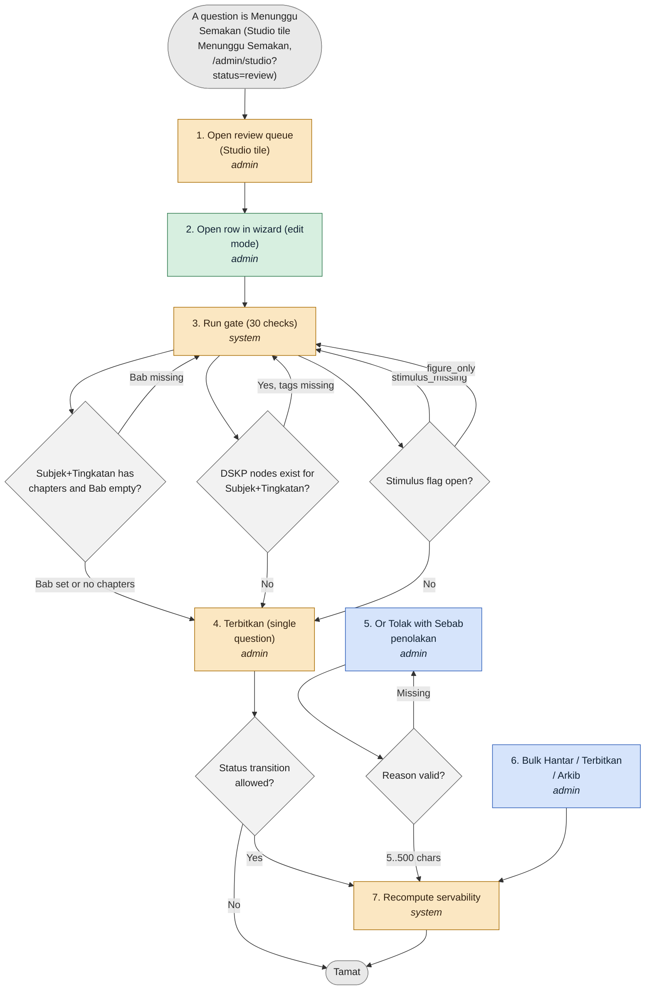

States:

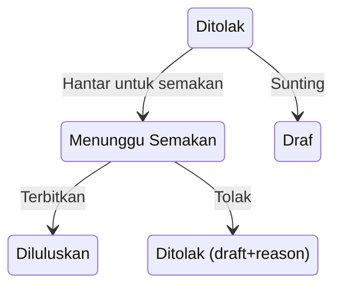

| # | Status | Actor | Step | Screen | API | Data | Notes |
|---|---|---|---|---|---|---|---|
| 1 | Change | admin | Open review queue (Studio tile) | /admin/studio?status=review (redirect from /admin/spm/semakan) | API-Q-01 status=review | question_versions status=review | One queue; tile count equals filtered list (AC-ADM-Q03.1). Status filter value review. |
| 2 | Exists in V3 | admin | Open row in wizard (edit mode) | /admin/studio/questions/:id/sunting | API-Q-02 GET /api/questions/:id | - | Reads completeness panel; completes tags. |
| 3 | Change | system | Run gate (30 checks) | - | API-Q-05 gate-check; 422 of API-Q-04/06 | curriculum_nodes, chapters (EXISTS lookups) | Codes: 1 NO_SUBJECT, 2 NO_LEVEL, 3 NO_UNIT, 4 NO_SP, 5 LEAF_NO_TP, 6 LEAF_NO_ARAS, 7 NO_KERTAS (SPM-bound), 8 NO_CHAPTER, 9 NO_DIFFICULTY, 10 STEM_SHORT, 11 MCQ rules, 12 NO_KEY, 13 SCHEME_SUM, 14 SCHEME_DEPENDS, 15 BAND_RANGE, 16 NO_SCHEME, 17 BANK_LETTER, 18 GAP_UNLINKED, 19 WORD_RANGE, 20 TOPICS_COUNT, 21 DRAWING_TEMPLATE, 22 TABLE_NO_BLANK, 23 EN_REQUIRED, 24 ALT_REQUIRED, 25 STIMULUS_MISSING, 26 FIGURE_ONLY, 27 GROUP_EMPTY, 28 GROUP_MIXED, 29 MEMBER_NOT_READY, 30 GATE_STATUS(409). S = also at Hantar; A = Terbitkan only (3,4,5,6,7,8,16,27,29). Rows 11-20 owner S1-T09a, 21-22 S1-T09b, rest S1-T02; inert until the owner card merges. Gate runs only on transition into approved; legacy approved rows never re-gated (D80). |
| 4 | Change | admin | Terbitkan (single question) | wizard status bar | API-Q-06 {to:'approved'} | question_versions.status approved; superseded version n archived (reason superseded) when n+1 | Admin Pusat only. For group member only via Terbitkan kumpulan (A2). |
| 5 | Build | admin | Or Tolak with Sebab penolakan | wizard / Studio | API-Q-06 {to:'rejected', reason 5..500} | question_versions.status draft + rejection_reason (DM-58) | Stored as draft + rejection_reason; shown chip Ditolak; owner notified; next Hantar clears reason. Group has no Tolak kumpulan: reject the offending member. |
| 6 | Build | admin | Bulk Hantar / Terbitkan / Arkib | Studio bulk bar (StudioBulkBar.vue) | API-Q-04 POST /api/questions/bulk-action, /bulk-action/filter | question_versions.status | Result panel {ok} berjaya, {gagal} dilangkau. Selection with part of a group refused whole: 422 Soalan dalam kumpulan rangsangan mesti dipilih bersama. (ERR-QST-02); ids+groupId together 422 ERR-REQ-01; Luluskan Hasil Tapisan never approves a row lacking R-DSKP tags; Arkib Semua needs typed ARKIB. |
| 7 | Change | system | Recompute servability | - | served-rule.ts / learner-visibility.ts | question_versions flags | Same function for indicator and pupil draws; see A7. |

Decisions:

- Step 3: Subjek+Tingkatan has chapters and Bab empty?
  - Bab set or no chapters → 4: "Pass"
  - Bab missing → 3: "Sila pilih Bab. (NO_CHAPTER, step 4)"
- Step 3: DSKP nodes exist for Subjek+Tingkatan?
  - No → 4: "Unit/SP/TP/aras not checked; question approved untagged (D101, D112(3)); served by Databank, Latih Tubi, Bab; not placed in blueprint papers"
  - Yes, tags missing → 3: "Sila pilih unit DSKP.; Sila pilih sekurang-kurangnya satu SP DSKP.; Bahagian ({label}) belum ada TP.; Bahagian ({label}) belum ada aras pemikiran."
- Step 3: Stimulus flag open?
  - No → 4
  - stimulus_missing → 3: "Soalan menyebut {Rajah 3} tetapi tiada rangsangan. Pilih kumpulan atau tambah rangsangan."
  - figure_only → 3: "Soalan ini hanya mengandungi rangsangan. Tukarkan kepada rangsangan kumpulan."
- Step 4: Status transition allowed?
  - Yes → 7
  - No → end: "Perubahan status ini tidak dibenarkan daripada status semasa. (409 ERR-CON-04)"
- Step 5: Reason valid?
  - 5..500 chars → 7
  - Missing → 5: "Sila nyatakan sebab penolakan (sekurang-kurangnya 5 aksara)."

Resolved points (how the docs settle them):

- Resolved: gate codes are renamed per S1-T02 (SUBJECT_MISSING->NO_SUBJECT etc.); TP_MISSING (question-level TP, path tp) is kept under its V3 name beside rows 3 to 6 of the gate table (docs/prd/r1/45-question-authoring-flow.md:4.1 note; docs/plan/r1-development-plan.md:S1-T02)
- Servability reason code is chapter_missing but gate code is NO_CHAPTER (deliberately different).
- NO_KERTAS applies when 'SPM-bound' (subject in SPM catalogue and Tingkatan 4 or 5); 45 2.5 and 4.1 both state this, while rule R-DSKP itself is independent of SPM-bound.

### A7 Question lifecycle states and servability flags per surface

- Actors: admin, system
- Trigger: Any status change, flag change, group change, or paper Terbit/Tarik balik
- Cards: S1-T07, S1-T06, S1-T02, S3-T03
- Acceptance criteria: AC-ADM-Q06.1, AC-ADM-Q06.2, AC-ADM-G7.1, AC-ADM-G7.3, AC-QA-01, AC-QA-12, AC-QA-45, AC-R1-17.2

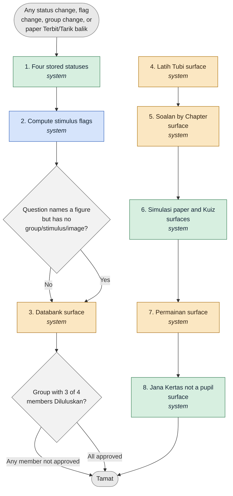

States:

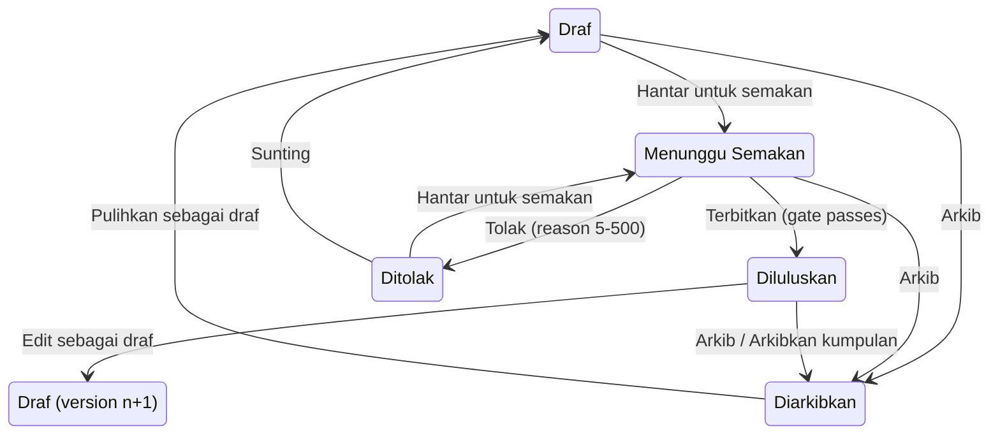

| # | Status | Actor | Step | Screen | API | Data | Notes |
|---|---|---|---|---|---|---|---|
| 1 | Exists in V3 | system | Four stored statuses | - | API-Q-06 | question_versions.status draft/review/approved/archived (+rejection_reason) | Labels: Draf (draft), Menunggu Semakan (review), Diluluskan (approved), Ditolak (draft+reason), Diarkibkan (archived). English words never shown. Transitions: Draf->Menunggu (Hantar untuk semakan, admin or owning teacher); Menunggu->Diluluskan (Terbitkan, admin only); Menunggu->Ditolak (Tolak); any non-archived->Diarkibkan (Arkib; pupil surfaces drop it at once, affected Terbit papers listed); Diarkibkan->Draf (Pulihkan sebagai draf); Diluluskan->new Draf (Edit sebagai draf, version n+1). |
| 2 | Build | system | Compute stimulus flags | - | detectors on every version write; uat-ops/flag-stimulus.ts (dry-run) | question_versions.stimulus_flag, stimulus_flag_ref (numbered/unnumbered), flag_dismissed_at/by (DM-05, DM-53) | stimulus_missing and figure_only EXCLUDE a question from every pupil surface; stem_duplicated is shown once and never excluded (NOT_FLAGGED_SQL). Cleared by attaching a group/stimulus or Bukan masalah (POST /api/admin/questions/:id/flags/dismiss). |
| 3 | Change | system | Databank surface | - | API-Q-11 | served-rule | Served when Diluluskan, group servable, no open stimulus flag. Reasons: Belum diluluskan.; Kumpulan belum lengkap - {n} soalan belum diluluskan.; Rangsangan tiada — soalan merujuk {Rajah 14} tetapi tiada gambar. |
| 4 | Change | system | Latih Tubi surface | - | API-Q-11 | served-rule | As Databank; untagged legacy MCQs stay served (D80); figure questions and whole groups served, never split (D105). Surfaces that serve whole groups (allowStimulus): latih_tubi, chapter, databank, tracking_a, question_set; revision, remedial, mission, pksk and games stay text-only standalone. |
| 5 | Change | system | Soalan by Chapter surface | - | API-Q-11 | served-rule | As Latih Tubi AND chapter_id set. Reason: Bab belum dipaut - tidak disajikan dalam Soalan by Chapter. |
| 6 | Exists in V3 | system | Simulasi paper and Kuiz surfaces | - | API-Q-11 | served-rule, paper pins | Placed in a Terbit paper (pinned) AND DSKP complete. Reason: Belum ditanda DSKP — tidak dimasukkan dalam kertas blueprint. Paper holding an archived question refuses new sittings: Kertas ini sedang dikemas kini dan tidak boleh dicuba buat masa ini. |
| 7 | Change | system | Permainan surface | - | API-Q-11 | served-rule | Diluluskan, single-leaf MCQ, no stimulus, no option image. Reason image_games: Soalan bergambar tidak digunakan dalam permainan. |
| 8 | Exists in V3 | system | Jana Kertas not a pupil surface | - | - | - | jana_kertas stays in OPT-SERVABILITY enum for admin Jana set only; reason text Jana Kertas murid tiada dalam R1. Indicator reads n daripada 6. |

Decisions:

- Step 2: Question names a figure but has no group/stimulus/image?
  - No → 3: "Not flagged"
  - Yes → 3: "Flag stimulus_missing (ref kind numbered or unnumbered; unnumbered never auto-linked) -> excluded on every surface"
- Step 3: Group with 3 of 4 members Diluluskan?
  - Any member not approved → end: "None of the 4 shown to pupils; admin sees reason on each"
  - All approved → end: "All 4 shown together, stimulus once"

Resolved points (how the docs settle them):

- Resolved: allowStimulus is true for latih_tubi, chapter, databank, tracking_a and question_set (D90, D105); revision, remedial, mission, pksk and games stay text-only (docs/plan/r1-development-plan.md:S1-T06 per-surface table)
- 30 Q-25 PKSK statuses are Menunggu, Diluluskan, Ditolak (module's own words) and PKSK is outside group/DSKP/Bab rules; D-QA-11 status vocabulary applies to Studio questions only.
- Resolved: the six hub entries are 5 cards + the Bijak SPM banner; the six servability keys are a different six (docs/prd/r1/46-pupil-activity-flow.md:4.1)

### A8 Maintain published content: edit-as-draft, group draft copy, move, merge, retire, Sunting Pantas

- Actors: admin
- Trigger: Admin needs to change, move, merge or retire a Diluluskan question/group
- Cards: S1-T01, S2-T01, S2-T05, S2-T02, S2-T04
- Acceptance criteria: AC-ADM-QE1.2, AC-ADM-Q05.1, AC-ADM-Q24.1, AC-ADM-Q24.2, AC-QA-04, AC-QA-05, AC-QA-06, AC-QA-07, AC-QA-08, AC-QA-44, AC-QA-46

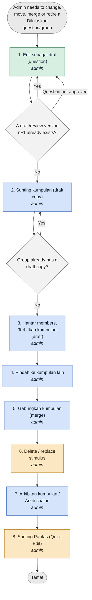

States:

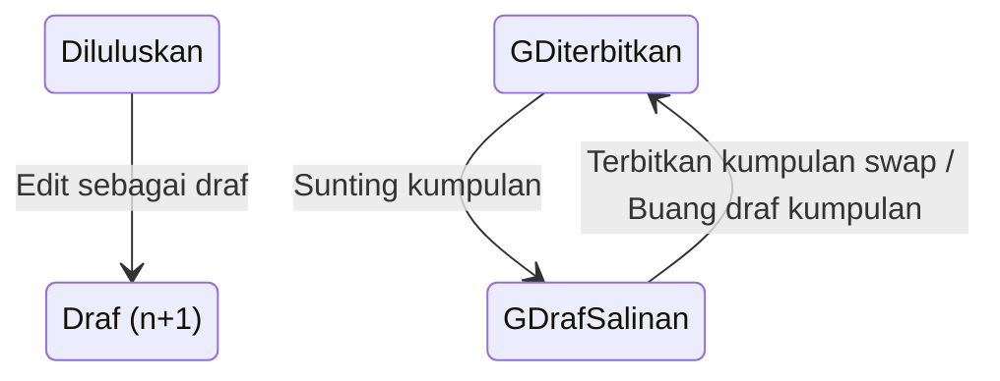

| # | Status | Actor | Step | Screen | API | Data | Notes |
|---|---|---|---|---|---|---|---|
| 1 | Exists in V3 | admin | Edit sebagai draf (question) | Studio row action | API-Q-03 POST /api/questions/:id/edit-as-draft | question_versions version n+1 status draft | Original stays Diluluskan and served; flash: Draf baharu #{id} dicipta. Soalan asal kekal diterbitkan sehingga draf ini diterbitkan. Publishing n+1 supersedes n (archived, superseded). Structured question with marks now opens in wizard (draft.ts:352 block removed, S2-T01). |
| 2 | Build | admin | Sunting kumpulan (draft copy) | /admin/studio/groups/:id | API-Q-32 POST /api/stimulus-groups/:id/edit-as-draft; DELETE /:id/draft | stimulus_groups.draft_of_group_id (DM-51), new stimulus rows, member versions n+1 | Banner: Kumpulan ini sedang dipaparkan kepada murid. Tekan Sunting kumpulan untuk menyunting salinan draf; yang asal kekal diterbitkan sehingga draf ini diterbitkan. Allowed: change/add/remove stimulus (1..3), reorder, add/remove/replace member, edit member content, bank. At most one open draft per group. Flash: Draf kumpulan #{id} dicipta. Member row action reads Sunting kumpulan (no per-member Edit sebagai draf). |
| 3 | Build | admin | Hantar members, Terbitkan kumpulan (draft) | group screen | API-Q-31 POST /api/stimulus-groups/:draftId/publish | ONE transaction: gate, apply membership/order, relink stimuli, approve n+1 and archive n, delete draft group | Group id and question ids unchanged; pinned sittings and Terbit placements keep pinned versions; replaced stimulus rows are kept (immutable once referenced). Pupils see old until swap. |
| 4 | Build | admin | Pindah ke kumpulan lain | group screen | API-Q-34 POST /api/stimulus-groups/:id/members/:questionId/move | questions.group_id | Draft group: applies at once. Served member: source and target each get draft copy, published together or refused. Conflict: Soalan ini sudah berada dalam kumpulan rangsangan lain. Mixed: Soalan dalam satu kumpulan mesti sama subjek. / …sama kertas. Moving a question that names a figure asks confirmation. |
| 5 | Build | admin | Gabungkan kumpulan (merge) | Semak Ekstrak (API-Q-38) / regroup work-list (API-Q-35) | API-Q-35 POST /api/stimulus-groups/merge {fromGroupId, intoGroupId} | stimulus_groups, stimulus_group_stimuli | Max 3 stimuli after merge; item citing two figures in two groups -> merged. Not on the saved-group screen. |
| 6 | Change | admin | Delete / replace stimulus | group screen | API-Q-07 DELETE /api/stimuli/:id | stimuli | Stimulus with members cannot be deleted: Rangsangan ini masih digunakan oleh {n} soalan. (409 RESTRICT, DM-02). Replace only in draft group or draft copy. Dissolve (Bubarkan kumpulan: confirm Bubarkan kumpulan ini? / Soalan ahli kekal, tanpa rangsangan bersama.) only for a draft group. |
| 7 | Build | admin | Arkibkan kumpulan / Arkib soalan | group screen / Studio row | API-Q-33 POST /api/stimulus-groups/:id/retire {confirm:true} | question_versions.status archived (all members), audit | Confirm Arkibkan kumpulan ini? / {n} soalan tidak lagi dipaparkan kepada murid. {m} kertas terbit yang memuatkannya akan terjejas. Single: Arkibkan soalan ini? Terbit paper refuses new sittings; in-progress sittings keep pinned version. Restore: Pulihkan sebagai draf per member then Terbitkan kumpulan. |
| 8 | Change | admin | Sunting Pantas (Quick Edit) | /admin/spm/soalan/:qid/sunting | PATCH quick-edit (fix on real API) | question_versions | FIX not Keep (D112(5)); only single-leaf non-grouped MCQ; group member/multi-part shows Soalan ini di luar skop suntingan Panel — sunting di Studio penuh. + Buka editor penuh; saving Diluluskan uses edit-as-draft semantics; messages Soalan ini tidak boleh ditanda seperti sedia ada: / Teks soalan tidak boleh kosong. / Tiada jawapan betul dipilih — soalan ini tidak boleh ditanda. |

Decisions:

- Step 1: A draft/review version n+1 already exists?
  - No → 2
  - Yes → 1: "Soalan ini sudah mempunyai draf atau semakan yang belum diterbitkan. Sunting draf itu. (409 ERR-CON-02, button Buka Draf)"
  - Question not approved → 1: "Hanya soalan yang diterbitkan boleh disunting sebagai draf."
- Step 2: Group already has a draft copy?
  - No → 3
  - Yes → 2: "409 ERR-CON-02 with Buka Draf"

Resolved points (how the docs settle them):

- 45 6.1 step 6 says Sunting Pantas status radio set Diluluskan, Draf, Menunggu Semakan, Diarkibkan (30 24-04) while V2 labels were Diluluskan, Draf, Menunggu, Ditolak; V3 labels follow 5 words of section 0.

### A9 Legacy data work-lists: Regroup work-list, Soalan tanpa Bab, Audit Rajah

- Actors: admin, guru (Audit Rajah list + upload only)
- Trigger: U-OP-05/07/17 content work on migrated questions (Admin Pusat in the screens)
- Cards: S1-T07, S2-T04, S4-T04, S2-T08, S4-T03, S6-T18
- Acceptance criteria: AC-ADM-QE8.1, AC-ADM-QE8.2, AC-ADM-G7.1, AC-ADM-G7.2, AC-ADM-G7.3, AC-QA-12, AC-QA-13, AC-QA-14, AC-ADM-Q03.3, AC-ADM-C05.*

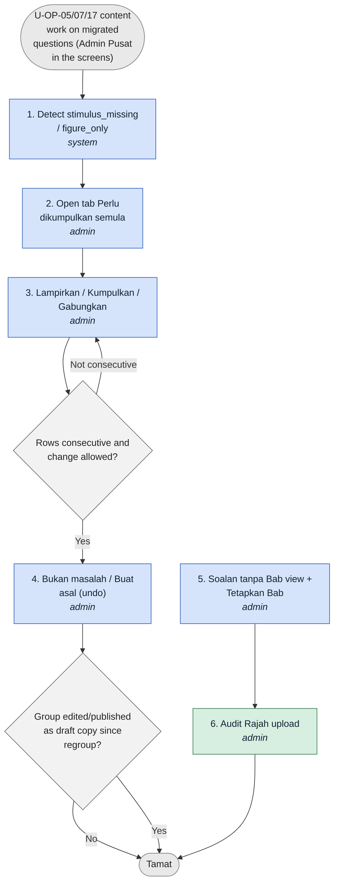

States:

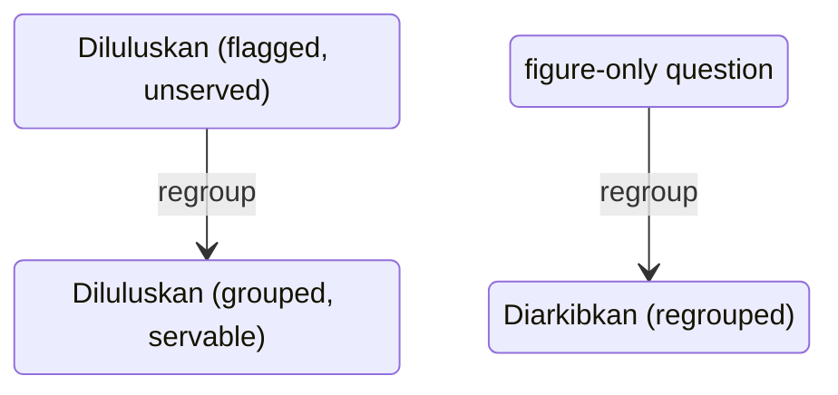

| # | Status | Actor | Step | Screen | API | Data | Notes |
|---|---|---|---|---|---|---|---|
| 1 | Build | system | Detect stimulus_missing / figure_only | - | flag-stimulus.ts (dry-run default, batches of 5,000, idempotent) | question_versions flags | OPS runs dry-run, report, user approval, real run. Keyword set is the one canonical list in 45 6.6.1 (rajah, figure, diagram, gambar rajah, gambar, jadual, table, graf, graph, carta, chart, peta, map, petikan, passage + source words sumber, teks, text, maklumat, pernyataan, situasi, bahan). |
| 2 | Build | admin | Open tab Perlu dikumpulkan semula | Senarai Soalan tab (RegroupPage.vue) | API-Q-13 GET /api/admin/questions/regroup-worklist | question_versions flags | Header {n} perlu tindakan · {m} selesai; filters Subjek, Tingkatan, Kertas sumber, Sebab; columns Soalan, Subjek, Tingkatan, Kertas sumber, Sebab (stimulus_missing/figure_only/gambar berulang/gambar tiada), Rujukan (Rajah 14 or tanpa nombor), Cadangan (2 prev + 2 next), Tindakan. Empty: Tiada soalan perlu dikumpulkan semula. |
| 3 | Build | admin | Lampirkan / Kumpulkan / Gabungkan | work-list row actions | API-Q-24 POST /api/admin/questions/regroup | stimuli, stimulus_groups, question_versions (archive_reason='regrouped'), question_status_events, audit_events kind regroup | One transaction. Accepts served unflagged members; NOT a new version and NOT a status transition; DSKP gate does not run; member keeps Diluluskan; figure-only question archived; images removed from members kept stored. Kumpulkan: Pilih baris yang berturutan sahaja. |
| 4 | Build | admin | Bukan masalah / Buat asal (undo) | work-list | POST /api/admin/questions/:id/flags/dismiss; API-Q-36 POST /regroup/:auditId/undo | question_versions.flag_dismissed_*; audit_events | Bukan masalah confirm: Tandakan sebagai bukan masalah? (Batal / Ya, Tandakan). Undo refused if group edited since: Kumpulan telah diubah selepas kumpul semula; tidak boleh dibuat asal. |
| 5 | Build | admin | Soalan tanpa Bab view + Tetapkan Bab | Studio saved view (chapter=none) | POST /api/admin/curriculum/questions/bulk-chapter | question_versions.chapter_id | Note: Soalan tanpa Bab tidak akan muncul dalam Soalan by Chapter dan Heatmap Topik Lemah. Bulk filter must name one Subjek and one Tingkatan; dry-run {n} soalan akan dipautkan ke Bab {nama}; other Subjek/Tingkatan rows skipped. Does not change status or Latih Tubi servability. Order: 6 sample subjects at T4/T5 first, then other T4/T5, then T1-T3 (D89, U-OP-07). |
| 6 | Exists in V3 | admin | Audit Rajah upload | /admin/soalan-gambar | API-Q-21 GET /api/diagram-audit; POST /:kind/:id/image; POST /:kind/:id/dismiss | stimuli (image attached once to group's stimulus) | Menu item Audit Rajah under group Soalan (NEW entry); tiles MCQ Perlu Gambar, Struktur Perlu Gambar, Jumlah; empty Semua soalan sudah lengkap dengan gambar rajah!; teacher gets list and image upload (creates intake batch source=guru) but no Bukan masalah. |

Decisions:

- Step 3: Rows consecutive and change allowed?
  - Yes → 4
  - Not consecutive → 3: "Pilih baris yang berturutan sahaja."
- Step 4: Group edited/published as draft copy since regroup?
  - No → end: "restored"
  - Yes → end: "Kumpulan telah diubah selepas kumpul semula; tidak boleh dibuat asal. (409)"

Resolved points (how the docs settle them):

- Content work (Bab, figures, regroup) is done by Admin Pusat in the screens, not by developers (D110); scripts only produce dry-run reports.
- S1-T01 U-OP-18: unique stimulus-per-group index applied only when group-integrity.sql reports 0.

## B. Bijak SPM papers (admin content)

### B1 Kontrak Simulasi (blueprint/JSU) to Disahkan

- Actors: admin
- Trigger: Admin opens Kontrak from Set Builder landing (button Kontrak Simulasi) or paper review (Sunting kontrak); no sidebar entry
- Cards: S3-T01, S4-T02, S3-T08
- Acceptance criteria: AC-ADM-Q16.1, AC-ADM-Q16.2, AC-ADM-Q16.3, AC-ADM-Q16.4, AC-QA-25, AC-QA-42

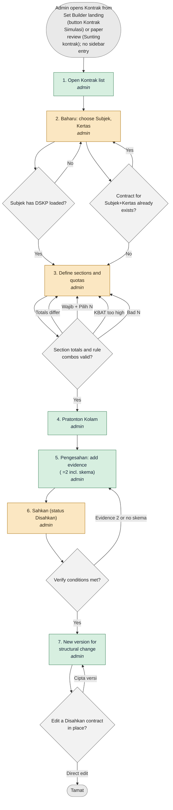

States:

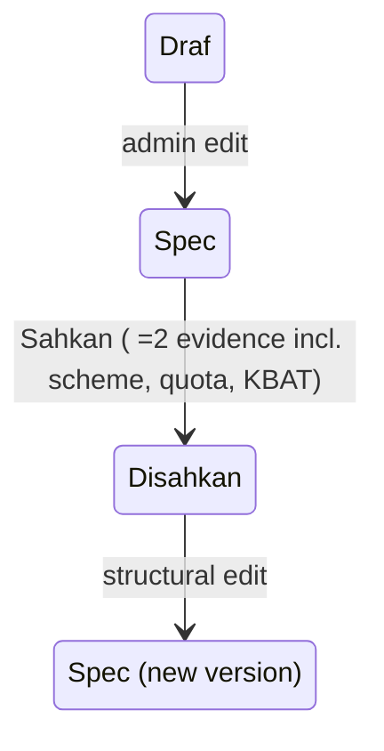

| # | Status | Actor | Step | Screen | API | Data | Notes |
|---|---|---|---|---|---|---|---|
| 1 | Exists in V3 | admin | Open Kontrak list | /admin/spm/kontrak | API-BIJAK-09 GET /api/admin/blueprints | blueprints, blueprint_sections | Lists only subjects whose DSKP is loaded (D112(3)). Seeded Spec launch contracts 1449/1, 1449/2, 3472/1, 3472/2, 4531/2, 1249/2; 1249/1 and 4531/1 have none. 4 of 6 seeded are INCOMPLETE (KBAT omitted) and stay refused by verify until an admin fills KBAT. |
| 2 | Change | admin | Baharu: choose Subjek, Kertas | /admin/spm/kontrak/:subjek/:kertas | API-BIJAK-09 POST /api/admin/blueprints; API-DSKP-06 lookups | blueprints | Baharu Subjek list hides/disables subjects without curriculum_nodes. Header: Subjek, Kertas 1..4, Kod Kertas ^[0-9]{4}/[0-9]$, Tempoh 1..300, Jumlah Markah (= sum of sections), Sumber (Draf/Spec/Disahkan), Boleh tanda auto, Nota. |
| 3 | Change | admin | Define sections and quotas | Kontrak editor tabs | API-BIJAK-09 POST .../versions, .../sections/:position/review | blueprint_sections (label, compulsory, question_count, rule_type, rule_n, mark_budget, marks_per_question DM-57 NEW, kbat_marks, quota, profile) | Per section: Label, Peraturan Pilihan (Tiada/Jawab Semua/Pilih N), Wajib dijawab, Bilangan soalan, Markah, Markah setiap soalan, Arahan, Mod Jawapan Dijangka, Kuota unit, Profil TP, Kuota KBAT. Migration 0164 adds marks_per_question and blueprints.question_count. |
| 4 | Exists in V3 | admin | Pratonton Kolam | /admin/spm/kontrak/kolam | API-BIJAK-09 GET .../pool | questions (read) | Per unit and KBAT quota whether pool can fill; units by code and name; Lihat soalan keeps filters. Legacy untagged MCQs excluded (D80). |
| 5 | Exists in V3 | admin | Pengesahan: add evidence (>=2 incl. skema) | Pengesahan tab (VerifyPanel) | API-BIJAK-09 GET/POST .../evidence, GET .../verification | blueprint evidence | Jenis bukti Skema / Kertas rasmi / Spesifikasi LPM, Rujukan, Fail; rows Syarat Disahkan pass/fail; count Belum lengkap untuk Disahkan (n). |
| 6 | Change | admin | Sahkan (status Disahkan) | GeneralTab status control / VerifyPanel | API-BIJAK-09 POST .../verify | blueprints.status Disahkan + verifier | S3-T01: control now offers Disahkan (was Draf/Spec only) and runs verify with conditions shown inline. Only Admin Pusat verifies. Terbit under Disahkan contract needs no exception box. |
| 7 | Exists in V3 | admin | New version for structural change | Kontrak editor | API-BIJAK-09 POST .../versions | blueprints (new Spec version) | Disahkan is immutable in place; pupils keep v1 until new version verified; Spec contract never shown to pupils. |

Decisions:

- Step 2: Subjek has DSKP loaded?
  - Yes → 3
  - No → 2: "DSKP belum dimuatkan untuk subjek ini. Kontrak tidak boleh dicipta."
- Step 2: Contract for Subjek+Kertas already exists?
  - No → 3
  - Yes → 2: "Kontrak untuk subjek/kertas ini sudah wujud."
- Step 3: Section totals and rule combos valid?
  - Yes → 4
  - Totals differ → 3: "Jumlah markah ({a}) mesti sama dengan jumlah markah bahagian ({b})."
  - Wajib + Pilih N → 3: "Bahagian wajib dijawab tidak boleh digabungkan dengan Pilih N."
  - KBAT too high → 3: "Markah KBAT melebihi jumlah markah."
  - Bad N → 3: "Nombor N tidak sah."
- Step 6: Verify conditions met?
  - Yes → 7: "Disahkan"
  - Evidence <2 or no skema → 5: "Sekurang-kurangnya 2 bukti termasuk skema diperlukan."
- Step 8: Edit a Disahkan contract in place?
  - Cipta versi → 8
  - Direct edit → end: "Kontrak Disahkan tidak boleh diubah di tempat. Cipta versi baharu dahulu."

Resolved points (how the docs settle them):

- Kontrak data for other subjects is entered by Admin Pusat from sample papers when two bodies of evidence exist (D95, D-QA-15); U-OP-04 order 3472/2, 1449/1, 1249/1, 4531/1, Sains K1, then 1449/2, 3472/1, 4531/2, 1249/2.
- Plan S3-T01 mutual-exclusion message 'Bahagian wajib dijawab tidak boleh digabungkan dengan Pilih N.' is a D115 default, not in 45.

### B2 Set Builder -> Semak Kertas Simulasi -> Terbit

- Actors: admin
- Trigger: Admin opens Set Builder (/admin/studio/sets) to compose a Simulasi paper (generate or manual)
- Cards: S3-T02, S3-T01, S1-T06, S1-T10, S3-T08, S2-T03
- Acceptance criteria: AC-ADM-Q13.1, AC-ADM-Q13.2, AC-ADM-Q14.1, AC-ADM-Q14.2, AC-ADM-Q15.1, AC-ADM-Q15.2, AC-ADM-Q15.3, AC-ADM-QE7.1, AC-ADM-QE7.2, AC-QA-41, AC-ADM-R6, AC-ADM-R7, AC-CHAIN-2

```mermaid
flowchart TD
  classDef ex fill:#d7efe0,stroke:#2f7a4f,color:#123;
  classDef ch fill:#fbe7c2,stroke:#a86b00,color:#321;
  classDef bu fill:#d6e4fb,stroke:#2b5cb8,color:#123;
  classDef dc fill:#f2f2f2,stroke:#666,color:#222;
  classDef en fill:#e9e9e9,stroke:#888,color:#222;
  START(["Admin opens Set Builder<br/>(/admin/studio/sets) to<br/>compose a Simulasi paper<br/>(generate or manual)"]):::en
  S1["1. Open Set Builder landing<br/><i>admin</i>"]:::ch
  S2["2. Jana set<br/>(Tahun/Negeri/Bilangan)<br/><i>admin</i>"]:::ch
  S3["3. Or Mula kosong<br/><i>admin</i>"]:::ex
  S4["4. Add from bank, group as<br/>one unit<br/><i>admin</i>"]:::ch
  S5["5. Set section rule and<br/>order<br/><i>admin</i>"]:::ch
  S6["6. Open Semak Kertas<br/>Simulasi<br/><i>admin</i>"]:::ch
  S7["7. Fix blockers (all listed<br/>by name)<br/><i>admin</i>"]:::ex
  S8["8. Terbit (confirm)<br/><i>admin</i>"]:::ch
  S9["9. Exception Terbit (no<br/>Disahkan contract)<br/><i>admin</i>"]:::ex
  S10["10. Tarik balik ke draf /<br/>Salin set<br/><i>admin</i>"]:::ex
  END(["Tamat"]):::en
  START --> S1
  S1 --> S2
  S2 --> S3
  S3 --> S4
  D4_0{"Add a single member of a<br/>group, or group of 0?"}:::dc
  S4 --> D4_0
  D4_0 -->|"Whole group"| S5
  D4_0 -->|"Partial"| S4
  D4_0 -->|"0 members"| S4
  S5 --> S6
  D6_0{"Concurrent save?"}:::dc
  S6 --> D6_0
  D6_0 -->|"No"| S7
  D6_0 -->|"Yes"| S6
  D7_0{"Blockers?"}:::dc
  S7 --> D7_0
  D7_0 -->|"None"| S8
  D7_0 -->|"Question not approved"| S7
  D7_0 -->|"Group split"| S7
  D7_0 -->|"Section count short"| S7
  D7_0 -->|"Total marks"| S7
  D7_0 -->|"marks_per_question order"| S7
  D7_0 -->|"Unit quota"| S7
  D7_0 -->|"Mode not allowed"| S7
  D7_0 -->|"Choose-N range"| S7
  D7_0 -->|"Compulsory section empty"| S7
  D7_0 -->|"Empty content"| S7
  D8_0{"Contract Disahkan?"}:::dc
  S8 --> D8_0
  D8_0 -->|"Yes"| END
  D8_0 -->|"No"| S9
  S9 --> S10
  S10 --> END
```

States:

```mermaid
stateDiagram-v2
  state "Draf" as s0
  state "Terbit" as s1
  s0 --> s1 : Terbit (blockers 0)
  s1 --> s0 : Tarik balik ke draf
```

| # | Status | Actor | Step | Screen | API | Data | Notes |
|---|---|---|---|---|---|---|---|
| 1 | Change | admin | Open Set Builder landing | /admin/studio/sets | API-BIJAK-10 GET /api/admin/papers | papers | One paper list; /admin/spm/kertas and /admin/spm/kertas/baharu redirect here. Lists Set sedia ada (title, chip Terbit/DRAF, {subjek} · {n} soalan · {m} markah, Kertas, Dilihat murid). Kertas options from contracts and questions (Sejarah offers Kertas 1 once a contract exists). |
| 2 | Change | admin | Jana set (Tahun/Negeri/Bilangan) | landing card Jana set | API-BIJAK-11 POST /api/admin/papers/generate {subject,kertas,title,years[],negeri[],count} | papers, paper_sections, paper_placements; reads questions pool | Fields Tajuk set (<=120), Subjek, Kertas 1-4 optional, Bilangan soalan 1..100 (default contract total or 40), Tahun, Negeri (22 options). Aside Kolam soalan: {n} soalan tersedia / Anda meminta {k} daripadanya. Fix: Jana set was disabled for every Kontrak (KBAT) with misleading 'hanya 0'; needs a Disahkan contract (NO_BLUEPRINT/SHORTAGE 422). Admin Jana set only; no pupil Jana Kertas. |
| 3 | Exists in V3 | admin | Or Mula kosong | landing | API-BIJAK-10 POST /api/admin/papers | papers + 3 empty sections (rule Jawab Semua) | Tajuk set kosong + Subjek (all subjects in dropdown). |
| 4 | Change | admin | Add from bank, group as one unit | /admin/studio/sets/:paper/builder | API-BIJAK-10 GET /sections/:sid/pool; POST placements | paper_placements (question_id FK NOT VALID -> VALIDATE, migration 0160) | Bank shows only Diluluskan + complete DSKP questions; a group = ONE card Rajah 3 · 4 soalan; adding one member adds whole group in order. Filters Tahun, Negeri, Cari teks soalan…, Bahagian destinasi; pager not 50-row stop. Error copy: Soalan gagal ditambah — cuba lagi.; Susunan gagal disimpan — muat semula halaman dan cuba lagi.; Soalan gagal dibuang — cuba lagi.; Bahagian gagal dikemas kini.; Ralat semasa mencari bank soalan. |
| 5 | Change | admin | Set section rule and order | builder section blocks | API-BIJAK-10 PUT sections | paper_sections (rule semua/pilih N, rule_n) | Jawab Semua / Pilih N (choice unit = numbered question, a group is ONE unit; equal marks in section; Wajib dijawab read-only from contract, never with Pilih N); chips Soalan x / n and Markah x / budget and budget-check panel ported from old editor; Tulis soalan baharu per Bahagian; Naik/Turun. |
| 6 | Change | admin | Open Semak Kertas Simulasi | /admin/spm/kertas/:id (PaperEditorPage becomes review) | API-BIJAK-10 GET /api/admin/papers/:id | papers | Metadata (Tajuk, Tempoh, Kod kertas, Arahan kulit), Bahan rujukan, Isu import ({n}) card, section blocks, contract block, chips Disematkan and Tidak disajikan, publication block (Belum boleh diterbitkan + {n} masalah). Section editing replaced by button Sunting di Set Builder. |
| 7 | Exists in V3 | admin | Fix blockers (all listed by name) | Semak Kertas Simulasi | paper-check / blockers | - | Terbit disabled with title Betulkan {n} masalah dahulu. See decisions. |
| 8 | Change | admin | Terbit (confirm) | Semak Kertas Simulasi | API-BIJAK-10 POST publish | papers.status Terbit; pins snapshot per placement (question_version ids AND stimulus row ids) | Confirm Terbitkan kertas ini? Ia akan terus boleh diakses pelajar di Simulasi. Flash: Kertas '{title}' telah DITERBITKAN — kini boleh diakses pelajar di Simulasi. S3-T08 pipeline for UAT. Admin Sekolah and Guru get 403. |
| 9 | Exists in V3 | admin | Exception Terbit (no Disahkan contract) | Semak Kertas Simulasi (PublishOverride) | publish with override+reason | audit BIJAK_PAPER_PUBLISHED_OVERRIDE | Checkbox Terbitkan walaupun tidak memenuhi kontrak Simulasi + Sebab 5..500 + second Terbitkan; flash Diterbitkan dengan 1 pengecualian kontrak (direkodkan). Hidden when contract Disahkan. |
| 10 | Exists in V3 | admin | Tarik balik ke draf / Salin set | Semak Kertas Simulasi / builder | API-BIJAK-10 withdraw/copy | papers.status | Confirm Tarik balik kertas ini ke draf? Pelajar tidak lagi dapat mengaksesnya. Published paper read-only: Kertas ini sudah diterbitkan — tekan Salin set di atas untuk menyunting salinan draf. Salin flash: Set disalin sebagai draf. Sunting dan terbitkan salinan baharu. Sittings in progress keep pinned version. |

Decisions:

- Step 7: Blockers?
  - None → 8
  - Question not approved → 7: "Soalan {no}: belum diluluskan."
  - Group split → 7: "Kumpulan {nama} akan terbelah."
  - Section count short → 7: "Bahagian A: Kurang 9 soalan (perlu 10, ada 1)"
  - Total marks → 7: "Jumlah markah ({a}) tidak sepadan dengan kontrak ({b})."
  - marks_per_question order → 7: "Markah soalan {no} tidak sepadan dengan kontrak."
  - Unit quota → 7: "Kuota unit {kod}: perlu {n}, ada {m}."
  - Mode not allowed → 7: "Tidak disajikan: jenis jawapan tidak dibenarkan dalam bahagian ini"
  - Choose-N range → 7: "Nombor N tidak sah."
  - Compulsory section empty → 7: "Bahagian {label} wajib ada soalan."
  - Empty content → 7: "“{title}” tiada kandungan - tidak boleh diterbitkan. (ERR-QST-03)"
- Step 8: Contract Disahkan?
  - Yes → end: "Terbit"
  - No → 9: "Audited exception path"
- Step 4: Add a single member of a group, or group of 0?
  - Whole group → 5
  - Partial → 4: "Soalan dalam kumpulan rangsangan mesti dipilih bersama."
  - 0 members → 4: "Kumpulan perlu sekurang-kurangnya 1 soalan."
- Step 6: Concurrent save?
  - No → 7
  - Yes → 6: "Kertas ini telah dikemas kini oleh pengguna lain. (ERR-CON-02b)"

Resolved points (how the docs settle them):

- Resolved: the review screen heading is "Semak Kertas Simulasi" ("Semak Kertas" is the short name) (docs/plan/r1-development-plan.md:S3-T02; docs/prd/r1/30-admin-pusat.md:FR-ADM-Q02.2)
- S3-T02: pre-existing duplicate editors (SetBuilder + Pembina Kertas) are NOT yet merged in V3; merge is Change not Exists.
- Pin of stimulus row ids is verified by S3-T02 gap check (45 2.10); not yet proven in code.

### B3 Accepted batch becomes a draft paper (batch-to-paper, S1-T10)

- Actors: admin, system
- Trigger: Admin presses Hantar untuk semakan on a decided intake batch (Kelompok Item)
- Cards: S1-T10, S2-T02, S3-T02, S1-T03, S1-T04
- Acceptance criteria: AC-ADM-Q07.3, AC-ADM-Q07.4, AC-ADM-Q07.5, AC-ADM-Q07.6, AC-QA-41, AC-CHAIN-2

```mermaid
flowchart TD
  classDef ex fill:#d7efe0,stroke:#2f7a4f,color:#123;
  classDef ch fill:#fbe7c2,stroke:#a86b00,color:#321;
  classDef bu fill:#d6e4fb,stroke:#2b5cb8,color:#123;
  classDef dc fill:#f2f2f2,stroke:#666,color:#222;
  classDef en fill:#e9e9e9,stroke:#888,color:#222;
  START(["Admin presses Hantar<br/>untuk semakan on a<br/>decided intake batch<br/>(Kelompok Item)"]):::en
  S1["1. Press Hantar untuk<br/>semakan (batch)<br/><i>admin</i>"]:::bu
  S2["2. Create ONE draft paper<br/>per batch<br/><i>system</i>"]:::bu
  S3["3. One section per printed<br/>Bahagian<br/><i>system</i>"]:::bu
  S4["4. Place accepted questions<br/>in print order<br/><i>system</i>"]:::bu
  S5["5. See paper in Kertas<br/>Diimport<br/><i>admin</i>"]:::bu
  S6["6. Approve every placed<br/>question<br/><i>admin</i>"]:::ex
  S7["7. Semak & Terbit then<br/>Terbit<br/><i>admin</i>"]:::ch
  END(["Tamat"]):::en
  START --> S1
  D1_0{"Any item pending<br/>(generated, needs_review<br/>or duplicate)?"}:::dc
  S1 --> D1_0
  D1_0 -->|"No"| S2
  D1_0 -->|"Yes"| S1
  D1_1{"Batch is source batch of<br/>a Kertas Subjektif<br/>paper?"}:::dc
  S1 --> D1_1
  D1_1 -->|"No (simulasi)"| S2
  D1_1 -->|"Yes"| END
  D2_0{"Second call for same<br/>batch?"}:::dc
  S2 --> D2_0
  D2_0 -->|"Paper Draf"| S4
  D2_0 -->|"Paper Terbit"| END
  S3 --> S4
  D4_0{"Placement would split<br/>accepted members of a<br/>group?"}:::dc
  S4 --> D4_0
  D4_0 -->|"No"| S5
  D4_0 -->|"Yes"| S4
  S5 --> S6
  S6 --> S7
  S7 --> END
```

States:

```mermaid
stateDiagram-v2
  state "(batch decided)" as s0
  state "paper Draf" as s1
  state "Terbit" as s2
  s0 --> s1 : Hantar untuk semakan
  s1 --> s2 : B2 step 8 when all placed questions Diluluskan
```

| # | Status | Actor | Step | Screen | API | Data | Notes |
|---|---|---|---|---|---|---|---|
| 1 | Build | admin | Press Hantar untuk semakan (batch) | Kelompok Item / Semak Ekstrak | S2-T02 chooses: API-Q-25 POST /api/intake/batches/:id/paper OR API-BIJAK-14 POST /api/admin/papers/:id/source {apply:true} when batch.targetPaperId set | - | Enabled when no item pending and >=1 accepted. 409 ERR-CON-05 while pending: {n} item belum diputuskan. ({n} = open items). |
| 2 | Build | system | Create ONE draft paper per batch | - | API-Q-25 | papers (source_batch_id, paper_code, surface='simulasi' only once 0161 exists), unique (source_batch_id, paper_code) migration 0163 | Header from batch (subject, Tingkatan, Kertas, year, title). paper_code = upload Kod kertas else K{kertas}. One batch = one paper code; to import two codes upload twice. Idempotent per batch+code. |
| 3 | Build | system | One section per printed Bahagian | - | builder.service addSection | paper_sections (label from intake_items.section_label; default U-04; none = Bahagian A; rule semua/pilih N + budget + compulsory copied from Disahkan contract section by label, trimmed case-insensitive; no match = Jawab semua) | Sections in order of first appearance. |
| 4 | Build | system | Place accepted questions in print order | - | builder.service addPlacement | paper_placements (question_id from accepted item, number_label); groups whole and contiguous | Rejected member not placed; group with no accepted member not placed; split of accepted members = 422. Questions stay Draf at this point. |
| 5 | Build | admin | See paper in Kertas Diimport | /admin/spm/soalan/ekstrak?tab=kertas-diimport | API-BIJAK-10 GET /api/admin/papers?imported=true | papers (questionCount, paperCode, sourceBatchId, importIssueCount, status) | Columns Kertas, Subjek, Bilangan Soalan, Status, link Semak & Terbit; empty: Tiada kertas diimport lagi.; batch with paper shows link instead of creating another. |
| 6 | Exists in V3 | admin | Approve every placed question | Studio wizard / group screen | API-Q-06 / API-Q-31 | question_versions.status | Admin sets Bab, SP, TP, Kesukaran per question (A1/A6), Hantar, Terbitkan; group via Terbitkan kumpulan. Paper review lists Soalan {no}: belum diluluskan. until done. |
| 7 | Change | admin | Semak & Terbit then Terbit | /admin/spm/kertas/:id | see B2 | papers.status | Preview as pupil, blueprint validation against the Kontrak (no Jadual JSU, removed from R1), Terbit only from preview. |

Decisions:

- Step 1: Any item pending (generated, needs_review or duplicate)?
  - No → 2
  - Yes → 1: "{n} item belum diputuskan. (409 ERR-CON-05; creates nothing)"
- Step 1: Batch is source batch of a Kertas Subjektif paper?
  - No (simulasi) → 2
  - Yes → end: "API-Q-25 answers 422 Kertas subjektif tidak dijana daripada kelompok.; use API-BIJAK-14 apply (flow B4)"
- Step 4: Placement would split accepted members of a group?
  - No → 5
  - Yes → 4: "Soalan dalam kumpulan rangsangan mesti dipilih bersama. (422 fields.items, ERR-QST-02)"
- Step 2: Second call for same batch?
  - Paper Draf → 4: "Append only placements for items accepted since first call; never removes/reorders/edits admin changes"
  - Paper Terbit → end: "Kertas ini sudah diterbitkan. Tarik balik ke draf dahulu. (409)"

Resolved points (how the docs settle them):

- Resolved: 409 ERR-CON-05 "{n} item belum diputuskan." with {n} = open items (docs/prd/r1/45-question-authoring-flow.md:3.3.6; docs/plan/r1-development-plan.md:S1-T10; docs/prd/r1/60-api-contract.md:API-Q-25)
- S1-T10 and S3-T06 order: surface column from migration 0161 (Sprint 4) arrives after S1-T10 (Sprint 2); S1-T10 tests the column at start-up. Migration 0163 belongs to S3 range (requested via needs:schema).
- AC-CHAIN-2: 15 placements, items 5-8 adjacent in one section, Bilangan Soalan 15, all 15 questions Draf after Hantar untuk semakan.

### B4 Kertas Subjektif admin (Kertas 2/3/4 percubaan negeri)

- Actors: admin
- Trigger: Admin opens /admin/kertas-subjektif (alias /admin/spm/kertas-subjektif) and presses Baharu
- Cards: S3-T06, S1-T09a, S1-T09b, S1-T10, S2-T02, S3-T03
- Acceptance criteria: AC-ADM-Q18.1, AC-ADM-Q18.2, AC-ADM-Q18.3, AC-QA-20, AC-QA-23, AC-QA-48, AC-QA-49

```mermaid
flowchart TD
  classDef ex fill:#d7efe0,stroke:#2f7a4f,color:#123;
  classDef ch fill:#fbe7c2,stroke:#a86b00,color:#321;
  classDef bu fill:#d6e4fb,stroke:#2b5cb8,color:#123;
  classDef dc fill:#f2f2f2,stroke:#666,color:#222;
  classDef en fill:#e9e9e9,stroke:#888,color:#222;
  START(["Admin opens<br/>/admin/kertas-subjektif<br/>(alias<br/>/admin/spm/kertas-subjektif)<br/>and presses Baharu"]):::en
  S1["1. Create paper (Baharu)<br/><i>admin</i>"]:::bu
  S2["2. Muat naik PDF sumber<br/>(+skema)<br/><i>admin</i>"]:::bu
  S3["3. Review batch in Semak<br/>Ekstrak<br/><i>admin</i>"]:::ch
  S4["4. Hantar untuk semakan<br/>(apply:true)<br/><i>admin</i>"]:::bu
  S5["5. Edit tags, scheme tab<br/><i>admin</i>"]:::bu
  S6["6. Terbit / Sembunyikan /<br/>Padam<br/><i>admin</i>"]:::bu
  END(["Tamat"]):::en
  START --> S1
  S1 --> S2
  D2_0{"File acceptable?"}:::dc
  S2 --> D2_0
  D2_0 -->|"PDF =30 MB"| S3
  D2_0 -->|"Wrong/oversize"| S2
  S3 --> S4
  S4 --> S5
  S5 --> S6
  D6_0{"Terbit allowed?"}:::dc
  S6 --> D6_0
  D6_0 -->|"Content + schemes +<br/>gate-complete"| END
  D6_0 -->|"No content"| S6
  D6_0 -->|"Missing unit/TP"| S5
  D6_0 -->|"Marks mismatch"| S1
```

States:

```mermaid
stateDiagram-v2
  state "Draf" as s0
  state "Terbit" as s1
  s0 --> s1 : Terbit
  s1 --> s0 : Sembunyikan
```

| # | Status | Actor | Step | Screen | API | Data | Notes |
|---|---|---|---|---|---|---|---|
| 1 | Build | admin | Create paper (Baharu) | /admin/kertas-subjektif | API-BIJAK-10 POST /api/admin/papers {surface:'subjektif', examBoard, year, durationMinutes, totalMarks} | papers (surface, exam_board, duration_minutes, total_marks; migration 0161) | Form 18-02..18-08: Tajuk <=150, Subjek, Kertas 2/3/4 (never 1), Negeri, Tahun, Tempoh 1..300, Jumlah Markah 1..200 = sum of placed marks at Terbit. Flash: “{title}” telah dicipta sebagai draf. Visible also in Set Builder via Buka di Set Builder (list defaults to surface=simulasi). |
| 2 | Build | admin | Muat naik PDF sumber (+skema) | detail /admin/kertas-subjektif/:id | API-BIJAK-14 POST /api/admin/papers/:id/source | intake_batches (source=admin, subject/Tingkatan/Kertas of paper fixed), intake_files | paper-source.service.ts calls IntakeUploadService. PDF <=30 MB. Same extraction as A3. |
| 3 | Change | admin | Review batch in Semak Ekstrak | /admin/spm/soalan/ekstrak/:batchId | API-Q-15 | intake_items | Same review as A3 (groups, tags, scheme linking). |
| 4 | Build | admin | Hantar untuk semakan (apply:true) | Kelompok Item | API-BIJAK-14 POST /api/admin/papers/:id/source {apply:true} | paper_placements of THAT paper (no new paper; API-Q-25 not called) | Accepted groups/questions appended in print order with same section rule as B3; re-send appends under re-call rule. |
| 5 | Build | admin | Edit tags, scheme tab | detail tabs Kandungan / Skema | API-Q-03, API-Q-30 | question_parts, answer_keys | Each question carries DSKP tags and K/N/P scheme; Skema tab; paper without scheme flagged tiada skema — tidak disajikan. |
| 6 | Build | admin | Terbit / Sembunyikan / Padam | list row menu | API-BIJAK-10 publish/withdraw/delete | papers.status | Draf -> Terbit needs content, every question gate-complete, a scheme. Flashes: “{title}” kini diterbitkan.; “{title}” disembunyikan daripada pelajar.; “{title}” telah dipadam. Padam kertas ini? (Batal / Ya, Padam). No feature flag (D104). |

Decisions:

- Step 6: Terbit allowed?
  - Content + schemes + gate-complete → end: "Kertas Terbit; pupil sees it at /kertas-subjektif"
  - No content → 6: "“{title}” tiada kandungan — tidak boleh diterbitkan."
  - Missing unit/TP → 5: "Sila pilih unit DSKP.; Bahagian (a) belum ada TP."
  - Marks mismatch → 1: "Jumlah markah ({a}) mesti sama dengan jumlah markah bahagian ({b})."
- Step 2: File acceptable?
  - PDF <=30 MB → 3
  - Wrong/oversize → 2: "Format fail tidak sah. Gunakan .pdf.; Fail melebihi had 30 MB.; ERR-INT-01..03"

Resolved points (how the docs settle them):

- OCR bake-off on 5 scanned papers is a release gate (E-05) run on UAT by the designated developer.
- Admin list column renamed Kandungan (V2 Halaman) because V3 stores editable text not page images.
- V2 list has Pratonton/Sembunyi, panel has Sunting/Halaman/Sembunyikan/Padam; V3 menu: Pratonton, Sunting, Kandungan, Sembunyikan, Terbit, Padam.

### B5 Databank / lanes hub (6 lanes) and lane lists

- Actors: admin
- Trigger: Admin opens /admin/spm (Kandungan SPM / SPM)
- Cards: S3-T03, S3-T05, S3-T06, S2-T06, S2-T03, S0-T07
- Acceptance criteria: AC-ADM-Q01.1, AC-ADM-Q01.2, AC-ADM-Q02.1, AC-ADM-Q02.2, AC-ADM-Q23.1, AC-ADM-Q23.2, AC-R1-21.1

```mermaid
flowchart TD
  classDef ex fill:#d7efe0,stroke:#2f7a4f,color:#123;
  classDef ch fill:#fbe7c2,stroke:#a86b00,color:#321;
  classDef bu fill:#d6e4fb,stroke:#2b5cb8,color:#123;
  classDef dc fill:#f2f2f2,stroke:#666,color:#222;
  classDef en fill:#e9e9e9,stroke:#888,color:#222;
  START(["Admin opens /admin/spm<br/>(Kandungan SPM / SPM)"]):::en
  S1["1. Open SPM hub (6 cards)<br/><i>admin</i>"]:::ch
  S2["2. Buka senarai (lane list)<br/><i>admin</i>"]:::ch
  S3["3. Row Sunting opens the<br/>owning editor<br/><i>admin</i>"]:::ch
  S4["4. Latih Tubi lane<br/>(subjects x Tingkatan)<br/><i>admin</i>"]:::bu
  S5["5. Subjektif lane attention<br/><i>admin</i>"]:::bu
  S6["6. Servability reason per<br/>row<br/><i>admin</i>"]:::ch
  END(["Tamat"]):::en
  START --> S1
  D1_0{"Lane screen route<br/>registered?"}:::dc
  S1 --> D1_0
  D1_0 -->|"Yes"| S2
  D1_0 -->|"No"| END
  D2_0{"Non Admin Pusat role?"}:::dc
  S2 --> D2_0
  D2_0 -->|"Admin Pusat"| S3
  D2_0 -->|"Other"| END
  S3 --> S4
  S4 --> S5
  S5 --> S6
  S6 --> END
```

| # | Status | Actor | Step | Screen | API | Data | Notes |
|---|---|---|---|---|---|---|---|
| 1 | Change | admin | Open SPM hub (6 cards) | /admin/spm | API-Q-11 / API-BIJAK-15 GET /api/admin/servability/overview | served-rule counts | Title SPM (replaces Kandungan SPM); intro: Setiap kad di bawah ialah satu laluan yang pelajar boleh buka. Nombor merah menunjukkan berapa banyak item yang perlu diperiksa. Cards in order: Databank Soalan, Tracking A, Subjektif, Bijak SPM, Kertas Subjektif, Latih Tubi. Each: lane name, description, big count, attention line or Semua elok, button Buka senarai, link lihat sisi pelajar. A card whose screen does not exist is not shown (router.hasRoute). Per-card load error: Tidak dapat dimuatkan. + Cuba lagi. No Kontrak Simulasi button; no Flag OFF tag (D104). |
| 2 | Change | admin | Buka senarai (lane list) | /admin/spm/databank \| /tracking-a \| /subjektif \| /simulasi \| /kertas-subjektif \| /latih-tubi | API-BIJAK-12 GET /api/admin/servability/lanes/{lane} | served-rule reasons | Only databank and bijak-spm lane reads exist; latih-tubi, tracking-a, subjektif, kertas-subjektif are NEW (S3-T03). Filters Subjek, Status (Databank & Latih Tubi), Cari <=100, Tapis/Set Semula; 25 per page; row: stem 120 chars, meta (#id · subject · Tingkatan · n pilihan), status, Perhatian (BM reason), actions Pratonton / Salin (native Simulasi only) / Sunting. Empty: Tiada item untuk penapis ini. |
| 3 | Change | admin | Row Sunting opens the owning editor | lane row | - | - | Databank/Latih Tubi rows -> Quick Edit /admin/spm/soalan/:qid/sunting; Simulasi row -> Semak Kertas (heading Semak Kertas); Tracking A -> /admin/spm/tracking-a/:set/sunting (B7); Kertas Subjektif -> /admin/kertas-subjektif (B4); Subjektif lane = LaneSubjektifPage (NEW). |
| 4 | Build | admin | Latih Tubi lane (subjects x Tingkatan) | /admin/spm/latih-tubi (LaneLatihTubiPage NEW) | API-BIJAK-12 | servable counts; Kawalan Ciri latih-tubi | Servable count per cell and switch state badge Dibuka / Ditutup (read-only; edit in /admin/feature-toggles). |
| 5 | Build | admin | Subjektif lane attention | /admin/spm/subjektif | API-BIJAK-12 | reasons no_scheme, no_key | Attention: {n} tiada skema — tidak disajikan and {n} tiada kunci jawapan. Lane lists structured/essay questions; Soalan Berstruktur list /admin/structured-questions read-only (Sunting di Studio opens wizard); filter Pemarkahan: Semua, Ada rubrik, Skema sahaja, Tiada skema — disembunyikan. |
| 6 | Change | admin | Servability reason per row | lane list / Studio | API-Q-11 GET /api/admin/servability/questions/:id | - | Same function as pupil draw; Perhatian shows full SERVABILITY_REASON_MS sentence e.g. DSKP belum lengkap — lengkapkan Tag dan TP di borang soalan. |

Decisions:

- Step 1: Lane screen route registered?
  - Yes → 2: "Card shown"
  - No → end: "Card hidden (FR-ADM-Q01.4)"
- Step 2: Non Admin Pusat role?
  - Admin Pusat → 3
  - Other → end: "ERR-ACC-01"

Resolved points (how the docs settle them):

- Hub count must equal the lane list count for every lane (S3-T03 test).
- 30 Q-02 and 4.V list attention labels 'tidak boleh ditanda', 'set tidak lengkap', 'tiada skema — tidak disajikan', 'tiada kunci jawapan', 'tiada kandungan'.

### B6 UAT dry-run tooling and Terbit pipeline (U-OP tasks)

- Actors: OPS (designated UAT developer), admin, DEV
- Trigger: A one-off data operation is needed on UAT (DSKP load, flag detection, backfills, paper publishing dry-run)
- Cards: S3-T08, S4-T03, S1-T01, S1-T02, S1-T07, S5-T15, S4-T02
- Acceptance criteria: AC-MUR-13 paper list non-empty, AC-R1-12.6, AC-ADM-C04.3, AC-ADM-Q16.3, AC-ADM-G7.2

```mermaid
flowchart TD
  classDef ex fill:#d7efe0,stroke:#2f7a4f,color:#123;
  classDef ch fill:#fbe7c2,stroke:#a86b00,color:#321;
  classDef bu fill:#d6e4fb,stroke:#2b5cb8,color:#123;
  classDef dc fill:#f2f2f2,stroke:#666,color:#222;
  classDef en fill:#e9e9e9,stroke:#888,color:#222;
  START(["A one-off data operation<br/>is needed on UAT (DSKP<br/>load, flag detection,<br/>backfills, paper<br/>publishing dry-run)"]):::en
  S1["1. Build tool or screen<br/><i>DEV</i>"]:::bu
  S2["2. Run dry-run, produce<br/>report<br/><i>OPS</i>"]:::bu
  S3["3. User reviews report and<br/>approves<br/><i>admin</i>"]:::ex
  S4["4. Run real write (data<br/>script)<br/><i>OPS</i>"]:::ex
  S5["5. Content work in the<br/>screens<br/><i>admin</i>"]:::ex
  S6["6. Publish real papers<br/>under Disahkan Kontrak<br/><i>admin</i>"]:::ex
  S7["7. Clean test data<br/><i>admin</i>"]:::ex
  END(["Tamat"]):::en
  START --> S1
  S1 --> S2
  D2_0{"Contract exists and<br/>Disahkan?"}:::dc
  S2 --> D2_0
  D2_0 -->|"Yes"| S3
  D2_0 -->|"No / Spec"| S3
  D3_0{"User approved?"}:::dc
  S3 --> D3_0
  D3_0 -->|"approve U-OP-nn"| S4
  D3_0 -->|"Not approved"| END
  S4 --> S5
  S5 --> S6
  S6 --> S7
  S7 --> END
```

| # | Status | Actor | Step | Screen | API | Data | Notes |
|---|---|---|---|---|---|---|---|
| 1 | Build | DEV | Build tool or screen | - | apps/api/scripts/uat-ops/* | - | Folder uat-ops/ is new: group-integrity.sql (S1-T01, read-only report U-OP-18), tag-integrity.sql, difficulty-level-backfill.ts (S1-T02, U-OP-19), flag-stimulus.ts (S1-T07, U-OP-05), backfill-bijak-answers.ts (S5-T15, U-OP-20), terbit-papers.ts (S3-T08), paper-group-integrity.sql (S3-T02), lib.ts (S4-T03). DSKP loader: npm run dskp:load -w @pp/api -- --dry-run. |
| 2 | Build | OPS | Run dry-run, produce report | - | npm run uat:terbit-papers (wrapper be:uat:terbit-papers); logs in via /api/auth/login with UAT_ADMIN_EMAIL/PASSWORD from env | .evidence/terbit-papers-{date}.csv (gitignored, no names) | terbit-papers.ts is READ-ONLY: no POST /admin/papers, no generate, no publish, no --apply. Reads GET /api/admin/papers/pool-preview?subject&kertas -> verdict boleh/tidak_boleh/tidak_pasti. Report columns code, kertas, source (Spec\|Disahkan), canGenerate, verdict, firstFailure, eligibleTotal, publishedTotal, wouldCreate. Launch list 3472/2, 1449/1, 1249/1, 4531/1, Sains K1, 1449/2, 3472/1, 4531/2, 1249/2; lists 'no contract' when none. |
| 3 | Exists in V3 | admin | User reviews report and approves | - | - | - | The user approves every write operation: message approve U-OP-nn. No AI session acts on a server (D95). |
| 4 | Exists in V3 | OPS | Run real write (data script) | - | script --apply or runbook command | UAT DB (clone of V2 production with real pupil data) | Writes only after approval; idempotent (second run inserts 0). Never leave half-done edits in shared tree. |
| 5 | Exists in V3 | admin | Content work in the screens | Studio, Soalan tanpa Bab, Audit Rajah, regroup list, Kontrak, Set Builder | - | - | Bab mapping (U-OP-07), figures and regroup (U-OP-05/17), contracts (U-OP-04), pool seeding by intake of trial papers (U-OP-08), build and Terbit papers (U-OP-09), Tracking A fill (U-OP-10). Content owners: Admin users; first batch BM, BI, Matematik, Matematik Tambahan, Fizik, Sejarah, Kertas 1 first. |
| 6 | Exists in V3 | admin | Publish real papers under Disahkan Kontrak | Set Builder / Semak Kertas | see B2 | papers | Real Terbit is done by an admin in Set Builder or by OPS after user approval; verify as T5 pupil Bijak SPM lists the paper; one test sitting submits. |
| 7 | Exists in V3 | admin | Clean test data | - | U-OP-14 | UJI Rantaian Bab, test questions, batches 1-2, papers 6-8 | After each chain run remove every UJI record. |

Decisions:

- Step 3: User approved?
  - approve U-OP-nn → 4
  - Not approved → end: "No write"
- Step 2: Contract exists and Disahkan?
  - Yes → 3: "wouldCreate=yes only when canGenerate and verdict boleh"
  - No / Spec → 3: "Real run would fail with NO_BLUEPRINT (422) or SHORTAGE (422, details.shortages); report prints firstFailure"

Resolved points (how the docs settle them):

- No 'dry-run' for admin screens themselves; dry-run exists for scripts only (dskp:load, flag-stimulus, difficulty backfill, bijak answer backfill, terbit-papers).
- Terbit-papers.ts dry-run launches Sains K1 by subject name (no contract code).

### B7 Tracking A set editor (admin)

- Actors: admin
- Trigger: Admin opens /admin/spm/tracking-a (lane list) and Sunting on a set, or Tambah Set
- Cards: S3-T05, S3-T03, S5-T15
- Acceptance criteria: AC-ADM-Q17.1, AC-ADM-Q17.2, AC-ADM-Q17.3, AC-PA-09, AC-PA-34

```mermaid
flowchart TD
  classDef ex fill:#d7efe0,stroke:#2f7a4f,color:#123;
  classDef ch fill:#fbe7c2,stroke:#a86b00,color:#321;
  classDef bu fill:#d6e4fb,stroke:#2b5cb8,color:#123;
  classDef dc fill:#f2f2f2,stroke:#666,color:#222;
  classDef en fill:#e9e9e9,stroke:#888,color:#222;
  START(["Admin opens<br/>/admin/spm/tracking-a<br/>(lane list) and Sunting<br/>on a set, or Tambah Set"]):::en
  S1["1. Open Tracking A lane<br/>list<br/><i>admin</i>"]:::bu
  S2["2. Tambah Set<br/><i>admin</i>"]:::bu
  S3["3. Isi set / tukar / buang<br/><i>admin</i>"]:::bu
  S4["4. Naik/Turun reorder<br/><i>admin</i>"]:::bu
  S5["5. Simpan (one transaction)<br/><i>admin</i>"]:::bu
  END(["Tamat"]):::en
  START --> S1
  S1 --> S2
  S2 --> S3
  D3_0{"Candidate group fits<br/>remaining slots?"}:::dc
  S3 --> D3_0
  D3_0 -->|"Fits (e.g. 4 free, group<br/>of 4)"| S4
  D3_0 -->|"Does not fit (3 free)"| S3
  D3_0 -->|"No candidate"| S3
  S4 --> S5
  D5_0{"At least one question<br/>selected?"}:::dc
  S5 --> D5_0
  D5_0 -->|"Yes"| END
  D5_0 -->|"No"| S3
```

States:

```mermaid
stateDiagram-v2
  state "incomplete set (hidden from pupils)" as s0
  state "complete set (unlocked)" as s1
  s0 --> s1 : Simpan reaching target
```

| # | Status | Actor | Step | Screen | API | Data | Notes |
|---|---|---|---|---|---|---|---|
| 1 | Build | admin | Open Tracking A lane list | /admin/spm/tracking-a | API-BIJAK-13 GET /api/admin/spm/tracking-a | spm_tracking_sets, spm_tracking_set_questions | One row per set (Bahasa Melayu · 2026 Set 1, #1 · ramalan · 8 soalan); attention Hanya {a} daripada {b} soalan; page /admin/spm/tracking-a currently 404. |
| 2 | Build | admin | Tambah Set | editor | API-BIJAK-13 POST /api/admin/spm/tracking-a | spm_tracking_sets (subject, year >=2020, set 1..99) | Error: Set {n} sudah wujud untuk subjek dan tahun ini. Target size = spm_subject_configs.target_size shown read-only (no per-set target; field 17-02 dropped D115). |
| 3 | Build | admin | Isi set / tukar / buang | /admin/spm/tracking-a/:set/sunting | API-BIJAK-13 GET /:id | servable candidates | Counter 8 / 40; {n} soalan lagi diperlukan.; Isi set fills shortfall; a stimulus group is ONE unit (added/replaced/removed together in order; skipped when it does not fit, with reason); candidates = servable questions incl. figure questions and groups; question not reused in a sibling set of same subject/year (migration 0162 unique (subject_id, year, question_id)). |
| 4 | Build | admin | Naik/Turun reorder | editor | - | - | Touch buttons (D9) beside drag handles. |
| 5 | Build | admin | Simpan (one transaction) | editor | API-BIJAK-13 PUT /api/admin/spm/tracking-a/:id | spm_tracking_set_questions | Flashes: Set dikemas kini.; Set ini lengkap.; Set ini masih kosong. Reaching target unlocks the set for pupils. |

Decisions:

- Step 3: Candidate group fits remaining slots?
  - Fits (e.g. 4 free, group of 4) → 4: "All members added together in order"
  - Does not fit (3 free) → 3: "Skipped with reason; slots filled from other candidates"
  - No candidate → 3: "Tiada soalan lain yang boleh disajikan untuk mengisi set ini."
- Step 5: At least one question selected?
  - Yes → end: "Set dikemas kini."
  - No → 3: "Pilih sekurang-kurangnya satu soalan sebelum menyimpan."

Resolved points (how the docs settle them):

- Resolved: Tracking A sets serve whole groups; tracking_a is an allowStimulus surface (docs/plan/r1-development-plan.md:S1-T06; docs/prd/r1/30-admin-pusat.md:FR-ADM-Q17.6)

## C. Pupil (and teacher-assigned) practice and test activities

### C0 SPM hub /spm and Sejarah Kuiz SPM (entry to Bijak, Databank, Latih Tubi SPM, Tracking A, Subjektif, Kertas Subjektif)

- Actors: murid
- Trigger: Pupil opens Mod SPM (/spm) from the menu or Dashboard
- Cards: S3-T07, S3-T03, S3-T04, S3-T05, S3-T06
- Acceptance criteria: AC-MUR-13-1, AC-MUR-13-2, AC-MUR-13-3, AC-MUR-13-22

```mermaid
flowchart TD
  classDef ex fill:#d7efe0,stroke:#2f7a4f,color:#123;
  classDef ch fill:#fbe7c2,stroke:#a86b00,color:#321;
  classDef bu fill:#d6e4fb,stroke:#2b5cb8,color:#123;
  classDef dc fill:#f2f2f2,stroke:#666,color:#222;
  classDef en fill:#e9e9e9,stroke:#888,color:#222;
  START(["Pupil opens Mod SPM<br/>(/spm) from the menu or<br/>Dashboard"]):::en
  S1["1. Open Mod SPM hub<br/><i>murid</i>"]:::ch
  S2["2. Pick an SPM lane card<br/><i>murid</i>"]:::ch
  S3["3. Open Sejarah Kuiz SPM<br/><i>murid</i>"]:::ch
  END(["Tamat"]):::en
  START --> S1
  S1 --> S2
  D2_0{"Pupil in Tingkatan 1-3?"}:::dc
  S2 --> D2_0
  D2_0 -->|"T4/T5"| END
  D2_0 -->|"T1-T3"| END
  S3 --> END
```

| # | Status | Actor | Step | Screen | API | Data | Notes |
|---|---|---|---|---|---|---|---|
| 1 | Change | murid | Open Mod SPM hub | /spm (title Mod SPM — PRESTASIPLUS) | API-BIJAK-07 GET /api/spm/overview | practice_answers (SPM modes) counts, papers, sets | Hero MOD SPM / Persediaan SPM; banner Bijak SPM (button Buka -> /spm/bijak); stat tiles Jumlah Soalan, Subjek SPM, Tahun Tersedia (hidden when no year data), Soalan Tracking A - all computed (D91); cards Databank Soalan, Latih Tubi SPM, Tracking A, Subjektif, Kertas Subjektif (all present, no flag, D104); card with zero content shows data-empty text, never a dead link. Panel Prestasi SPM Anda: Sesi Kuiz, Purata Ketepatan (pooled), Syiling Diperoleh, Soalan Dijawab from practice_answers modes databank, tracking_a, structured, subjektif, simulasi, kuiz, latih_tubi (+legacy past_year, ramalan). |
| 2 | Change | murid | Pick an SPM lane card | /spm | - | - | Databank -> C13 (/spm/tahun-lepas); Latih Tubi SPM -> C1 with Tingkatan 4 and 5 preselected; Tracking A -> C14 (/spm/ramalan); Subjektif -> C9 (/spm/subjektif); Kertas Subjektif -> C15 (/kertas-subjektif); Bijak banner -> C3. Empty texts: Tiada soalan tersedia lagi. / Tiada soalan berstruktur ditemui / Kertas subjektif sedang dalam penyediaan. Semak semula tidak lama lagi. / Tiada kertas tersedia buat masa ini. |
| 3 | Change | murid | Open Sejarah Kuiz SPM | /spm/history | practice history API | practice_sessions + exam_attempts (read) | Tiles Sesi Kuiz, Purata Ketepatan, Jumlah Syiling, Soalan Dijawab; chips Semua, Tahun Lepas (databank+past_year), Latih Tubi, Tracking A (tracking_a+ramalan); 15 per page; swept sessions not listed; empty: 'Belum ada percubaan SPM' / 'Mula kuiz SPM untuk membina sejarah percubaan anda!' button Mula Kuiz SPM -> C13. Owner S3-T07. |

Decisions:

- Step 2: Pupil in Tingkatan 1-3?
  - T4/T5 → end: "Full lanes"
  - T1-T3 → end: "Same screens; levels/subjects with no content show a data-empty state, never 'akan datang' (D101); hub copy still says Tingkatan 4 & 5"

Resolved points (how the docs settle them):

- Resolved: hub six entries (5 cards + banner) is not the six servability keys (docs/prd/r1/46-pupil-activity-flow.md:4.1)
- Tab 'Jana Kertas' is hidden and POST /api/bijak/papers/generate is not offered to pupils; Bijak page has one list Kertas Pilihan (D112(6)).

### C1 Latih Tubi drill

- Actors: murid
- Trigger: Pupil opens /practice (or Latih Tubi SPM card, T1-T3 now included)
- Cards: S5-T03, S5-T01, S4-T06, S1-T06, S1-T07, S8-T02, S5-T15
- Acceptance criteria: AC-MUR-16-1, AC-MUR-16-2, AC-MUR-16-3, AC-MUR-16-4, AC-MUR-16-8, AC-PA-02, AC-PA-12, AC-PA-13, AC-PA-15, AC-CHAIN-1, AC-CHAIN-9

```mermaid
flowchart TD
  classDef ex fill:#d7efe0,stroke:#2f7a4f,color:#123;
  classDef ch fill:#fbe7c2,stroke:#a86b00,color:#321;
  classDef bu fill:#d6e4fb,stroke:#2b5cb8,color:#123;
  classDef dc fill:#f2f2f2,stroke:#666,color:#222;
  classDef en fill:#e9e9e9,stroke:#888,color:#222;
  START(["Pupil opens /practice<br/>(or Latih Tubi SPM card,<br/>T1-T3 now included)"]):::en
  S1["1. Pick subject (Teras then<br/>Elektif)<br/><i>murid</i>"]:::ch
  S2["2. Setup level, difficulty,<br/>count<br/><i>murid</i>"]:::ch
  S3["3. Mula Kuiz (start<br/>session)<br/><i>murid</i>"]:::ch
  S4["4. Draw whole groups or<br/>single MCQ<br/><i>system</i>"]:::bu
  S5["5. Choose option, Semak<br/>Jawapan<br/><i>murid</i>"]:::ex
  S6["6. Next question or Tamat<br/><i>murid</i>"]:::ex
  S7["7. Tamat: submit session<br/><i>murid</i>"]:::ch
  S8["8. See result<br/><i>murid</i>"]:::ex
  S9["9. Sweep idle session after<br/>2 h<br/><i>system</i>"]:::bu
  END(["Tamat"]):::en
  START --> S1
  S1 --> S2
  S2 --> S3
  D3_0{"Can the session start?"}:::dc
  S3 --> D3_0
  D3_0 -->|"Yes"| S4
  D3_0 -->|"Trial spent"| END
  D3_0 -->|"Not enough questions"| END
  D3_0 -->|"Invalid mode"| END
  D3_1{"Reload with stored<br/>clientUuid?"}:::dc
  S3 --> D3_1
  D3_1 -->|"Same uuid"| S5
  D3_1 -->|"Session already<br/>submitted"| S8
  S4 --> S5
  D5_0{"Check request fails<br/>(online)?"}:::dc
  S5 --> D5_0
  D5_0 -->|"Succeeds"| S6
  D5_0 -->|"Fails after 3 retries (1<br/>s, 3 s, 5 s)"| S5
  D6_0{"Leave after =1 checked?"}:::dc
  S6 --> D6_0
  D6_0 -->|"Teruskan Kuiz"| S6
  D6_0 -->|"Keluar"| END
  S7 --> S8
  S8 --> S9
  S9 --> END
```

States:

```mermaid
stateDiagram-v2
  state "in_progress" as s0
  state "completed" as s1
  state "abandoned (ditinggalkan)" as s2
  s0 --> s1 : Tamat (submit)
  s0 --> s2 : 2 h idle sweep
```

| # | Status | Actor | Step | Screen | API | Data | Notes |
|---|---|---|---|---|---|---|---|
| 1 | Change | murid | Pick subject (Teras then Elektif) | /practice (Latih Tubi) | API-PRAC-04 GET /api/practice/subjects | questions (D91 counts) | Sub Pilih subjek dan mula berlatih!; card name, English name, {n} soalan, badge Teras, Mula Latihan; banner Soalan by Chapter. Sentence Bab seterusnya terkunci sehingga bab semasa lengkap. REMOVED; T1-T3 gate lower-form.ts deleted. Empty: Tiada subjek tersedia untuk tahap ini. |
| 2 | Change | murid | Setup level, difficulty, count | /practice/:code | API-PRAC-04 GET /api/practice/subjects/:code | questions (live counts) | Pilih Tahap Pendidikan T1..T5 + Semua Tahap (default own form); Pilih Tahap Kesukaran Sangat Mudah 1..Sangat Sukar 5 + Semua (difficulty 1 now accepted - was 422); Bilangan Soalan 5/10(default)/15/20 (disabled above available, title Hanya {n} soalan tersedia.); Ringkasan; Bersedia untuk bermula!. Shortage: Soalan Tidak Mencukupi / Kurangkan bilangan soalan atau tukar tetapan penapisan. |
| 3 | Change | murid | Mula Kuiz (start session) | /practice/:code -> /quiz | API-PRAC-01 POST /api/practice/sessions {mode:'latih_tubi', subjectCode, levelId, difficulty, count, clientUuid} | practice_sessions (mode latih_tubi, status in_progress) | clientUuid made once (sessionStorage pp:sess:{id}) so reload resumes. mode 'random' now 422 ERR-PRAC-07 Mod tidak sah. Free trial 50 checked answers. Free-trial exhausted: 402. |
| 4 | Build | system | Draw whole groups or single MCQ | - | start.planner / serving rules | questions, stimulus_groups | Part B: servableMcq stops refusing group/stimulus (option-image still excluded); response gains stimuli[] and group{id,index,size}; whole group or nothing; target met by whole groups first; blocks shuffled; a group that overshoots is skipped (quiz may be shorter and summary says so). mcq_multi NOT served here. Options shuffled and re-lettered per session; key not sent. |
| 5 | Exists in V3 | murid | Choose option, Semak Jawapan | /practice/:code/quiz (QuizRunner) | API-PRAC-02 POST /api/practice/sessions/:id/check-answer | practice_checks (one row per Semak); NO practice_answers row yet (ADR-0014) | Header Soalan {i} daripada {n}, clock Masa; stimulus panel Lihat {label} (sticky at 375/768, two-pane from 1024); feedback 🎉 Betul! / 😟 Salah, ✅/❌, Penjelasan:. A question can be checked once; repeat returns stored result. Offline: Semak disabled, title Perlukan sambungan internet. |
| 6 | Exists in V3 | murid | Next question or Tamat | quiz | - | - | Soalan Seterusnya → / Tamat → on the last. Lapor Soalan in toolbar (C16). |
| 7 | Change | murid | Tamat: submit session | quiz | API-PRAC-03 POST /api/practice/sessions/:id/submit {timeSpent} | practice_sessions completed; practice_answers rows for every checked question written HERE via AnswerLogPort inside the submit transaction (mode latih_tubi); wallet credit coinsPerCorrect() x correct, XP 10 per correct | coinsPerCorrect() replaces constant MISSION_COINS_PER_CORRECT=3 for every mode (reads reward_settings, 1 until S7-T05); credited once. AC-MUR-16-4: 7 of 10 -> 7 Syiling, 70 XP at rate 1; rate 3 -> 21. |
| 8 | Exists in V3 | murid | See result | result | - | - | Kuiz Selesai!; Tahniah, anda telah lengkapkan {subjek}.; tiles Markah {correct}/{served}, Ketepatan (pooled, whole number, skipped not 'answered'), Masa, Syiling, Mata; buttons ↻ Cuba Lagi, Senarai Subjek. |
| 9 | Build | system | Sweep idle session after 2 h | - | session-sweeper.service (interval service started from the practice module, PRACTICE_SWEEP_INTERVAL_MS 5 min; no jobs/ registration, no S0 PR) - API-PRAC-03 | practice_sessions.status abandoned (ditinggalkan), migration 0182 | No session reward; not listed under Sesi Kuiz; Masa Belajar excludes it. Checked answers stay in practice_checks only: no practice_answers row, not counted in any report (ADR-0014, D115). |

Decisions:

- Step 3: Can the session start?
  - Yes → 4
  - Trial spent → end: "Baki percubaan percuma anda telah habis. (ERR-PRAC-01, 402)"
  - Not enough questions → end: "Soalan tidak mencukupi. (ERR-PRAC-02, button Kembali); empty draw: Tiada soalan untuk pilihan ini."
  - Invalid mode → end: "Mod tidak sah. (ERR-PRAC-07)"
- Step 5: Check request fails (online)?
  - Succeeds → 6
  - Fails after 3 retries (1 s, 3 s, 5 s) → 5: "Jawapan belum dihantar. Cuba Semula. - buttons Cuba Semula / Langkau (Langkau leaves it unanswered; no row; ERR-SAVE-06)"
- Step 3: Reload with stored clientUuid?
  - Same uuid → 5: "Anda menyambung kuiz yang belum selesai. (answered[] restored, resumed:true)"
  - Session already submitted → 8: "Sesi ini sudah dihantar. (409 ERR-PRAC-06) -> result page, no error shown"
- Step 6: Leave after >=1 checked?
  - Teruskan Kuiz → 6
  - Keluar → end: "Keluar daripada kuiz? / Jawapan yang sudah disemak telah disimpan. Anda boleh menyambung semula kuiz ini."

Resolved points (how the docs settle them):

- Resolved: a drill writes its practice_answers rows at submit (Tamat) through the port; Semak stores a practice_checks row only; an abandoned drill contributes nothing to Prestasi (docs/prd/r1/46-pupil-activity-flow.md:2.6, 3.7, 6.1; docs/plan/r1-development-plan.md:S5-T15 Decided D115)
- Resolved: the practice-session sweeper is an interval service in practice/ (like AttemptSweeper); no S0 jobs-worker PR (docs/prd/r1/46-pupil-activity-flow.md:2.6; docs/plan/r1-development-plan.md:S5-T15)
- Slice 0 step 3 includes this flow; rate-3 clause of AC-MUR-16-4 is [UAT] after S7-T05.

### C2 Soalan by Chapter

- Actors: murid
- Trigger: Pupil opens /practice/chapter (banner on Latih Tubi or menu)
- Cards: S5-T02, S4-T03, S4-T06, S8-T02, S1-T06
- Acceptance criteria: AC-MUR-9-1, AC-MUR-9-9, AC-PA-02, AC-CHAIN-1

```mermaid
flowchart TD
  classDef ex fill:#d7efe0,stroke:#2f7a4f,color:#123;
  classDef ch fill:#fbe7c2,stroke:#a86b00,color:#321;
  classDef bu fill:#d6e4fb,stroke:#2b5cb8,color:#123;
  classDef dc fill:#f2f2f2,stroke:#666,color:#222;
  classDef en fill:#e9e9e9,stroke:#888,color:#222;
  START(["Pupil opens<br/>/practice/chapter<br/>(banner on Latih Tubi or<br/>menu)"]):::en
  S1["1. Pick subject<br/><i>murid</i>"]:::ch
  S2["2. Pick Tingkatan and<br/>chapter<br/><i>murid</i>"]:::ch
  S3["3. Mula: start chapter<br/>session<br/><i>murid</i>"]:::ch
  S4["4. Answer, Semak Jawapan,<br/>Tamat<br/><i>murid</i>"]:::ex
  S5["5. Feed Heatmap Bab tile<br/><i>system</i>"]:::ch
  END(["Tamat"]):::en
  START --> S1
  S1 --> S2
  S2 --> S3
  D3_0{"Bab count enough?"}:::dc
  S3 --> D3_0
  D3_0 -->|"Yes"| S4
  D3_0 -->|"Count above available"| S2
  S4 --> S5
  S5 --> END
```

States:

```mermaid
stateDiagram-v2
  state "in_progress" as s0
  state "completed" as s1
  s0 --> s1 : Tamat
```

| # | Status | Actor | Step | Screen | API | Data | Notes |
|---|---|---|---|---|---|---|---|
| 1 | Change | murid | Pick subject | /practice/chapter | API-PRAC-05 GET /api/practice/chapter-subjects | chapters, questions with chapter_id | Hero Mode Sistematik / Soalan by Chapter / Pelajar jawab bab demi bab.; button Latih Tubi Rawak -> /practice (starts latih_tubi); cards {Subjek}, {n} bab tersedia, {m} soalan chapter. No 70% sentence anywhere. Empty: Tiada subjek bab tersedia untuk tahap ini. |
| 2 | Change | murid | Pick Tingkatan and chapter | /practice/chapter/:code | API-PRAC-05 GET /chapter-subjects/:code (API-GUR-08/API-DSKP chapters) | chapters | Pilih Tahap (T1..T5 with chapters, default own form); rows in textbook order with real number, Bab {n}: {title}, {x} soalan, {a}/{b} soalan unik · Skor {s}%; buttons 5/10/15/20 soalan (above available disabled, title Hanya {n} soalan tersedia.); chapter < 5 questions: single button Mula ({n} soalan). Every chapter open, no lock. Chapter with 0: chip Tiada soalan. |
| 3 | Change | murid | Mula: start chapter session | /practice/chapter/:code/:chapterId/quiz | API-PRAC-01 POST /api/practice/sessions {mode:'chapter', chapterId, count, clientUuid} | practice_sessions mode chapter | Only questions linked to that chapter (needs Bab mapping S4-T03); whole groups, figure once. |
| 4 | Exists in V3 | murid | Answer, Semak Jawapan, Tamat | drill screen | API-PRAC-02, API-PRAC-03 | practice_answers mode chapter (Bab copied from question) | Same drill mechanics as C1 steps 5-9; reward as C1. |
| 5 | Change | system | Feed Heatmap Bab tile | /buku-nota/heatmap | API-DSKP-08 | practice_answers.chapter_id | AC-CHAIN-1: tile reads 3 cuba · 67% betul (amber) for the test Bab UJI Rantaian. |

Decisions:

- Step 3: Bab count enough?
  - Yes → 4
  - Count above available → 2: "Hanya {n} soalan tersedia."

Resolved points (how the docs settle them):

- A question without Bab never appears here (note on Soalan tanpa Bab, A9). Waits for admin Bab data (U-OP-07, T1-T3 chapters: E-03/U-OP-15).

### C3 Bijak SPM sitting (Simulasi paper): Mod Peperiksaan / Mod Latihan

- Actors: murid, system (sweeper)
- Trigger: Pupil opens /spm/bijak (Bijak SPM banner/hub) and presses Mula/Sambung on a Terbit paper
- Cards: S3-T04, S3-T02, S5-T15, S8-T02, S8-T03, S8-T04, S8-T05, S1-T09a, S3-T06, S9-T06
- Acceptance criteria: AC-MUR-13-1, AC-MUR-13-4, AC-MUR-13-6, AC-MUR-13-7, AC-MUR-13-14, AC-MUR-13-25, AC-MUR-QP-1, AC-MUR-QP-16, AC-PA-01, AC-PA-11, AC-PA-20, AC-CHAIN-2

```mermaid
flowchart TD
  classDef ex fill:#d7efe0,stroke:#2f7a4f,color:#123;
  classDef ch fill:#fbe7c2,stroke:#a86b00,color:#321;
  classDef bu fill:#d6e4fb,stroke:#2b5cb8,color:#123;
  classDef dc fill:#f2f2f2,stroke:#666,color:#222;
  classDef en fill:#e9e9e9,stroke:#888,color:#222;
  START(["Pupil opens /spm/bijak<br/>(Bijak SPM banner/hub)<br/>and presses Mula/Sambung<br/>on a Terbit paper"]):::en
  S1["1. Browse Kertas Pilihan<br/><i>murid</i>"]:::ex
  S2["2. Open cover, choose mode<br/><i>murid</i>"]:::ex
  S3["3. Mula / Sambung / Mula<br/>Semula<br/><i>murid</i>"]:::ex
  S4["4. Navigate: navigator,<br/>flags, choose-N<br/><i>murid</i>"]:::ch
  S5["5. Answer with the kind's<br/>widget<br/><i>murid</i>"]:::ch
  S6["6. Autosave answers<br/><i>system</i>"]:::ex
  S7["7. Mod Latihan: Semak per<br/>question<br/><i>murid</i>"]:::ex
  S8["8. Timer (Mod Peperiksaan)<br/><i>system</i>"]:::ex
  S9["9. Hantar (confirm)<br/><i>murid</i>"]:::ch
  S10["10. Sweeper closes unsent<br/>attempts<br/><i>system</i>"]:::ch
  S11["11. Semakan / result<br/><i>murid</i>"]:::ex
  S12["12. Self-mark belum_dimarkah<br/>parts<br/><i>murid</i>"]:::ch
  S13["13. Cuba Lagi / Lihat<br/>semakan lepas<br/><i>murid</i>"]:::ex
  END(["Tamat"]):::en
  START --> S1
  S1 --> S2
  S2 --> S3
  S3 --> S4
  D4_0{"Choose-N tick above cap?"}:::dc
  S4 --> D4_0
  D4_0 -->|"Within N"| S5
  D4_0 -->|"(N+1)th"| S4
  S5 --> S6
  D6_0{"Session expired (401)<br/>during timed attempt?"}:::dc
  S6 --> D6_0
  D6_0 -->|"No"| S7
  D6_0 -->|"Yes"| S6
  S7 --> S8
  D8_0{"Attempt already closed<br/>when client submits at<br/>0?"}:::dc
  S8 --> D8_0
  D8_0 -->|"No"| S9
  D8_0 -->|"Yes"| S11
  D9_0{"Blank questions at<br/>Hantar?"}:::dc
  S9 --> D9_0
  D9_0 -->|"None"| S10
  D9_0 -->|"Some"| S10
  D9_0 -->|"Submit fails (not<br/>network)"| S9
  S10 --> S11
  S11 --> S12
  S12 --> S13
  S13 --> END
```

States:

```mermaid
stateDiagram-v2
  state "in_progress" as s0
  state "submitted" as s1
  state "auto_submitted" as s2
  state "abandoned" as s3
  s0 --> s1 : Hantar
  s0 --> s2 : timer 0 or sweeper deadline+300 s
  s0 --> s3 : Mula Semula
```

| # | Status | Actor | Step | Screen | API | Data | Notes |
|---|---|---|---|---|---|---|---|
| 1 | Exists in V3 | murid | Browse Kertas Pilihan | /spm/bijak (Simulasi Peperiksaan — PRESTASIPLUS) | API-BIJAK-01 GET /api/bijak/papers | papers (status Terbit only), exam_attempts open check | Filters Subjek (Semua subjek), Kertas (Semua kertas); groups by subject; tile chips Kertas {k}, {marks} markah, {duration} min, button Mula or Sambung; buttons Simulasi — Kuiz (C12), Sejarah Bijak SPM. A draft id opens 404. Empty: Tiada kertas tersedia buat masa ini / Set simulasi sedang dalam penyediaan. Semak semula tidak lama lagi. |
| 2 | Exists in V3 | murid | Open cover, choose mode | /spm/bijak/kertas/:paperId | API-BIJAK-02 GET /api/bijak/papers/:id | papers, formula sheets | SULIT, paper code, subject, Kertas, minutes, instructions, foldable reference sheets; radios Mod Peperiksaan (default, timed) / Mod Latihan (untimed, per-question Semak). Paper holding an archived question: Kertas ini sedang dikemas kini dan tidak boleh dicuba buat masa ini. (ERR-BIJ-04); not found: Kertas tidak dijumpai. (ERR-BIJ-05). |
| 3 | Exists in V3 | murid | Mula / Sambung / Mula Semula | cover / resume page | API-BIJAK-04 POST /api/bijak/attempts {paperId, mode, restart?} | exam_attempts (in_progress, composition, deadline) | 200 returns open attempt, 201 new. Open attempt older than 60 s shows Percubaan belum dihantar / Masa berlalu setakat ini: mm:ss; buttons Sambung, Mula Semula (marks open attempts abandoned; dialog: Semua jawapan dan masa untuk percubaan ini akan dikosongkan. Mula semula?). |
| 4 | Change | murid | Navigate: navigator, flags, choose-N | /spm/bijak/percubaan/:attemptId | - | exam_attempts.flags, picks, position | One question or whole stimulus group per screen; stimulus once (sticky/collapsible 375/768, pinned left from 1024); navigator button {answered}/{total} (sheet/side rail; Dijawab/Ditanda/Belum); flag Tanda soalan; section rule lines Jawab semua soalan. / Jawab {N} soalan sahaja. / Soalan ini mesti dijawab.; choose-N tick; Sebelum/Seterusnya; Hantar at every width. Server counts best N attempted (tie lower position); others Tidak dikira. |
| 5 | Change | murid | Answer with the kind's widget | sitting | - | - | mcq, true_false, mcq_multi (checkbox, Pilih semua jawapan yang betul.), match_letter + bank, short_text, numeric, cloze gaps {{gap:N}}, working (Ruang kerja + Jawapan:), essay (live word count), essay_choice (Pilih satu daripada {n} gesaan), drawing (Papan Lukisan or photo), table_fill. Bilingual toggle BM + English / Bahasa Melayu / English. S8-T03 builds widgets; today photo widget for drawing exists, table_fill excluded in Bijak layer. |
| 6 | Exists in V3 | system | Autosave answers | top bar state | PUT /api/bijak/attempts/:id/answers {changes[{partId, answer, rev, savedAt}], flags, picks, position} | exam_attempts answers (rev wins); localStorage pp.bijak.local.{attemptId} | Debounce 800 ms, flush on blur/question change/every 15 s dirty/sendBeacon; retry every 5 s on failure; states menyimpan… / disimpan / gagal simpan / luar talian. Offline banner Anda luar talian. Jawapan disimpan pada peranti ini dan akan dihantar apabila sambungan pulih.; recovery Sambungan pulih. Jawapan telah disimpan. |
| 7 | Exists in V3 | murid | Mod Latihan: Semak per question | sitting | POST /attempts/:id/check (latihan) | exam_attempts.checks[] | Auto-markable parts only (mcq, true_false, mcq_multi, match_letter, short_text, numeric); max 3 answer-changing checks, then Had semakan untuk soalan ini telah dicapai.; failure Semakan tidak dapat dibuat sekarang. Cuba lagi. (ERR-SAVE-07). Essay/working/drawing/table_fill have no Semak. |
| 8 | Exists in V3 | system | Timer (Mod Peperiksaan) | top bar Masa berbaki | server deadline + serverNow offset | exam_attempts.deadline | Amber Amaran: masa berbaki kurang 5 minit. at <=300 s; at 0 auto-submit auto:true, banner Masa tamat. Jawapan anda telah dihantar secara automatik. Offline at 0: inputs locked, queued submit, Masa tamat. Jawapan akan dihantar apabila sambungan pulih. |
| 9 | Change | murid | Hantar (confirm) | sitting bottom bar | API-BIJAK-04 POST /api/bijak/attempts/:id/submit (key {attemptId}-hantar) | exam_attempts submitted; practice_answers one row per ANSWERED leaf mode simulasi (attempt_id, part_ref); practice_attempt_aggregates; wallet | Dialog: Anda belum menjawab {n} soalan. then Hantar jawapan anda sekarang? (Batal / Hantar). Server marks with the one grader questions/grading.ts via marking.ts; M-MCQ/M-MULTI/M-MATCH/M-SHORT(≥3-word wrong answer => belum_dimarkah)/M-NUM/M-WORK/M-ESSAY/M-DRAW/M-TABLE. Idempotent: 40 rows stay 40 (AC-MUR-13-25). Reward Mod Peperiksaan: rate x awarded marks + 10 XP per mark (Mod Latihan only unrevealed parts, D-PA-13); Mod Pelajar none (is_test). |
| 10 | Change | system | Sweeper closes unsent attempts | - | AttemptSweeper (BIJAK_SWEEP_INTERVAL_SECONDS 60) | exam_attempts auto_submitted at deadline+300 s | Late submit or offline sync (<=24 h) still accepted, stored with real submittedAt, re-marks. Untimed attempts (Mod Latihan, B5, B6) stay open. Sweeper also gets Kuiz branch (C12). |
| 11 | Exists in V3 | murid | Semakan / result | /spm/bijak/percubaan/:attemptId/keputusan | API-BIJAK-04 GET /attempts/:id/result | exam_attempts, practice_answers | Status chip (Belum dihantar/Dihantar/Dihantar automatik/Ditinggalkan), {score} / {max}, percent, per-Bahagian totals, banner Markah sementara - {n} bahagian belum dimarkah.; per part: verdict, Jawapan anda, Skema Pemarkahan · {n} markah (only after Hantar; before: 409 Skema hanya didedahkan selepas Hantar), Markah kendiri. |
| 12 | Change | murid | Self-mark belum_dimarkah parts | Semakan | API-BIJAK-05 POST /api/bijak/attempts/:id/self-mark | practice_answers.marks_awarded updated (same row), self-mark detail DM-25 | Ticks 'Saya dapat markah ini', rubric band select, per-criterion steppers (BI), stepper 0..marks (typed decimal rounds half up, over max stored as max). Reward = positive delta over highest total already paid (2→3 pays 1; 3→1 pays 0; then 1→4 pays 1); nothing taken back. Auto-marked part: 409 Bahagian ini ditanda automatik; markah kendiri tidak diperlukan. |
| 13 | Exists in V3 | murid | Cuba Lagi / Lihat semakan lepas | Semakan | POST /bijak/attempts | exam_attempts (new) | Refused if not closed: Hantar percubaan ini dahulu sebelum mencuba semula.; paper gone: Kertas ini sudah tidak tersedia untuk dicuba semula. |

Decisions:

- Step 9: Blank questions at Hantar?
  - None → 10: "Hantar jawapan anda sekarang?"
  - Some → 10: "Anda belum menjawab {n} soalan. Hantar jawapan anda sekarang?"
  - Submit fails (not network) → 9: "Jawapan tidak dapat dihantar. Jawapan anda masih disimpan pada peranti ini. (ERR-SAVE-03, Cuba Semula)"
- Step 6: Session expired (401) during timed attempt?
  - No → 7
  - Yes → 6: "Sesi anda telah tamat. Jawapan anda disimpan pada peranti ini. Log masuk semula untuk meneruskan. (button Log Masuk Semula; ERR-AUTH-01)"
- Step 4: Choose-N tick above cap?
  - Within N → 5
  - (N+1)th → 4: "Anda hanya boleh memilih {N} soalan dalam bahagian ini."
- Step 8: Attempt already closed when client submits at 0?
  - No → 9
  - Yes → 11: "Masa tamat. Jawapan yang disimpan sebelum masa tamat telah dihantar. (button Lihat Keputusan, ERR-SAVE-05)"

Resolved points (how the docs settle them):

- Resolved: the Kuiz/auto-submit sweep is the existing AttemptSweeper extended by S3-T04; no new job file and no S0 jobs-worker PR (docs/prd/r1/46-pupil-activity-flow.md:2.6, 2.7; docs/plan/r1-development-plan.md:S3-T04)
- Today the code pays only Mod Peperiksaan (a.mode === 'exam'); PRD D-PA-13 changes to 'unrevealed parts' for Mod Latihan.
- Resolved: D113 supersedes TRACKER D97(1): the Syiling rate is the admin setting (default 1) times marks, plus 10 XP per mark (docs/prd/r1/48-game-and-gamification-spec.md:section 1 D113-d)

### C4 Soalan Aku Salah / Ulang Kaji (revision drill)

- Actors: murid
- Trigger: Pupil opens /practice/revision (Soalan Aku Salah) or a revision card
- Cards: S5-T07, S5-T15, S10-T01
- Acceptance criteria: AC-MUR-12-1, AC-MUR-12-3, AC-MUR-12-4, AC-PA-13

```mermaid
flowchart TD
  classDef ex fill:#d7efe0,stroke:#2f7a4f,color:#123;
  classDef ch fill:#fbe7c2,stroke:#a86b00,color:#321;
  classDef bu fill:#d6e4fb,stroke:#2b5cb8,color:#123;
  classDef dc fill:#f2f2f2,stroke:#666,color:#222;
  classDef en fill:#e9e9e9,stroke:#888,color:#222;
  START(["Pupil opens<br/>/practice/revision<br/>(Soalan Aku Salah) or a<br/>revision card"]):::en
  S1["1. Open Soalan Aku Salah<br/><i>murid</i>"]:::ex
  S2["2. Pick subject card<br/><i>murid</i>"]:::ex
  S3["3. Start revision drill<br/><i>murid</i>"]:::ex
  S4["4. Answer with revision<br/>feedback<br/><i>murid</i>"]:::ch
  END(["Tamat"]):::en
  START --> S1
  S1 --> S2
  S2 --> S3
  D3_0{"Wrong list and<br/>weak-topic list both<br/>empty?"}:::dc
  S3 --> D3_0
  D3_0 -->|"At least one"| S4
  D3_0 -->|"Both empty"| END
  S4 --> END
```

States:

```mermaid
stateDiagram-v2
  state "in_progress" as s0
  state "completed" as s1
  s0 --> s1 : Tamat
```

| # | Status | Actor | Step | Screen | API | Data | Notes |
|---|---|---|---|---|---|---|---|
| 1 | Exists in V3 | murid | Open Soalan Aku Salah | /practice/revision | API-PRAC-06 GET /api/practice/revision | practice_answers (latest answer per question) read | Sub Ulang kaji soalan yang pernah dijawab salah — berdasarkan jawapan terkini anda. Empty: Tiada soalan perlu diulang kaji! / Setakat ini semua jawapan terkini anda betul. Teruskan berlatih! (buttons Terus Berlatih →, Kembali ke Latihan). |
| 2 | Exists in V3 | murid | Pick subject card | /practice/revision/:code (Ulang Kaji {Subjek}) | API-PRAC-06 GET /api/practice/revision/:code | practice_answers | Selection: pupil's wrong questions whose LATEST answer is wrong and still servable, most recent wrong first, max 20; if <5 top up from weakest topics (accuracy asc, >=2 attempts, never-correct first) until 20 or exhausted. |
| 3 | Exists in V3 | murid | Start revision drill | quiz | API-PRAC-01 POST /api/practice/sessions {mode:'revision'} | practice_sessions mode revision | 422 ERR-PRAC-03 only when both lists empty (card not listed): Maaf, terdapat masalah memuatkan kuiz ulang kaji. Text-only standalone questions only (revision keeps today's rule). |
| 4 | Change | murid | Answer with revision feedback | drill screen | API-PRAC-02, API-PRAC-03 | practice_answers mode revision (via port) | Feedback Betul! Kali ini berjaya! / Masih belum tepat; result as C1; reward as C1. mode revision written only here (S5-T07 adds it to the port). |

Decisions:

- Step 3: Wrong list and weak-topic list both empty?
  - At least one → 4
  - Both empty → end: "Maaf, terdapat masalah memuatkan kuiz ulang kaji. (ERR-PRAC-03)"

Resolved points (how the docs settle them):

- Resolved: rows exist from Tamat (submit), not at each check (docs/prd/r1/46-pupil-activity-flow.md:2.6, 6.1)

### C5 Misi Harian (teacher creates, pupil completes)

- Actors: guru, murid
- Trigger: Teacher opens /guru/misi-harian (from Dashboard checklist/tile) and presses Cipta Misi; pupil sees mission on Dashboard checklist or /misi-harian
- Cards: S6-T07, S5-T03, S6-T16, S7-T05, S7-T01
- Acceptance criteria: AC-GUR-2b-1, AC-GUR-2b-5, AC-GUR-2b-8, AC-GM-20.1, AC-GM-20.2, AC-GM-20.3, AC-GM-20.4, AC-GM-20.5

```mermaid
flowchart TD
  classDef ex fill:#d7efe0,stroke:#2f7a4f,color:#123;
  classDef ch fill:#fbe7c2,stroke:#a86b00,color:#321;
  classDef bu fill:#d6e4fb,stroke:#2b5cb8,color:#123;
  classDef dc fill:#f2f2f2,stroke:#666,color:#222;
  classDef en fill:#e9e9e9,stroke:#888,color:#222;
  START(["Teacher opens<br/>/guru/misi-harian (from<br/>Dashboard<br/>checklist/tile) and<br/>presses Cipta Misi;<br/>pupil sees mission on<br/>Dashboard checklist or<br/>/misi-harian"]):::en
  S1["1. Open Misi Harian list<br/><i>guru</i>"]:::bu
  S2["2. Cipta Misi (form)<br/><i>guru</i>"]:::bu
  S3["3. Delete mission<br/><i>guru</i>"]:::bu
  S4["4. See today's missions<br/><i>murid</i>"]:::ch
  S5["5. Start mission drill<br/><i>murid</i>"]:::ch
  S6["6. Answer, Semak, Tamat<br/><i>murid</i>"]:::ex
  END(["Tamat"]):::en
  START --> S1
  S1 --> S2
  D2_0{"Teacher input valid?"}:::dc
  S2 --> D2_0
  D2_0 -->|"Yes"| S3
  D2_0 -->|"6th mission today"| S2
  D2_0 -->|"rewardCoins 100"| S2
  D2_0 -->|"target out of range"| S2
  S3 --> S4
  S4 --> S5
  D5_0{"Mission already<br/>completed?"}:::dc
  S5 --> D5_0
  D5_0 -->|"No"| S6
  D5_0 -->|"Yes"| END
  S6 --> END
```

| # | Status | Actor | Step | Screen | API | Data | Notes |
|---|---|---|---|---|---|---|---|
| 1 | Build | guru | Open Misi Harian list | /guru/misi-harian (MisiHarianPage) | API-GUR-11 GET /api/guru/missions | missions (migration 0205) | Teacher side does not exist today (no route/controller/service); route removed from GURU_TOOLS out-of-scope list (delete-only S0 PR). /guru/misi-harian/cipta redirects to list with form open. The list also READS the active S7 Cabaran Harian challenges as rows with a Global badge (no delete; "{n} pelajar selesai" = that teacher's pupils who completed the challenge today, via S7's contract); S6 has no global seed. |
| 2 | Build | guru | Cipta Misi (form) | MisiHarianFormPage | API-GUR-11 POST /api/guru/missions | missions (mission_type 'harian', question_count 1..1000, reward_coins 0..100, description, date), mission_items (recipient snapshot) | Fields: Subjek (required, OPT-SUBJEK), date, targetQuestions, rewardCoins, class scope (one class or Semua kelas saya). Recipients = snapshot of pupils of the teacher's active classes at creation; later pupils do not get it. Success: Misi dicipta. |
| 3 | Build | guru | Delete mission | list | API-GUR-11 DELETE /api/guru/missions/:id | missions | Confirm Padam misi ini? / Ganjaran yang sudah dibayar kekal. (Padam / Batal); a Global row (id challenge-<id>) has no delete control and a direct delete answers 403 Misi global tidak boleh dipadam. |
| 4 | Change | murid | See today's missions | Dashboard Misi Harian card / /misi-harian (V3 routes /misi-harian, /misi-harian/:id) | API-GUR-10 GET /api/missions/today | missions, mission_items | Valid on its date only (MYT); expired not listed; own classes only (platform challenges are S7-T04); payload gains rewardCoins and description. |
| 5 | Change | murid | Start mission drill | /misi-harian/:id | API-PRAC-01 POST /api/practice/sessions {mode:'mission', missionId} | practice_sessions (mission_id) | Questions drawn (S6-T16): bank questions of mission Subjek + class Tingkatan plus the setting teacher's personal teacher_private questions of same Subjek/Tahap, equal weight, no replacement. Text-only standalone questions. |
| 6 | Exists in V3 | murid | Answer, Semak, Tamat | drill screen | API-PRAC-02, API-PRAC-03 | practice_answers mode mission | Per-answer Syiling = admin rate coinsPerCorrect() (constant 3 deleted by S5-T03). rewardCoins paid ONCE when progress reaches target (idempotent per pupil+mission through mission_rewards, DM-88); AC-GM-20.2: rate 1, target 5, rewardCoins 10 => 15 Syiling; 6th answer +1 only. Ledger Misi Harian: {title}; reached: Misi selesai! +{n} syiling. |

Decisions:

- Step 2: Teacher input valid?
  - Yes → 3
  - 6th mission today → 2: "Had 5 misi sehari telah dicapai."
  - rewardCoins >100 → 2: "Ganjaran syiling mesti antara 0 dan 100. (API: 422 ERR-GAME-17 Ganjaran misi melebihi had.)"
  - target out of range → 2: "Sasaran soalan mesti antara 1 dan 1000."
- Step 5: Mission already completed?
  - No → 6
  - Yes → end: "Misi ini sudah diselesaikan. (ERR-PRAC-04)"

Resolved points (how the docs settle them):

- Resolved: pupil routes are /misi-harian and /misi-harian/:id (V3); /misi is not a route (docs/prd/r1/46-pupil-activity-flow.md:1.1 D5, 4.12)
- Resolved: the stored mode token is `mission` (V3 check) (docs/plan/r1-development-plan.md:S6-T07; docs/prd/r1/40-cross-cutting.md:master table)
- Existing missions.coins_per_correct column (default 3) is no longer read for the credit.
- AC-GM-20.5 and rate-3 clauses are [UAT] after S7-T05.

### C6 Set Soalan Guru (assign -> pupil answers -> teacher report)

- Actors: guru, murid
- Trigger: Teacher opens /guru/set-soalan (Dashboard tile Set Soalan > Urus set →) and creates a set
- Cards: S6-T14, S5-T11, S1-T06, S6-T10, S9-T06
- Acceptance criteria: AC-GUR-8b-8, AC-GUR-8b-9, AC-GUR-8b-10, AC-GUR-8b-12, AC-MUR-26-1, AC-MUR-26-5, AC-PA-14, AC-CHAIN-4

```mermaid
flowchart TD
  classDef ex fill:#d7efe0,stroke:#2f7a4f,color:#123;
  classDef ch fill:#fbe7c2,stroke:#a86b00,color:#321;
  classDef bu fill:#d6e4fb,stroke:#2b5cb8,color:#123;
  classDef dc fill:#f2f2f2,stroke:#666,color:#222;
  classDef en fill:#e9e9e9,stroke:#888,color:#222;
  START(["Teacher opens<br/>/guru/set-soalan<br/>(Dashboard tile Set<br/>Soalan Urus set →) and<br/>creates a set"]):::en
  S1["1. Open Set Soalan list<br/><i>guru</i>"]:::bu
  S2["2. Pick approved questions<br/>(bank picker)<br/><i>guru</i>"]:::bu
  S3["3. Choose explicit classes,<br/>Simpan Draf / Terbitkan<br/><i>guru</i>"]:::bu
  S4["4. See set in Set Soalan<br/>Guru<br/><i>murid</i>"]:::ch
  S5["5. Start set (drill)<br/><i>murid</i>"]:::ch
  S6["6. Answer, Semak, Tamat<br/><i>murid</i>"]:::ex
  S7["7. Read Hasil (results per<br/>class)<br/><i>guru</i>"]:::bu
  END(["Tamat"]):::en
  START --> S1
  S1 --> S2
  S2 --> S3
  D3_0{"Edit after pupils<br/>answered?"}:::dc
  S3 --> D3_0
  D3_0 -->|"No attempts"| S3
  D3_0 -->|"Has attempts"| S3
  S4 --> S5
  D5_0{"Pupil enrolled in an<br/>assigned class?"}:::dc
  S5 --> D5_0
  D5_0 -->|"Yes"| S6
  D5_0 -->|"No / other class /<br/>unknown id"| END
  S6 --> S7
  S7 --> END
```

States:

```mermaid
stateDiagram-v2
  state "draft" as s0
  state "published" as s1
  s0 --> s1 : Terbitkan
  s1 --> s0 : Jadikan Draf
```

| # | Status | Actor | Step | Screen | API | Data | Notes |
|---|---|---|---|---|---|---|---|
| 1 | Build | guru | Open Set Soalan list | /guru/set-soalan | API-GUR-16 GET /api/guru/question-sets (summary {total, siap}) | question_sets (kind 'set', status draft\|published, migration 0200 kind), question_set_classrooms (0201) | Only the pupil feed GET /api/set-soalan-saya exists today; all teacher routes are Missing-Build. A teacher set list shows kind='set' only (kertas have kind 'kertas', C18). |
| 2 | Build | guru | Pick approved questions (bank picker) | /guru/set-soalan/cipta | API-GUR-16 GET /api/guru/question-sets/bank?subjectId&levelId&q&cursor | questions (served predicate) | Units: a question or a whole stimulus group as ONE row; 50 per call; cap 100 questions. Partial group => 422 Soalan dalam kumpulan rangsangan mesti dipilih bersama. (fields.questionIds). |
| 3 | Build | guru | Choose explicit classes, Simpan Draf / Terbitkan | form | API-GUR-16 POST/PUT /api/guru/question-sets, POST /:id/status | question_sets, question_set_classrooms (classroomIds[]) | A draft needs no class (Simpan Draf never needs a class); several explicitly selected own classes; optional Tingkatan (pilihan) education_level_id. Toasts: Draf disimpan., Set diterbitkan., Set dijadikan draf., Set dipadam., Set disalin. Edit lock after pupils answered: Soalan tidak boleh diubah kerana pelajar telah menjawab set ini. Salin sends one-element classroomIds. |
| 4 | Change | murid | See set in Set Soalan Guru | /set-soalan-saya (title Set Soalan Guru — PRESTASIPLUS) | API-GUR-15 GET /api/set-soalan-saya | question_sets published via question_set_classrooms | Sub Set soalan yang disediakan oleh guru anda; only published sets assigned to a class the pupil is enrolled in (DM-46); Dashboard Set Soalan Dari Cikgu links here. Empty: Tiada Set Soalan / Guru anda belum menyediakan sebarang set soalan buat masa ini. / Set soalan akan muncul di sini sebaik sahaja guru anda menerbitkannya. |
| 5 | Change | murid | Start set (drill) | /pelajar/set/:id | API-PRAC-01 POST /api/practice/sessions {mode:'question_set', questionSetId, clientUuid} | practice_sessions mode question_set (checks at Semak, answer rows at submit) | 404 start check for unassigned set (S5-T11, after DM-46); options shuffled; whole groups; archived items drop out and count updates; mcq_multi served here via selectedOptionIds[] (API-PRAC-02). No timer in R1: timeLimitSec is null and ERR-PRAC-05 is never raised; the V3 countdown code is kept and tested as inactive. |
| 6 | Exists in V3 | murid | Answer, Semak, Tamat | drill screen | API-PRAC-02, API-PRAC-03 | practice_answers mode question_set (written at Tamat) | Reward and result as C1; AC-MUR-26-1 5 rows. |
| 7 | Build | guru | Read Hasil (results per class) | /guru/set-soalan/:id/keputusan | API-GUR-16 GET /:id/results?classroomId= | practice_answers question_set rows | Penyertaan = pupils who completed >=1 attempt; accuracy round(correct/total x 100); green >=70, amber >=50, else red; AC-CHAIN-4: Penyertaan 1, Skor Purata 80 (4 of 5), class Prestasi +5, school-admin Prestasi +5. |

Decisions:

- Step 5: Pupil enrolled in an assigned class?
  - Yes → 6
  - No / other class / unknown id → end: "Rekod tidak dijumpai. (404 ERR-ACC-02)"
- Step 3: Edit after pupils answered?
  - No attempts → 3
  - Has attempts → 3: "Soalan tidak boleh diubah kerana pelajar telah menjawab set ini."

Resolved points (how the docs settle them):

- Resolved: Set Soalan Guru has no timer in R1 (the teacher form has no time-limit field; timeLimitSec null) (docs/prd/r1/46-pupil-activity-flow.md:1.1 D4, 2.7; docs/plan/r1-development-plan.md:S5-T11, S6-T14)
- Resolved: question_set is an allowStimulus surface, so whole groups are served in sets (docs/plan/r1-development-plan.md:S1-T06, S5-T11)
- scheduled status stays in the check but is never produced by R1.

### C7 PKSK (grant -> practice sets of 10 -> full exam 30/70/1; batch pages)

- Actors: admin (Pusat), murid
- Trigger: Admin Pusat grants PKSK access (/admin/pksk/access); pupil opens /pksk
- Cards: S5-T13, S5-T15
- Acceptance criteria: AC-MUR-19-1, AC-MUR-19-2, AC-MUR-19-3, AC-MUR-19-4, AC-MUR-19-5, AC-ADM-Q25.1, AC-ADM-Q25.2, AC-ADM-Q26.1, AC-ADM-Q26.2, AC-ADM-Q26.3, AC-ADM-Q26.4, AC-ADM-Q26.5

```mermaid
flowchart TD
  classDef ex fill:#d7efe0,stroke:#2f7a4f,color:#123;
  classDef ch fill:#fbe7c2,stroke:#a86b00,color:#321;
  classDef bu fill:#d6e4fb,stroke:#2b5cb8,color:#123;
  classDef dc fill:#f2f2f2,stroke:#666,color:#222;
  classDef en fill:#e9e9e9,stroke:#888,color:#222;
  START(["Admin Pusat grants PKSK<br/>access<br/>(/admin/pksk/access);<br/>pupil opens /pksk"]):::en
  S1["1. Beri Akses Baru (grant)<br/><i>admin</i>"]:::ex
  S2["2. Maintain PKSK questions<br/><i>admin</i>"]:::ex
  S3["3. Open /pksk hub<br/><i>murid</i>"]:::ch
  S4["4. Pick level, Bahagian,<br/>domain<br/><i>murid</i>"]:::ex
  S5["5. Do practice set of 10<br/>(one domain), one Hantar<br/><i>murid</i>"]:::ch
  S6["6. Take full exam<br/>Peperiksaan Penuh<br/><i>murid</i>"]:::ch
  S7["7. History<br/><i>murid</i>"]:::ex
  END(["Tamat"]):::en
  START --> S1
  D1_0{"Grant input valid?"}:::dc
  S1 --> D1_0
  D1_0 -->|"Yes"| S2
  D1_0 -->|"Unknown user"| S1
  S2 --> S3
  D3_0{"Active grant?"}:::dc
  S3 --> D3_0
  D3_0 -->|"Yes"| S4
  D3_0 -->|"No / expired / revoked"| END
  S4 --> S5
  D5_0{"Blank answers at Hantar?"}:::dc
  S5 --> D5_0
  D5_0 -->|"Some"| S6
  D5_0 -->|"None"| S6
  S6 --> S7
  S7 --> END
```

States:

```mermaid
stateDiagram-v2
  state "grant Aktif" as s0
  state "Tamat Tempoh" as s1
  state "Ditarik" as s2
  s0 --> s1 : expiry date passes
  s0 --> s2 : Tarik
```

| # | Status | Actor | Step | Screen | API | Data | Notes |
|---|---|---|---|---|---|---|---|
| 1 | Exists in V3 | admin | Beri Akses Baru (grant) | /admin/pksk/access (PKSK Akses) | API-ADM-18 POST (pksk-admin-access.service) | PKSK grants (user_id, package T1/T4/ALL, expiry) | Fields ID Pengguna, Pakej (PKSK Tingkatan 1 / Tingkatan 4 / Kombo (T1 + T4)), Tamat Tempoh (empty = Tiada had). Flash: Akses PKSK berjaya diberi.; unknown id: Pengguna tidak dijumpai.; Tarik: confirm Tarik balik akses? flash Akses PKSK telah ditarik balik. Statuses Aktif / Tamat Tempoh / Ditarik. Only Admin Pusat. Menu label renamed Akses PKSK -> PKSK Akses. |
| 2 | Exists in V3 | admin | Maintain PKSK questions | /admin/pksk/questions (PKSK Soalan) | pksk-admin-questions | PKSK questions (Menunggu/Diluluskan/Ditolak) | Bahagian A Insaniah / B Intelek / C Esei; Level Tingkatan 1/4; Domain; A,B: 4 options one correct; C: Panduan jawapan. Outside stimulus-group, DSKP, Bab, TP, Kesukaran rules; never in Studio/Databank/papers. Luluskan / Tolak (Sebab penolakan 5..500). Flashes Soalan PKSK disimpan., Soalan PKSK diluluskan. |
| 3 | Change | murid | Open /pksk hub | /pksk (PkskHubPage) | API-PRAC-12 GET /api/pksk/me/access, GET /api/pksk-domains | grants, PKSK questions (counts) | No grant: banner Anda belum mempunyai akses PKSK PRO / Akses PKSK diberikan oleh pentadbir sekolah anda. Hubungi guru atau pentadbir sekolah untuk mengaktifkan pakej. + tiles Jumlah soalan, Bahagian (3), Domain; Soalan mengikut Bahagian; Domain teratas; Pakej PKSK static list; NO question text. questionCount per domain NEW. |
| 4 | Exists in V3 | murid | Pick level, Bahagian, domain | /pksk/level/:level, /domains, /domain/:code | API-PRAC-12 GET .../dashboard, .../domains, .../domains/:code | PKSK questions | Level L usable when active grant (not revoked, expiry empty/future) has package L or ALL, or full-access flag; admin has both. Grant counts through end of expiry day (MYT). |
| 5 | Change | murid | Do practice set of 10 (one domain), one Hantar | PkskPracticePage | API-PRAC-12 POST .../domains/:code/practice-sessions | one completed session mode pksk (completeDirect -> PracticeService.completePksk); practice_answers rows (mode pksk) via port | Batch screen: up to PRACTICE_SIZE=10 on one page, one Hantar. NEW: Hantar dialog Anda belum menjawab {n} soalan. / Hantar jawapan anda sekarang?; leave dialog Keluar daripada kuiz? / Jawapan anda belum dihantar dan akan hilang. (Teruskan Kuiz / Keluar); in-page result Kuiz Selesai!, Markah {betul}/10, Ketepatan, Syiling, Mata, review list; Bahagian C labelled Keputusan indikatif — Markah esei ialah penilaian indikatif. Buttons ↻ Cuba Lagi, Senarai Domain. POST /api/practice/sessions refuses pksk (422). Not the drill engine: no per-question Semak; rows of mode pksk are written at the single Hantar. |
| 6 | Change | murid | Take full exam Peperiksaan Penuh | /pksk/level/:level/exam | API-PRAC-12 POST .../exam-attempts, GET .../exam | PKSK exam attempt (score, grade); practice_answers rows mode pksk (attempt_id = exam attempt id, no practice session) via port | EXAM_PLAN A 30 + B 70 + C 1 essay as built; no time limit in R1 (follow-up S5-T13); same dialogs; result Keputusan Peperiksaan, Markah {scorePct}%, Gred {grade}, buttons Kembali ke Dashboard, Sejarah; Bahagian C marked by a simulated essay marker (min length), shown as indicative. Full exam writes NO practice_answers rows in R1. Answered questions are also written to the one answer store (D113); no session, no reward change. |
| 7 | Exists in V3 | murid | History | /pksk/level/:level/history | API-PRAC-12 GET .../exam-attempts | PKSK attempts | AC-MUR-19-1..4. |

Decisions:

- Step 3: Active grant?
  - Yes → 4
  - No / expired / revoked → end: "Anda belum mempunyai akses PKSK PRO ... ; expired grant refused at once on domains/:code, practice-sessions, exam, exam-attempts with no question text in body (AC-MUR-19-3)"
- Step 1: Grant input valid?
  - Yes → 2: "Akses PKSK berjaya diberi."
  - Unknown user → 1: "Pengguna tidak dijumpai."
- Step 5: Blank answers at Hantar?
  - Some → 6: "Anda belum menjawab {n} soalan."
  - None → 6: "Hantar jawapan anda sekarang?"

Resolved points (how the docs settle them):

- Resolved: PKSK is a batch page (one Hantar) on API-PRAC-12, not the drill engine; POST /api/practice/sessions refuses pksk (docs/prd/r1/46-pupil-activity-flow.md:1.1, 4.12; docs/plan/r1-development-plan.md:S5-T13)
- Resolved: the full exam also writes practice_answers rows of mode pksk at its Hantar (D113 every activity writes the one store) (docs/prd/r1/46-pupil-activity-flow.md:4.12; docs/plan/r1-development-plan.md:S5-T13)
- 46 D6 'exam is timed' was corrected to 'no time limit in R1' by S5-T13; 46 1.1 row D6 already says no limit.
- PKSK questions in Battle 'PKSK' tab only if standalone text-only MCQ (mode battle).

### C8 Remedial (auto cards + teacher-assigned tests)

- Actors: murid, guru
- Trigger: Pupil opens /remedial/saya (Ujian Remedial Saya); teacher may generate remedial from Command Center
- Cards: S5-T07, S5-T15, S10-T01, S6-T07
- Acceptance criteria: AC-MUR-12-1, AC-MUR-12-2, AC-MUR-12-3, AC-MUR-12-5, AC-MUR-12-6

```mermaid
flowchart TD
  classDef ex fill:#d7efe0,stroke:#2f7a4f,color:#123;
  classDef ch fill:#fbe7c2,stroke:#a86b00,color:#321;
  classDef bu fill:#d6e4fb,stroke:#2b5cb8,color:#123;
  classDef dc fill:#f2f2f2,stroke:#666,color:#222;
  classDef en fill:#e9e9e9,stroke:#888,color:#222;
  START(["Pupil opens<br/>/remedial/saya (Ujian<br/>Remedial Saya); teacher<br/>may generate remedial<br/>from Command Center"]):::en
  S1["1. Open Ujian Remedial Saya<br/><i>murid</i>"]:::bu
  S2["2. (Teacher) scan/generate<br/>remedial<br/><i>guru</i>"]:::ex
  S3["3. Start remedial drill<br/><i>murid</i>"]:::ex
  S4["4. Answer, Tamat, see<br/>Selepas<br/><i>murid</i>"]:::ch
  END(["Tamat"]):::en
  START --> S1
  D1_0{"Subject pooled accuracy<br/>60?"}:::dc
  S1 --> D1_0
  D1_0 -->|"Yes"| S3
  D1_0 -->|"No"| END
  S2 --> S3
  S3 --> S4
  D4_0{"Test already finished?"}:::dc
  S4 --> D4_0
  D4_0 -->|"No"| S4
  D4_0 -->|"Yes"| END
```

| # | Status | Actor | Step | Screen | API | Data | Notes |
|---|---|---|---|---|---|---|---|
| 1 | Build | murid | Open Ujian Remedial Saya | /remedial/saya | API-PRAC-08 GET /api/practice/remedial-suggestions; API-PRAC-07 GET /api/remedial-tests/mine | practice_answers (pooled accuracy per subject, all modes) | Three sections in order: completed sets (Remedial Set {n} — {Subjek} — {name}, Selesai, Sebelum: {x}%, Selepas: {y}% ({+/-d}%), chip {Subjek} (Umum), 🎯 Ulang Latihan →); Perlu Pemulihan Sekarang (subject cards with pooled accuracy < 60: Ketepatan: {x}%, Sasaran: 60%, 🎯 Latihan Pemulihan →); assigned tests. Today only assigned tests exist (RemedialListPage lists GET /remedial-tests/mine). Empty: Tiada topik lemah! / Prestasi anda baik merentas semua subjek. Teruskan! (Terus Berlatih →). |
| 2 | Exists in V3 | guru | (Teacher) scan/generate remedial | Command Center RemedialModal | API-GUR-12 GET .../remedial/scan, POST .../generate, POST .../cancel | remedial tests (missions) | S6-T07 only click-verifies modals; assigned test opens /remedial/:id. |
| 3 | Exists in V3 | murid | Start remedial drill | /practice/revision/:code or /remedial/:id | API-PRAC-01 POST /api/practice/sessions {mode:'remedial'\|'revision'} | practice_sessions | Wrong still-servable questions first, topped up from weakest topic to 20 or topic size. A card is listed only when its drill has questions (V2 message Tiada soalan salah untuk {Subjek} buat masa ini. never shown while card is listed). |
| 4 | Change | murid | Answer, Tamat, see Selepas | drill + result | API-PRAC-02/03 | practice_answers mode remedial\|revision | Rows via AnswerLogPort; Sebelum = pooled accuracy before, Selepas = drill accuracy; card figures equal Penguasaan Subjek and Analisa Item. |

Decisions:

- Step 1: Subject pooled accuracy < 60?
  - Yes → 3: "Card Perlu Pemulihan"
  - No → end: "Tiada topik lemah!"
- Step 4: Test already finished?
  - No → 4
  - Yes → end: "Ujian ini sudah selesai. (ERR-PRAC-04)"

Resolved points (how the docs settle them):

- 60 API-PRAC-08 text 'mean session accuracy, one decimal' is corrected to pooled whole-number (D115); verify document updated.

### C9 Soalan Berstruktur / Subjektif practice (B5)

- Actors: murid
- Trigger: Pupil opens /spm/subjektif or /latihan-berstruktur
- Cards: S5-T11, S3-T06, S8-T03, S3-T07, S1-T09a
- Acceptance criteria: AC-MUR-17-1, AC-MUR-17-2, AC-MUR-17-4, AC-MUR-13-24, AC-PA-06, AC-PA-07, AC-PA-18

```mermaid
flowchart TD
  classDef ex fill:#d7efe0,stroke:#2f7a4f,color:#123;
  classDef ch fill:#fbe7c2,stroke:#a86b00,color:#321;
  classDef bu fill:#d6e4fb,stroke:#2b5cb8,color:#123;
  classDef dc fill:#f2f2f2,stroke:#666,color:#222;
  classDef en fill:#e9e9e9,stroke:#888,color:#222;
  START(["Pupil opens<br/>/spm/subjektif or<br/>/latihan-berstruktur"]):::en
  S1["1. Pick subject (Subjektif<br/>page)<br/><i>murid</i>"]:::ch
  S2["2. Browse Soalan<br/>Berstruktur<br/><i>murid</i>"]:::ch
  S3["3. Open answer screen,<br/>create attempt<br/><i>murid</i>"]:::ch
  S4["4. Hantar & Semak<br/><i>murid</i>"]:::ch
  S5["5. See scheme and self-mark<br/><i>murid</i>"]:::ch
  END(["Tamat"]):::en
  START --> S1
  S1 --> S2
  S2 --> S3
  S3 --> S4
  D4_0{"Blank leaves?"}:::dc
  S4 --> D4_0
  D4_0 -->|"All answered"| S5
  D4_0 -->|"Some blank"| S5
  D5_0{"Self-mark before closed<br/>or on auto-marked part?"}:::dc
  S5 --> D5_0
  D5_0 -->|"Closed + belum_dimarkah"| END
  D5_0 -->|"Before Hantar"| S5
  D5_0 -->|"Auto-marked part"| S5
```

States:

```mermaid
stateDiagram-v2
  state "in_progress" as s0
  state "submitted" as s1
  s0 --> s1 : Hantar & Semak
```

| # | Status | Actor | Step | Screen | API | Data | Notes |
|---|---|---|---|---|---|---|---|
| 1 | Change | murid | Pick subject (Subjektif page) | /spm/subjektif (Latihan Subjektif SPM) | API-BIJAK-07 GET /api/spm/subjektif | questions (structured, markable) | Tiles Set Dijawab, Subjek Dicuba, Skor Terbaik, Set Terbaik Disimpan; chips Semua/Teras/Elektif; copy box Bagaimana ia berfungsi?. Empty Tiada soalan berstruktur ditemui. |
| 2 | Change | murid | Browse Soalan Berstruktur | /latihan-berstruktur | API-PRAC-10 GET /api/practice/structured (subjectId, kbatLevel 1..6) | questions (approved structured with usable scheme) | Filters Subjek, Aras KBAT (Semua, LOTS 1, LOTS 2, MOTS 3, HOTS 4/5/6), search <=100; cards with stimulus excerpt, {n} bahagian · {m} markah; 12 per page; Mula or Cuba Lagi. Empty: Tiada soalan berstruktur ditemui / Tiada soalan sepadan dengan tapisan anda. Cuba tapisan lain. |
| 3 | Change | murid | Open answer screen, create attempt | /latihan-berstruktur/:id | API-PRAC-10 POST /api/practice/structured/:id/attempts | exam_attempts (paper_kind 'structured', paper_id null, composition frozen, mode latihan untimed) - widened check migration 0165 | Line ✍️ Tulis jawapan anda, kemudian tekan Hantar & Semak.; stimulus once; part tree with widgets per leaf; autosave and restore. Legacy 3-row textarea without autosave not used. No structured_attempts table. |
| 4 | Change | murid | Hantar & Semak | answer screen bottom bar | API-PRAC-10 submit (closes attempt) | practice_answers per answered leaf mode structured (part_ref) | Dialog if blanks: Hantar & Semak sekarang? / Anda belum menjawab {n} bahagian. (Kembali / Hantar & Semak). Objective leaves auto; others belum_dimarkah. Reward: rate x awarded marks paid once per set (only the gain over highest total already paid). |
| 5 | Change | murid | See scheme and self-mark | /latihan-berstruktur/keputusan/:attempt | API-BIJAK-05 POST /api/bijak/attempts/:id/self-mark | practice_answers.marks_awarded (same row) | Total {score} / {max}; Skema Pemarkahan: and Jalan Kerja / Skema:; Markah kendiri:. Buttons Cuba Lagi (new blank attempt), Kembali ke Subjektif. AC-MUR-13-24: one row 3 of 4, Prestasi shows 3 / 4, change to 2 updates same row. Reuses SelfMarkControl from S3-T06. |

Decisions:

- Step 4: Blank leaves?
  - All answered → 5
  - Some blank → 5: "Anda belum menjawab {n} bahagian."
- Step 5: Self-mark before closed or on auto-marked part?
  - Closed + belum_dimarkah → end: "Saved"
  - Before Hantar → 5: "Skema hanya didedahkan selepas Hantar (409)"
  - Auto-marked part → 5: "Bahagian ini ditanda automatik; markah kendiri tidak diperlukan."

Resolved points (how the docs settle them):

- Route naming: plan S5-T11 lists /latihan-berstruktur/:id/jawab as the existing route while 46 uses /latihan-berstruktur/:id; keep per 46.
- Pupil screens for B5 are S5-T11; B6 Kertas Subjektif is S3-T06; both share one self-mark control.

### C10 Audio KBAT (Ujian Mendengar)

- Actors: murid, admin
- Trigger: Pupil opens /audio-kbat; admin uploads sets at /admin/audio-kbat
- Cards: S5-T12, S5-T15
- Acceptance criteria: AC-MUR-27-1, AC-MUR-27-2, AC-MUR-27-3, AC-XS-4

```mermaid
flowchart TD
  classDef ex fill:#d7efe0,stroke:#2f7a4f,color:#123;
  classDef ch fill:#fbe7c2,stroke:#a86b00,color:#321;
  classDef bu fill:#d6e4fb,stroke:#2b5cb8,color:#123;
  classDef dc fill:#f2f2f2,stroke:#666,color:#222;
  classDef en fill:#e9e9e9,stroke:#888,color:#222;
  START(["Pupil opens /audio-kbat;<br/>admin uploads sets at<br/>/admin/audio-kbat"]):::en
  S1["1. Create / publish audio<br/>set<br/><i>admin</i>"]:::ex
  S2["2. List published sets<br/><i>murid</i>"]:::ex
  S3["3. Play audio, answer Ujian<br/>Mendengar<br/><i>murid</i>"]:::ch
  S4["4. Record each answer via<br/>port at the single<br/>Hantar<br/><i>system</i>"]:::bu
  S5["5. Result and review<br/><i>murid</i>"]:::bu
  END(["Tamat"]):::en
  START --> S1
  S1 --> S2
  S2 --> S3
  D3_0{"Audio file loads?"}:::dc
  S3 --> D3_0
  D3_0 -->|"Yes"| S4
  D3_0 -->|"Missing"| S3
  S4 --> S5
  S5 --> END
```

| # | Status | Actor | Step | Screen | API | Data | Notes |
|---|---|---|---|---|---|---|---|
| 1 | Exists in V3 | admin | Create / publish audio set | /admin/audio-kbat (+/create, /template) | API-PRAC-11 admin GET/POST /api/admin/audio-kbat-sets | audio sets | Built (BS-07, R1-ADM-P2-17); verify only. Audio KBAT questions are objective questions of a published set. |
| 2 | Exists in V3 | murid | List published sets | /audio-kbat (filters Tahap, Subjek) | API-PRAC-11 GET /api/audio-kbat-sets | audio sets published | Empty: Belum ada audio diterbitkan / Audio KBAT akan muncul di sini selepas dimuat naik dan diterbitkan. |
| 3 | Change | murid | Play audio, answer Ujian Mendengar | AudioKbatPlayerPage | API-PRAC-11 GET .../:id/sections/:no/audio; POST .../:id/attempts | audio_kbat_attempts (today); practice_answers mode audio_kbat (NEW) | Player: play, pause, seek, transcript off by default; missing file shows error with retry (FR-MUR-27-2). Player is 'provisional' today: no timer, no review, no result layout, one Hantar. Stays a single-submit batch page (not QuizRunner); same result, reward and reports as a drill. |
| 4 | Build | system | Record each answer via port at the single Hantar | - | AnswerLogPort.record (partRef null, mode audio_kbat) | practice_answers | audio.service.ts:202-227 writes only audio_kbat_attempts today; S5-T12 adds AnswerLogPort.record per question so Audio KBAT reaches Prestasi (AC-XS-4). |
| 5 | Build | murid | Result and review | result view | - | - | Result view and review; reward as drills. |

Decisions:

- Step 3: Audio file loads?
  - Yes → 4
  - Missing → 3: "Error with retry control (FR-MUR-27-2)"

Resolved points (how the docs settle them):

- Resolved: Audio KBAT stays a single-submit page (audio_kbat_attempts) and also writes one practice_answers row per question through the port at Hantar (docs/prd/r1/46-pupil-activity-flow.md:1.1, 4.12; docs/plan/r1-development-plan.md:S5-T12)

### C11 Heatmap, Topik, Peta Belajar and Dashboard practice entry points

- Actors: murid
- Trigger: Pupil opens Heatmap Topik Lemah, Topik, Peta Belajar, Dashboard or Remedial card
- Cards: S10-T05, S5-T12, S5-T02, S5-T01, S4-T03
- Acceptance criteria: AC-MUR-14-1, AC-MUR-20, AC-MUR-24, AC-MUR-25, AC-CHAIN-1

```mermaid
flowchart TD
  classDef ex fill:#d7efe0,stroke:#2f7a4f,color:#123;
  classDef ch fill:#fbe7c2,stroke:#a86b00,color:#321;
  classDef bu fill:#d6e4fb,stroke:#2b5cb8,color:#123;
  classDef dc fill:#f2f2f2,stroke:#666,color:#222;
  classDef en fill:#e9e9e9,stroke:#888,color:#222;
  START(["Pupil opens Heatmap<br/>Topik Lemah, Topik, Peta<br/>Belajar, Dashboard or<br/>Remedial card"]):::en
  S1["1. Open Heatmap Topik Lemah<br/><i>murid</i>"]:::ch
  S2["2. Click tile - practice<br/>that Bab<br/><i>murid</i>"]:::ch
  S3["3. Topik list and detail<br/><i>murid</i>"]:::ch
  S4["4. Peta Belajar<br/><i>murid</i>"]:::ch
  S5["5. Dashboard / hub<br/>shortcuts<br/><i>murid</i>"]:::ex
  END(["Tamat"]):::en
  START --> S1
  D1_0{"Subject has Bab-linked<br/>approved questions?"}:::dc
  S1 --> D1_0
  D1_0 -->|"Yes"| S2
  D1_0 -->|"No"| S2
  S2 --> S3
  S3 --> S4
  S4 --> S5
  S5 --> END
```

| # | Status | Actor | Step | Screen | API | Data | Notes |
|---|---|---|---|---|---|---|---|
| 1 | Change | murid | Open Heatmap Topik Lemah | /buku-nota/heatmap | API-DSKP-08 GET /buku-nota/heatmap | practice_answers grouped by chapter; chapters | chapters[{number, name, attempts, correct, accuracy, state belum-cuba\|band}]; tile text {n} cuba · {acc}% betul; red <50, amber 50-79, green >=80, grey Belum cuba; no minimum attempts (V3's 5 removed); SP-tile fallback only for subject with no Bab-linked approved question. 0 of 339,112 UAT questions have Bab until U-OP-07. |
| 2 | Change | murid | Click tile -> practice that Bab | /practice/chapter?chapter=<id> | - | - | Tile click goes to chapter question list of m05 /practice/chapter with chapter query (FR-MUR-14-2; confirm query name in chapter.ts). Continues C2. |
| 3 | Change | murid | Topik list and detail | /topik, /topik/:id | curriculum topics | legacy_topics (DM-16 switch is S4-T06) | Tingkatan select before Subjek; {n} soalan tersedia per D91; TopicDetailPage Mula Berlatih links to /practice/{topic.practiceCode} (C1). 'akan datang' gate removed (S5-T01). |
| 4 | Change | murid | Peta Belajar | /peta-belajar | curriculum + attempts | practice_answers progress | Progress from the pupil's attempts; every chapter with servable questions open. |
| 5 | Exists in V3 | murid | Dashboard / hub shortcuts | Dashboard, /spm, Remedial | API-PRAC-04, API-PRAC-08 | - | Cards open Latih Tubi (/practice), Soalan by Chapter, Remedial (/remedial/saya), Set Soalan Dari Cikgu (/set-soalan-saya), Misi (C5). |

Decisions:

- Step 1: Subject has Bab-linked approved questions?
  - Yes → 2: "Chapter tiles"
  - No → 2: "SP tiles (fallback)"

Resolved points (how the docs settle them):

- Heatmap contract currently rejects < 5 attempts and any grey band (heatmap.test.ts); D115 D-D reverses it (V2 wins).

### C12 Simulasi — Kuiz (random Kuiz and per-paper Kuiz)

- Actors: murid, system (sweeper)
- Trigger: Pupil presses Simulasi — Kuiz on /spm/bijak (or a paper's Kuiz)
- Cards: S3-T04, S5-T15
- Acceptance criteria: AC-PA-07, AC-PA-08, AC-MUR-13-16, AC-MUR-13-25, AC-CHAIN-10

```mermaid
flowchart TD
  classDef ex fill:#d7efe0,stroke:#2f7a4f,color:#123;
  classDef ch fill:#fbe7c2,stroke:#a86b00,color:#321;
  classDef bu fill:#d6e4fb,stroke:#2b5cb8,color:#123;
  classDef dc fill:#f2f2f2,stroke:#666,color:#222;
  classDef en fill:#e9e9e9,stroke:#888,color:#222;
  START(["Pupil presses Simulasi —<br/>Kuiz on /spm/bijak (or a<br/>paper's Kuiz)"]):::en
  S1["1. Open Kuiz with count in<br/>URL<br/><i>murid</i>"]:::ex
  S2["2. Semak each question<br/><i>murid</i>"]:::ex
  S3["3. Tamat (finish)<br/><i>murid</i>"]:::ch
  S4["4. Result<br/><i>murid</i>"]:::ex
  S5["5. Sweeper closes idle Kuiz<br/>after 2 h<br/><i>system</i>"]:::bu
  END(["Tamat"]):::en
  START --> S1
  D1_0{"Count valid?"}:::dc
  S1 --> D1_0
  D1_0 -->|"5/10/20/40"| S2
  D1_0 -->|"Other"| S2
  S2 --> S3
  S3 --> S4
  S4 --> S5
  S5 --> END
```

States:

```mermaid
stateDiagram-v2
  state "in_progress" as s0
  state "completed" as s1
  state "abandoned" as s2
  s0 --> s1 : Tamat (finish)
  s0 --> s2 : 2 h idle (rows for checked questions kept, no reward)
```

| # | Status | Actor | Step | Screen | API | Data | Notes |
|---|---|---|---|---|---|---|---|
| 1 | Exists in V3 | murid | Open Kuiz with count in URL | /simulasi/kuiz?count=n&subject=CODE or /simulasi/:paperId/kuiz | API-BIJAK-06 POST /api/bijak/kuiz/sessions | practice_sessions (mode latih_tubi, legacy_paper='bijak_kuiz') | Count 5/10/20 (default and fallback)/40; no picker (D83). Questions: random approved objective parts of Terbit papers or those of one paper. Empty: Belum ada soalan objektif (422 NO_QUESTIONS). Archived paper: Kertas ini sedang dikemas kini dan tidak boleh dicuba buat masa ini. |
| 2 | Exists in V3 | murid | Semak each question | quiz | API-BIJAK-06 POST /kuiz/sessions/:id/check | NOTHING written; no trial check consumed | Returns verdict, right option, explanation: 🎉 Betul! / 😟 Salah. mcq_multi served (ticks sent together). |
| 3 | Change | murid | Tamat (finish) | quiz | API-BIJAK-06 POST /kuiz/sessions/:id/finish (idempotent) | practice_answers mode kuiz, one row per CHECKED question (marks 1 or 0); wallet rate x correct | Rows appear only here; a never-checked question has no row. Second finish idempotent: 200 same stored result. AC-CHAIN-10(a): 5 checked (3 correct) => 0 rows until Tamat, then 5 rows kuiz, +3 Syiling +30 XP once. |
| 4 | Exists in V3 | murid | Result | result | - | - | Kuiz Selesai! Markah, Ketepatan, Masa; buttons ↻ Cuba Lagi, Kertas penuh. |
| 5 | Build | system | Sweeper closes idle Kuiz after 2 h | - | AttemptSweeper Kuiz branch -> KuizService.closeIdle | writes kuiz rows for checked questions, session abandoned, no reward | Clock = latest practice_checks.checked_at else started_at. Predicate legacy_paper='bijak_kuiz'; S5-T15 session sweeper must skip those rows. |

Decisions:

- Step 1: Count valid?
  - 5/10/20/40 → 2
  - Other → 2: "Fallback 20"

Resolved points (how the docs settle them):

- Resolved: same as C3: the existing AttemptSweeper is extended by S3-T04; the practice sweeper is an interval service from S5-T15; no S0 PR (docs/prd/r1/46-pupil-activity-flow.md:2.6)

### C13 Databank Soalan SPM

- Actors: murid
- Trigger: Pupil presses Databank Soalan on /spm
- Cards: S3-T07, S5-T03, S1-T06, S1-T07
- Acceptance criteria: AC-MUR-13-9, AC-MUR-13-10, AC-PA-02

```mermaid
flowchart TD
  classDef ex fill:#d7efe0,stroke:#2f7a4f,color:#123;
  classDef ch fill:#fbe7c2,stroke:#a86b00,color:#321;
  classDef bu fill:#d6e4fb,stroke:#2b5cb8,color:#123;
  classDef dc fill:#f2f2f2,stroke:#666,color:#222;
  classDef en fill:#e9e9e9,stroke:#888,color:#222;
  START(["Pupil presses Databank<br/>Soalan on /spm"]):::en
  S1["1. Pick subject and count<br/>on card<br/><i>murid</i>"]:::ch
  S2["2. Start databank session<br/><i>murid</i>"]:::ch
  S3["3. Answer, Semak Jawapan,<br/>Tamat<br/><i>murid</i>"]:::ex
  S4["4. Result with grade<br/><i>murid</i>"]:::ch
  END(["Tamat"]):::en
  START --> S1
  S1 --> S2
  D2_0{"Enough questions?"}:::dc
  S2 --> D2_0
  D2_0 -->|"Yes"| S3
  D2_0 -->|"No"| END
  S3 --> S4
  S4 --> END
```

States:

```mermaid
stateDiagram-v2
  state "in_progress" as s0
  state "completed" as s1
  s0 --> s1 : Tamat
```

| # | Status | Actor | Step | Screen | API | Data | Notes |
|---|---|---|---|---|---|---|---|
| 1 | Change | murid | Pick subject and count on card | /spm/tahun-lepas (Databank Soalan SPM) | API-BIJAK-07 GET /api/spm/databank | questions (every admin-approved MCQ of subject; spmPool flag removed) | Card per subject: {n} soalan dalam databank, Pilih set: 5/10(default)/20, Mula. Count above available disabled. Figure questions and whole groups included. Zero: Tiada soalan tersedia lagi. |
| 2 | Change | murid | Start databank session | /spm/tahun-lepas/:kod/kuiz?count=n | API-PRAC-01 POST /api/practice/sessions {mode:'databank', subjectCode, count, clientUuid} | practice_sessions mode databank (migration 0181 widens check) | Random draw of whole groups and single MCQ; options shuffled. R1 never writes past_year (legacy rows read as databank). |
| 3 | Exists in V3 | murid | Answer, Semak Jawapan, Tamat | drill screen | API-PRAC-02, API-PRAC-03 | practice_answers mode databank | As C1 steps 5-8. |
| 4 | Change | murid | Result with grade | result | - | - | Kuiz Selesai!, Tahniah, anda telah lengkapkan {Subjek}., Markah, Ketepatan, Gred (A+ >=90, A 80, A- 70, B+ 65, B 60, C+ 55, C 50, D 40, else E), Masa, Ganjaran Anda; ↻ Cuba Lagi, Senarai Subjek. |

Decisions:

- Step 2: Enough questions?
  - Yes → 3
  - No → end: "Soalan tidak mencukupi. (ERR-PRAC-02)"

Resolved points (how the docs settle them):

- Plan master table assigns the databank mode writer to S3-T07 while the drill engine itself is S5-T03.

### C14 Tracking A (Objektif drill and Bahasa sitting)

- Actors: murid
- Trigger: Pupil opens /spm/ramalan
- Cards: S3-T05, S3-T03, S5-T15
- Acceptance criteria: AC-MUR-13-11, AC-PA-09, AC-PA-34, AC-CHAIN-3

```mermaid
flowchart TD
  classDef ex fill:#d7efe0,stroke:#2f7a4f,color:#123;
  classDef ch fill:#fbe7c2,stroke:#a86b00,color:#321;
  classDef bu fill:#d6e4fb,stroke:#2b5cb8,color:#123;
  classDef dc fill:#f2f2f2,stroke:#666,color:#222;
  classDef en fill:#e9e9e9,stroke:#888,color:#222;
  START(["Pupil opens /spm/ramalan"]):::en
  S1["1. Browse Tracking A lanes<br/><i>murid</i>"]:::ex
  S2["2. Pick set<br/><i>murid</i>"]:::ex
  S3["3. Objektif: drill on the<br/>set<br/><i>murid</i>"]:::ch
  S4["4. Bahasa: run Subjektif<br/>sitting<br/><i>murid</i>"]:::bu
  S5["5. Reports include Tracking<br/>A<br/><i>system</i>"]:::ch
  END(["Tamat"]):::en
  START --> S1
  S1 --> S2
  S2 --> S3
  D3_0{"Set still ready?"}:::dc
  S3 --> D3_0
  D3_0 -->|"Yes"| S3
  D3_0 -->|"No"| END
  S4 --> S5
  S5 --> END
```

| # | Status | Actor | Step | Screen | API | Data | Notes |
|---|---|---|---|---|---|---|---|
| 1 | Exists in V3 | murid | Browse Tracking A lanes | /spm/ramalan (Tracking A SPM) | API-BIJAK-07 GET /api/spm/tracking-a | spm_tracking_sets (complete only) | Lane cards Tracking A Objektif and Tracking A Bahasa; Bahasa section BM/BI cards (Buka Tracking A Bahasa); objective subject cards with {k} set bersih, Target Latihan: 40, Pilih Set. Incomplete set not listed. Empty text Tiada set objektif Tracking A yang bersedia lagi. ... |
| 2 | Exists in V3 | murid | Pick set | /spm/ramalan/:kod | GET /api/spm/tracking-a/:code | spm_tracking_sets | Rows {tahun} · Set {n}, chip Sedia dimain, 40 soalan, Mula. |
| 3 | Change | murid | Objektif: drill on the set | /spm/ramalan/:kod?year=&set= | API-PRAC-01 POST /api/practice/sessions {mode:'tracking_a', subjectCode, year, setNo} | practice_sessions tracking_a; practice_answers tracking_a (not ramalan) | Fixed question list in admin order, groups whole, options shuffled, Semak Jawapan per question; set no longer ready => URL replaced by set list, 422 SET_NOT_READY / NOT_ENOUGH_QUESTIONS, 404. No Bijak-style attempt for objective lane (D-PA-12). |
| 4 | Build | murid | Bahasa: run Subjektif sitting | structured set list -> sitting | API-BIJAK-04 + API-BIJAK-05 | exam_attempts paper_kind subjektif; practice_answers mode tracking_a with part_ref | Uses Kertas Subjektif sitting engine (C15). |
| 5 | Change | system | Reports include Tracking A | - | - | practice_answers | AC-CHAIN-3: 30 of 40 correct => 40 rows, Soalan Dijawab +40, Ketepatan 75, hub Prestasi SPM Anda +1 session, Headcount AR includes them. |

Decisions:

- Step 3: Set still ready?
  - Yes → 3
  - No → end: "422 SET_NOT_READY / NOT_ENOUGH_QUESTIONS; redirected to set list"

Resolved points (how the docs settle them):

- Resolved: Tracking A objective is a tracking_a drill session; no Bijak-style attempt (docs/prd/r1/46-pupil-activity-flow.md:D-PA-12, 4.5, 9.5)

### C15 Kertas Subjektif sitting (B6)

- Actors: murid
- Trigger: Pupil opens /kertas-subjektif
- Cards: S3-T06, S8-T05, S1-T09a, S1-T09b, S5-T15
- Acceptance criteria: AC-MUR-13-20, AC-MUR-13-21, AC-MUR-13-22, AC-MUR-13-23, AC-PA-10, AC-PA-18, AC-PA-19, AC-PA-43, AC-CHAIN-3

```mermaid
flowchart TD
  classDef ex fill:#d7efe0,stroke:#2f7a4f,color:#123;
  classDef ch fill:#fbe7c2,stroke:#a86b00,color:#321;
  classDef bu fill:#d6e4fb,stroke:#2b5cb8,color:#123;
  classDef dc fill:#f2f2f2,stroke:#666,color:#222;
  classDef en fill:#e9e9e9,stroke:#888,color:#222;
  START(["Pupil opens<br/>/kertas-subjektif"]):::en
  S1["1. List published papers<br/><i>murid</i>"]:::bu
  S2["2. Open paper, start<br/>untimed attempt<br/><i>murid</i>"]:::bu
  S3["3. Hantar & Semak<br/><i>murid</i>"]:::bu
  S4["4. Tunjuk Skema Pemarkahan<br/>(after Hantar)<br/><i>murid</i>"]:::bu
  S5["5. Self-mark per question<br/>or Bahagian<br/><i>murid</i>"]:::ch
  END(["Tamat"]):::en
  START --> S1
  S1 --> S2
  S2 --> S3
  S3 --> S4
  D4_0{"Attempt closed?"}:::dc
  S4 --> D4_0
  D4_0 -->|"Yes"| S5
  D4_0 -->|"No"| S4
  S5 --> END
```

States:

```mermaid
stateDiagram-v2
  state "in_progress" as s0
  state "submitted" as s1
  s0 --> s1 : Hantar & Semak
```

| # | Status | Actor | Step | Screen | API | Data | Notes |
|---|---|---|---|---|---|---|---|
| 1 | Build | murid | List published papers | /kertas-subjektif | API-BIJAK-04 GET /api/bijak/papers?surface=subjektif | papers surface subjektif Terbit | Sub Kertas 2, 3 & 4 percubaan negeri — baca soalan, jawab atas kertas, kemudian buka skema untuk semak sendiri; grouped by subject; draft id => 404. Empty Kertas subjektif sedang dalam penyediaan. Semak semula tidak lama lagi. Today there is NO pupil route. |
| 2 | Build | murid | Open paper, start untimed attempt | /kertas-subjektif/:paperId | API-BIJAK-04 POST /api/bijak/attempts {paperId, mode:'latihan'} | exam_attempts paper_kind subjektif (derived from papers.surface), paper_id set | Reflowing text with stimuli inline once; widgets per leaf; Masa berlalu count-up; save state; she may answer on paper. |
| 3 | Build | murid | Hantar & Semak | bottom bar | submit | practice_answers mode subjektif per answered leaf | Dialog Hantar & Semak sekarang? / Anda belum menjawab {n} bahagian.; all blank: Anda belum menaip sebarang jawapan. Teruskan jika anda menjawab di atas kertas. |
| 4 | Build | murid | Tunjuk Skema Pemarkahan (after Hantar) | /kertas-subjektif/:paperId/semakan/:attemptId (SubjektifSemakanPage) | API-BIJAK-04 GET /attempts/:id/result?scheme=1 | - | Button disabled before Hantar & Semak with title Hantar & Semak dahulu untuk melihat skema.; scheme fetched only at the press (not in page source); Sembunyi hides; failure Skema pemarkahan tidak tersedia untuk kertas ini. |
| 5 | Change | murid | Self-mark per question or Bahagian | Semakan | API-BIJAK-05 | practice_answers.marks_awarded | Label Markah dinilai sendiri (Bahagian {x}): single stepper; if no part budget: Markah maksimum Bahagian ini belum ditetapkan - hubungi pentadbir. AC-CHAIN-3: 4-mark part self-marked 3 => one row 3/4 not counted correct, Syiling +3, 30 XP; change to 4 => same row, +1 Syiling +10 XP. |

Decisions:

- Step 4: Attempt closed?
  - Yes → 5
  - No → 4: "Skema hanya didedahkan selepas Hantar (409 NOT_SUBMITTED, ERR-BIJ-06)"

Resolved points (how the docs settle them):

- Pupil route list: /kertas-subjektif, /kertas-subjektif/:paperId, /kertas-subjektif/:paperId/semakan/:attemptId (plan) vs 46 4.7 route shows only first two; Semakan route added by plan.

### C16 Lapor Soalan (report a question)

- Actors: murid, guru, admin
- Trigger: Pupil taps Lapor Soalan in a question toolbar (any engine; in a game on result review only)
- Cards: S5-T06, S0-T05
- Acceptance criteria: AC-ADM-Q22.1, FR-MUR-54

```mermaid
flowchart TD
  classDef ex fill:#d7efe0,stroke:#2f7a4f,color:#123;
  classDef ch fill:#fbe7c2,stroke:#a86b00,color:#321;
  classDef bu fill:#d6e4fb,stroke:#2b5cb8,color:#123;
  classDef dc fill:#f2f2f2,stroke:#666,color:#222;
  classDef en fill:#e9e9e9,stroke:#888,color:#222;
  START(["Pupil taps Lapor Soalan<br/>in a question toolbar<br/>(any engine; in a game<br/>on result review only)"]):::en
  S1["1. Open Lapor Soalan dialog<br/><i>murid</i>"]:::ch
  S2["2. Hantar Laporan<br/><i>murid</i>"]:::ch
  S3["3. Review in Laporan Soalan<br/>queue<br/><i>admin</i>"]:::ex
  END(["Tamat"]):::en
  START --> S1
  S1 --> S2
  D2_0{"Allowed?"}:::dc
  S2 --> D2_0
  D2_0 -->|"Yes"| S3
  D2_0 -->|"Not own question"| END
  D2_0 -->|"Daily cap"| END
  S3 --> END
```

| # | Status | Actor | Step | Screen | API | Data | Notes |
|---|---|---|---|---|---|---|---|
| 1 | Change | murid | Open Lapor Soalan dialog | question toolbar | - | - | Page /laporan-soalan is hidden today; S0-T05 un-hides it. Dialog Sebab Laporan checkboxes (7 reasons MCQ / 5 structured), Komen Tambahan (pilihan) max 500 counter {n}/500; buttons Batal, Hantar Laporan (disabled until reason; Menghantar...). |
| 2 | Change | murid | Hantar Laporan | dialog | API-Q-19 POST /api/question-reports | question reports (one per pupil per question version; cap 20/day) | Success Terima Kasih! / Laporan berjaya dihantar.; failure Gagal menghantar laporan. Sila cuba lagi. (text kept); cap Anda telah mencapai had 20 laporan sehari. Sila cuba lagi esok. (ERR-QUOTA-02); only for question in own session/attempt: 403 Anda hanya boleh melapor soalan yang dipaparkan kepada anda. |
| 3 | Exists in V3 | admin | Review in Laporan Soalan queue | /admin/question-reports | API-Q-20 GET/PATCH /api/question-reports | question reports | A report never takes a question out of service (D98): admin decides; queue shows question and paper; archive from report row warns affected Terbit papers. |

Decisions:

- Step 2: Allowed?
  - Yes → 3: "Terima Kasih!"
  - Not own question → end: "Anda hanya boleh melapor soalan yang dipaparkan kepada anda."
  - Daily cap → end: "Anda telah mencapai had 20 laporan sehari. Sila cuba lagi esok."

### C17 Games answer writes (Battle, room games, solo games)

- Actors: murid, system
- Trigger: Pupil plays a game from /battle, /permainan or /games/solo/:game
- Cards: S7-T01, S7-T03, S7-T06, S5-T15, S1-T06
- Acceptance criteria: AC-MUR-21-6, AC-PA-26, AC-PA-31, AC-CHAIN-10

```mermaid
flowchart TD
  classDef ex fill:#d7efe0,stroke:#2f7a4f,color:#123;
  classDef ch fill:#fbe7c2,stroke:#a86b00,color:#321;
  classDef bu fill:#d6e4fb,stroke:#2b5cb8,color:#123;
  classDef dc fill:#f2f2f2,stroke:#666,color:#222;
  classDef en fill:#e9e9e9,stroke:#888,color:#222;
  START(["Pupil plays a game from<br/>/battle, /permainan or<br/>/games/solo/:game"]):::en
  S1["1. Start game (queue or<br/>room)<br/><i>murid</i>"]:::ch
  S2["2. Answer or time out<br/><i>murid</i>"]:::bu
  S3["3. Credit XP / Syiling with<br/>caps<br/><i>system</i>"]:::bu
  S4["4. Game does not add Sesi<br/>Kuiz or streak<br/><i>system</i>"]:::ex
  END(["Tamat"]):::en
  START --> S1
  D1_0{"Pupil is T1-T3 on SPM<br/>tab?"}:::dc
  S1 --> D1_0
  D1_0 -->|"T4/T5"| S2
  D1_0 -->|"T1-T3"| END
  S2 --> S3
  S3 --> S4
  S4 --> END
```

| # | Status | Actor | Step | Screen | API | Data | Notes |
|---|---|---|---|---|---|---|---|
| 1 | Change | murid | Start game (queue or room) | /battle, /permainan, /games/solo/:game | API-GAME-01..03 | game sessions | Only text-only standalone approved MCQ (no group, no figure, no option image; servability permainan, reason image_games). Game with fewer playable questions than draw size hidden. Battle SPM tab T4-T5 only: Khas untuk pelajar Tingkatan 4 & 5 sahaja. No human within 30 s: Robot PrestasiPlus (is_bot) joins; robot never enters standings; after 120 s Tiada lawan dijumpai. |
| 2 | Build | murid | Answer or time out | game screen | API-GAME-03 answer | practice_answers mode battle (Battle) or game (others; part_ref <game_key>#<position>) | ONE row per answered/timed-out bank question in the same transaction as the game state change; timeout = wrong with null option; unique (attempt_id, user_id, question_id, part_ref). Never written: robot answers, Mod Pelajar, skipped, Roda Nasib, Kad Memori move count. Perang Fakta one row per vote; Kad Memori row per matched pair. |
| 3 | Build | system | Credit XP / Syiling with caps | result | gamification settings | wallet ledger source game:<key> | XP = xp_per_correct x correct + win/draw/play XP; Syiling only when games_award_syiling=1 (default Tidak); caps games_daily_syiling_cap 100 and games_daily_xp_cap 500 per MYT day; anti-speed: Keputusan disimpan tanpa ganjaran.; messages Anda dapat +{xp} mata dan +{syiling} syiling. / Anda dapat +{xp} mata. / Had ganjaran permainan hari ini telah dicapai. Cuba lagi esok. |
| 4 | Exists in V3 | system | Game does not add Sesi Kuiz or streak | - | - | - | D-PA-18: rows count in Soalan Dijawab/Ketepatan only; abandoned after 30 min inactivity: no reward, rows stay. |

Decisions:

- Step 1: Pupil is T1-T3 on SPM tab?
  - T4/T5 → 2
  - T1-T3 → end: "Khas untuk pelajar Tingkatan 4 & 5 sahaja."

Resolved points (how the docs settle them):

- Included for completeness (Battle/rooms/solo are not 'practice' in the strict sense but write the one answer store). 46 5.5 says Jutawan 60 s/question is R1 copy D113.

### C18 Kertas Peperiksaan (guru) create and share

- Actors: guru, murid
- Trigger: Teacher opens /guru/kertas-peperiksaan (Alat Soalan tile Kertas Peperiksaan)
- Cards: S6-T20, S6-T14
- Acceptance criteria: AC-GUR-44e-1, AC-GUR-44e-5

```mermaid
flowchart TD
  classDef ex fill:#d7efe0,stroke:#2f7a4f,color:#123;
  classDef ch fill:#fbe7c2,stroke:#a86b00,color:#321;
  classDef bu fill:#d6e4fb,stroke:#2b5cb8,color:#123;
  classDef dc fill:#f2f2f2,stroke:#666,color:#222;
  classDef en fill:#e9e9e9,stroke:#888,color:#222;
  START(["Teacher opens<br/>/guru/kertas-peperiksaan<br/>(Alat Soalan tile Kertas<br/>Peperiksaan)"]):::en
  S1["1. Create draf kertas<br/><i>guru</i>"]:::bu
  S2["2. Share to chosen own<br/>classes<br/><i>guru</i>"]:::bu
  S3["3. Pupil sees paper like a<br/>set<br/><i>murid</i>"]:::ch
  END(["Tamat"]):::en
  START --> S1
  S1 --> S2
  D2_0{"Share target?"}:::dc
  S2 --> D2_0
  D2_0 -->|"Chosen own classes"| S3
  D2_0 -->|"Another teacher's id"| END
  S3 --> END
```

States:

```mermaid
stateDiagram-v2
  state "draf" as s0
  state "dikongsi" as s1
  s0 --> s1 : share
  s1 --> s0 : withdraw
```

| # | Status | Actor | Step | Screen | API | Data | Notes |
|---|---|---|---|---|---|---|---|
| 1 | Build | guru | Create draf kertas | /guru/kertas-peperiksaan, /…/cipta | API-GUR-28 GET/POST /api/guru/kertas-peperiksaan | question_sets kind 'kertas' (migration 0200), status draft | Own-only; shape KertasPeperiksaan {id,name,subjectId,status draf\|dikongsi,questionIds,classroomIds}. Add approved questions (same picker rules as sets: whole groups). Empty name/subject messages in 20 R1-GUR-44e field table. |
| 2 | Build | guru | Share to chosen own classes | form | API-GUR-28 POST /:id/share | question_sets.status published + question_set_classrooms | dikongsi = published with >=1 classroom row. Withdraw: POST /:id/withdraw. File upload of a paper stays in S6-T06 (A5). |
| 3 | Change | murid | Pupil sees paper like a set | /set-soalan-saya | API-GUR-15 | question_sets kind IN ('set','kertas') | Same pupil path as C6 (no distinguishing label in R1); mode question_set. |

Decisions:

- Step 2: Share target?
  - Chosen own classes → 3: "Shared reaches only own classes with group intact"
  - Another teacher's id → end: "404"

Resolved points (how the docs settle them):

- 60 API-GUR-28 text 'all own classes' corrected to chosen classes (D-T20-1).

## D. After answering: answer store, rewards, reports, end-to-end chains

### D1 Single answer store practice_answers with mode (AnswerLogPort writer, sweepers, backfill)

- Actors: system, OPS
- Trigger: Any pupil activity records an answer or closes a session/attempt
- Cards: S5-T15, S3-T04, S5-T03, S5-T07, S5-T11, S5-T12, S5-T13, S3-T05, S3-T06, S7-T01, S10-T01
- Acceptance criteria: AC-PA-01, AC-PA-15, AC-PA-23, AC-MUR-13-25, AC-XS-4

```mermaid
flowchart TD
  classDef ex fill:#d7efe0,stroke:#2f7a4f,color:#123;
  classDef ch fill:#fbe7c2,stroke:#a86b00,color:#321;
  classDef bu fill:#d6e4fb,stroke:#2b5cb8,color:#123;
  classDef dc fill:#f2f2f2,stroke:#666,color:#222;
  classDef en fill:#e9e9e9,stroke:#888,color:#222;
  START(["Any pupil activity<br/>records an answer or<br/>closes a session/attempt"]):::en
  S1["1. Engine produces an<br/>answer event<br/><i>system</i>"]:::ch
  S2["2. Call<br/>AnswerLogPort.record(entry)<br/><i>system</i>"]:::bu
  S3["3. Idempotency by unique<br/>key<br/><i>system</i>"]:::ch
  S4["4. Validate mode (16<br/>writable values)<br/><i>system</i>"]:::bu
  S5["5. Copy question metadata<br/>at write time<br/><i>system</i>"]:::bu
  S6["6. Flag is_test for Mod<br/>Pelajar<br/><i>system</i>"]:::ex
  S7["7. Enforce: no write<br/>outside the port<br/><i>system</i>"]:::bu
  S8["8. Sweepers close stale<br/>sessions<br/><i>system</i>"]:::bu
  S9["9. Backfill past Bijak<br/>attempts<br/><i>OPS</i>"]:::bu
  S10["10. Readers consume the one<br/>store<br/><i>system</i>"]:::ch
  END(["Tamat"]):::en
  START --> S1
  S1 --> S2
  S2 --> S3
  D3_0{"Same (attempt, user,<br/>question, part_ref)<br/>exists?"}:::dc
  S3 --> D3_0
  D3_0 -->|"No"| S5
  D3_0 -->|"Yes"| S5
  D4_0{"Mode in the 16 writable<br/>values?"}:::dc
  S4 --> D4_0
  D4_0 -->|"Yes"| S5
  D4_0 -->|"No (past_year, ramalan,<br/>random, other)"| END
  S5 --> S6
  S6 --> S7
  S7 --> S8
  S8 --> S9
  S9 --> S10
  S10 --> END
```

States:

```mermaid
stateDiagram-v2
  state "practice_sessions in_progress" as s0
  state "completed" as s1
  state "abandoned" as s2
  s0 --> s1 : submit
  s0 --> s2 : 2 h sweep
```

| # | Status | Actor | Step | Screen | API | Data | Notes |
|---|---|---|---|---|---|---|---|
| 1 | Change | system | Engine produces an answer event | drill (QuizRunner), sitting (AttemptPage), Room/Battle, structured, Audio KBAT, PKSK | API-PRAC-02/03, API-BIJAK-04/05/06, API-GAME-01/03/12, API-PRAC-10/11/12 | - | Three engines only: Drill (Latih Tubi, Chapter, Databank, Tracking A objective, Kuiz, Remedial, Ulang Kaji, Set Soalan Guru, Misi); PKSK and Audio KBAT are existing single-Hantar batch pages, Sitting (Bijak paper, Subjektif, Kertas Subjektif, Tracking A Bahasa), Room/Battle (all games). |
| 2 | Build | system | Call AnswerLogPort.record(entry) | - | record({userId, attemptId, questionId, partRef, mode, isCorrect, marksAwarded, marksMax, answeredAt, isTest}) -> Promise<{id, created}> | practice_answers (DM-44) | Single signature (60 2.17.5). For a drill attemptId = practice session id and partRef null for MCQ; for a sitting attemptId = exam attempt id and partRef = leaf path; games partRef = <game_key>#<position>. marksMax 1 for MCQ else leaf marks (legacy null read as 1). Two existing direct writers practice.repository.ts:475 and :566 are moved behind the port (S5-T15). Bijak, battle, games, audio write nothing to practice_answers today. Write point: a drill writes at session submit; PKSK (set and exam) and Audio KBAT at their single Hantar; Semak stores practice_checks only. |
| 3 | Change | system | Idempotency by unique key | - | - | unique index (attempt_id, user_id, question_id, part_ref) - null part_ref read as '' | Second record with same key UPDATES the row and returns created:false (INV-33). D-PA-17: user_id added to the key because several pupils can share one attempt_id in multiplayer (DM-44's earlier index lacked it). Self-mark replaces the same row, never a second. |
| 4 | Build | system | Validate mode (16 writable values) | - | port guard before DB check | ck_practice_answers_mode (NOT VALID first, VALIDATE + NOT NULL in 0188) | Writable: latih_tubi, chapter, revision, remedial, databank, tracking_a, kuiz, simulasi, subjektif, structured, question_set, mission, pksk, audio_kbat, battle, game. Legacy read-only: past_year (read as databank), ramalan (read as tracking_a), random (read as latih_tubi). practice_sessions.mode check has 12 values (adds databank, tracking_a). |
| 5 | Build | system | Copy question metadata at write time | - | port reads the served question version | practice_answers subject, level, Bab, topic, difficulty | So Heatmap and Analisa Item need no join to later-edited versions. |
| 6 | Exists in V3 | system | Flag is_test for Mod Pelajar | - | port sets from entry.isTest | practice_answers.is_test (exists) | Admin/Admin Sekolah in Mod Pelajar (teacher has no Mod Pelajar in R1): excluded from every count, wallet, XP, standings, badges; games write no rows for them. |
| 7 | Build | system | Enforce: no write outside the port | CI | lint-style test with shrinking allow-list | - | Allow-list starts with the two practice repository lines; each owning card removes its entry; card S5-T15 is status:done only after migration 0188 merges. |
| 8 | Build | system | Sweepers close stale sessions | - | practice session sweeper (S5-T15, interval service, 5 min); AttemptSweeper (S3-T04: Bijak deadline+300 s, Kuiz 2 h); games 30 min inactivity | practice_sessions.status abandoned; exam_attempts auto_submitted; game sessions abandoned | Practice drill: 2 h idle -> abandoned, no session reward. Bijak: auto_submitted at deadline+300 s, late sync 24 h. Kuiz: finalised with rows for checked questions, no reward (D-PA-15). Game: 30 min inactivity, no reward, written rows stay. |
| 9 | Build | OPS | Backfill past Bijak attempts | - | apps/api/scripts/uat-ops/backfill-bijak-answers.ts (dry-run default, --apply) | practice_answers from exam_attempts/practice_attempt_aggregates | U-OP-20; idempotent on DM-44 key; second run inserts 0; report counts per mode; run before the first Prestasi acceptance walk. |
| 10 | Change | system | Readers consume the one store | Prestasi, Analisa Item, Heatmap, Analitik, Headcount AR, Laporan, Kirkpatrick, Command Center | S10 cards read | practice_answers | Every report is a live read (no nightly batch, no separate Bijak aggregate); aggregates table practice_attempt_aggregates remains only a detail of the result screen. Prestasi bypassing exam_attempts is the defect closed by S5-T15 (audit F-02, D-A1). |

Decisions:

- Step 4: Mode in the 16 writable values?
  - Yes → 5
  - No (past_year, ramalan, random, other) → end: "Refused by the port; API-PRAC-01 rejects mode:'random' with 422 ERR-PRAC-07 Mod tidak sah."
- Step 3: Same (attempt, user, question, part_ref) exists?
  - No → 5: "INSERT, created:true"
  - Yes → 5: "UPDATE, created:false (no second row)"

Resolved points (how the docs settle them):

- Resolved: rows are written at submit through the port (ADR-0014); an abandoned drill writes none (docs/prd/r1/46-pupil-activity-flow.md:D-PA-1, D-PA-8)
- Resolved: sweepers are interval services (practice/ and the extended AttemptSweeper); no S0 jobs-worker PR (docs/prd/r1/46-pupil-activity-flow.md:2.6)
- Plan S5-T15 says the registry has 19 values on practice_answers (16 writable + 3 legacy) but 12 on practice_sessions; 46 D-PA-1 only says mode is one of the writable values.
- PKSK full exam and Audio KBAT attempts may not write rows (S5-T13: full exam writes none; S5-T12 adds port call for Audio KBAT).

### D2 Coins per correct and rewards ledger (Syiling, XP, caps, self-mark delta)

- Actors: system, admin (settings)
- Trigger: A drill is submitted, a sitting is submitted/auto-submitted, a self-mark raises a mark, a Kuiz finishes, a mission target is reached, or a game finishes
- Cards: S5-T15, S5-T03, S3-T04, S3-T06, S6-T07, S7-T05, S7-T01, S7-T04, S7-T11
- Acceptance criteria: AC-MUR-13-7, AC-MUR-16-4, AC-GM-17.1, AC-GM-17.5, AC-GM-20.2, AC-GM-20.5, AC-CHAIN-9, AC-CHAIN-3

```mermaid
flowchart TD
  classDef ex fill:#d7efe0,stroke:#2f7a4f,color:#123;
  classDef ch fill:#fbe7c2,stroke:#a86b00,color:#321;
  classDef bu fill:#d6e4fb,stroke:#2b5cb8,color:#123;
  classDef dc fill:#f2f2f2,stroke:#666,color:#222;
  classDef en fill:#e9e9e9,stroke:#888,color:#222;
  START(["A drill is submitted, a<br/>sitting is<br/>submitted/auto-submitted,<br/>a self-mark raises a<br/>mark, a Kuiz finishes, a<br/>mission target is<br/>reached, or a game<br/>finishes"]):::en
  S1["1. Read coin rate<br/>coinsPerCorrect()<br/><i>system</i>"]:::bu
  S2["2. Drills: credit once at<br/>Tamat<br/><i>system</i>"]:::ch
  S3["3. Bijak sitting: credit at<br/>Hantar<br/><i>system</i>"]:::ch
  S4["4. Self-mark: pay positive<br/>delta only<br/><i>system</i>"]:::ch
  S5["5. Kuiz: credit at finish<br/><i>system</i>"]:::ex
  S6["6. Mission reward once at<br/>target<br/><i>system</i>"]:::bu
  S7["7. Games: only if admin<br/>allows<br/><i>system</i>"]:::bu
  S8["8. Order inside one<br/>completion<br/><i>system</i>"]:::ex
  S9["9. Change rate / caps<br/><i>admin</i>"]:::bu
  END(["Tamat"]):::en
  START --> S1
  S1 --> S2
  D2_0{"Session swept or Mod<br/>Pelajar?"}:::dc
  S2 --> D2_0
  D2_0 -->|"Normal"| S8
  D2_0 -->|"Swept/abandoned or<br/>is_test"| END
  S3 --> S4
  S4 --> S5
  S5 --> S6
  S6 --> S7
  D7_0{"Game credit allowed?"}:::dc
  S7 --> D7_0
  D7_0 -->|"Within caps"| S8
  D7_0 -->|"Cap reached"| S8
  D7_0 -->|"Too fast"| S8
  S8 --> S9
  D9_0{"Wallet short<br/>(shop/convert)?"}:::dc
  S9 --> D9_0
  D9_0 -->|"Enough"| END
  D9_0 -->|"Short"| END
```

| # | Status | Actor | Step | Screen | API | Data | Notes |
|---|---|---|---|---|---|---|---|
| 1 | Build | system | Read coin rate coinsPerCorrect() | - | practice/coins.ts (reward_settings.coins_per_correct, DM-48) | reward_settings (id=1) | Async; reads the row on EVERY credit; table-presence check cached 60 s (to_regclass); table or row absent -> 1; value clamped 0..20. Default 1 until S7-T05 migration 0223. Slice 0 needs no S7-T05. Per-answer constant 3 (MISSION_COINS_PER_CORRECT) deleted; old constant 2 dropped. |
| 2 | Change | system | Drills: credit once at Tamat | result tiles Syiling / Mata | API-PRAC-03 submit | wallet ledger earn (source = practice mode) | Syiling = rate x correct; XP = 10 per correct; swept (abandoned) session earns nothing. |
| 3 | Change | system | Bijak sitting: credit at Hantar | result | API-BIJAK-04 submit | wallet ledger (source Bijak) | Mod Peperiksaan: rate x awarded marks + 10 XP per mark, once at Hantar/auto-submit. Mod Latihan: only for parts never opened with Semak (replaces gate a.mode==='exam'). Subjektif/Kertas Subjektif: as Mod Peperiksaan, plus self-mark gain. |
| 4 | Change | system | Self-mark: pay positive delta only | Semakan | API-BIJAK-05 | coins_awarded per attempt (highest total already paid derived as max over earlier submitted attempts of same paper) | Syiling = rate x gain in marks, XP = 10 x gain, paid once per part per mark gained, never above full marks, nothing taken back. 2→3 pays 1; 3→1 pays 0; then 1→4 pays 1. Mod Pelajar pays nothing. Structured set: paid once per set (gain over highest total for same set). |
| 5 | Exists in V3 | system | Kuiz: credit at finish | result | API-BIJAK-06 finish | wallet ledger | rate x correct at final submit, once; Semak writes nothing; abandoned Kuiz: rows kept, no reward. |
| 6 | Build | system | Mission reward once at target | Misi | missions service | wallet ledger source mission, text Misi Harian: {title} | rewardCoins 0..100 paid once per (pupil, mission); stored value above cap is paid as min(stored, cap). |
| 7 | Build | system | Games: only if admin allows | game result | gamification_settings (Tetapan Permainan /admin/permainan) | wallet ledger source game:<key> | games_award_syiling default 0 (Tidak, XP only); flat_quiz_reward 1; xp_per_correct 10; win/draw/play XP 20/10/5; game_win_bonus_syiling 5; daily caps 100 Syiling / 500 XP per MYT day; anti-speed guard; idempotency key = game session id. |
| 8 | Exists in V3 | system | Order inside one completion | - | wallet/streak/challenge/achievement services | wallet, streak, challenges, achievements | streak touch -> wallet credit -> challenges -> achievements. Every credit idempotent by (user, source, source_id). Streak qualifying events: completed practice or Bijak session, password login; a game session does NOT qualify. Level = floor(XP/1000)+1; tier from lifetime Syiling earned (Gangsa 0, Perak 500, Emas 2000, Platinum 5000), never demoted. |
| 9 | Build | admin | Change rate / caps | Kawalan Reward / Tetapan Permainan | API-ADM-16 | reward_settings, gamification_settings | Applies to later events only; every write audited. AC-CHAIN-9: rate 3 after rate 1 => next 7 of 10 gives 21 Syiling; Papan Pendahulu Minggu Ini shows 28 for the period. |

Decisions:

- Step 2: Session swept or Mod Pelajar?
  - Normal → 8: "Credit"
  - Swept/abandoned or is_test → end: "No credit"
- Step 7: Game credit allowed?
  - Within caps → 8: "Anda dapat +{xp} mata dan +{syiling} syiling. (XP only: Anda dapat +{xp} mata.)"
  - Cap reached → 8: "Had ganjaran permainan hari ini telah dicapai. Cuba lagi esok."
  - Too fast → 8: "Keputusan disimpan tanpa ganjaran."
- Step 9: Wallet short (shop/convert)?
  - Enough → end
  - Short → end: "Baki syiling tidak mencukupi. (ERR-WAL-01)"

Resolved points (how the docs settle them):

- Resolved: D113 supersedes TRACKER D97(1) for the rate: admin coins_per_correct (default 1) times marks, 10 XP per mark kept (docs/prd/r1/48-game-and-gamification-spec.md:section 1 D113-d)
- Mod Latihan reward: code pays only exam mode; FR-MUR-13-14 says every attempt earns; D-PA-13 reconciles to unrevealed parts only.
- Rate-3 and AC-GM-20.5 clauses tagged [UAT] after S7-T05.

### D3 Reports reading the one store (Prestasi, Analisa Item, Headcount, Laporan, Laporan Mingguan, Kirkpatrick, Command Center, Heatmap, Analitik)

- Actors: murid, guru, Admin Sekolah, admin
- Trigger: A user opens a report after rows are written (live read, next page load)
- Cards: S10-T01, S10-T02, S10-T03, S10-T04, S10-T05, S10-T07, S10-T09, S6-T01, S6-T02, S6-T03, S5-T15
- Acceptance criteria: AC-X4-1, AC-XS-4, AC-PA-24, AC-PA-25, AC-CHAIN-1, AC-CHAIN-3, AC-CHAIN-5

```mermaid
flowchart TD
  classDef ex fill:#d7efe0,stroke:#2f7a4f,color:#123;
  classDef ch fill:#fbe7c2,stroke:#a86b00,color:#321;
  classDef bu fill:#d6e4fb,stroke:#2b5cb8,color:#123;
  classDef dc fill:#f2f2f2,stroke:#666,color:#222;
  classDef en fill:#e9e9e9,stroke:#888,color:#222;
  START(["A user opens a report<br/>after rows are written<br/>(live read, next page<br/>load)"]):::en
  S1["1. Exclude is_test, read<br/>practice_answers<br/><i>system</i>"]:::ch
  S2["2. Prestasi / Dashboard /<br/>Profil<br/><i>murid</i>"]:::ch
  S3["3. Analisa Item<br/><i>murid</i>"]:::bu
  S4["4. Heatmap Topik Lemah /<br/>Analitik Adaptif<br/><i>murid</i>"]:::ch
  S5["5. Headcount AR (Auto)<br/><i>guru</i>"]:::bu
  S6["6. Prestasi Kelas, Laporan,<br/>Laporan Mingguan<br/><i>guru</i>"]:::bu
  S7["7. School-admin Prestasi,<br/>Kirkpatrick, Monitoring<br/><i>Admin Sekolah</i>"]:::ch
  S8["8. Command Center, Admin<br/>Laporan, Analitik<br/><i>admin</i>"]:::ch
  END(["Tamat"]):::en
  START --> S1
  D1_0{"Row is_test?"}:::dc
  S1 --> D1_0
  D1_0 -->|"No"| S2
  D1_0 -->|"Yes"| END
  S2 --> S3
  S3 --> S4
  S4 --> S5
  S5 --> S6
  S6 --> S7
  S7 --> S8
  S8 --> END
```

| # | Status | Actor | Step | Screen | API | Data | Notes |
|---|---|---|---|---|---|---|---|
| 1 | Change | system | Exclude is_test, read practice_answers | - | S10-T01 shared reader | practice_answers (all modes) | Correct = awarded equals available; self-marked part below full marks is answered, not correct. Percent = whole number, rounded half up, '—' with 0 answers. MYT days. Boards cached max 60 s. |
| 2 | Change | murid | Prestasi / Dashboard / Profil | /prestasi, Dashboard, Profil | S10-T01 | practice_answers + sessions | Soalan Dijawab = rows (XS-4); Ketepatan = pooled correct/answered (XS-5); Sesi Kuiz = practice sessions completed + Bijak sittings closed (games add none); Masa Belajar excludes swept/abandoned; Penguasaan bands green >=80 amber 60-79 red <60. |
| 3 | Build | murid | Analisa Item | Analisa Item | S10-T03 | practice_answers (distinct question XS-7) | Pemulihan = attempts>=2 and correct=0; Pengukuhan = attempts>=2 and 0<correct<attempts; Isyarat Awal = attempts=1 and correct=0; pill red below 60. Also teacher, school-admin. |
| 4 | Change | murid | Heatmap Topik Lemah / Analitik Adaptif | /buku-nota/heatmap, Analitik | S10-T05, S10-T04 | practice_answers with Bab / SP | Heatmap per Bab: round half up(correct/attempts x 100), {n} cuba · {acc}% betul; red<50, amber 50-79, green>=80, grey Belum cuba. Analitik per SP: Mahir 75+, Sederhana 50-74, Lemah <50 (X4b). |
| 5 | Build | guru | Headcount AR (Auto) | /headcount (teacher table), pupil /headcount, AS list | S10-T02, S10-T09 | practice_answers (config year, subject match) | HC-3 round(correct/answered x 100); OTR HC-2; On Track HC-4; whole number, '—' with none; Tracking A included when HC-3 lists the mode (AC-CHAIN-5). |
| 6 | Build | guru | Prestasi Kelas, Laporan, Laporan Mingguan | /prestasi/kelas, /guru/laporan-mingguan | S10-T07, S6-T01 (API-GUR-21 weekly-report) | practice_answers | Laporan Mingguan is NEW (S6-T01). Skor Purata = mean of session accuracies, separate measure never called Ketepatan. Set Hasil: Penyertaan, accuracy bands green >=70, amber >=50, else red. |
| 7 | Change | Admin Sekolah | School-admin Prestasi, Kirkpatrick, Monitoring | /prestasi/sekolah, Kirkpatrick 7 screens | S6-T02, S6-T03, S6-T08, S6-T09 | practice_answers | XS-1..XS-8 cross-screen numbers; Kirkpatrick Tahap 2 uses Soalan Dijawab, Ketepatan, Soalan Diuji, Skor Purata. |
| 8 | Change | admin | Command Center, Admin Laporan, Analitik | /admin Command Center, /admin/laporan, /admin/analytics | S6-T11, S6-T13, S10-T06 | practice_answers | Admin Laporan shows answers + sessions for the window. Games' rows count here; no report excludes a mode (caption would say so). |

Decisions:

- Step 1: Row is_test?
  - No → 2: "Counted"
  - Yes → end: "Excluded everywhere (XS-1..XS-7)"

Resolved points (how the docs settle them):

- Report refresh: 46 says next load; 40 AC-CHAIN-5 uses 'same number' under FR-X4 precision list.

### D4 AC-CHAIN-1 and AC-CHAIN-2 end to end (subject-agnostic; Sains T4 in specs, Sejarah Kertas 1 in Slice 0)

- Actors: admin, murid, guru, Admin Sekolah
- Trigger: S9-T06 chain specs (CI seed) and acceptance walk on UAT at 1280 px with a 375 px pupil pass; Slice 0 runs both by hand (Sejarah)
- Cards: S9-T06, S10-T05, S3-T04, S1-T01, S1-T02, S1-T03, S1-T04, S1-T10, S2-T01, S2-T02, S5-T15, S10-T01, S10-T03, S6-T03
- Acceptance criteria: AC-CHAIN-1, AC-CHAIN-2, AC-MUR-16-2, AC-ADM-QE7.3, AC-ADM-M06.2

```mermaid
flowchart TD
  classDef ex fill:#d7efe0,stroke:#2f7a4f,color:#123;
  classDef ch fill:#fbe7c2,stroke:#a86b00,color:#321;
  classDef bu fill:#d6e4fb,stroke:#2b5cb8,color:#123;
  classDef dc fill:#f2f2f2,stroke:#666,color:#222;
  classDef en fill:#e9e9e9,stroke:#888,color:#222;
  START(["S9-T06 chain specs (CI<br/>seed) and acceptance<br/>walk on UAT at 1280 px<br/>with a 375 px pupil<br/>pass; Slice 0 runs both<br/>by hand (Sejarah)"]):::en
  S1["1. CHAIN-1: create test Bab<br/>and group Rajah 3 (3<br/>MCQ)<br/><i>admin</i>"]:::ch
  S2["2. CHAIN-1: Hantar<br/>kumpulan, Terbitkan<br/>kumpulan<br/><i>admin</i>"]:::bu
  S3["3. CHAIN-1: chapter list<br/>shows 3 soalan, draw is<br/>the 3<br/><i>murid</i>"]:::ch
  S4["4. CHAIN-1: answer 3 (2<br/>right, 1 wrong)<br/><i>murid</i>"]:::ch
  S5["5. CHAIN-1: Prestasi and<br/>Analisa Item and Heatmap<br/><i>murid</i>"]:::ch
  S6["6. CHAIN-1:<br/>teacher/AS/Admin reports<br/><i>guru</i>"]:::ch
  S7["7. CHAIN-2: upload PDF<br/>(Sains T4 Kertas 1),<br/>accept 15<br/><i>admin</i>"]:::bu
  S8["8. CHAIN-2: tag 15, Hantar,<br/>Terbitkan, Terbit<br/><i>admin</i>"]:::ch
  S9["9. CHAIN-2: sit, answer 15<br/>(12 correct), Hantar<br/>twice<br/><i>murid</i>"]:::ch
  S10["10. CHAIN-2: reports and<br/>wallet<br/><i>murid</i>"]:::ch
  END(["Tamat"]):::en
  START --> S1
  S1 --> S2
  D2_0{"Fourth question without<br/>Bab, Sains T4?"}:::dc
  S2 --> D2_0
  D2_0 -->|"Bab set"| S3
  D2_0 -->|"No Bab"| S2
  S3 --> S4
  S4 --> S5
  S5 --> S6
  S6 --> S7
  S7 --> S8
  S8 --> S9
  D9_0{"Subject+Tingkatan with<br/>no loaded DSKP?"}:::dc
  S9 --> D9_0
  D9_0 -->|"Has nodes (Sains T4)"| S10
  D9_0 -->|"No nodes"| S10
  S10 --> END
```

| # | Status | Actor | Step | Screen | API | Data | Notes |
|---|---|---|---|---|---|---|---|
| 1 | Change | admin | CHAIN-1: create test Bab and group Rajah 3 (3 MCQ) | Kurikulum, /admin/studio/groups/:id, wizard | A2 + A1 APIs | Bab UJI Rantaian (Sains T4), group, 3 questions (one SP, TP 3, difficulty 3) | Sains T4 has DSKP nodes and chapters. |
| 2 | Build | admin | CHAIN-1: Hantar kumpulan, Terbitkan kumpulan | group screen | API-Q-04 groupId; API-Q-31 | question_versions approved | (a) A fourth question with no Bab is refused with gate list naming Bab (plus SP/TP/aras where missing). |
| 3 | Change | murid | CHAIN-1: chapter list shows 3 soalan, draw is the 3 | /practice/chapter/:code | API-PRAC-05, API-PRAC-01 | practice_sessions chapter | (b)(c) Draw exactly the 3 of Rajah 3 with Rajah 3 shown once. |
| 4 | Change | murid | CHAIN-1: answer 3 (2 right, 1 wrong) | drill | API-PRAC-02, API-PRAC-03 | practice_answers mode chapter x3 | (d) Session ends after the 3rd answer. Wallet +2 Syiling +20 XP. |
| 5 | Change | murid | CHAIN-1: Prestasi and Analisa Item and Heatmap | reports | D3 | - | Sesi Kuiz = 1, Soalan Dijawab 3, Ketepatan 67; Analisa Item lists the wrong one under Isyarat Awal; Heatmap tile Bab UJI Rantaian reads 3 cuba · 67% betul (amber). |
| 6 | Change | guru | CHAIN-1: teacher/AS/Admin reports | Prestasi Kelas, Prestasi Sekolah, Admin Laporan | D3 | - | Teacher Soalan Dijawab +3 and XS-7 +3; school-admin +3; Admin Pusat Laporan +3 answers and +1 session. |
| 7 | Build | admin | CHAIN-2: upload PDF (Sains T4 Kertas 1), accept 15 | Muat Naik Kertas, Semak Ekstrak | A3 | batch: Bahagian A 10 items, Bahagian B 5, items 5-8 share Rajah 3 | Hantar untuk semakan on batch => 1 draft paper, 2 sections, 15 placements, items 5-8 adjacent in one section, Kertas Diimport shows Bilangan Soalan 15, all 15 questions Draf. |
| 8 | Change | admin | CHAIN-2: tag 15, Hantar, Terbitkan, Terbit | Studio wizard (11 singles + 4 members), group screen, Semak & Terbit | A1/A2/A6/B3/B2 | question_versions approved; papers Terbit | Set Bab (required, Sains T4 has chapters), SP, TP, Kesukaran on each; Hantar untuk semakan on each (group via Hantar kumpulan); Terbitkan on singles, Terbitkan kumpulan on group; Semak & Terbit shows no Soalan {no}: belum diluluskan.; Terbit. Done through the UI, never DB insert. Under Disahkan contract listed to T4 pupil in Bijak. |
| 9 | Change | murid | CHAIN-2: sit, answer 15 (12 correct), Hantar twice | Bijak sitting | C3 | practice_answers exactly 15 rows mode simulasi (12 correct) | Rajah 3 shown once for items 5-8; result 12 / 15; Hantar twice => still 15 rows. |
| 10 | Change | murid | CHAIN-2: reports and wallet | Prestasi etc. | D3, D2 | - | Soalan Dijawab 15, Ketepatan 80, sitting listed once with Bijak label; teacher/AS/Admin +15 answers; wallet +12 Syiling +120 XP. |

Decisions:

- Step 2: Fourth question without Bab, Sains T4?
  - Bab set → 3
  - No Bab → 2: "Gate list: Sila pilih Bab. (and any of SP/TP/aras missing; Kesukaran required)"
- Step 9: Subject+Tingkatan with no loaded DSKP?
  - Has nodes (Sains T4) → 10: "SP/TP/aras required"
  - No nodes → 10: "Publishes without them"

Resolved points (how the docs settle them):

- Resolved: the chains are subject-agnostic; the specs use Sains T4, Slice 0 runs the same numbers on Sejarah Kertas 1 (docs/prd/r1/40-cross-cutting.md:X9 "Subject of the chains"; docs/plan/r1-development-plan.md:5A)
- AC-CHAIN-1(d): drill count 3 so the session ends after the 3rd answer; Tamat is automatic.
- Chain spec of chain 1 is written by S10-T05, chain 2 by S3-T04 (last cards), runs maintained by S9-T06 under e2e/r1/chains/.

### D5 Other end-to-end chains touching practice/test activities (AC-CHAIN-3, 4, 6, 10)

- Actors: murid, guru, admin
- Trigger: S9-T06 chain specs
- Cards: S9-T06, S3-T05, S3-T06, S5-T11, S6-T06, S3-T04, S7-T01
- Acceptance criteria: AC-CHAIN-3, AC-CHAIN-4, AC-CHAIN-6, AC-CHAIN-10

```mermaid
flowchart TD
  classDef ex fill:#d7efe0,stroke:#2f7a4f,color:#123;
  classDef ch fill:#fbe7c2,stroke:#a86b00,color:#321;
  classDef bu fill:#d6e4fb,stroke:#2b5cb8,color:#123;
  classDef dc fill:#f2f2f2,stroke:#666,color:#222;
  classDef en fill:#e9e9e9,stroke:#888,color:#222;
  START(["S9-T06 chain specs"]):::en
  S1["1. CHAIN-3: Tracking A<br/>30/40 and Kertas<br/>Subjektif self-mark<br/><i>murid</i>"]:::bu
  S2["2. CHAIN-4: class, Set<br/>Soalan, results<br/><i>guru</i>"]:::bu
  S3["3. CHAIN-6: teacher<br/>question to pupil<br/><i>guru</i>"]:::bu
  S4["4. CHAIN-10: Kuiz and games<br/>answers<br/><i>murid</i>"]:::bu
  S5["5. CHAIN-5/7/8/9 (not<br/>practice-specific)<br/><i>admin</i>"]:::ex
  END(["Tamat"]):::en
  START --> S1
  S1 --> S2
  S2 --> S3
  S3 --> S4
  S4 --> S5
  S5 --> END
```

| # | Status | Actor | Step | Screen | API | Data | Notes |
|---|---|---|---|---|---|---|---|
| 1 | Build | murid | CHAIN-3: Tracking A 30/40 and Kertas Subjektif self-mark | C14, C15 | API-PRAC-01/02/03; API-BIJAK-04/05 | 40 rows tracking_a; 1 row subjektif 3/4 then 4/4 | Ketepatan 75; hub +1 session; Headcount AR includes; self-mark 3 of 4 => wallet 3 x rate +30 XP, then 4 => +1 Syiling +10 XP only. |
| 2 | Build | guru | CHAIN-4: class, Set Soalan, results | Kelas Saya, Set Soalan | C6 | 5 rows question_set | Partial group refused 422 fields.questionIds; assigned to 4A only; P2 gets 404; Penyertaan 1, Skor Purata 80. |
| 3 | Build | guru | CHAIN-6: teacher question to pupil | A5 | A5, A6 | intake item guru -> Draf -> Diluluskan | Terbitkan refused while Bab/SP/TP empty; accepted after Bab 2, SP, TP 3; teacher sees Diluluskan; Soalan by Chapter Bab 2 +1 soalan; Digunakan rises after a pupil answers. |
| 4 | Build | murid | CHAIN-10: Kuiz and games answers | C12, C17 | API-BIJAK-06; API-GAME-03 | 5 kuiz rows after Tamat (0 before); 5 battle rows each; robot match 5 rows pupil only | Soalan Dijawab 15, Ketepatan 60 (9/15), Sesi Kuiz 1 (games add none); leaderboard human Battle only. |
| 5 | Exists in V3 | admin | CHAIN-5/7/8/9 (not practice-specific) | - | - | - | 5 Headcount, 7 support ticket, 8 school/quota/users, 9 coins to redemption (rate 1 -> 3, tier Gangsa 50:1, Tebusan states Menunggu/Dihantar/Dibatalkan). |

Resolved points (how the docs settle them):

- Chain-last card writes the spec: chain 1 S10-T05, 2 S3-T04, 3 S3-T07, 4 S5-T11, 6 S6-T06 (per 40 X9 chain table).
