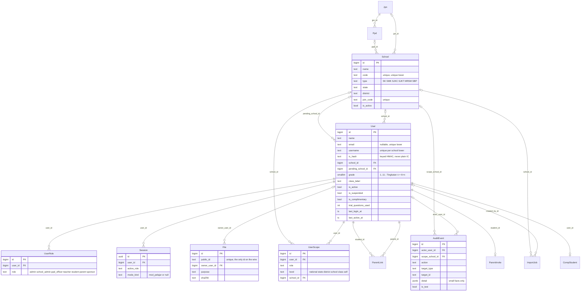
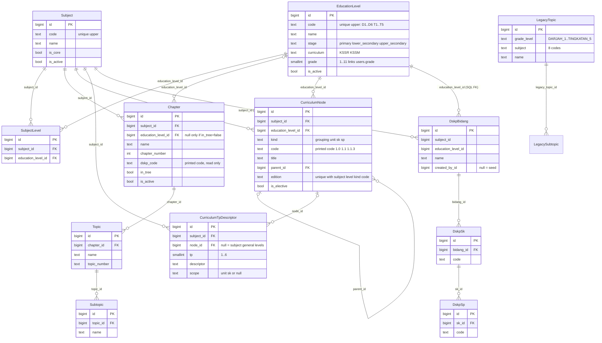
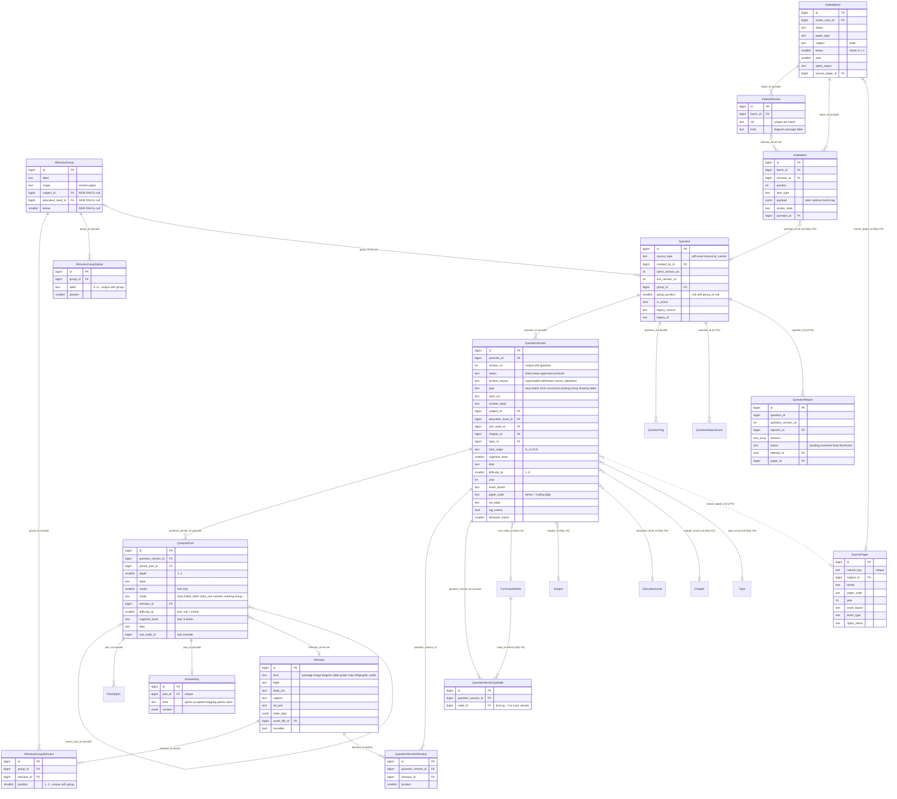
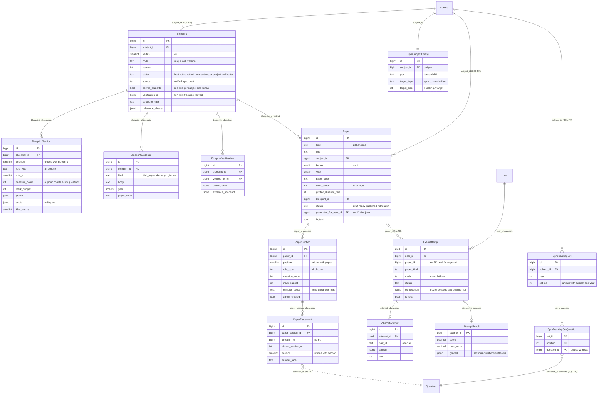
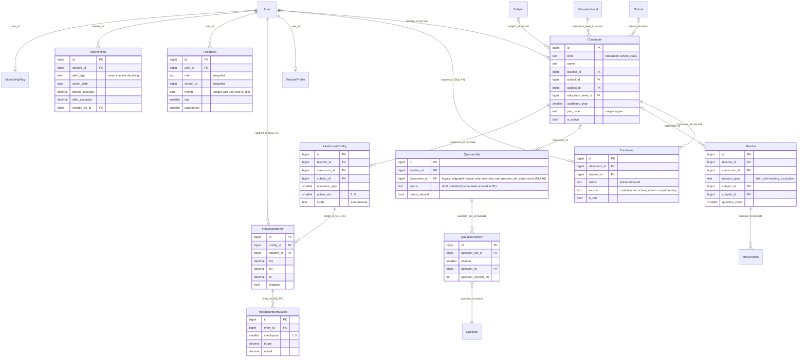
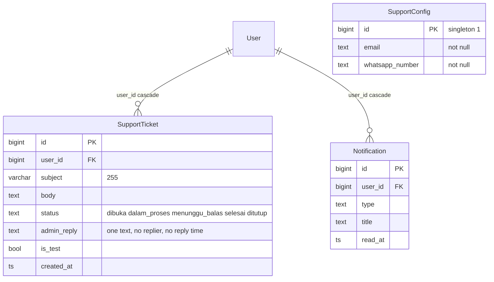
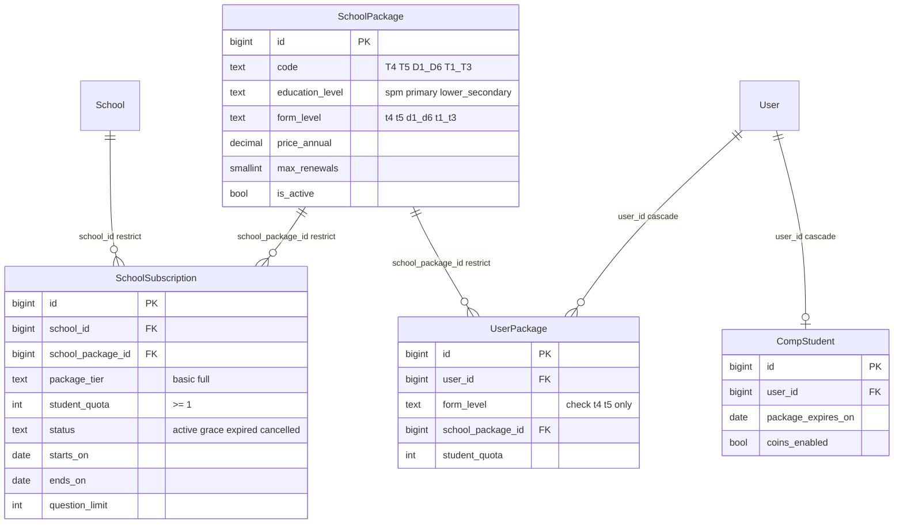

# R1 PRD 50: Data model and ERD (gap-closing release)

Part of the Release 1.0 PRD ([index](00-index.md)). Feature slug `r1-prd-devplan`. **Status:** for user review (G2 input). **Date:** 2026-11-04. **Owner:** Solution Architect.

This file is the data view of the R1 gap-closing release. It is **not** a redesign. It documents the data model that exists on `feature/v3-bijak-r1` (Prisma multi-file schema `apps/api/prisma/schema/*.prisma` plus the hand-written SQL in `apps/api/prisma/migrations/`), and lists the **delta** that the R1 requirements ([40-cross-cutting](40-cross-cutting.md) FR-X1-5, the three portal parts, and the [development plan](../../plan/r1-development-plan.md)) need. Existing models are extended in preference to adding new ones. Where this file proposes something that does not exist, it says **Planned**, and it is never drawn as existing in a "current" diagram.

---

## 0. Purpose and conventions

### 0.1 Reading rules
- **Current** = exists in the schema files or in a migration under `apps/api/prisma/migrations/`. Every section 2 diagram cites its source file.
- **Planned** = appears only in section 4 (delta) and in the overlay diagram 2.10.
- **Foreign keys.** Many foreign keys exist only in the migration SQL and are not Prisma relations (the schema file headers say so: `questions.prisma`, `classes.prisma`, `practice.prisma`, `reports.prisma`, `exam.prisma`, `spm.prisma`). The diagrams draw a relationship line when the migration has a real FK. A dotted line (`..`) means **the column exists but no database FK exists** (a finding, see DM-11 and section 5).
- Where a `legacy_source` / `legacy_id` pair exists (ETL from V1/V2), it is omitted from the diagrams. Every migrated table has it, with `unique (legacy_source, legacy_id)`.
- Common column conventions (all current tables): `id bigint identity` (UUID for sessions and attempts), `created_at` / `updated_at timestamptz`, enums stored as `text` with a named `ck_*` check, constraint names `fk_*`, `uq_*`, `ix_*`, `ck_*`, `is_test boolean` on rows written under Mod Pelajar (excluded from every count).

### 0.2 ID conventions
| Kind | Format | Example |
|---|---|---|
| Entity | `ENT-<Name>`, where `<Name>` is the Prisma model name (the diagram entity name) | `ENT-StimulusGroup` |
| Data change | `DM-01` … `DM-83`, ascending, never reused | `DM-05` |
| Action tag | **Keep** (matches; verify only) · **Fix** (wrong today) · **Complete** (partly built) · **Build** (missing). Same meaning as FR-X1-5. | |
| Change kind | new entity · new field · constraint · index · rule (no schema change) · seed · data fix | |
| Migration | `0NNN_<sector>_<slug>` inside the sector range of plan section 3: S1 0120-0139, S4 0140-0159, S3 0160-0179, S5 0180-0189, S10 0190-0199, S6 0200-0219, S7 0220-0239, S2 0240-0244, S0 0250-0259, Delivery Lead data fixes 0260-0269 | `0121_s1_servability_flags` |

### 0.3 Ground rules for every data change
1. **Expand, then contract.** Additive and nullable first. A destructive step needs its own release (plan section 3).
2. **Large tables.** `question_versions` holds about 339,112 questions on UAT. Constraints on it are added `NOT VALID` and then `VALIDATE`d, so the migration does not hold a long lock.
3. **Data repairs are scripts, not migrations** (`apps/api/scripts/uat-ops/`, `--dry-run` by default, idempotent, a report file). They run on UAT only with the user's approval (FR-X5-3, D95).
4. **No invented records.** Seeds and fixtures mirror observed values or the repository's reference files (section 6).
5. **Ownership.** A sector that needs a column in another sector's schema file asks the owner (`needs:schema`); the owner adds it in their own migration range. Section 4 names the owner per change.
6. **Privacy.** No real names, e-mails, credentials or addresses appear here or in any seed (NFR-5).

---

## 1. Findings that shape the delta (read first)

| # | Finding | Evidence | Consequence |
|---|---|---|---|
| F1 | The stimulus-group model is **built**: `stimuli`, `stimulus_groups`, `stimulus_group_stimuli` (1 to 3 stimuli per group), `stimulus_group_options`, and `questions.group_id` + `group_position` with `ck_questions_group_position` (both null or both set) and a partial unique index `uq_questions_group_id_group_position`. | `questions.prisma`; migration `0011_question_bank` lines 324, 390-394 | R1 does not add a group entity. It fixes the **size rule**, the **integrity gaps** and the **legacy data** (DM-01 to DM-06). |
| F2 | Code still requires **2 or more** members (`STIMULUS_MESSAGES.builderBlocker` = "Kumpulan perlu sekurang-kurangnya 2 soalan."; `smallGroup(n)`), while D108(1) and FR-ADM-QE2.4 say **1..n**. There is no database constraint on member count. | `packages/contract/src/questions/stimuli.ts`; `questions/group-members.ts` | DM-01 is a rule and message change, not a migration. |
| F3 | A "served lock" stops a question that pupils can see from being added to or removed from a group. The legacy defects (figure-less "Rajah 14 ..." questions) are **served** questions, so the lock would block the very regroup that QE-08 requires. | `questions/group-members.ts` (header comment) | DM-04: a question held back by an open servability flag does not count as served. |
| F4 | `question_versions` has the DSKP tags (`subject_id`, `education_level_id`, `unit_node_id`, `chapter_id`, `topic_id`, `difficulty_tp`, `cognitive_level`, `kbat`, `form_origin`, SP nodes in `question_version_sp_nodes`, per-leaf `difficulty_tp` / `cognitive_level` / `kbat` / `unit_node_id` in `question_parts`), all **nullable**. The "required" rule is a service gate (`dskp-gate.ts`, `checkTagGate`) that binds only a **new approval** of a question, and for the DSKP tags only where DSKP nodes exist for its Subjek + Tingkatan (D112-3; the pupil's level or the paper being for SPM does not change this). Legacy approved questions are exempt (D80 DEC-2). | `questions.prisma`; `questions/dskp-gate.ts` | The rule cannot become a plain `NOT NULL`. DM-19 documents the contract and adds verification queries. |
| F5 | There are **four** curriculum structures: (a) `chapters/topics/subtopics` (the pupil-facing Bab tree, V2 data), (b) `curriculum_nodes` + `curriculum_tp_descriptors` (the DSKP tree, loaded by script), (c) `dskp_bidang/sk/sp` (teacher picking list, a separate table set), (d) `legacy_topics/legacy_subtopics` (prototype seed). Pupil Topik and Peta Belajar read (d), which is empty on UAT. | `curriculum.prisma`, `classes.prisma`; `curriculum/learner.service.ts` lines 73, 80, 110 | DM-16 switches the reader to (a). DM-15 keeps (c). |
| F6 | Education levels: the repository seed (`curriculum-data/levels.json`) already has D1-D6 `isActive:false` and T1-T5 active. UAT shows 11 active levels, so the UAT data drifted (migration). The public "Tahap" statistic is `count(*) FROM education_levels WHERE is_active` (`account/account-data.repository.ts:187`). | `levels.json`; FR-X3-2 | DM-12 (data fix) and DM-13 (a check so it cannot recur). |
| F7 | Question to Bab is `question_versions.chapter_id` (FK to `chapters`, `ON DELETE SET NULL`). UAT has 0 links. A partial index on `chapter_id` for approved versions exists (`ix_qv_pub_chapter`). | migration 0011 line 366, 0100 | No new link table. DM-17 is an API/data operation; DM-18 changes the FK to `RESTRICT`. |
| F8 | `support_tickets` **exists** (migration `0009_content_support`) with one `admin_reply` text, no replier, no timestamp of the reply, no role or school. `support_config` (singleton id=1) exists but UAT returns 404 because no row exists. | `content.prisma` | DM-32, DM-33. |
| F9 | `feature_flags` does **not** exist (ADR-0035 was only a proposal and was never built). `base.prisma` says "Do not add models here". | `base.prisma`, ADR-0035 | DM-34 (new file `feature-flags.prisma`; plan S0-T10 names `base.prisma`, which contradicts that header). |
| F10 | `intake_batches` has no education level, its `kertas` is restricted to `1,2` (`ck_intake_batches_kertas`), and the contract tag level enum is `T4`, `T5`, `T4+T5`. Kertas Subjektif is Kertas 2, 3, 4 (Q-18) and levels must be T1-T5. A bank question has no "Bahagian" column (Bahagian belongs to a paper placement). | `intake.prisma`; migration 0020 line 32; `contract/src/intake/question.ts:119` | DM-07, DM-08, DM-09. |
| F11 | The following do **not** need a migration, although the plan says "if required": `0140_s4_question_chapter_link` (the link is `question_versions.chapter_id`), `0160_s3_self_mark` (self-marks are stored in `attempt_results.graded.selfMarks`, `bijak/attempts/self-mark.ts`), `0220_s7_marketplace_admin` (seller and product status checks already cover the PRD states). | respective files | Recorded in section 4.3 as plan corrections. |

---

## 2. Current ERD per domain

Notation: Mermaid `erDiagram`. Only fields that R1 reads or changes are drawn. `FK` is a real database foreign key (often in SQL only). Types: `bigint`, `int`, `text`, `bool`, `ts` (timestamptz), `date`, `jsonb`, `uuid`.

### 2.1 Identity and schools
Sources: `identity.prisma`, `schools.prisma`, `files.prisma`, migrations 0002, 0004, 0005.

### 2.2 Curriculum and DSKP
Sources: `curriculum.prisma`, `classes.prisma` (teacher DSKP list), migration 0008, `docs/ops/dskp-loader.md`.

### 2.3 Question bank and stimulus groups
Sources: `questions.prisma`, `questions-workflow.prisma`, `intake.prisma`; migrations 0011, 0043, 0092, 0100, 0102, 0105, 0106, 0107.

### 2.4 Papers, blueprints and Bijak SPM
Sources: `exam.prisma`, `bijak-attempts.prisma`, `spm.prisma`; migrations 0012, 0013, 0025, 0092, 0104.

### 2.5 Practice and attempts
Sources: `practice.prisma`; migrations 0014, 0018, 0022, 0040, 0044, 0091.

```mermaid
erDiagram
  User ||--o{ PracticeSession : "user_id cascade"
  Subject |o--o{ PracticeSession : "subject_id set null"
  EducationLevel |o--o{ PracticeSession : "education_level_id set null"
  Chapter |o--o{ PracticeSession : "chapter_id set null"
  PracticeSession ||--o{ PracticeSessionQuestion : "session_id cascade"
  PracticeSession ||--o{ PracticeAnswer : "session_id cascade"
  PracticeSession ||--o{ PracticeCheck : "session_id cascade"
  PracticeSessionQuestion }o..|| Question : "question_id (no FK)"
  PracticeAnswer }o..o| Question : "question_id (no FK)"
  User ||--o{ PracticeAnswer : "user_id cascade"
  User ||--o{ RevisionQueue : "user_id cascade"
  User ||--o{ Mastery : "user_id"
  User ||--o{ SpmTarget : "user_id"
  PracticeAttemptAggregate ||--o{ PracticeAttemptAggregateItem : "aggregate_id cascade"
  ExamAttempt ||..o| PracticeAttemptAggregate : "attempt_id (no FK)"
  School |o--o{ PracticeAttemptAggregate : "school_id snapshot"

  PracticeSession {
    uuid id PK
    bigint user_id FK
    uuid client_uuid "unique per user"
    text mode "random chapter revision latih_tubi mission remedial question_set pksk databank (legacy past_year ramalan, read-only, DM-44)"
    bigint subject_id FK
    bigint education_level_id FK
    bigint chapter_id FK
    smallint question_count
    text status "in_progress completed; abandoned added by DM-66"
    bigint mission_id
    bigint remedial_test_id
    bigint question_set_id
    bool is_test
  }
  PracticeSessionQuestion {
    bigint id PK
    uuid session_id FK
    smallint position "unique with session"
    bigint question_id "unique with session"
    int question_version_no "version served"
  }
  PracticeAnswer {
    bigint id PK
    uuid session_id FK
    bigint user_id FK
    bigint question_id
    bigint subject_id FK
    bigint chapter_id FK
    bigint topic_id FK
    bool is_correct
    ts answered_at
    bool is_test
  }
  PracticeCheck {
    bigint id PK
    uuid session_id FK
    bigint question_id "unique with session"
    bool is_correct
  }
  RevisionQueue {
    bigint id PK
    bigint user_id FK
    bigint question_id "unique with user"
    int wrong_times
  }
  Mastery {
    bigint id PK
    bigint user_id FK
    bigint subject_id FK
    int correct
    int answered
  }
  PracticeAttemptAggregate {
    bigint id PK
    text source "bijak"
    uuid attempt_id "unique with source"
    bigint user_id FK
    bigint paper_id
    text subject_code
    decimal units_awarded
    decimal units_max
    bigint school_id FK "snapshot at write"
    bool is_test
  }
  SpmTarget {
    bigint id PK
    bigint user_id FK
    bigint subject_id FK
    text target_grade
  }
```

### 2.6 Classes, headcount and analytics
Sources: `classes.prisma`, `reports.prisma`; migrations 0015, 0021, 0023, 0030, 0090.

### 2.7 Gamification, wallet, battle, marketplace
Sources: `gamification.prisma`, `wallet.prisma`, `battle.prisma`, `games.prisma`, `marketplace.prisma`; migrations 0010, 0019, 0027, 0032, 0033.

```mermaid
erDiagram
  Tier ||--o{ Wallet : "tier_id restrict"
  User ||--o| Wallet : "user_id cascade"
  User ||--o{ CoinLedger : "user_id cascade"
  Challenge ||--o{ ChallengeCompletion : "challenge_id cascade"
  Achievement ||--o{ UserAchievement : "achievement_id cascade"
  Draw ||--o{ DrawPrize : "draw_id cascade"
  Draw ||--o{ DrawTicket : "draw_id restrict"
  Reward ||--o{ RewardRedemption : "reward_id set null"
  SyilingReward ||--o{ RewardClaim : "reward_id restrict"
  Tournament ||--o{ TournamentSubject : "tournament_id cascade"
  School ||--o{ SekolahBersaingWeek : "school_id (SQL FK)"
  MarketplaceSeller ||--o{ MarketplaceProduct : "seller_id restrict"
  MarketplaceCategory ||--o{ MarketplaceProduct : "category_id restrict"
  MarketplaceProduct ||--o{ MarketplaceProductImage : "product_id cascade"

  Tier {
    bigint id PK
    text tier_name
    text label_ms
    int min_syiling
    decimal conversion_rate
    int sort_order
    int pksk_reward_correct
    int board_game_reward_win
    bool is_active
  }
  Wallet {
    bigint id PK
    bigint user_id FK
    bigint tier_id FK
    int current_syiling
    int total_syiling_earned
    int token_balance
    int xp
  }
  CoinLedger {
    bigint id PK
    bigint user_id FK
    text type
    text source
    int amount
    int balance_after
    bool is_test
  }
  Challenge {
    bigint id PK
    text title
    text challenge_type
    int target_value
    int reward_syiling
    bool is_active
  }
  Draw {
    bigint id PK
    text title
    int ticket_cost_syiling
    int max_tickets_per_student
    text status "draft open closed"
    bigint winner_user_id "single"
    ts drawn_at
  }
  DrawPrize {
    bigint id PK
    bigint draw_id FK
    text label
    int value_sen
    int qty ">= 1"
    smallint position
  }
  DrawTicket {
    bigint id PK
    bigint draw_id FK
    bigint user_id FK
  }
  Reward {
    bigint id PK
    text category
    text vendor
    int token_cost
    int stock_quantity "null unlimited"
    bool is_active
    bool requires_parent_consent
  }
  RewardRedemption {
    bigint id PK
    bigint user_id FK
    bigint reward_id FK
    text status
    text voucher_code "secret"
  }
  MysteryBoxOpening {
    bigint id PK
    bigint user_id FK
    int box_id "constant in shop.constants.ts, no table"
    int coins
    int xp
  }
  GamificationSetting {
    bigint id PK
    text key
    decimal value
  }
  Tournament {
    uuid id PK
    text education_level_id "code tingkatan4 tingkatan5 spm"
    text format
    text status "draft registration ongoing completed"
    bigint created_by
  }
  SekolahBersaingWeek {
    bigint id PK
    date week_start "unique with rank"
    smallint rank
    bigint school_id FK
    decimal aktif_pct
  }
  GameSettings {
    smallint id PK "singleton 1"
    smallint boardgame_quiz_tiles
  }
  MarketplaceSeller {
    bigint id PK
    bigint user_id FK
    text status "pending active suspended banned"
    ts verified_at
  }
  MarketplaceProduct {
    bigint id PK
    bigint seller_id FK "null = official"
    bigint category_id FK
    text status "active draft rejected"
    text stock_status
    decimal price
  }
```

### 2.8 Support and tickets
Sources: `content.prisma` (`SupportConfig`, `SupportTicket`), `identity.prisma` (`Notification`), migration `0009_content_support`.

### 2.9 Subscriptions and quotas
Sources: `schools.prisma`, `identity.prisma`; migration `0006_subscriptions_parents`.

### 2.10 R1 delta overlay (planned; nothing here exists yet)
Shows only what section 4 adds. New entities are drawn in full. Existing entities show only the **new** columns, marked `NEW`.

```mermaid
erDiagram
  QuestionVersion {
    text stimulus_flag "NEW DM-05 stimulus_missing figure_only stem_duplicated"
    ts stimulus_flag_at "NEW DM-05"
    ts flag_dismissed_at "NEW DM-05"
    bigint flag_dismissed_by "NEW DM-05 FK users"
    text section_label "NEW DM-07 printed Bahagian"
  }
  QuestionVersionPrivate {
    text visibility "NEW DM-42 bank or teacher_private"
    bigint owner_user_id "NEW DM-42 FK users"
    text reference_url "NEW DM-42"
  }
  QuestionSet {
    text kind "NEW DM-43 set or kertas"
  }
  IntakeBatch {
    bigint education_level_id "NEW DM-09 FK education_levels"
  }
  Paper {
    text exam_board "NEW DM-23"
    text surface "NEW DM-23 simulasi or subjektif"
  }
  SpmTrackingSetQuestion {
    bigint subject_id "NEW DM-24 copied from set"
    int year "NEW DM-24 copied from set"
  }
  SupportTicket {
    text created_role "NEW DM-32"
    bigint school_id "NEW DM-32 FK schools"
    bigint admin_replied_by_id "NEW DM-32 FK users"
    ts admin_replied_at "NEW DM-32"
  }
  FeatureFlag {
    text key PK "DM-34"
    text label_ms
    text audience "pelajar guru"
    bool enabled "default true"
    bool locked "true = cannot be turned on"
    int sort_order
    bigint updated_by FK
    ts updated_at
  }
  DrawWinner {
    bigint id PK "DM-36"
    bigint draw_id FK
    bigint draw_prize_id FK
    smallint slot "unique with draw_prize_id"
    bigint user_id FK
    ts drawn_at
    bigint drawn_by_id FK
  }
  MysteryBox {
    int id PK "DM-37 ids = shop.constants.ts"
    text label
    int cost_syiling
    bool is_active
  }
  MysteryBoxPrize {
    bigint id PK "DM-37"
    int box_id FK
    text label
    int coins
    int xp
    int weight ">= 0"
    int stock "null unlimited"
  }
  PracticeAnswerNew {
    text mode "NEW DM-44 ck_practice_answers_mode 19 values"
    uuid attempt_id "NEW DM-44 unique with user_id question_id part_ref"
    text part_ref "NEW DM-44 game_key#position for battle and game"
    numeric marks_awarded "NEW DM-44"
    numeric marks_max "NEW DM-44"
  }
  PracticeSessionNew {
    text status "DM-66 adds abandoned"
  }
  Battle {
    bool counts_for_ranking "NEW DM-60 default true"
  }
  GameRoom {
    uuid session_id "NEW DM-67 unique attempt_id of room answers"
  }
  TournamentRound {
    bigint id PK "DM-61"
    bigint tournament_id FK
    smallint n
    ts opens_at
    ts closes_at
    jsonb question_ids
  }
  TournamentEntry {
    bigint id PK "DM-61"
    bigint tournament_id FK
    bigint user_id FK
    bigint school_id FK
    ts registered_at
  }
  TournamentRoundScore {
    bigint id PK "DM-61"
    bigint round_id FK
    bigint user_id FK
    int score
    uuid attempt_id "unique answer-store attempt id"
  }
  ChallengeClaim {
    bigint id PK "DM-63"
    bigint user_id FK
    bigint challenge_id FK
    date myt_date "unique with user_id challenge_id"
  }
  SpinSegment {
    smallint position PK "DM-64 8 rows"
    text label
    int syiling
    int weight
    bool active
  }
  Video {
    bigint id PK "ENT-Video"
    text visibility "NEW DM-76 global or school"
    bigint school_id "NEW DM-76 FK schools"
    text category "DM-76 widened"
  }
  Draw {
    text status "DM-65 adds drawn cancelled"
    ts cancelled_at "NEW DM-65"
  }
  TournamentRound ||--o{ TournamentRoundScore : "round_id"
  MysteryBox ||--o{ MysteryBoxPrize : "box_id cascade"
  Draw ||--o{ DrawWinner : "draw_id"
  DrawPrize ||--o{ DrawWinner : "draw_prize_id"
  IntakeBatch }o--o| EducationLevel : "education_level_id"
  SupportTicket }o--o| School : "school_id"
```

---

## 3. Entity dictionary

Owner = module (as named in the schema headers) / sector (plan section 2). "FR" lists the main requirements that read or write the entity; it is not exhaustive. Types are shortened as in section 2. All `id` columns are `bigint identity` unless stated.

### 3.1 Identity and schools (S0 / S6)
| Entity | Purpose | Key fields and constraints | Owner | FR |
|---|---|---|---|---|
| `ENT-User` (`users`) | Every account. Pupil, teacher, school admin, admin. | `school_id` FK restrict; `grade` 1..11 (Tingkatan n = `education_levels.grade` 6+n = `users.grade` 6+n; for example Tingkatan 4 = 10); `ic_hash` keyed HMAC, `ic_masked` only value shown; unique `lower(email)` partial, unique `(school_id, lower(username))`; `trial_questions_used`; `is_active` (inactive stays in XS-1 totals) | M01/M02, S0 + S6 | XS-1..3, U-01..U-03, R1-MUR-A1, FR-X4-4 |
| `ENT-UserRole` (`user_roles`) | Roles of an account (one user may have several). | unique `(user_id, role)`; role check of 7 values | M01, S0 | FR-X2-3, XS-1, XS-3 |
| `ENT-UserScope` (`user_scopes`) | Data scope per role grant. | unique `(user_id, role)`; `level` national..self; `school_id` | M01, S0 | XS-6(a), AC-SH |
| `ENT-Session` (`sessions`) | Server session; `mode_kind = mod_pelajar` marks admin-in-pupil mode. | `token_hash` unique; mode columns all null or all set | M01, S0 | U-OP-12, `is_test` rules |
| `ENT-AuditEvent` (`audit_events`) | Append-only audit trail for admin writes. | `action`, `target_type`, `target_id`, small `detail` jsonb (no content); `is_test` | M01, S0 | FR-ADM-H0.3, C05.2, P2-19.2 |
| `ENT-School` (`schools`) | A school. | unique `code`, unique `lower(code)`, unique `join_code`; `type` check; `is_active` | M02, S6 | U-04, R1-AS-*, Sekolah Bersaing |
| `ENT-Jpn`, `ENT-Ppd` (`jpns`, `ppds`) | State and district offices; school location. | `code` unique; `ppds.jpn_id` restrict | M02, S6 | U-04 (D72: primary types hidden by default) |
| `ENT-File` (`files`) | Stored object (image, PDF, audio). | `public_id` unique (the only wire id); `purpose` open list (`question_image`, `intake_*`, `avatar`, ...); `sha256`; `storage_key` unique | files, S1 | FR-X1-4b (figure stored once), QE-05 |
| `ENT-ImportJob` (`import_jobs`) | Bulk user or student import result. | `kind` users/students; `failures` jsonb | M02, S6 | U-05, U-06, R1-AS-51 |
| `ENT-ParentLink`, `ENT-ParentInvite` | Parent to pupil link; single-use invite (hash only). | unique `(parent_id, student_id)`; unique `student_id` on invite, `token_hash` unique | M02, S6 | R1-MUR-40, P2-16 |
| `ENT-CompStudent` (`comp_students`) | Complimentary pupil profile. | unique `user_id`; `package_expires_on` | M02, S6 | U-07 |

### 3.2 Curriculum and DSKP (M03 / S4)
| Entity | Purpose | Key fields and constraints | Owner | FR |
|---|---|---|---|---|
| `ENT-EducationLevel` (`education_levels`) | Darjah D1-D6 and Tingkatan T1-T5. | `code` unique upper; `stage`; `grade` 1..11; `is_active`. Seed: D1-D6 inactive, T1-T5 active | M03, S4 | FR-X3-1/2/3, C-03, FR-ADM-QE3.5 |
| `ENT-Subject` (`subjects`) | Subject catalogue. | `code` unique upper (13 DSKP codes: BM, BI, MATH, ADDMATH, PHY, SCI, SEJ, PI, TI, PM, PSV, LNR, KNP); `is_active` | M03, S4 | C-02 |
| `ENT-SubjectLevel` (`subject_levels`) | Which subject is taught at which level. | unique `(subject_id, education_level_id)` | M03, S4 | X3-3, MUR-9, MUR-16 |
| `ENT-Chapter` (`chapters`) | Bab (textbook chapter) per subject and level. | `in_tree=false` for 60 out-of-tree chapters (null level and name allowed only then); `dskp_code` printed; `chapter_number` | M03, S4 | C-01, C-05, MUR-9, MUR-14, MUR-24/25 |
| `ENT-Topic`, `ENT-Subtopic` | Topik and subtopik under a Bab. | `topics.chapter_id` cascade; `topic_number` free text, naturally ordered | M03, S4 | C-01, MUR-24 |
| `ENT-CurriculumNode` (`curriculum_nodes`) | **The DSKP tree**: grouping, unit, sk, sp. Versioned by `edition`. | unique `(subject_id, education_level_id, edition, kind, code)`; `parent_id` cascade; loaded by script, never migrated; T4-T5 only today (2,844 nodes over 13 subjects in the dry run) | M03, S4 | C-04, QE-03, G.1, XS (Analitik, DSKP Heatmap) |
| `ENT-CurriculumTpDescriptor` | TP 1-6 descriptor per unit or SK, or the subject's general levels (`node_id` null). | `tp` 1..6; unique `(subject_id, coalesce(node_id,0), tp)` (SQL) | M03, S4 | G.1, MUR-5 |
| `ENT-LegacyTopic`, `ENT-LegacySubtopic` | Prototype topic catalogue for Topik and Peta Belajar (grade + 8 subject codes). Seed only. | `grade_level` check DARJAH_1..TINGKATAN_5 | M03, S4 | DM-16 retires the reader |
| `ENT-DskpBidang`, `ENT-DskpSk`, `ENT-DskpSp` | Teacher DSKP picking list (3 levels). Separate from `curriculum_nodes` (OWN-11). | `created_by_id` null = seed | M10, S1/S6 | R1-GUR-44, R1-GUR-8b, DM-15 |

### 3.3 Question bank and stimulus groups (M04 / S1)
| Entity | Purpose | Key fields and constraints | Owner | FR |
|---|---|---|---|---|
| `ENT-Question` (`questions`) | Stable identity of a question. | `group_id` FK set null, `group_position`; `ck_questions_group_position` (both null or both set); partial unique `(group_id, group_position)`; `live_version_no`; `is_active`; `unique(legacy_source, legacy_id)` | M04, S1 | FR-X1-4a..f, QE-01, QE-07 |
| `ENT-QuestionVersion` (`question_versions`) | Content and tags of one version. | `status` draft/review/approved/archived; **one approved version per question** (`uq_question_versions_one_approved`); tag columns (F4); provenance (`year`, `exam_board`, `paper_code`, `set_label`); `declared_marks`; `last_editor` | M04, S1 | QE-03, QE-04, G.1, C-05, XS |
| `ENT-QuestionVersionSpNode` | 1..3 SP tags per version. | unique `(question_version_id, node_id)`; `node_id` FK restrict to `curriculum_nodes`; kind `sp` and count 1..3 are service checks | M04, S1 | QE-03, MUR-5 |
| `ENT-QuestionPart` (`question_parts`) | Part tree, depth <= 3; marks and answer mode on leaves. | leaf `difficulty_tp`, `cognitive_level` (6 levels), `kbat`, `unit_node_id`, `form_origin` override the version; `stimulus_id` (part-level stimulus, Sejarah (c)) | M04, S1 | QE-03, G.2 |
| `ENT-PartOption`, `ENT-AnswerKey` | MCQ options (A..H); one key per leaf (kind option/accepted/mapping/points/rubric). | unique `(part_id, label)`, unique `part_id` on key | M04, S1 | QE-03, Q-24 |
| `ENT-Stimulus` (`stimuli`) | A rajah, petikan, jadual, graf, peta, carta. **Never a question.** | `kind` check of 8 (the service uses 7; `audio` unused); `asset_file_id` FK set null; `reusable` | M04, S1 | FR-X1-4a, QE-01 |
| `ENT-StimulusGroup` (`stimulus_groups`) | One shared stimulus set and its ordered questions. | no member-count constraint; `scope` section/paper | M04, S1 | FR-X1-4a/b/d/e, QE-02, QE-07 |
| `ENT-StimulusGroupStimulus` | Stimuli of a group (1 to 3). | `position` 1..3; unique `(group_id, position)` and `(group_id, stimulus_id)`; `stimulus_id` restrict | M04, S1 | QE-01 |
| `ENT-StimulusGroupOption` | Lettered option bank A..H shared by the group (BI Part 4). | unique `(group_id, label)`, `(group_id, position)` | M04, S1 | AC-ADM-G6.3 |
| `ENT-QuestionVersionStimulus` | Question-level (non-group) stimulus link. | unique `(question_version_id, stimulus_id)` and position | M04, S1 | QE-01.3, DM-03 |
| `ENT-QuestionTag` | Pool and PKSK tags. | unique `(question_id, kind, code)` | M04, S1 | (PKSK, out of scope) |
| `ENT-SourcePaper` (`source_papers`) | Identity and rights register of an imported paper. | `natural_key` unique; `rights_status` | M04, S1 | Q-19, D99 |
| `ENT-QuestionStatusEvent` | Append-only status history. | `from_status`, `to_status`, `reason`, `answer_changed` | M04, S1 | QE-08, G7 |
| `ENT-QuestionReport` (`question_reports`) | Pupil report of a question version. | unique `(reporter_id, question_id, question_version_no)`; status pending/reviewed/fixed/dismissed | M04, S1 (pupil page S5) | R1-MUR-54, Q-22 |
| `ENT-QuestionImport` | Excel/CSV import run (history). | `failures` jsonb | M04, S1 | Q-11, QE-06 |
| `ENT-IntakeBatch`, `ENT-IntakeStimulus`, `ENT-IntakeItem` | Paper upload, staged stimuli and reviewable drafts. | batch `kertas` check `in (1,2)`; items link a stimulus (`stimulus_id`) so a figure can serve many items | intake, S1 | Q-07..Q-09, QE-05, FR-X1-4c |

### 3.4 Papers, blueprints and Bijak SPM (M28, M06 / S3)
| Entity | Purpose | Key fields and constraints | Owner | FR |
|---|---|---|---|---|
| `ENT-Blueprint` (`blueprints`) | "Kontrak": the rule set of a paper per subject and kertas. | unique `(code, version)`; one `active` per `(subject_id, kertas)`; `source` verified/spec/draft; `verification_id` non-null iff verified (check); `serves_students` one true per subject and kertas (partial unique) | M28, S3 | Q-16, X5 FR-X5-3 |
| `ENT-BlueprintSection` | Section rule: `all` or `choose n`, quota and KBAT jsonb. | unique `(blueprint_id, position)`; `question_count` counts a group by all its questions | M28, S3 | Q-14/16 |
| `ENT-BlueprintEvidence`, `ENT-BlueprintVerification` | Evidence rows; insert-only verification record (trigger). | verification never updated or deleted (`trg_blueprint_verifications_insert_only`) | M28, S3 | Q16.2/16.3, D76(4) |
| `ENT-Paper` (`papers`) | Curated (`pilihan`) or generated (`jana`) paper. | `jana` iff `generated_for_user_id` set; `status` draft/ready/published/withdrawn; `level_scope` t4/t5/t4_t5; total marks never stored for `pilihan` and `jana` papers (a `subjektif` paper stores the admin-typed `Jumlah Markah` in `total_marks`, DM-23) | M28, S3 | Q-13..Q-15, MUR-13 |
| `ENT-PaperSection` | Bahagian of a paper. | unique `(paper_id, position)`; `stimulus_policy` none/group/per_part; `admin_created` | M28, S3 | Q15, QE-07 |
| `ENT-PaperPlacement` | A question placed in a section; pinned version. | unique `(paper_section_id, position)` and `(paper_section_id, question_id)`; **`question_id` has no FK** | M28, S3 | QE-07.1, Q14 |
| `ENT-ExamAttempt` (`exam_attempts`) | One sitting. | uuid; `composition` frozen; `paper_id` no FK (null for migrated); the attempt kind is the existing column `paper_kind` (today `pilihan`, `jana`, migration 0013; there is no `kind` column): DM-83 (migration `0186_s3_exam_attempt_paper_kind`, card S3-T06) widens `ck_exam_attempts_paper_kind` to `pilihan`, `jana`, `subjektif`, `structured`. A Kertas Subjektif sitting has `paper_kind = 'subjektif'` and `paper_id` set; a Soalan Berstruktur attempt has `paper_kind = 'structured'`, `paper_id` null, `composition` = the frozen question list and `title` = the set title; both use `mode = 'latihan'` (untimed) | M28, S3 | MUR-13, AC-X6-2 |
| `ENT-AttemptAnswer`, `ENT-AttemptResult` | Per-part answers (rev-guarded); graded result with `graded.selfMarks`. | unique `(attempt_id, part_id)` | M28, S3 | MUR-13, Q18.8 |
| `ENT-SpmSubjectConfig` (`spm_subject_configs`) | The 19 SPM subjects, lane order, Tracking A target (`target_size`). | unique `subject_id` | M06, S3 | Q-01, Q-17 |
| `ENT-SpmTrackingSet`, `ENT-SpmTrackingSetQuestion` | Tracking A set and its ordered questions. | unique `(subject_id, year, set_no)`; PK `(set_id, position)`; unique `(set_id, question_id)` | M06, S3 | Q-17 |

### 3.5 Practice and attempts (M05 / S5)
| Entity | Purpose | Key fields and constraints | Owner | FR |
|---|---|---|---|---|
| `ENT-PracticeSession` (`practice_sessions`) | Latih Tubi, Soalan by Chapter, remedial, question-set sessions. | uuid; `mode` check of 10; partial unique `(user_id, client_uuid)`; `is_test` | M05, S5 | MUR-9, MUR-12, MUR-16, XS-4 |
| `ENT-PracticeSessionQuestion` | The served list in order with the version served. | unique `(session_id, position)` and `(session_id, question_id)`; `question_id` no FK | M05, S5 | QE7.4, QP-6/7 |
| `ENT-PracticeAnswer` (`practice_answers`) | **The single answer store (DM-44)**: one row per checked question (per leaf part for structured work), for every answering activity; dimensions copied at answer time; `mode`, `attempt_id`, `part_ref`, `marks_awarded`, `marks_max` after DM-44. | indexes by `(user_id, subject_id, answered_at)`, `(subject_id, chapter_id)`; partial `(answered_at, id) WHERE NOT is_test`; `question_id` no FK | M05, S5 | XS-2/4/5, MUR-4/5/6/14 |
| `ENT-PracticeCheck`, `ENT-RevisionQueue`, `ENT-Mastery` | Instant check per question; wrong list; per-subject counters. | unique per `(session, question)` / `(user, question)` / `(user, subject)` | M05, S5 | MUR-12, MUR-16 |
| `ENT-PracticeAttemptAggregate` (+`Item`) | One analytics row per graded Bijak sitting (idempotent upsert). | unique `(source, attempt_id)`; `school_id` snapshot at write | M05/M28, S3 + S10 | MUR-6, Analisa Item |
| `ENT-SpmTarget` | Target grade per subject (a Soalan Berstruktur attempt is an `exam_attempts` row with `paper_kind = 'structured'`, no table of its own). | unique `(user_id, subject_id)` on target | M05, S5 | MUR-13, MUR-17 |

### 3.6 Classes, headcount and analytics (M10, M08, M11, M12 / S6, S10)
| Entity | Purpose | Key fields and constraints | Owner | FR |
|---|---|---|---|---|
| `ENT-Classroom` (`classrooms`) | `classroom` (teacher-made) or `school_class`. | `school_id` restrict (backfilled by 0090 for teacher classes); unique `upper(join_code)`; `join_code` is unused in R1 and never displayed (a pupil is in a class only because a teacher or admin enrolled them; follow V2, OQ-X-3); drop in a later release | M10, S6 | R1-AS-53, R1-GUR-8, XS-1, XS-6(e) |
| `ENT-Enrolment` (`enrolments`) | Pupil in a class; removal keeps the row (`status=removed`). | unique `(classroom_id, student_id)` | M10, S6 | XS-1, AC-XS-2 |
| `ENT-TeacherProfile` | Teaching details. | unique `user_id` | M10, S6 | R1-GUR-A1 |
| `ENT-Mission`, `ENT-MissionItem` | Teacher mission and recipients. Completion derived from `practice_sessions.mission_id`. | unique `(mission_id, student_id)` | M10, S6 | R1-GUR-2b |
| `ENT-QuestionSet`, `ENT-QuestionSetItem`, `ENT-QuestionSetClassroom` (`question_set_classrooms`, DM-46) | Teacher set and its explicitly selected classes. | `classroom_id` is legacy (migrated header only, `needs_rebuild`); assignment rows unique `(set, classroom)`; unique `(set, position)`, `(set, question)`; `question_id` FK restrict | M10, S1 carve-out + S6 | R1-GUR-8b, R1-MUR-26 |
| `ENT-RemedialTest` | Teacher remedial for one pupil. | partial unique open test per `(teacher, student, subject)` | M10, S6 | R1-MUR-12 |
| `ENT-HeadcountConfig`, `ENT-HeadcountEntry`, `ENT-HeadcountEntryMark` | TOV/ETR/RS and OTR/AR checkpoints. | unique `(classroom_id, subject_id, academic_year, mode)`, `(config_id, student_id)`, `(entry_id, checkpoint)` | M08, S10 | R1-MUR-3, R1-GUR-3, R1-AS-3, XS-6(d)(f) |
| `ENT-Feedback`, `ENT-Intervention`, `ENT-MonitoringFlag` | Kirkpatrick L1 (monthly), L3 (teacher intervention), monitoring flag. L2 and L4 are computed. | unique `(user_id, month, is_test)`; intervention `student_id` scoped to the viewer's school | M11/M12, S6 | R1-AS-11, R1-GUR-11, FR-X4-3 |

### 3.7 Gamification, games, marketplace (M14-M16, M20 / S7)
| Entity | Purpose | Key fields and constraints | Owner | FR |
|---|---|---|---|---|
| `ENT-Wallet`, `ENT-Tier`, `ENT-CoinLedger` | Balance, tier config, append-only ledger (trigger). | ledger rows never updated or deleted | M14, S7 | P2-01..05, FR-MUR-SH-4 |
| `ENT-Challenge`, `ENT-ChallengeCompletion`, `ENT-Achievement`, `ENT-UserAchievement` | Daily challenges (one completion per user, challenge, day) and unlocks. | unique completion key; unique `(user, achievement)` | M14, S7 | P2-03, R1-MUR-30/34 |
| `ENT-Draw`, `ENT-DrawPrize`, `ENT-DrawTicket` | Cabutan Bertuah. `draws.winner_user_id` is a single winner. | `status` draft/open/closed; tickets restrict on delete | M14, S7 | P2-10 |
| `ENT-Reward`, `ENT-RewardRedemption`, `ENT-SyilingReward`, `ENT-RewardClaim` | Digital reward catalogue and redemptions; syiling reward budget. | stock decrement guard; `voucher_code` secret. `rewards` is the one catalogue. `syiling_rewards` and `reward_claims` are migrated into `rewards`, `reward_redemptions` and `reward_settings` and retired (D113, DM-77). | M15, S7 | P2-07..09 |
| `ENT-MysteryBoxOpening` | One opening. The four boxes are **code constants** (`box_id`), no table. | | M14, S7 | P2-11 |
| `ENT-GamificationSetting`, `ENT-GameSettings` | Key/value economy settings; singleton game settings. | | M14/M16, S7 | P2-06, N-05 |
| `ENT-Tournament`, `ENT-TournamentSubject`, `ENT-SekolahBersaingWeek` | Tournament; weekly school board snapshot (seed-only today). | `education_level_id` is a **text code** (`tingkatan4`, `tingkatan5`, `spm`); unique `(week_start, rank)` | M16, S7 | P2-14, R1-AS-45 |
| `ENT-TournamentRound`, `ENT-TournamentEntry`, `ENT-TournamentRoundScore` | Rounds, registrations and per-round scores of a single-match or league tournament (DM-61). | unique `(tournament_id, user_id)`; unique `(round_id, user_id)`; `tournament_round_scores.attempt_id` unique uuid (the answer-store attempt id) | M16, S7 | P2-14; 48 GAME-15 |
| `ENT-ChallengeClaim` | One claim of a daily challenge reward (DM-63). | unique `(user_id, challenge_id, myt_date)` | M14, S7 | 48 GAME-19 |
| `ENT-SpinSegment` | The 8 segments of the spin wheel (DM-64). | 8 rows; `position` unique | M14, S7 | 48 GAME-14 |
| `ENT-MarketplaceSeller`, `ENT-MarketplaceProduct` (+`Category`, `Image`) | Seller and product with status checks. | seller `pending/active/suspended/banned`; product `active/draft/rejected`; `seller_id` null = official | M20, S7 | P2-12, P2-13 |

### 3.8 Support, tickets and settings (M22 / S7, schema S5)
| Entity | Purpose | Key fields and constraints | Owner | FR |
|---|---|---|---|---|
| `ENT-SupportTicket` (`support_tickets`) | A ticket from any signed-in user ("Tiket Bantuan"). | `status` 5 BM codes; `admin_reply` one text; indexes `(user_id, status, created_at desc)` and `(status, created_at desc, id desc)` | M22; model in `content.prisma` (S5), BE/FE S7 | R1-MUR-A4, R1-GUR-A4, R1-AS-A4, P2-20 |
| `ENT-Video` (`videos`) | Videos for pupils; Admin Pusat rows are global, Guru rows are school-scoped (DM-76). | `visibility` `global`/`school`; `school_id` set when `school`; `category` check | M21, S5 | R1-GUR-7; 20 ADD-18 |
| `ENT-SupportConfig` (`support_config`) | Singleton support contact. | `id = 1` check; `email`, `whatsapp_number` not null | M22 (`content.prisma`, S5) | R1-ADM-N-07, R1-MUR-A3, U-OP-16 |
| `ENT-Notification` | In-app notifications. | | M01/M06, S0 | (reply notice, optional) |

### 3.9 Subscriptions and quotas (M19 / S6)
| Entity | Purpose | Key fields and constraints | Owner | FR |
|---|---|---|---|---|
| `ENT-SchoolPackage` (`school_packages`) | Package catalogue T4, T5, D1_D6, T1_T3. | `code` unique; price per pupil per year | M19, S6 | U-09 (T4/T5 only offered) |
| `ENT-SchoolSubscription` (`school_subscriptions`) | A school's subscription and pupil quota. | `student_quota >= 1`; `status` active/grace/expired/cancelled; latest by `starts_on, id` | M19, S6 | U-09, R1-AS-2, R1-AS-1 (FR-AS-1-3) |
| `ENT-UserPackage` (`user_packages`) | School-admin package assignment. | unique `(user_id, form_level)`; check `t4,t5` | M19, S6 | (OD-6 decided: no T1-T3 package, D109) |

**Entities documented before the 4.9 additions: 112 current** (each model named in a dictionary row is counted once; a grouped row counts every entity it names): 3.1 = 13, 3.2 = 13, 3.3 = 19, 3.4 = 13, 3.5 = 10, 3.6 = 14, 3.7 = 24 (including `MarketplaceCategory`, `MarketplaceProductImage`, `SyilingReward`, `RewardClaim`), 3.8 = 4 (with `ENT-Video`), 3.9 = 3 (`CompStudent` is counted in 3.1). **Entities documented: 113 current** after `ENT-Video` is added to 3.8. **Planned new entities: 9** (section 4): `ENT-FeatureFlag`, `ENT-DrawWinner`, `ENT-MysteryBox`, `ENT-MysteryBoxPrize` and, from section 4.9, `ENT-TournamentRound`, `ENT-TournamentEntry`, `ENT-TournamentRoundScore`, `ENT-ChallengeClaim`, `ENT-SpinSegment`. Total 122.

---

## 4. R1 data changes (the delta)

Columns: **DM** · **Action** (Keep/Fix/Complete/Build) · **Change** (kind) · **Reason** · **FR / AC** · **Cards** · **Migration and backfill** · **Risk**. "No migration" means the change is a rule, a script or a read-side change.

### 4.1 Stimulus groups and question structure (S1)

| DM | Action | Change | Reason | FR / AC | Cards | Migration and backfill | Risk |
|---|---|---|---|---|---|---|---|
| DM-01 | Fix | **Rule.** A group holds **1..n** questions. A 0-member group is allowed as a draft only and cannot be placed in a paper (blocker "Kumpulan perlu sekurang-kurangnya 1 soalan."). Change `STIMULUS_MESSAGES.builderBlocker`, `smallGroup(n)` and the "at least 2 members when created" validation in `StimuliService.createGroup` (S1-T01). The 1..n group change in `exam/builder/paper-check.ts` is S3-T02's (API-BIJAK-10(a)). No DB constraint on count (a deferrable count constraint is not worth the lock cost). | F2: code says 2+, D108(1) says 1..n; real SPM figures often serve one question. | FR-X1-4a, FR-ADM-QE2.4; AC-ADM-QE2.1/2.2 | S1-T01, S2-T01, S3-T02 | No migration. Contract text and its tests change (additive). Existing groups are untouched. | Low. A contract test asserts the old text; update it in the contract PR first. |
| DM-02 | Complete | **Constraint + verification.** (a) Replace `fk_questions_group_id ON DELETE SET NULL` by `ON DELETE RESTRICT`. Today deleting a group that still has members sets only `group_id` null and then fails `ck_questions_group_position` with a raw check violation; RESTRICT gives a clean 409 ("Rangsangan ini masih digunakan oleh {n} soalan."). (b) Optional: partial `unique (stimulus_id)` on `stimulus_group_stimuli` to enforce "a stimulus lives in exactly one group"; only after the duplicate report below is empty, otherwise keep it as a service rule. (c) Add the **group-integrity SQL pack** (`apps/api/scripts/uat-ops/group-integrity.sql`): empty groups, `group_position` gaps (positions must be 1..n), members of different subjects, groups without a stimulus, stimuli in more than one group. | F1: integrity is only in service code. "No orphan questions". | FR-X1-4a, FR-ADM-QE1.2/1.4; AC-ADM-QE1.2 | S1-T01 | `0120_s1_group_fk_restrict` (add the new FK `NOT VALID`, `VALIDATE`, drop the old one). Backfill: none; the pack only reports. | Low-medium. FK swap on a 339k-row table (use NOT VALID). (b) may hit existing multi-group stimuli; do not apply blindly. |
| DM-03 | Complete | **Rule (no schema).** Question-level stimulus (`question_version_stimuli`) and part-level stimulus (`question_parts.stimulus_id`) stay valid. New entry through Studio always creates a **1-member group** (4.G.5 step 4). The projection returns a `group` shape for both, so drills treat "single question with a stimulus" as a 1-member group and never serve it without the stimulus. **No backfill** of the 339k legacy rows in R1. | Two attach paths exist. Rewriting legacy rows is out of scope (FR-X1-5). | FR-X1-4d/4e, QE1.3, QP-4/5/6/7 | S1-T01, S1-T06, S8-T02 | No migration. Add a test: a question with a version-level stimulus is drawn only together with it. | Medium. The drill SQL must handle both paths; covered by the 1000-draw property test of S1-T06. |
| DM-04 | Fix | **Rule (no schema).** In `GroupMembers.servingMemberIds` / `served`, a question excluded by an open servability flag (DM-05) is **not** treated as served, so it can be attached to a group. A question pinned by a published paper stays locked. | F3: the served lock would block QE-08 regrouping. | FR-ADM-QE8.2, G7.3, G7.4; AC-ADM-QE8.1, G7.2 | S1-T01, S1-T07, S2-T04 | No migration. | Medium. A mistake could let an admin change a group that pupils see. Test: a served, unflagged member stays locked. |
| DM-05 | Build | **New fields** on `question_versions`: `stimulus_flag text null` (check in `stimulus_missing`, `figure_only`, `stem_duplicated`), `stimulus_flag_at timestamptz null`, `flag_dismissed_at timestamptz null`, `flag_dismissed_by bigint null` (FK `users` set null). Partial index `(subject_id, education_level_id) WHERE stimulus_flag IS NOT NULL AND flag_dismissed_at IS NULL` for the work-list and the hub "Perhatian" count. Detector = the pure function that already reads `figure-links.ts` reference words (the single canonical set of 45 section 6.6.1; the code exports one constant used by `figure-links.ts` and its frontend twin) + "figure-only" + "stem equals only-leaf prompt". Written on every version write; the **same SQL predicate** is used by every pupil draw and by "Dilihat murid di" (FR-X4-2). `stimulus_missing` and `figure_only` exclude a question from pupil surfaces; `stem_duplicated` is display-once and a data fix (DM-40), not an exclusion (AC-ADM-G7.3; OD-3 decided). The API servability reason codes are `group_incomplete`, `stimulus_missing`, `chapter_missing`, `permainan` (on top of the flags; see API-Q-11). `stimulus_flag_ref` (DM-53) records numbered or unnumbered. Stored, not computed: draws and counts run over 339k rows and the ADR-0028 `question_version_facts` table was never built. | UAT serves "Rajah 14 ..." questions without a figure (id 812791); counts include figure-only rows. | FR-ADM-G7.1..G7.6, QE-08, FR-X4-2, FR-MUR-QP-4/5; AC-ADM-G7.1/7.2/7.3 | S1-T07, S4-T04, S2-T04 | `0121_s1_servability_flags`. Backfill by **script**, not migration: `uat-ops/flag-stimulus.ts`, `--dry-run` default, batches of 5,000, approved live versions only, idempotent, prints counts per subject and Tingkatan (U-OP-05). Clears when a group or stimulus is attached (recompute on write) or when dismissed ("Bukan masalah"). | **High.** False positives hide good questions; false negatives keep serving broken ones. Mitigation: dry-run report reviewed by the admin before apply; "Bukan masalah" override; keyword list is the existing one (no new rules). Draw performance: the predicate must be covered by the existing partial indexes on `status='approved'` (check with a read-only `EXPLAIN` on UAT, run by the designated UAT developer). |
| DM-06 | Complete | **Rule + enum widening.** The QE-08 regroup operation: create a `stimulus` (from the figure-only row's text and image if it has one) and a group, attach the member questions, archive the figure-only question with `archive_reason = 'regrouped'`. Add `'regrouped'` to `ck_question_versions_archive_reason`. Writes a `question_status_events` row (reason) and an `audit_events` row. Images never copied from .cloud (D80 Q-03) are reported as "gambar tiada" and stay unserved. | FR-ADM-QE8.2 needs an archive reason that is not `superseded/withdrawn/source_takedown`. | FR-ADM-QE8.1..8.4; AC-ADM-QE8.1/8.2 | S2-T04, S4-T04, S1-T01 | `0122_s1_archive_reason_regrouped` (drop and re-add the check `NOT VALID`, then `VALIDATE`; widening only). | Low. Counts: the converted figure-only row leaves the approved set, so "339,112" drops by the number of figure-only rows (FR-ADM-QE1.5, expected). |
| DM-07 | Complete | **New field** `question_versions.section_label text null` (the printed Bahagian, for example `A`, max 20 chars, trimmed). Provenance next to `paper_code`, `set_label`, `number_label`; **not authoritative** (the paper placement stays the source of truth). Used to prefill the Set Builder destination Bahagian and the QE-04 panel. **Intake item column (P-12, run 5):** `intake_items.section_label text null` (same shape: max 20 chars, trimmed) holds, per extracted item, the printed Bahagian detected by the extractor or, when none was detected, the one typed at upload (45 U-04); it is set in the same migration `0123_s1_section_label`, written by the extraction (S1-T03, the owner of this row; S1-T05 only copies the CSV column) and read by API-Q-25 (the section of the imported paper) and by accept, which copies it to `question_versions.section_label`. CSV import (`bahagian` column) copies it to every created question. | F10: Bahagian chosen at upload is lost because a bank question has nowhere to keep it (E2E F2). | FR-ADM-QE5.2, QE6.1; AC-ADM-QE5.3 | S1-T03 | `0123_s1_section_label`. No backfill (null for legacy). | Low. Risk of two truths (field vs placement): the UI labels the field "Bahagian (cetakan)" and reads placements first. |
| DM-08 | Fix | **Constraint + enum widening.** Kertas domain becomes **1..4**: `ck_intake_batches_kertas` from `(1,2)` to `(1,2,3,4)`; contract `QuestionKertasSchema` and filters from `'1'..'3'` to `'1'..'4'`; `kertasOfPaperCode` and `kertasOfSourcePaper` accept a trailing `4`. `papers.kertas` and `blueprints.kertas` already allow `>= 1`. `kertas` is also nullable on `intake_batches` when `source = 'guru'` (DM-72). Contract union `QuestionKertasSchema`, `QuestionRow.kertas`, list filters, Kontrak and the 60 section 4.1 payloads are `'1'..'4'`. | Kertas Subjektif is Kertas 2, 3, 4 (Q-18); batch rejects 3 and 4. | FR-ADM-Q18.1, QE5.1 | S1-T03, S1-T05, S3-T06 | `0124_s1_kertas_range` (widening, `NOT VALID` then `VALIDATE`). Contract PR first (additive widening of a union breaks exhaustive `switch` in TypeScript consumers). | Low-medium: type-check fallout across sectors; ship the contract PR alone. |
| DM-09 | Complete | **New field** `intake_batches.education_level_id bigint null` FK `education_levels` (restrict). Required by the service for new batches (Tingkatan T1-T5 at upload, D99 header), null for existing. The contract tag level enum `T4`/`T5`/`T4+T5` becomes `T1`..`T5` plus `T4+T5`; items inherit the batch level unless the reviewer sets it. **Also (same migration):** `intake_batches.paper_code text null` (the `Kod kertas` of the upload header, 45 U-09, `^[0-9]{4}/[0-9]$`; null when none was typed; DM-45 reads it). | F10: batch has no Tingkatan; T1-T3 content cannot be tagged. | FR-ADM-QE5.1, QE3.5, FR-X3-3 | S1-T03, S1-T02, S2-T02 | `0125_s1_intake_level` (adds `education_level_id` and `paper_code`). No backfill (existing batches stay null and show "Tingkatan belum ditetapkan"). | Low. |
| DM-10 | Complete | **No schema.** CSV import: codes (subject, Tingkatan, unit, SP list with `;`, TP, KBAT, kertas, bahagian, number label) replace raw ids; rows sharing a `group_key` become one `stimulus_group` created in the same transaction as its member drafts; `stimulus_text` / `stimulus_image` on the first row. Unknown codes are reported per row with row number and field. `question_imports` keeps its columns. | Template carries raw ids today; CSV questions can never publish. | FR-ADM-QE6.1..6.3; AC-ADM-QE6.1/6.2 | S1-T05, S2-T05 | No migration. | Low. |
| DM-11 | Fix | **Constraint.** Add `fk_paper_placements_question_id` -> `questions(id)` `ON DELETE RESTRICT`. Today `paper_placements.question_id` has no FK (the 0012 header says "until BE-09 is merged"; no later migration adds it). Run the orphan report first. Group-as-unit in a paper (all members, contiguous, in `group_position` order) is **not** expressible as a simple constraint; it stays in `exam/builder/paper-check.ts` plus a verification query (DM-26). | "No orphan questions" in papers; a hard delete of a question would silently orphan a published paper. | FR-X1-4e, QE-07.1/7.2, Q15.1 | S3-T02 | `0160_s3_placement_question_fk` (`NOT VALID`, report orphans, `VALIDATE`). On UAT there are 0 papers, so validation is trivial; local seeds are checked. | Low. |

### 4.2 Curriculum, DSKP and levels (S4, with S1 for question-table constraints)

| DM | Action | Change | Reason | FR / AC | Cards | Migration and backfill | Risk |
|---|---|---|---|---|---|---|---|
| DM-12 | Fix | **Data fix (UAT).** Deactivate D1-D6 in `Tahap Pendidikan` so that exactly T1-T5 are active (U-OP-03). The repository seed already has this state (`levels.json`); UAT drifted through migration. Add `uat-ops/check-levels.ts` (active levels, public "Tahap" count, any hard-coded level list). The public statistic `levelCount` already counts `is_active`. | UAT shows 11 active levels and a public "Tahap" of 11. | FR-X3-1, FR-X3-2, FR-ADM-C03.1..3; AC-ADM-C03.1, AC-X3-1 | S4-T05, S4-T08 | No migration. Done by the admin in the UI with the user's approval. Rows and FKs stay (no hard delete). | Low. Pickers that hard-code levels are fixed by the card. |
| DM-13 | Build | **Constraint.** `ck_education_levels_no_active_primary CHECK (stage <> 'primary' OR is_active = false)`, added `NOT VALID`, validated after DM-12. After the migration no seed can hold an active Darjah (the 11-level defect is an in-memory test fixture only). Stops a re-run of the ETL or an admin toggle from re-activating Darjah; the API returns 409 with BM copy. The ETL mapping for `education_levels` must set primary rows inactive (S0 owns `etl.prisma`). | The 11-level defect must not come back (D72/D96). | FR-X3-1, FR-ADM-C01.5, C03.3 | S4-T05 | `0140_s4_levels_secondary_only`. | Low-medium. The ETL replay path must be checked; the constraint only rejects an update that would make a primary row active. |
| DM-14 | Complete | **Data (script).** Run the DSKP loader on UAT for T4-T5 (U-OP-01): dry run reports 2,844 nodes and 1,394 TP descriptors (42 general) over 13 subjects, 4 rejected Landskap TP rows. Verification SELECTs in `docs/ops/dskp-loader.md`. T1-T3 extracts are not yet loaded: per D109 they use the same DSKP structure as T4-T5, built from the existing T1-T3 chapter and topic data (S4-T09; official PDFs are not required); T1-T3 questions are approved without DSKP tags (FR-ADM-C04.4, D101) until SP/TP are loaded. **D112(3):** the same S4 loading card (S4-T09) also loads the DSKP structure (Tingkatan, Subjek, Bab, SK, SP, TP, as D109) for EVERY SPM subject offered that has no `curriculum_node` rows yet (for example Kimia, Biologi, Geografi, Perniagaan, Prinsip Perakaunan, Ekonomi), from the official KPM DSKP documents; until a subject is loaded its SP and TP are required at publish only where nodes exist for that Subjek + Tingkatan (FR-ADM-QE4.6, FR-ADM-C04.6), and a Kontrak (JSU) can be created only for a Subjek whose nodes exist (FR-ADM-Q16.7). No new table or column: the rule is a lookup on `curriculum_node`. | UAT had 0 nodes, so tagging, blueprints and Jana Kertas cannot work there. | FR-ADM-C04.1..4; AC-ADM-C04.1/2, AC-R1-12.6 | S4-T02, S4-T09 | No migration (loader is idempotent insert-only). Edition text per level when T1-T3 arrive. | Medium for T1-T3 (blocked on the user); low for T4-T5. |
| DM-15 | Keep | `dskp_bidang` / `dskp_sk` / `dskp_sp` stay as the **teacher picking list** (OWN-11). Tag data on questions uses `curriculum_nodes` only; nothing reads `dskp_*` for question tags, heatmaps or blueprints. Documented so that nobody joins the two. | F5: parallel hierarchy; replacing it would be a rewrite (FR-X1-5). | R1-GUR-44, R1-GUR-8b | S1-T08, S6-T14 | No migration. See OD-5. | Medium (confusion risk, not a defect). |
| DM-16 | Fix | **Read-side switch (no schema).** Pupil Topik, Peta Belajar and Topic Detail read `chapters` -> `topics` -> `subtopics` (filter `in_tree`, active subject and level, Tingkatan 1-5), not `legacy_topics`. `legacy_topics` / `legacy_subtopics` stay in the schema, are no longer read, and are dropped in a later release. DSKP SP progress is shown only where `curriculum_nodes` exist (FR-MUR-DK-5). | F5: the pupil screens read a prototype seed that is empty on UAT. | FR-MUR-24, FR-MUR-25, FR-MUR-DK-1..5, FR-X3-3; AC-MUR-DK-1 | S4-T06 | No migration. | Medium. UAT has 686 T4/T5 chapters but unknown T1-T3 chapters (E-03, U-OP-15). |
| DM-17 | Build | **API + data operation (no schema).** Bulk "Tetapkan Bab": `POST /api/admin/curriculum/questions/bulk-chapter` (dry-run count, apply, audit). It updates `question_versions.chapter_id` **in place** on the live approved version (same pattern as `QuestionsRepository.fillChapter`, `questions.repository.ts:964`), only when the Bab's subject and level match the version's. It creates no version, changes no status and no servability, and does not set unit/SP/TP (D89). Cap per run = `FILTER_ACTION_CAP`; an `audit_events` row stores filter, chapter id, matched, applied, skipped (counts only). For rollback the script can write the affected ids to a local file under `.evidence/`. | UAT: 0 of 339,112 questions linked; Soalan by Chapter is empty. | FR-ADM-C05.1..5; AC-ADM-C05.1/2/3 | S4-T03, S2-T08, S4-T08 | **No `0140_s4_question_chapter_link`** (not needed, F11). Updates touch `ix_qv_pub_chapter` (partial index). | Medium. Write volume on a hot table: run per subject and level in batches; do not run during pupil peak hours. |
| DM-18 | Fix | **Constraint.** Change `fk_question_versions_chapter_id` from `ON DELETE SET NULL` to `ON DELETE RESTRICT` (and keep `topic_id` as is). Chapter deletion in the admin service pre-checks the linked count and answers 409 with "Bab ini masih mempunyai {n} soalan.". A subject or level delete that cascades to chapters is then refused while questions are linked (intended). | Without it, deleting a Bab silently unlinks questions, and the C-05 work is lost. | FR-ADM-C01.4; AC-ADM-C01.1 | S4-T07, S4-T03 (request to S1) | `0126_s1_chapter_fk_restrict` (table owner is S1; requested by S4 with `needs:schema`). Add new FK `NOT VALID`, `VALIDATE`, drop old. | Low-medium. |
| DM-19 | Complete | **Contract + verification pack.** Documents the tag contract in 4.2.1 and adds verification SQL (`apps/api/scripts/uat-ops/tag-integrity.sql`, a new file of card S1-T02, beside `group-integrity.sql`): `unit_node_id` has kind `unit` and the same subject and level as the version; every SP node has kind `sp`, same subject and level, at most 3; every question approved after R1 whose Subjek + Tingkatan has DSKP nodes has unit, >= 1 SP, TP and cognitive level on every leaf; a Bab (`chapter_id`) where the Subjek + Tingkatan has chapters; and a kertas where the Subjek + Tingkatan is an SPM paper subject (T4/T5); counts of legacy untagged questions per subject and level (reported, never "fixed"). `dskp_complete` stays **computed** (`isDskpComplete`), not stored. The error list `GET /api/questions/:id/gate-check` already exists. | F4: rules are service-only; admins need to see what is missing at entry. | FR-ADM-QE3.1..3.6, QE4.1..4.4, G.1, FR-MUR-DK-2; AC-ADM-QE4.1/4.2 | S1-T02, S4-T08, S10-T04 | No migration. | Low. |
| DM-20 | Fix | **Rule (no schema).** The practice and curriculum learner code limits levels to `['T4','T5']` (`practice/rules.ts:41` `SPM_LEVEL_CODES`, `OFFERED_LEVEL_CODES`). Replace with "active levels with `stage <> 'primary'`" read from `education_levels`; per subject, only subjects that have approved questions for that level are offered; no level-wide "akan datang". | D101: T1-T5 are served wherever questions exist. | FR-X3-3; AC-X3-1 | S4-T06, S5-T01 | No migration. | Medium: practice counts change for T1-T3 pupils; verify on UAT. |

#### 4.2.1 Tag contract per question (what is required, where it is stored, what enforces it)

| Field | Stored in | Required for | Enforced by |
|---|---|---|---|
| Subject, Tingkatan (T1-T5) | `question_versions.subject_id`, `education_level_id` | every approval | `checkTagGate` (service); picker lists active levels only |
| Unit (Tajuk / Bab-DSKP / skill) | `question_versions.unit_node_id` (leaf override `question_parts.unit_node_id`) | new approval, only where DSKP nodes exist for the Subjek + Tingkatan (D112(3)) ("Sila pilih unit DSKP.") | `checkTagGate` |
| SP (1 to 3) | `question_version_sp_nodes` | same, including the nodes-exist condition ("Sila pilih sekurang-kurangnya satu SP DSKP.") | `checkTagGate`; unique `(version, node)`; kind and count in service |
| SK | derived from the SP, never typed | | |
| TP 1-6 | `question_versions.difficulty_tp` (= highest leaf TP, derived at save); leaf `question_parts.difficulty_tp` | each leaf, only where DSKP nodes exist for the Subjek + Tingkatan (D112(3)) ("Bahagian (b) belum ada TP.") | `dskpApprovalIssues` |
| Kesukaran (5 labels: Sangat Mudah, Mudah, Sederhana, Sukar, Sangat Sukar) | `question_versions.difficulty_level` 1..5 (DM-47), **typed** by the admin as the field `Tahap kesukaran` (contract `difficultyLevel`, required, "Sila pilih tahap kesukaran."), pre-filled with `min(5, TP)` while the admin has not touched it; a later change of TP never overwrites a touched value; CSV, intake and teacher rows without a value get `min(5, TP)` and the flag `difficultyDefaulted` (hint "Dikira daripada TP. Sahkan.") and the admin confirms in the wizard before `Terbitkan`; a teacher or private question stores its 1..5 stars here and has no TP until tagged. The database column is `smallint null` (339k legacy rows read `least(5, difficulty_tp)` while null); the service refuses a new or edited bank version without it. Label order: `practice-config.ts:12`; default derivation: `be09-practice-mapping.ts:25`. The three-label "Mudah/Sederhana/Sukar" is the display of this value only (1-2 Mudah, 3 Sederhana, 4-5 Sukar), not a field | every question | form validation + `checkTagGate` (`difficulty_level` required) |
| Aras pemikiran | leaf `question_parts.cognitive_level` (6 levels); version `cognitive_level` is the default | each leaf, only where DSKP nodes exist for the Subjek + Tingkatan (D112(3), D108(2)) | `dskpApprovalIssues` |
| KBAT | derived from the aras (mengaplikasi, menganalisis, menilai, mencipta); leaf `kbat` may override; `bukan` = explicit not-KBAT | not a separate gate | derived |
| Kertas | trailing digit of `question_versions.paper_code` (domain 1..4 after DM-08) | SPM-bound ("Sila pilih kertas untuk soalan SPM.") | `dskpApprovalIssues` |
| Bahagian (cetakan) | `question_versions.section_label` (after DM-07) | not a gate | informational |
| Bab (the textbook chapter of Kurikulum `chapters`; not the DSKP unit) | `question_versions.chapter_id` | every new approval where the subject and Tingkatan have chapters (D-A5, D112(1); a Subjek + Tingkatan without chapters does not list this item): without it the question never reaches Soalan by Chapter or the Heatmap. The admin picks it; it is never derived (D89). Legacy approved questions are untouched and listed in the work-list "Soalan tanpa Bab" (`GET /api/questions?chapter=none`, counts in API-DSKP-10, mapped in bulk by API-DSKP-09) | `checkTagGate` (new issue code `NO_CHAPTER`, blocker, message "Sila pilih Bab.") |
| Provenance (year, board, set, code, source) | `question_versions` columns | declared once per upload batch (D99) | batch header |
| T1-T3 content | `form_origin` = `t1_t3`; no DSKP nodes until extracts exist | approved untagged (D101) | gate does not bind T1-T3 |
| Legacy approved question | unchanged | none (D80 DEC-2: gate runs only on a transition **into** approved) | |

### 4.3 Bijak SPM: contracts, papers, Tracking A, Kertas Subjektif (S3)

| DM | Action | Change | Reason | FR / AC | Cards | Migration and backfill | Risk |
|---|---|---|---|---|---|---|---|
| DM-21 | Fix | **Seed/fixture fix.** The e2e seed fails with `blueprint 3472/2 does not pass the Sahkan checks (NO_QUOTA, NO_KBAT)`: give the verified e2e fixture its unit quota and KBAT (from `docs/reference/blueprints/3472-2.json`, which the README marks complete for sections A, B and C) or make the seed use the Disahkan path with a recorded `blueprint_verifications` row. Production/UAT blueprints are **not** seeded (D95). | The stack must boot with no manual step. | FR-X5-2, FR-ADM-Q16.2; AC-ADM-Q16.1 | S0-T02, S3-T01 | No migration. Edit `seed/e2e.ts`, `e2e-k2.ts` with S3 review. | Medium: changing fixture values must not "tune values to make totals agree"; use the reference JSON as is. |
| DM-22 | Build | **Data operations (UAT, by admin).** Create and verify contracts in Kontrak (U-OP-04): Matematik Tambahan 3472/2 first, then Matematik 1449/1, Sejarah 1249/1, Fizik 4531/1, Sains K1 when two bodies of evidence exist, and 1449/2, 3472/1, 4531/2, 1249/2 per `docs/reference/blueprints`. Build and `Terbit` one paper per launch paper under the Disahkan contract (U-OP-08, U-OP-09). Script `uat-ops/terbit-papers.ts` (dry-run default) drives the admin API. Today UAT has 0 contracts and 0 papers. | Bijak SPM has no papers on UAT. | FR-ADM-Q13..Q16; AC-ADM-Q14.2, AC-ADM-Q16.3; AC-MUR-13 (paper list non-empty) | S3-T08, S4-T08 | No migration. The data lives in `blueprints`, `blueprint_sections`, `blueprint_evidence`, `blueprint_verifications`, `papers`, `paper_sections`, `paper_placements`. | High (data readiness): needs U-OP-01 (units), U-OP-08 (at least one tagged trial paper per contract), and the user's approval to write to UAT. |
| DM-23 | Complete | **New fields** on `papers`: `exam_board text null` (Negeri/badan), `surface text not null default 'simulasi'` with check `in ('simulasi','subjektif')`. Kertas Subjektif papers (Kertas 2/3/4 percubaan negeri) are **`papers` rows with `surface = 'subjektif'`** whose placements point at **bank questions** (structured/essay/working types) that carry the full DSKP tags and stimulus groups, so FR-ADM-Q18.6/7 hold. Their skema is the question mark scheme (D4), shown after submit. This replaces the document model of ADR-0033 (which excluded DSKP and stimulus groups); a new ADR is required. Listing columns Negeri, Tahun, Kertas come from `exam_board`, `year`, `kertas`. The Kertas Subjektif fields `Tempoh (minit)` and `Jumlah Markah` are stored on the paper row: this DM ADDS `duration_minutes int null` (null = untimed, shown as information only) and `total_marks int null`; `papers.printed_duration_min` is NOT NULL today and stays for Simulasi (D115); API-BIJAK-14 and the paper detail carry both. | Q-18 list needs Negeri; the Subjektif lane and the Simulasi lane need a discriminator. | FR-ADM-Q18.1..8; AC-ADM-Q18.1..3; R1-MUR-13 (F) | S3-T06, S3-T02 | `0161_s3_paper_surface`. Backfill: all existing papers `simulasi`, `exam_board` null; for imported papers (`source_batch_id` not null) it backfills `surface='simulasi'` only and `exam_board` stays null. | Medium. Design choice confirmed in OD-2. |
| DM-24 | Complete | **New fields + unique index** on `spm_tracking_set_questions`: `subject_id`, `year` copied from the set (the set's subject and year are immutable), and `unique (subject_id, year, question_id)` so a question cannot sit in two sibling sets of the same subject and year (FR-ADM-Q17.3 and ADR-0032: a question is not reused in a sibling set of the same subject and year; today only `validateSave` checks it). **Decision:** the target size stays `spm_subject_configs.target_size` (what `hub.service.ts` and `tracking.service.ts` read); ADR-0032's per-set `target_count` is **not** added. A group is one unit; `target_size` counts questions (FR-ADM-Q17.6) in service code. | ADR-0032 described the index but it was never built. | FR-ADM-Q17.2/17.3/17.6; AC-ADM-Q17.1..3 | S3-T05 | `0162_s3_tracking_sibling_unique`: add columns nullable, backfill from the parent set, add the unique index; fails if seed data has duplicates (report first). | Low-medium. |
| DM-25 | Keep | Self-mark storage: `attempt_results.graded.selfMarks` (jsonb); no new table. Marks clamp to 0..part marks; apply is idempotent (`bijak/attempts/self-mark.ts`). The self-mark JSON also keeps `pointsHit[]` (point ticks) and `criteria[{id, mark}]` (BI rubric criteria). "Highest total already paid" is derived: the max `coins_awarded` over the pupil's earlier submitted attempts of the same paper (or, for Soalan Berstruktur, the same set); no column. Soalan Berstruktur reward = rate x awarded marks, paid once per set: only the gain over the highest total already paid for the same set is credited (46 wins). | F11 | FR-ADM-Q18.8; R1-MUR-13 | S3-T06 | **No `0160_s3_self_mark`.** | Low. |
| DM-26 | Complete | **Verification (no schema).** `uat-ops/paper-group-integrity.sql`: every group with a member on a paper has all its members placed in the same section, contiguous, in `group_position` order; `paper_sections.stimulus_policy = 'group'` where groups exist; section `question_count` counts a group by all its questions (as the column comment says). | DB cannot express "whole group"; keep service check and prove it. | FR-X1-4e, QE-07.1/7.2, Q17.6; AC-ADM-QE7.1/7.2 | S3-T02, S1-T06 | No migration. | Low. |
| DM-27 | Keep | `practice_session_questions` and `remedial_test_items` / `question_set_items` unique constraints stay. A drill that draws a group inserts all its members contiguously in group order, counted as its number of questions toward 5/10/20. `question_version_no` records the version served, so a later regroup does not change a finished session. | F1 | FR-ADM-QE7.3/7.4, FR-MUR-QP-6/7; AC-ADM-QE7.3 | S1-T06, S5-T03 | No migration. | Low. |

### 4.4 Counts, classes and analytics (S6, S10)

| DM | Action | Change | Reason | FR / AC | Cards | Migration and backfill | Risk |
|---|---|---|---|---|---|---|---|
| DM-28 | Complete | **Rule (no schema).** One named query per measure XS-1..XS-5 (section 5.3), used by every screen; delete the mock read models (`m27-school-admin/mock/read-models/*`). No stored display constants (AC-XS-3). If a read-only `EXPLAIN` on UAT shows the school-scope answer count above 300 ms p90, add `practice_answers.school_id` as a snapshot (same pattern as `practice_attempt_aggregates.school_id`, migration 0018); not before. | Pupils 17/16/13, teachers 3/4, answers 122/30/36 on different screens. | FR-X4-1; XS-1..6; AC-XS-1..3 | S6-T03, S10-T02, S10-T07 | No migration in the base plan. | Medium (performance on 339k-row bank joins; the answer log is separate). |
| DM-29 | Fix | **Rule + verification.** School-admin Headcount reads configs through `classrooms.school_id`, not "own config only". Verify with SQL that every `classrooms` row of `kind='classroom'` whose teacher has a school has `school_id` set (migration 0090 backfilled once; the ETL replay must repeat it). | AS Headcount list is empty. | R1-AS-3; XS-6(d)(f) | S10-T02 | No migration. | Low. |
| DM-30 | Complete | Kirkpatrick: `feedback` (L1), `interventions` (L3), `monitoring_flags`; L2 and L4 are computed. "No data" is `null`, never 0 or a decline (FR-X4-3). An intervention is visible to a school admin only when `student_id` belongs to the admin's school (AC-AS-11-5). Two additions: `interventions.alert_type` check gains `other` ("Lain-lain", OPT-JENIS-INTERVENSI); `interventions.after_accuracy numeric(5,2) null`, written by API-RPT-17 as the accuracy of the 14 days after the record (refused with 409 before 7 days after `action_date`). | Schema fits except the two additions. | R1-AS-11, R1-GUR-11, FR-X4-3; 20 ADD-05, ADD-15 | S6-T02 | `0202_s6_intervention_review`. No backfill. | Low. |
| DM-31 | Fix | **Rule (no schema, no job).** Sekolah Bersaing is computed on request from the live sessions (average session accuracy per school over T1-T5 sessions; FR-AS-45-4), so nothing writes `sekolah_bersaing_weeks`; the table and its seed stay untouched and are no longer read by the API. If a read-only `EXPLAIN` on UAT shows the aggregate above 300 ms p90, add a 60-second in-process cache of the response, not a stored weekly board. The first draft's weekly job and `unique (week_start, school_id)` are dropped. | "Data minggu ini belum dijana." (the weekly seed has no current week). | R1-AS-45 (FR-AS-45-*) | S7-T02 | No migration (`0220_s7_sbw_unique_school` of the first draft is dropped). | Low. Performance is the only risk and has the cache fallback above. |
| DM-42 | Build | **Personal question (Soalan & Rujukan).** Three columns on `question_versions`: `visibility` text not null default `'bank'` (`'bank'` or `'teacher_private'`, check), `owner_user_id` (FK `users`, set only when private), `reference_url` (text, http or https, max 2,048). Every served-set predicate (`served-rule.ts`, `learner-visibility.ts`, Databank, Set Soalan pickers, Studio lists, review queue, counts) adds `visibility = 'bank'`; the mission draw (`classes/missions`) is the only reader of `teacher_private`, limited to pupils of the owner's classes. A flag was chosen over a separate table because Misi Harian answers need the same `practice_answers` foreign key to `question_versions` that every other answer uses. | FR-GUR-44a-4 (a private question never reaches the bank or any other surface); the pupil link needs the reference field. | R1-GUR-44a; FR-GUR-44a-1..6 | S6-T16 | `0127_s1_personal_question` (S1 range, table owner S1; the file is written by the S1 holder at S6-T16's request (decision 7), merged first; the predicate edits of the S1 files travel in that S1 PR): add the columns with the default, no backfill, partial index on `(owner_user_id) where visibility = 'teacher_private'`. | Medium: a missed predicate would leak a private question into a public set. Test: a private question is absent from every list and count in the contract tests of S1 and S5 (OD-14). |
| DM-43 | Complete | **Teacher paper (Kertas Peperiksaan).** One column `question_sets.kind` text not null default `'set'` (`'set'` or `'kertas'`, check). A teacher paper reuses the set tables (owner, items, class sharing, results) instead of a new table or the admin-owned `papers` table. The Set Soalan Guru lists and the pupil set feed (API-GUR-01, API-GUR-15) show only `kind = 'set'`; a `kertas` row is listed only by the teacher paper screens of R1-GUR-44e. | FR-GUR-44e-3, 44e-4 use the same picker and sharing rules as R1-GUR-8b. | R1-GUR-44e; FR-GUR-44e-1..5 | S6-T20, S6-T14 | `0200_s6_question_set_kind` (S6 range): add the column with the default. No backfill. | Low (OD-15). |

### 4.5 Support, settings, feature flags, subscriptions (S5, S7, S0, S6)

| DM | Action | Change | Reason | FR / AC | Cards | Migration and backfill | Risk |
|---|---|---|---|---|---|---|---|
| DM-32 | Complete | **New fields** on `support_tickets`: `created_role text null` (the active role at creation, same check list as `user_roles.role`), `school_id bigint null` FK `schools` set null (snapshot), `admin_replied_by_id bigint null` FK `users` set null, `admin_replied_at timestamptz null`; index `(created_role, status, created_at desc)`. **Decision:** a single admin reply (`admin_reply` + replier + time), because V2 shows one "Balasan Sokongan" section and there is no evidence of back-and-forth (E-20); a thread table is deferred (OD-4). "Dibalas" = `admin_reply IS NOT NULL`. Admin list shows role label and school, never e-mail; only Admin Pusat replies. The model lives in `content.prisma` (S5), so S7 requests it with `needs:schema`. | Tickets exist, but the admin cannot reply, filter by role or see the school. | R1-ADM-P2-20 (FR-ADM-P2-20.1..4; AC-ADM-P2-20.1..3); R1-MUR-A4, R1-GUR-A4, R1-AS-A4 | S7-T09, S7-T10 | `0180_s5_support_ticket_context`. Backfill: `school_id` from `users.school_id`; `created_role` from the user's roles only when the user has exactly one role, else null (shown as "—"). | Low. Ambiguous roles on old rows are left null on purpose (no guessing). |
| DM-33 | Fix | **Behaviour (no schema).** `GET /api/config/support` answers **200** with empty strings when no `support_config` row exists (UAT returns 404 today); Panduan hides the contact block when both are empty. Admin Tetapan (`/admin/settings`) upserts `id = 1`. **No real contact values are seeded in the repo.** | UAT 404; Panduan has no contact. | R1-ADM-N-07; U-OP-16; R1-MUR-A3 | S5-T05, S7-T09 | No migration. Value set by the admin on UAT. | Low. |
| DM-34 | Build | **New entity** `ENT-FeatureFlag` (`feature_flags`): `key text PK`, `label_ms text`, `audience text` check `pelajar`/`guru`, `enabled bool default true`, `locked bool default false` (true = cannot be turned on: Cikgu Alesa and Keluarga Angkat, D102), `sort_order int`, `updated_by bigint` FK `users` set null, `updated_at`. Defaults: every flag ON (V2 text "Semua ciri HIDUP secara lalai"). Seed rows are the V2 labels in 30 P2-19 plus `latih-tubi` and `permainan`; **no `kertas-subjektif` row** (D104). A flag OFF makes the module's URL answer the standard 404 (D108(6)), not 403 (this supersedes ADR-0035 point 3). Each toggle writes an `audit_events` row (actor, key, old, new). New schema file `feature-flags.prisma` (S0), because `base.prisma` says "Do not add models here"; plan S0-T10 should name the new file. | No flag store exists; modules must be hideable (FR-X2-2). | R1-ADM-N-06, P2-19; AC-ADM-P2-19.1..3; FR-X2-2; NFR-6 | S0-T10, S0-T11 | `0250_s0_feature_flags` (table + seed rows). 5 s in-process cache; staleness bounded by the TTL. | Low-medium. A mislabelled key hides a module; the seed is reviewed against the V2 label list. |
| DM-35 | Keep | Subscriptions and quotas stay: `school_subscriptions.student_quota >= 1` is the Import Pelajar limit (compare with XS-1 active count); `school_packages` T4/T5 are the only packages offered (D72, FD-U09). The pupil Dashboard "Pakej SPM Aktif" reads the latest active/grace subscription of the pupil's school (or `comp_students.package_expires_on`); when none exists the card is hidden, and the "Percubaan Percuma" card reads `users.trial_questions_used` (OQ-MUR-2). No fake package. | Fidelity D9 (V2 hard-codes a package). | R1-ADM-U-09; FR-MUR-2-4; AC-MUR-2-3 | S6-T12, S6-T11, S5-T04 | No migration. See OD-6 for T1-T3 packages. | Low. |

### 4.6 Gamification, rewards (Delivery B, S7)

| DM | Action | Change | Reason | FR / AC | Cards | Migration and backfill | Risk |
|---|---|---|---|---|---|---|---|
| DM-36 | Build | **New entity** `ENT-DrawWinner` (`draw_winners`): `id`, `draw_id` FK `draws`, `draw_prize_id` FK `draw_prizes`, `slot smallint` (prize `qty` allows several winners), `user_id` FK `users`, `drawn_at`, `drawn_by_id` FK `users`; `unique (draw_prize_id, slot)` so a double "Cabut pemenang" cannot record a second winner. `draws.winner_user_id` is kept (the first prize) for compatibility. Add endpoints list/close/draw. | Existing `draws.winner_user_id` holds one winner; the PRD needs one per prize. | R1-ADM-P2-10; AC-ADM-P2-10.1/10.2; R1-MUR-22 | S7-T07 | `0221_s7_draw_winners`. No backfill. | Low. |
| DM-37 | Build | **New entities** `ENT-MysteryBox` (`mystery_boxes`: `id int PK`, `label`, `cost_syiling`, `is_active`) and `ENT-MysteryBoxPrize` (`mystery_box_prizes`: `box_id` FK cascade, `label`, `coins`, `xp`, `weight >= 0`, `stock` null = unlimited). Rows for the existing four boxes are **seeded with the same ids and values as the constants in `shop.constants.ts`** (no invented prizes) so `mystery_box_openings.box_id` stays valid. Opens per day come from `mystery_box_openings`. Validation: weights total 100 (AC-ADM-P2-11.2). | Admin must define boxes; today they are code constants. | R1-ADM-P2-11; R1-MUR-35; AC-ADM-P2-11.1..3 | S7-T07 | `0222_s7_mystery_boxes` (+ seed from the constants). | Low. |
| DM-38 | Keep | Gamification, reward, marketplace and tournament tables are sufficient for P2-01..09 and P2-12..15. Marketplace seller/product status checks already cover `Luluskan`, `Gantung`, `Haramkan`, `Nyahaktif` (Draf) and `Ditolak`. There is **no order table** in V3, so "Padam blocked if orders exist" (FR-ADM-P2-12.3) is vacuous (OD-9). `tournaments.education_level_id` stays the text code set (OD-10). Settings storage: new `gamification_settings` key rows for every key of 48 section 2 and 46 section 5.3 that is not in `reward_settings` (the key rows are seeded by S7-T01 in migration `0224_s7_game_engine`; the achievement #26 seed is S7-T04's). Only four values live in `reward_settings` (DM-48): `flat_quiz_reward` (= `coins_per_correct`), `games_award_syiling` (= `mini_games_give_coins`), `reward_budget_sen_session`, `current_session_year`. The caps (`games_daily_syiling_cap` 100, `games_daily_xp_cap` 500), referral and mystery-box keys are `gamification_settings` rows. | F11 | R1-ADM-P2-01..09, P2-12..15; 46 section 5.3; 30 A2 item 27; 10 A2 items 23, 30 | S7-T04, S7-T05, S7-T06, S7-T08 | **No `0220_s7_marketplace_admin`.** Key rows are inserted by `0224_s7_game_engine`. | Low. |

### 4.7 Seeds and data operations (S4, S0)

| DM | Action | Change | Reason | FR / AC | Cards | Migration and backfill | Risk |
|---|---|---|---|---|---|---|---|
| DM-39 | Build | **CI seed profile** `uat-like` (synthetic, fictitious data) for **automated tests only**, reproducing the defect shapes as fixtures: >= 11 education levels active, questions without Bab/SP, stimulus-less "Rajah n" stems, duplicated stems, 0 contracts, 0 papers, T1-T5 pupils, a school-admin account, >= 3 schools. It is not acceptance data (D110): acceptance runs on UAT, a clone of V2 production data; no UAT dump or anonymised restore is made. | Gives CI tests the defect shapes. | FR-X5-1; AC-X2-1 | S4-T01, S0-T02 | Seed files under `apps/api/prisma/seed/uat-like/`, registered in `index.ts` by S0. Values are synthetic; real names, e-mails or contacts are never used. | Low. |
| DM-40 | Fix | **Data fix (script, reversible).** Trim the leaf prompt that equals the stem on migrated single-leaf questions (U-OP-06). Dry run first; the script copies the old values into a backup table (`_bk_r1_trim_duplicate_stem`) before updating; no content is invented. | "(1) ..." printed twice. | FR-ADM-G7.2, G7.6; AC-ADM-G7.3 | S4-T04 | Script only. Backup table is dropped by a later cleanup. | Low-medium. Compare after normalising (trim, collapse whitespace) only. |
| DM-41 | Fix | **Data operations (admin).** Bab mapping by filter (U-OP-07) for the T4-T5 subjects first, then T1-T3 (D101); create Tingkatan 1-3 chapters and topics in Kurikulum where none exist (U-OP-15, depends on evidence E-03). Regroup work-list (U-OP-05, U-OP-17) per subject and Tingkatan, Sains T4 first. Uses DM-17 and DM-05/06. | Acceptance (Soalan by Chapter filled, no figure-less question served) depends on data. | AC-ADM-C05.3, AC-ADM-G7.2, U-OP-05/07/15/17 | S4-T03, S4-T08, S4-T07 | No migration. Needs the user's approval for UAT writes. | **High** (manual volume and evidence E-03/E-16). |

### 4.7a Data chains: one answer store, batch to paper, class assignment, difficulty, rewards, headcount defaults (audit F-01, F-02, F-06, F-07, F-11, D-A11)

| DM | Action | Change | Reason | FR / AC | Cards | Migration and backfill | Risk |
|---|---|---|---|---|---|---|---|
| DM-44 | Complete | **Single answer store (D-A1).** Every pupil answering activity writes its answers to `practice_answers` (owner: practice, S5) and to no other table. New columns: `mode text not null` (check, see the registry below; backfilled from the session), `attempt_id uuid null` (the id of the activity instance, no FK: `exam_attempts.id` of a Bijak sitting, `practice_sessions.id` of a drill, the battle uuid, `game_rooms.session_id`, the solo session uuid or `tournament_round_scores.attempt_id` of a game; null only on rows written before R1), `part_ref text null` (leaf path of a structured or subjective part; `<game_key>#<position>` for `battle` and `game` rows, e.g. `tournament#3`; null for an MCQ in any other mode), `marks_awarded numeric(6,2) null`, `marks_max numeric(6,2) null` (null on legacy rows; R1 writes 1 for an MCQ leaf and the leaf marks otherwise; readers use `is_correct`). The column `is_test` already exists on `practice_answers` (DM-44 does not add it; card S5-T15 does not add it either). `is_correct` is true for an MCQ when the key was chosen and for a marked part when `marks_awarded = marks_max`, so the pooled Ketepatan of XS-5 stays `correct / answered`. `session_id` stays nullable (a Bijak sitting has an attempt, not a session). Partial unique index `(attempt_id, user_id, question_id, coalesce(part_ref, ''))` where `attempt_id` is not null is the idempotency key of `AnswerLogPort.record` (the one signature in 60 section 2.17.5): it makes a re-submit, a repeated check-answer or a late self-mark an update, never a duplicate, and lets several pupils share one `attempt_id` (a game room or a Battle). Every R1 write sets `attempt_id` (a drill uses its session id and also fills `session_id`), so drill rows are covered by the same index. A write path exists for each activity (registry). One internal port `AnswerLogPort.record(entry)` in `practice/` (single-entry signature in 60 section 2.17.5) is the only writer; Bijak, Subjektif, Set Soalan and the games call it. All reports read this one store: Prestasi, Headcount AR, Analisa Item, Heatmap, Analitik, Remedial, Kirkpatrick, Command Center, Laporan, XS-2/4/5/7. `practice_attempt_aggregates` stays as the Bijak sitting summary (units and marks), never as a second source of answers. `mode` is a column added by this DM (not in the schema today); the check lists every mode of the registry. | F-02: reports read only `practice_answers`, but Bijak sittings, Databank, Tracking A, Subjektif and Kuiz wrote elsewhere, so the same pupil showed different figures on different screens. | FR-X4-1, FR-MUR-4-5, FR-MUR-13-21, FR-GUR-3 (AR source), FR-GUR-8b-6; AC-CHAIN-1, AC-CHAIN-3, AC-CHAIN-4; 10 A2 item 11; 46 section 5.2; 47 row 21 | S5-T15 | `0181_s5_answer_store_mode`: add the columns nullable, backfill `mode` from `practice_sessions.mode` (and `latih_tubi` for a row without a session), add the `mode` check `ck_practice_answers_mode` and NOT NULL as NOT VALID; the check lets a NULL `mode` pass, and NOT NULL is added in part 2 of S5-T15 once the direct-writer allow-list is empty, replace `ck_practice_sessions_mode` (adds `databank`, `tracking_a`) and add the partial unique index with `user_id`. Backfill of past Bijak sittings from `attempt_results` is a script (`apps/api/scripts/uat-ops/backfill-bijak-answers.ts`, dry-run default, a new file of card S5-T15, run by the UAT developer), not part of the migration. | Medium: hot table (millions of rows); add columns nullable first, backfill in batches, NOT VALID check that lets a NULL `mode` pass (so today's direct writers keep working); in part 2 of S5-T15, when the direct-writer allow-list is empty, the check is VALIDATEd and NOT NULL is added. Every writer must pass `mode`; a test fails the build if an activity writes an answer without the port. |
| DM-45 | Build | **Accepted batch becomes a draft paper (D-A2).** `papers.source_batch_id bigint null` FK `intake_batches` (set null), unique index on (`source_batch_id`, `paper_code`) where `source_batch_id` is not null (one draft paper per batch). `paper_code` of the imported paper is `intake_batches.paper_code` (the `Kod kertas` typed at upload, DM-09); when none was typed it is `K{kertas}` (e.g. `K1`). **One batch gives one paper** (the unique index keeps a re-call from creating a second). `papers.paper_code` is NOT NULL only for a paper with `source_batch_id` not null (a service rule; other papers may have null), so the index needs no `coalesce`. **Subjektif target (N-4):** API-Q-25 builds Simulasi papers only. For a Kertas Subjektif paper, `POST /api/admin/papers/:id/source` (API-BIJAK-14) creates the intake batch and sets `papers.source_batch_id` of THAT paper to the batch id; the accepted items of that batch are appended as placements of THAT paper by the same route with `{ apply: true }`, and no new paper is created. Bahagian to section: one `paper_sections` row per distinct `question_versions.section_label` (DM-07: the printed Bahagian detected by the extractor, or the one typed at upload when the extractor found none) in order of first appearance; no label gives one section "Bahagian A" (API-Q-25). The Bahagian is stored today in `paper_sections.label` (no new column needed; `question_versions.section_label`, DM-07, only prefills it). Placements are `paper_placements` rows in printed order with `number_label`; each stimulus group is placed whole, contiguous and in group order in one section (INV-14). `paper_placements.question_id` gets its FK through DM-11 (this DM does not repeat it). The paper is created as `status='draft'` with subject, Tingkatan, Kertas and year from the batch header. **`surface` and `exam_board` (P-13, run 5):** S1-T10 writes `surface='simulasi'` only when the migration 0161 columns (DM-23) exist; until S3-T06 merges, papers are created without them, and migration `0161_s3_paper_surface` backfills `surface='simulasi'` only for every paper with `source_batch_id` not null; `exam_board` stays null for imported papers (an admin sets it later); the section rule (`semua` or `pilih N`) is copied from the Disahkan contract when one exists. | F-01: nothing turned an accepted intake batch into a Bijak or SPM paper, so `Kertas Diimport` and `Semak & Terbit` listed nothing. | FR-ADM-Q07.3, FR-ADM-QE5.2, Q-15; AC-CHAIN-2 | S1-T10 | `0163_s3_paper_source_batch` (S3 range, table owner S3, requested by S1 with `needs:schema`). No backfill. | Low-medium: a second accept of the same batch and paper code must update the draft, not create another (unique index). |
| DM-46 | Complete | **Set Soalan assigned to explicitly selected classes (D-A7).** New table `question_set_classrooms` (`question_set_id` FK cascade, `classroom_id` FK cascade, `assigned_by` FK users, `assigned_at`, unique `(question_set_id, classroom_id)`). A published set is visible only to the pupils with an active enrolment in one of its assigned classes; a set with no assignment row is a draft and is never listed to a pupil. `question_sets.classroom_id` stays for migrated headers only and is not written for new sets; the check `ck_question_sets_classroom_or_migrated` is replaced by a service rule (publish needs at least one assigned class). `scheduled` stays in the status check but R1 offers only `draft` and `published` (no FR for scheduling). The pupil session mode is `question_set` everywhere (DM-44). `question_sets.education_level_id bigint null` (field "Tingkatan (pilihan)") is added in the same migration. | F-07: the create form had no class and the model allowed one class only. | FR-GUR-8b-3, FR-GUR-8b-4, FR-MUR-26-1..4; AC-CHAIN-4 | S6-T14 | `0201_s6_question_set_assignments`: create the table; backfill one row per existing set that has `classroom_id`. | Low. |
| DM-47 | Complete | **TP and difficulty stored separately (D-A6).** New `question_versions.difficulty_level smallint null` check 1..5. TP (1..6, DSKP) stays in `difficulty_tp`. `difficulty_level` is set on every save: the typed value, or the default `min(5, TP)` (3 when the question has no TP) pre-filled in the form and applied for CSV, intake and teacher rows; `difficultyDefaulted` is a response hint only and is never stored; `NO_DIFFICULTY` fires only when `difficulty_level` is null (legacy rows); the server never overwrites a typed value when TP changes; a teacher or private question stores its 1..5 stars in `difficulty_level` and leaves TP null until an admin tags it. The column is `smallint null` in the database (339k legacy rows) and required by the service for every new or edited bank version. Today one value serves both: the contract field `difficultyLevel` is stored in `difficulty_tp` (`apps/api/src/modules/questions/projection.ts:14`, `questions.service.ts:293`). The ONE label mapping is `1 Sangat Mudah, 2 Mudah, 3 Sederhana, 4 Sukar, 5 Sangat Sukar` (`src/modules/m05-practice/components/quiz/practice-config.ts:12`) over the 1..5 value produced by `difficultyOfTp`. The three-label display is `difficultyLabelOf` (`apps/api/src/modules/questions/projection.ts:98`): 1-2 Mudah, 3 Sederhana, 4-5 Sukar. The 1..5 value is produced by `difficultyOfTp` = `min(5, max(1, TP))` (`apps/api/src/modules/practice/question-bridge/be09-practice-mapping.ts:25`; inverse `tpsOfDifficulty` at line 28: 5 also selects TP 6). Latih Tubi, Databank, Set Soalan pickers and the Guru star filter read `difficulty_level` only. | F-06: three scales, one mandatory contract field, mapping only in code. | FR-ADM-QE3.1, FR-MUR-16-3, FR-GUR-44-2; AC-ADM-QE3.1 | S1-T02 | `0128_s1_difficulty_level`: the migration adds the column only. The copy is the script run **U-OP-19** (run by the UAT developer, dry run first, batches of 5,000 rows): `difficulty_level = least(5, difficulty_tp)` where `difficulty_level is null` and `difficulty_tp` is 1..6 (TP 6 gives 5, i.e. `min(5, tp)`); a row with no TP stays null (the legacy `difficulty_tp` held the typed 1-5 difficulty, so it is a copy of the same number). The script is idempotent (a second run changes nothing). `difficulty_tp` is NOT reset: it keeps its value and from now on means TP (1 to 6, the DSKP tag); a legacy value is a valid TP value and an admin corrects it when tagging. | Medium: 339k rows; batched copy; every reader falls back to `least(5, difficulty_tp)` while `difficulty_level` is null, else 3. |
| DM-48 | Build | **Coin rate is an admin setting (D-A11).** New singleton table `reward_settings` (`id = 1` check, `coins_per_correct smallint not null default 1` check 0..20, `redeem_budget_sen int not null default 300`, `session_year smallint not null`, `mini_games_give_coins boolean not null default false`, `updated_by`, `updated_at`). Defaults equal the observed V2 values (Syiling flat per correct answer = 1, budget RM3.00, mini-games coins "Tidak"). The wallet credit of every question-answering mode reads `coins_per_correct` from this row; Misi Harian per-answer Syiling uses the same rate, and the mission's teacher-set `rewardCoins` is paid once at the target (10 section 4.4). The constant `MISSION_COINS_PER_CORRECT = 3` is removed and replaced by no constant; the rate is read by one helper, `coinsPerCorrect()`, written by card S5-T15 (S3-T04 and S5-T03 depend on it), which returns `coins_per_correct` of the `reward_settings` row when the row exists, else 1. S7-T05 creates the row (migration `0223`); there is no reader switch PR, because the helper already reads the row once it exists. The rate is read when the credit is written: at "Tamat" for a drill, at submit for a sitting, at the answer for a mission (a change in the middle of a session applies to the credit not yet written). The mission per-correct rate column is not used for payout. **One redemption budget (N-8):** `redeem_budget_sen` (API key `reward_budget_sen_session`) is a single global budget for the academic session, in sen: a redemption is refused with ERR-GAME-22 "Had tebusan sesi ini telah dicapai." when the sum of the real cost of every non-cancelled non-digital redemption of the session year (status `Menunggu` or `Dihantar`) plus the cost of the new one exceeds it (P-8, run 5; the same sum is the liability tile of 30 P2-09.1 and step 4 of 48 GAME-21); there is no per-pupil money budget (per-pupil limits are the per-item stock, the per-pupil monthly cap of 48 GAME-21 step 3 and the daily caps). Bijak result coins = rate x score and XP = 10 x score (the "score * 2" comment and constant are removed). `reward_settings` keeps exactly four values; DM-38 is the master for the names, and the API keys are: `coins_per_correct` = `flat_quiz_reward`, `mini_games_give_coins` = `games_award_syiling`, `redeem_budget_sen` = `reward_budget_sen_session`, `session_year` = `current_session_year`; the referral reward (100 Syiling), caps and mystery-box keys are `gamification_settings` rows (DM-38), not `reward_settings` columns. | F-12: two sources of truth for the coin rate. | FR-ADM-P2-09.1..3, FR-MUR-16-7; AC-ADM-P2-09.2 | S7-T05 | `0223_s7_reward_settings`: create and insert the default row. | Low. |
| DM-49 | Complete | **Headcount class defaults (V2 "Simpan Sasaran").** `headcount_configs.default_tov numeric(4,1) null`, `default_etr numeric(4,1) null`, and a third column `headcount_entries.rs_recorded_at date null` (not in the future; "Tarikh Rekod RS"; written on the first save of RS through API-RPT-10 `rsRecordedAt`): the defaults are written by `PUT /api/headcounts/:id/defaults` (API-RPT-16). An entry with a null `tov` or `etr` reads the default. A pupil is "Active" in the pupil view when the entry has an ETR, its own or the class default (P-10, run 5): the pupil card shows "Draft" with "Belum Ada Data" exactly when the pupil has no ETR for that config, and a missing TOV alone does not change it. Everything else is the Headcount computation spec HC-SPEC in 20 R1-GUR-3 (HC-1..HC-6, FR-GUR-3-8, FR-GUR-3-9, AC-GUR-3-13): Auto AR = round(correct / answered * 100) over `practice_answers` of the subject in the config's academic year, **all modes**; Manual AR is stored at 1 decimal in `headcount_entry_marks`; the one "On Track" rule is AR >= OTR_k of the latest checkpoint with an AR (XS-6). 50 and 60 define no second rule. | F-11 and F-03: nowhere to save the class target; three different On Track rules. | FR-GUR-3-1..6, FR-MUR-3-1..8; AC-GUR-3-2, AC-CHAIN-5 | S10-T02 | `0191_s10_headcount_defaults`: three nullable columns. | Low. |

**Registry of `practice_answers.mode` (D-A1; check `ck_practice_answers_mode`).** The screen-to-mode table is the master table "Pupil activity → stored `mode` → API → card" in 40 (OPT-MODE-SESI, 16 writable values); the table below is the same list with the write point and must not contradict it. Existing session modes (`random, chapter, revision, past_year, latih_tubi, ramalan, mission, remedial, question_set, pksk`, check `ck_practice_sessions_mode` in migration `0014_practice_write`) are kept so old rows stay valid, and migration `0181` replaces that session check with the same ten values plus `databank` and `tracking_a` (12 values) so a Databank or Tracking A objective session is started with its own mode; the new answer values are `databank`, `kuiz`, `simulasi`, `tracking_a`, `subjektif`, `structured`, `battle`, `audio_kbat`, `game` (`pksk` is already a session mode and is also an answer mode). **Written versus read (D-T10-2):** R1 code writes `databank` for every Databank session and answer and `tracking_a` for every Tracking A answer; it never writes `past_year` or `ramalan`. The legacy values `past_year` and `ramalan` stay valid in the check only so old rows load; they are read-only, shown as "Tahun Lepas" and "Tracking A", and counted with `databank` and `tracking_a` in every filter, tile and report (a Sejarah chip "Tahun Lepas" selects `databank` and `past_year`; chip "Tracking A" selects `tracking_a` and `ramalan`). The exact check `ck_practice_answers_mode` is: `random, chapter, revision, past_year, latih_tubi, ramalan, mission, remedial, question_set, pksk, databank, kuiz, simulasi, tracking_a, subjektif, structured, battle, audio_kbat, game` (19 values) and equals OPT-MODE-SESI in 40. There is no `structured_attempts` table (N-3): a Soalan Berstruktur attempt is an `exam_attempts` row of kind `structured`, a Kertas Subjektif sitting one of kind `subjektif` (the attempt kind equals the stored mode of its rows; text value validated by the service, no database check; self-mark API-BIJAK-05 serves both kinds and never changes the mode of a row). `battle_answers`, `pksk_exam_attempts` and `audio_kbat_attempts` keep session-level data only; their answers are also written to `practice_answers`. A game answer has `mode = 'battle'` for Battle Arena and `mode = 'game'` for every other game, with the game key in `part_ref`.

| Activity | `mode` | Writes the row when | Writer (card) |
|---|---|---|---|
| Latih Tubi | `latih_tubi` (`random` is legacy read-only: old rows keep it, no R1 screen writes it) | `POST /practice/sessions/:id/check-answer` | S5-T03 (existing path, now through the port) |
| Soalan by Chapter | `chapter` | same | S5-T02 |
| Revision, Remedial, Misi Harian, PKSK | `revision`, `remedial`, `mission`, `pksk` | same | S5-T07, S6-T07, S5-T13 |
| SPM Databank (past-year lane) | `databank` (session mode and answer mode; `past_year` is a legacy read-only value for old rows, never written) | `POST /practice/sessions/:id/check-answer` of a Databank session | S3-T07 |
| Set Soalan Guru | `question_set` | a set session answer | S5-T11 |
| Bijak Kuiz | `kuiz` | Only at the final submit: `POST /bijak/kuiz/sessions/:id/finish` (random kuiz) or `POST /bijak/attempts/:id/submit` (kuiz paper), one row per checked question, idempotent per session and question. A per-question "Semak" (`.../check`) writes no `practice_answers` row (N-1) | S3-T04 |
| Bijak Simulasi (exam or latihan) | `simulasi` | `POST /bijak/attempts/:id/submit`, one row per leaf | S3-T04 |
| Tracking A set | `tracking_a` | submit of a Tracking A set: an objective set is a practice session of mode `tracking_a` (never `ramalan`) whose answer rows carry mode `tracking_a`; a Bahasa set is a Subjektif attempt whose rows carry mode `tracking_a` | S3-T05 |
| Kertas Subjektif sitting and its self-mark | `subjektif` | `POST /bijak/attempts/:id/submit` (`paper_kind = 'subjektif'`) writes the part rows; `POST /bijak/attempts/:id/self-mark` updates `marks_awarded` of the part row | S3-T06 |
| Battle Arena | `battle` | each answered or timed-out battle question; `attempt_id` = battle uuid; `part_ref` = `battle#<position>` | S7-T01 |
| Question-based games (rooms, solo, tournament) | `game` | each answered or timed-out bank question; `attempt_id` = `game_rooms.session_id` (room, DM-67), the solo session uuid, or `tournament_round_scores.attempt_id` (DM-61); `part_ref` = `<game_key>#<position>` | S7-T01, S7-T06 |
| Soalan Berstruktur (R1-MUR-17, "Latihan Berstruktur") | `structured` | `POST /practice/structured/:id/attempts` (API-PRAC-10) writes the part rows; its self-mark `POST /bijak/attempts/:id/self-mark` updates the same rows and keeps mode `structured` | S5-T11 |
| Audio KBAT | `audio_kbat` | each answered item | S5-T12 |
| PKSK | `pksk` | each answered PKSK item | S5-T13 |

Not an answer source: reading, videos, notes, the result of a game that shows no question.

### 4.8 Summary of schema work

**Migrations (51)** (23 before the second pass of 2026-11-04 plus 28 new: S1 0129-0137, S3 0164, S5 0182-0186 (0186 is written by S3-T06), S6 0202-0205, S7 0224-0232), in numeric order inside the sector ranges. The new items DM-50..DM-82 are registered in section 4.9; DM-59, DM-68 need no migration.
| No. | DM | Content |
|---|---|---|
| 0120_s1_group_fk_restrict | DM-02 | `fk_questions_group_id` set null -> restrict |
| 0121_s1_servability_flags | DM-05 | 4 columns + partial index on `question_versions` |
| 0122_s1_archive_reason_regrouped | DM-06 | widen `ck_question_versions_archive_reason` |
| 0123_s1_section_label | DM-07 | `question_versions.section_label` and `intake_items.section_label` |
| 0124_s1_kertas_range | DM-08 | `ck_intake_batches_kertas` to 1..4 |
| 0125_s1_intake_level | DM-09 | `intake_batches.education_level_id` |
| 0126_s1_chapter_fk_restrict | DM-18 | `fk_question_versions_chapter_id` set null -> restrict |
| 0127_s1_personal_question | DM-42 | 3 columns on `question_versions` (`visibility`, `owner_user_id`, `reference_url`) + check + partial index |
| 0128_s1_difficulty_level | DM-47 | `question_versions.difficulty_level` 1..5 |
| 0129_s1_bilingual_twins | DM-50 | `question_versions.stem_en`, `stimuli.body_en`, `stimuli.caption_en`, `stimulus_group_options.body_en` (question options and parts are already `{ms, en?}` JSON, no column); `language` check is `ms`, `en`, `ms+en`, and any stored `bm` is rewritten to `ms` first |
| 0130_s1_group_draft_copy | DM-51, DM-52 | `stimulus_groups` draft columns, `subject_id`, `education_level_id`, `kertas` + partial unique; `stimuli.source_citation`; `stimulus_group_options` `body`, `image_file_id`, `is_distractor` |
| 0131_s1_stimulus_kinds | DM-70 | 7 stimulus kinds on `stimuli` and `intake_stimuli`; `stimuli.style` |
| 0132_s1_stimulus_flag_ref | DM-53 | `question_versions.stimulus_flag_ref` + check |
| 0133_s1_scheme_v2_mode_config | DM-54, DM-55 | `question_versions.scheme_rules`; `question_parts.mode_config` |
| 0134_s1_question_types | DM-69 | 11 question types, leaf kinds, answer-key kind `options` (check widening) |
| 0135_s1_textbook_ref_rejection | DM-56, DM-58 | `question_versions.textbook_ref`, `rejection_reason` |
| 0136_s1_intake_retry_status | DM-71 | `intake_files.retry_count`; `intake_batches.status` adds `selesai_dengan_ralat` |
| 0137_s1_intake_guru_source | DM-72 | `intake_batches.source`, nullable `kertas`/`year`, `subject`, `source_text`, `paper_type` 12-slug check + `CASE` mapping |
| 0140_s4_levels_secondary_only | DM-13 | check: no active primary level |
| 0160_s3_placement_question_fk | DM-11 | FK `paper_placements.question_id` |
| 0161_s3_paper_surface | DM-23 | `papers.exam_board`, `papers.surface` |
| 0162_s3_tracking_sibling_unique | DM-24 | `subject_id`, `year`, unique on tracking set questions |
| 0163_s3_paper_source_batch | DM-45 | `papers.source_batch_id` + unique; written by the S3 holder at S1-T10's request (decision 7), like 0127 |
| 0164_s3_blueprint_marks_per_question | DM-57 | `blueprint_sections.marks_per_question`; `blueprints.question_count` |
| 0180_s5_support_ticket_context | DM-32 | 4 columns + index on `support_tickets` |
| 0181_s5_answer_store_mode | DM-44 | `practice_answers` mode, attempt_id, part_ref, marks + value check that allows NULL (NOT NULL added in part 2 of S5-T15) + unique; `ck_practice_sessions_mode` adds `databank`, `tracking_a` |
| 0182_s5_session_abandoned | DM-66 | `practice_sessions.status` adds `abandoned` |
| 0183_s5_video_school_visibility | DM-76 | `videos.visibility`, `school_id`, category check |
| 0184_s5_user_aspiration | DM-80 | `users.aspiration`; `users.bio` to 1000 |
| 0185_s5_report_source | DM-82 | `question_reports.source` + check + backfill |
| 0186_s3_exam_attempt_paper_kind | DM-83 | `ck_exam_attempts_paper_kind` widened to `pilihan`, `jana`, `subjektif`, `structured` (ENT-ExamAttempt; card S3-T06; replaces the name `0186_s5_exam_attempt_kind_structured`) |

**DM-69 legacy map** (the migration of FR-ADM-QE3.2; V2 mode names as listed in 30 R1-ADM-Q-04; the migration writes the question type, and the leaf mode of the part follows OPT-MOD-JAWAPAN in 40):

| V2 mode | Question type |
|---|---|
| `mcq` | `mcq` |
| `short_text` | `short_answer` |
| `numeric` | `short_answer` |
| `code` | `short_answer` |
| `numbered_list` | `structured` |
| `extended_essay` | `essay` |
| `essay_choice` | `essay` |
| `working_shown` | `working` |
| `graph_plot` | `drawing` |
| `draw_on_diagram` | `drawing` |
| `table_fill` | `table_fill` |
| `sequence_order` | `match` |
| `gapped_text_match` | `match` |
| `cloze` | `fill_blank` |
| 0191_s10_headcount_defaults | DM-49 | `headcount_configs.default_tov`, `default_etr`; `headcount_entries.rs_recorded_at` |
| 0200_s6_question_set_kind | DM-43 | `question_sets.kind` (`set` or `kertas`) + check |
| 0201_s6_question_set_assignments | DM-46 | `question_set_classrooms` + backfill; `question_sets.education_level_id` |
| 0202_s6_intervention_review | DM-30 | `interventions.alert_type` adds `other`; `interventions.after_accuracy` |
| 0203_s6_classroom_unique_name | DM-73 | unique `(teacher_id, academic_year, lower(name))` |
| 0204_s6_user_username_unique | DM-74 | unique `(school_id, lower(username))` |
| 0205_s6_mission_fields | DM-75 | `missions` description, reward, scope, type `harian`, nullable subject |
| 0221_s7_draw_winners | DM-36 | `draw_winners` |
| 0222_s7_mystery_boxes | DM-37 | `mystery_boxes`, `mystery_box_prizes` + seed |
| 0223_s7_reward_settings | DM-48 | `reward_settings` singleton |
| 0224_s7_game_engine | DM-60, DM-64, DM-38 (key rows) | `battles.counts_for_ranking`; nullable `battle_participants.user_id`; `spin_segments` + seed; `gamification_settings` key rows: one row, with its default, for every key of 48 section 2 that is not one of the four `reward_settings` values (DM-48); S7-T01 owns the migration and the one settings reader that replaces the constants |
| 0225_s7_league_tournament | DM-61, DM-62 | `tournament_rounds`, `tournament_entries`, `tournament_round_scores`; `league_standings.recomputed_at`, `leagues.frozen_at` |
| 0226_s7_challenge_claims | DM-63 | `challenge_claims` |
| 0227_s7_draw_status | DM-65 | `draws.status` adds `drawn`, `cancelled`; `draws.cancelled_at` |
| 0228_s7_game_room_session | DM-67 | `game_rooms.session_id` |
| 0229_s7_reward_catalogue_merge | DM-77 | data migration into `rewards`, `reward_redemptions`, `reward_settings` |
| 0230_s7_redemption_idempotency | DM-78 | `reward_redemptions.client_uuid`, `draw_tickets.client_uuid` + partial unique |
| 0231_s7_ledger_idempotency | DM-79 | `coin_ledger.client_uuid` + partial unique |
| 0232_s7_challenge_type_combo | DM-81 | `challenges.challenge_type` adds `combo` |
| 0250_s0_feature_flags | DM-34 | `feature_flags` + seed |

**Corrections to the development plan** (cards that name a migration or file the data model shows is not right):
1. S4-T03 names `0140_s4_question_chapter_link "if required"`: not required (DM-17). `0140` is used for DM-13.
2. S3-T06 names `0160_s3_self_mark`: not required (DM-25). `0160` is used for DM-11.
3. S7-T08 names `0220_s7_marketplace_admin`: not required (DM-38). (`0220_s7_sbw_unique_school` of the first draft is also dropped: Sekolah Bersaing is computed on request, DM-31.)
4. S0-T10 puts `feature_flags` in `SCH/base.prisma`: use a new `feature-flags.prisma` (DM-34).
5. S1-T01 says the group migration `0120_s1_group_*` is "only if a column is missing": one migration is needed (DM-02), and it is a constraint change.
6. S7-T09 needs a column in `content.prisma` (S5-owned): label `needs:schema`, migration `0180_*` from S5's range (DM-32).
7. S1-T08 / S6-T14 use `dskp_*` (teacher list) while S1-T02 uses `curriculum_nodes`: both stay (DM-15).
9. S5-T02 builds the 70% chapter lock: forbidden by D98 and AC-MUR-9-2; every chapter is open (F-04).
10. S1-T05 CSV columns `subjek, tingkatan, bab, sp, tp, aras, kertas, kumpulan_rangsangan, urutan` differ from QE6.1 / DM-10 / API-Q-17: use the QE6.1 columns plus `bab_kod` (F-05, F-16).
11. S1-T02 builds `GET /api/questions/:id/completeness`: no new route; extend `gate-check` `issues[]` (API-Q-05, F-16).
12. Six new data items for the data chains (DM-44 to DM-49) and six new migrations (4.8 table).
13. S1-T09 is split into S1-T09a/S1-T09b; the migrations 0129..0137 are owned by the cards named in section 4.9 (S1-T01, S1-T02, S1-T04, S1-T07, S1-T08, S1-T09a, S1-T09b).
8. ADRs to add or amend (numbers assigned by the Delivery Lead): (a) Kertas Subjektif as papers + bank questions, superseding ADR-0033 (DM-23); (b) feature flags default ON, 404, no `kertas-subjektif` row, new schema file, amending ADR-0035 (DM-34); (c) stored servability flag instead of the `question_version_facts` table of ADR-0028 (DM-05); (d) ADR-0032 amended: no `target_count`, sibling unique index only (DM-24).

### 4.9 Question authoring and games delta (45, 46, 48, A2 lists)

Registers DM-50..DM-83. DM-50..DM-59 are the rows numbered by 45 section 8.4, DM-60..DM-65 are the rows of 48 section 5.2, DM-66..DM-68 are the rows of 46 section 5.2, and DM-69..DM-83 come from the Appendix A2 lists of 10, 20, 30, 40 and 47. 4.7a keeps DM-44..DM-49; the extensions of existing rows (DM-05, DM-08, DM-25, DM-30, DM-38, DM-44, DM-46, DM-47, DM-48, DM-49) are written in their own rows. Each DM has exactly one owning card (first card in the Cards column).

| DM | Action | Change | Reason | FR / AC | Cards | Migration and backfill | Risk |
|---|---|---|---|---|---|---|---|
| DM-50 | Build | **Bilingual twins.** `question_versions.stem_en text null`, `stimuli.body_en text null`, `stimuli.caption_en text null`, `stimulus_group_options.body_en text null`; `question_versions.language` stores `ms`, `en` or `ms+en` (OPT-BAHASA in 40; `bm` is accepted on input from CSV and API and stored as `ms`; the migration first runs `update ... set language = 'ms' where language = 'bm'`, which is idempotent, then widens the check). Default `ms`. Prompts, options, part text and scheme text are already `{ms, en?}` JSON. | A bilingual (`ms+en`) question needs an English twin of every stem and stimulus text. | 45 FR-QA-17; 30 A2 item 14 | S1-T09b (also S1-T02) | `0129_s1_bilingual_twins`. Additive, no backfill; the `language` check is widened `NOT VALID` then `VALIDATE`. | Low. |
| DM-51 | Build | **Group draft copy and group scope.** `stimulus_groups.subject_id bigint null` (FK `subjects`), `stimulus_groups.education_level_id bigint null` (FK `education_levels`) and `stimulus_groups.kertas smallint null` (1..4): the Subjek, Tingkatan and optional Kertas of the group itself, so an empty group (0 members, a draft) already has them; the Studio sets them when the group is created (API-Q-08) and every member question must have the same Subjek and Tingkatan (service rule, 422 "Subjek dan Tingkatan ahli mesti sama dengan kumpulan."); existing groups are backfilled from their first member by the same migration (null when a group has no member). `stimulus_groups.draft_of_group_id bigint null` (self FK, set null), partial unique on `draft_of_group_id` where not null; `draft_members jsonb null` (ordered question ids), `draft_created_by`, `draft_created_at`. A stimulus row referenced by any published question version or Terbit paper is immutable; a change creates a new stimulus row and the old row is kept (D113). | An admin edits a served group without changing what pupils see until the draft is published. | 45 FR-QA-04; 30 A2 item 16 | S1-T01 | `0130_s1_group_draft_copy` (shared with DM-52; also adds the three scope columns and backfills them from the first member). | Low-medium. The immutability rule is a service rule; test that a published stimulus row is never updated in place. |
| DM-52 | Build | `stimuli.source_citation text null`; `stimulus_group_options` gain `body text`, `image_file_id bigint null`, `is_distractor bool not null default false` (the ERD option row had no body). | A stimulus shows its source; an option row needs its own text, image and distractor flag. | 45 FR-QA-10, FR-QA-29; 30 A2 item 17 | S1-T01 | `0130_s1_group_draft_copy`. Additive, no backfill. | Low. |
| DM-53 | Build | `question_versions.stimulus_flag_ref text null` check in `numbered`, `unnumbered`; extends the flag of DM-05; the partial index is unchanged. | The detector records whether the stimulus reference in the stem is numbered ("Rajah 3") or not ("rajah di atas"). | 45 FR-QA-12; 30 A2 item 17 | S1-T07 | `0132_s1_stimulus_flag_ref`. No backfill (the DM-05 script fills it). | Low. |
| DM-54 | Build | **Scheme v2** (field names: 45 section 7.0 is normative and supersedes `v2-exam-schema` D4; this row and API-Q-30 use those names exactly). `answer_keys.content` carries `scheme_v: 2` (pairs, caps, bonus, count-based marks, `notAccepted`, per-criterion rubric, `modelText`, `guidance`); `question_versions.scheme_rules jsonb null` for question-level deductions and `zeroIf`. Scheme v1 rows are read as before. | Marking schemes need rules that the v1 JSON cannot express. | 45 FR-QA-19; 30 A2 item 15 | S1-T09a | `0133_s1_scheme_v2_mode_config` (shared with DM-55). No backfill; validated by API-Q-30. | Medium. A reader that ignores `scheme_v` marks wrongly; the contract tests read both versions. |
| DM-55 | Build | `question_parts.mode_config jsonb null`: `maxWords`, `wordRange`, `hardLimit`, `answerSpace`, `alternatives`, `answerTemplate`, `dependsOnPart`, `preFill`, `multi`, `grid`, `drawingKind`, `example` (`{ "answer": string }`, present only on a `Contoh (tidak dimarkah)` leaf; `question_parts.marks` is 0 exactly when `example` is present and 1 to 100 otherwise). Names and meaning: 45 section 7.0 and 3.1.6. **Storage of `drawing` and `table_fill` (A-05, 45 mode 8 and 9):** `answerTemplate` is exactly one of `{ "imageId": Id }` (a file of purpose `drawing_template`, API-FILE-01) or `{ "grid": { "xMin", "xMax", "yMin", "yMax", "step" (> 0), "scale" (text, at most 100) } }`; `drawingKind` is `graf`, `rajah` or `lakaran`; the optional model drawing is `key.modelImageId` (same purpose). `grid` is `{ "rows": 1..20, "cols": 1..10, "cells": [[ { "type": "tajuk"\|"diberi"\|"kosong", "text"? } ]] }` and the key is `{ "kind": "mapping", "cells": { "r{row}c{col}": [accepted values] } }`, one entry per `kosong` cell. `multi: true` marks an `mcq_multi` leaf (N-12). | Per-part answer-mode settings of the 11 question types. | 45 FR-QA-21, 22, 23, 26, 28, 30; 30 A2 item 13 | S1-T09a | `0133_s1_scheme_v2_mode_config`. No backfill. | Low. |
| DM-56 | Build | `question_versions.textbook_ref jsonb null` `{bab, tingkatan, mukaSurat, hingga?}`. | A question can cite the textbook page it comes from. | 45 FR-QA-29; 30 A2 item 18 | S1-T02 | `0135_s1_textbook_ref_rejection` (shared with DM-58). No backfill. | Low. |
| DM-57 | Build | `blueprint_sections.marks_per_question jsonb null`; `compulsory bool` is stored; `label` is free text; plus `blueprints.question_count smallint null` ("Bilangan soalan dalam kertas"). | A Kontrak (JSU) section needs per-question marks and the paper question count. | 45 FR-QA-25, FR-QA-41; 30 A2 item 11 | S3-T01 | `0164_s3_blueprint_marks_per_question`. No backfill (null for existing blueprints). | Low. |
| DM-58 | Build | `question_versions.rejection_reason text null` (5 to 500 characters), cleared on the next send for review. | A rejected question shows the reason to its author. | 45 FR-QA-32, FR-QA-39; 30 A2 item 2 | S1-T02 | `0135_s1_textbook_ref_rejection`. No backfill. | Low. |
| DM-59 | Complete | **Rule (no schema).** Regroup audit payload (`audit_events` kind `regroup`: before and after ids, image file ids, flags cleared); removed images stay stored; undo (API-Q-36) is refused after a later edit. Owner of the ID is S1-T07; S4-T04 also edits through its script. | A regroup must be reversible. | 45 FR-QA-13; 30 A2 item 19 | S1-T07 (also S4-T04) | No migration. | Low. |
| DM-60 | Build | `battles.counts_for_ranking boolean not null default true` (false for a robot battle); `battle_participants.user_id` nullable (a robot has none; `is_bot` exists). | A battle against "Robot PrestasiPlus" must not count for ranking. | 48 GAME-01; 46 section 5.2; 10 A2 item 30 | S7-T01 | `0224_s7_game_engine`. No backfill (existing rows `true`). | Low. |
| DM-61 | Build | **New entities** `tournament_rounds` (tournament_id, n, opens_at, closes_at, question_ids), `tournament_entries` (tournament_id, user_id, school_id, registered_at; unique `(tournament_id, user_id)`), `tournament_round_scores` (round_id, user_id, score, correct, answered, total_ms, started_at, finished_at, `attempt_id uuid not null default gen_random_uuid() unique`; unique `(round_id, user_id)`). `attempt_id` is the answer-store `attempt_id` of a tournament round. | Single-match and league tournaments need rounds, entries and scores. | 48 GAME-15; 30 A2 item 28 | S7-T06 | `0225_s7_league_tournament` (shared with DM-62). No backfill. | Low-medium. |
| DM-62 | Build | `league_standings.recomputed_at`, `leagues.frozen_at`. | League standings are recomputed by an hourly job and frozen at the end. | 48 GAME-15 | S7-T06 | `0225_s7_league_tournament`. No backfill. | Low. |
| DM-63 | Build | **New entity** `challenge_claims` (user_id, challenge_id, myt_date, reward; unique `(user_id, challenge_id, myt_date)`). | A daily challenge reward is claimed once per MYT day. | 48 GAME-19 | S7-T04 | `0226_s7_challenge_claims`. No backfill. | Low. |
| DM-64 | Build | **New entity** `spin_segments` (8 rows: position, label, syiling, weight, active) + seed. | The spin wheel segments are admin data, not code constants. | 48 GAME-14 | S7-T01 | `0224_s7_game_engine` (table + seed). | Low. |
| DM-65 | Build | `draws.status` check adds `drawn`, `cancelled`; `draws.cancelled_at timestamptz null`. | Cabutan Bertuah needs a cancel state and a drawn state. | 48 GAME-22 | S7-T07 | `0227_s7_draw_status` (widening, `NOT VALID` then `VALIDATE`). No backfill. | Low. |
| DM-66 | Complete | `practice_sessions.status` check adds `abandoned` (UI word "ditinggalkan"). List queries exclude it. The abandoned-session sweeper (a scheduled job with no route; it moves a session idle for 2 hours to `abandoned`; API-PRAC-03 describes it) is built by the card that owns this row, S5-T15, and by no other card (S5-T03 only reads the status). It covers `practice_sessions` only: a Bijak attempt past its deadline + 300 s and an abandoned Kuiz session (2 h idle, checked rows kept, no reward) are handled by the one timer job in `bijak/` that card S3-T04 owns (API-BIJAK-04 a2, API-BIJAK-06). | An unfinished session must not stay `in_progress` forever or count as a resumable session. | 46 section 5.2; 10 A2 item 12 | S5-T15 | `0182_s5_session_abandoned` (widening). No backfill. | Low. |
| DM-67 | Build | `game_rooms.session_id uuid not null default gen_random_uuid() unique`, regenerated each time a room starts (`waiting` to `playing`). It is the `attempt_id` of room answer rows (`game_rooms.code` is 6 characters and can be reused). | The answer store needs a unique attempt id per room play. | 46 section 5.2; 48 GAME-R | S7-T01 | `0228_s7_game_room_session`. Existing rooms get a generated value. | Low. |
| DM-68 | Complete | **Rule (JSON contract, no schema).** The attempt part-answer JSON (`exam_attempts` answers; the table is owned by S3) gains `choices[]` (mcq_multi), `gaps{}` (cloze), `cells{}` (table_fill), `topicId` (essay_choice), per-part `rev` (integer; the server ignores a change whose `rev` is not above the stored one), `revealed` (boolean, set by "Semak" in Mod Latihan) and `savedAt` (capped at server now). | The 11 question types need their answers stored; autosave must not overwrite newer data. | 46 section 2.2; 10 A2 items 15, 16 | S3-T04 | No migration. | Low-medium. Old attempts have none of the keys and are read as empty. |
| DM-69 | Build | **Question types.** `QUESTION_TYPES` = the 11 values of OPT-JENIS-SOALAN in 40 and FR-ADM-QE3.2, in this order: `mcq`, `mcq_multi`, `true_false`, `match`, `short_answer`, `fill_blank`, `structured`, `working`, `essay`, `drawing`, `table_fill` (`short_text` and `numeric` are leaf modes of OPT-MOD-JAWAPAN, never question types; the mapping type → leaf modes is in 40; the 14 V2 modes map onto them by the legacy map table under this table ("DM-69 legacy map")). Widen the question-type / part-kind check if one exists. `mcq_multi` and `true_false` are question types whose leaves use leaf mode `mcq` (N-12: `multi: true` in DM-55 for `mcq_multi`; two fixed options A "Betul", B "Salah" for `true_false`). Answer-key kind `options` with `correctOptionIds: Id[]` beside the single-answer kind `option`. MCQ has 2 to 8 options (default 4); mcq_multi has 2 to 8 options with 1..(n-1) correct; reveal returns `correctOptionIds[]` (N-12). | The bank must hold all 11 types the SRS names. | 30 A2 item 4; 10 A2 item 8; 45 section 2.3; 46 section 2.2 | S1-T09a | `0134_s1_question_types` (widening, `NOT VALID` then `VALIDATE`). | Medium. A union widening breaks exhaustive `switch` in consumers; ship the contract change first. |
| DM-70 | Build | **Stimulus kinds.** `kind` set of 7 (`passage`, `diagram`, `table`, `graph`, `map`, `infographic`, `image`) on `stimuli.kind` and `intake_stimuli.kind`; `stimuli.style text null` (`kotak` on `passage`, `mono` for the code block). V2 kinds are mapped; Audio and Video are not migrated. | One closed stimulus vocabulary. | 30 A2 item 5 | S1-T01 | `0131_s1_stimulus_kinds` (widening + new column). | Low-medium. |
| DM-71 | Build | **Intake retry and partial state.** `intake_files.retry_count smallint not null default 0` (3 per file, ERR-INT-11); `intake_batches.status` check adds `selesai_dengan_ralat` (label "Selesai dengan ralat"); failed pages are listed with the ERR-INT text. The batch end rule (which of `ready_for_review`, `selesai_dengan_ralat` and `failed` is set) is written once, in 45 section 3.3.2 item 7. | A batch with failed pages must be retried and finish in a partial state. | 40 X10.12 E-10, X10.5.3; 30 A2 item 23 | S1-T04 | `0136_s1_intake_retry_status`. No backfill. | Low. |
| DM-72 | Build | **Teacher intake.** `intake_batches.source text not null default 'admin'` check `admin`/`guru`; `kertas` and `year` nullable; `subject` text up to 100 characters when `source = 'guru'`; `rights_status` default `own` for `guru`; `source_text` (max 200, default "Kiriman guru"); `paper_type` check = the union of 12 slugs: the OPT-JENIS-HANTARAN slugs `umum`, `trial`, `dskp`, `buku_teks`, `buku_latihan`, `peperiksaan`, `lain` (source `guru`) and the OPT-JENIS-KERTAS slugs `percubaan`, `sebenar`, `modul`, `topikal`, `latihan` (source `admin`). Existing rows: the migration first runs `SELECT DISTINCT paper_type` on the local seed, maps every legacy English slug with an explicit `CASE` (percubaan-like to `percubaan`, actual-like to `sebenar`, module-like to `modul`, topical-like to `topikal`, exercise-like to `latihan`, anything else to `lain` for `guru` rows or `topikal` for `admin` rows) and prints counts per mapping. On acceptance of a batch the admin side maps the value to `source_papers.exam_type` with the table in 40 OPT-JENIS-HANTARAN (`umum` to `topikal`, `trial` to `percubaan`, `dskp` to `topikal`, `buku_teks` to `latihan`, and so on as written there). DM-08 (kertas 1..4) and DM-09 stay; `kertas` null is allowed only when `source = 'guru'` (service rule). | A teacher can send a paper for review without Kertas or Tahun. | 20 ADD-06, ADD-07, ADD-08; 30 A2 items 24, 26 | S1-T08 | `0137_s1_intake_guru_source`. Backfill by the explicit `CASE` above. | Medium. A legacy slug missing from the `CASE` fails the new check; the printed counts are reviewed first. |
| DM-73 | Build | **Unique class name.** Unique index on `classrooms (teacher_id, academic_year, lower(btrim(name)))` where `kind = 'classroom'`; a duplicate answers 409 "Nama kelas sudah digunakan.". | Two classes of one teacher in one year must not share a name. | 20 ADD-01 | S6-T14 | `0203_s6_classroom_unique_name`. The migration is a data migration allowed under the rule of DM-77 (same PR as the unique index it completes, idempotent): a duplicate-name report is printed first (dry run by the UAT developer), then duplicates are suffixed with ` (2)`, ` (3)` and so on, and a second run changes nothing. | Low-medium. |
| DM-74 | Build | **Unique username per school.** Unique index on `users (school_id, lower(username))` where `username is not null`; `needs:schema` (identity table owner S0, requested by S6). | A school import must not create two pupils with one username. | 20 ADD-02 | S6-T10 (S6-T09 also uses it) | `0204_s6_user_username_unique`. A duplicate report runs first. | Medium. A hot identity table; build the index concurrently. |
| DM-75 | Build | **Misi Harian fields.** `missions.description text null`, `missions.reward_coins smallint null` (0..10000), `missions.scope text not null default 'teacher'` (`teacher`/`global`), `mission_type` value `harian`, `missions.subject_id` nullable; recipients in `mission_items`. | A daily mission has a text, a reward and an admin (global) form. | 20 ADD-03; 48 GAME-20 | S6-T07 | `0205_s6_mission_fields`. Existing rows `scope = 'teacher'`. | Low. |
| DM-76 | Build | **Teacher video.** `videos.visibility text not null default 'global'` check `global`/`school`; `videos.school_id bigint null` FK `schools` (set when `visibility = 'school'`); `videos.category` check accepts `motivasi`, `tutorial`, `tips_spm`, `ceramah`, `lain`. The list is the global videos plus the own school's. `ENT-Video` is documented in 3.8. | A teacher shares a video with the own school only. | 20 ADD-18 | S5-T08 | `0183_s5_video_school_visibility`. Existing rows `global`. | Low. |
| DM-77 | Build | **One reward catalogue (D113).** Migrate `syiling_rewards` cost and `reward_claims` rows into `rewards`, `reward_redemptions` and `reward_settings`; switch Kawalan Reward to `rewards`. **Columns added (same migration):** `rewards.cost_value_sen int not null default 0` (real cost in sen; digital = 0, 48 GAME-21); `reward_redemptions.token_cost_snapshot int not null` and `reward_redemptions.cost_value_sen_snapshot int not null` (the reward's `token_cost` and `cost_value_sen` at the time of redemption). The pupil price is the existing `rewards.token_cost` (48 GAME-21 step 5; the Syiling price of `syiling_rewards` migrates into it); the session budget of 48 GAME-21 step 4 sums `cost_value_sen_snapshot`; where the two catalogues give different costs for one reward the `rewards` value is kept and the dry run reports the difference. The admin "double submission" flag of API-ADM-15 is computed (no column): the same pupil has another non-cancelled redemption of the same reward in the same session year. `syiling_rewards` and `reward_claims` are retired in a later cleanup (not dropped in R1). | Two catalogues gave two truths for one reward. | 47 section 7 row 23, R-02; 10 A2 item 22 | S7-T05 | `0229_s7_reward_catalogue_merge`. **Category keys (N-9):** the stored key of a reward is an OPT-HADIAH-KATEGORI value (40 X11.3); the migration maps the V2 keys, compared without regard to letter case: `ecommerce` to `ecommerce`, `ewallet` to `ewallet`, `fnb` to `food_beverage`, `gaming` to `gaming`, `learning` to `education`, `streaming` to `streaming`, `telco` to `telco`; a key not in this table stops the migration with an error that names it (the dry run lists it first). A data migration is allowed only because it ships in the same PR as the schema change it completes (the `rewards` and `reward_redemptions` columns of DM-48 and DM-77) and is idempotent (re-runnable: rows already moved are skipped, so a second run moves nothing). **Dry run:** before the real run the migration is run in dry-run mode, which prints the row counts it would move (`syiling_rewards`, `reward_claims`) and the cost values that differ, and the category keys it cannot map, and writes nothing; the dry run is the read-only script `scripts/ops/reward-catalogue-dry-run.mjs` (`node scripts/ops/reward-catalogue-dry-run.mjs`, a new file of card S7-T05) that runs the same selects as the migration and prints the report; it is step 0 of **U-OP-13** (30 section 5, catalogues), run on UAT by the designated UAT developer (who has the database access that AI sessions lack), and the real run follows only when the printed counts reconcile with the source tables. Every other data repair is a script run by the UAT developer, never a migration. | Medium. Cost values must match; reconcile counts before the switch. |
| DM-78 | Build | **Idempotency of redeem and Cabutan ticket purchase.** `reward_redemptions.client_uuid uuid null` and `draw_tickets.client_uuid uuid null`, each with partial unique `(user_id, client_uuid) where client_uuid is not null`; a repeat returns the first result (FR-ERR-9). This is the only idempotency mechanism of a redeem (N-7): no `Idempotency-Key` header and no time window. | A double tap must not spend twice. | 40 X10.12 E-12; 10 A2 item 34 | S7-T05 | `0230_s7_redemption_idempotency`. No backfill. | Low. |
| DM-79 | Build | **Idempotency of Tukar Token and challenge claim.** `coin_ledger.client_uuid uuid null` with partial unique `(user_id, client_uuid) where client_uuid is not null`; ledger rows are append-only, so the column is set at insert. | A repeated claim must not credit twice. | 40 X10.12 E-12 | S7-T04 | `0231_s7_ledger_idempotency`. No backfill. | Low. |
| DM-80 | Build | **Profil.** `users.aspiration varchar(255) null`; `users.bio` widened to 1000 characters (`ACCOUNT_BIO_MAX = 1000`); `aspiration` is never in the public profile; `needs:schema` (identity owner S0, requested by S5). | The profile screen has an aspiration field and a longer bio. | 10 A2 items 1, 2 | S5-T05 | `0184_s5_user_aspiration`. Widening only. | Low. |
| DM-81 | Build | **Challenge type `combo`.** `GAMIFICATION_CHALLENGE_TYPES` and the `challenges.challenge_type` check gain `combo`; only types with an evaluator are selectable in admin. | The SRS lists a combined challenge. | 30 A2 item 29 | S7-T04 | `0232_s7_challenge_type_combo` (widening). | Low. |
| DM-82 | Build | **Question report source.** `question_reports.source text not null default 'murid'` check `murid`/`guru`, filled by the server from the reporter's active role (never from the body); backfill from the reporter's roles. | The admin needs to know whether a pupil or a teacher reported a question. | 10 A2 item 20 | S5-T06 | `0185_s5_report_source`. Backfill from the reporter's roles (a user with both roles gets `murid`). | Low. |
| DM-83 | Build | **Attempt kind `paper_kind` widened.** There is no `exam_attempts.kind` column; the attempt kind is the existing `exam_attempts.paper_kind` (check `ck_exam_attempts_paper_kind`, today `pilihan`, `jana`, migration 0013). The check is widened to `pilihan`, `jana`, `subjektif`, `structured`. A Kertas Subjektif sitting has `paper_kind = 'subjektif'` and `paper_id` set; a Soalan Berstruktur attempt has `paper_kind = 'structured'`, `paper_id` null, `composition` = the frozen question list and `title` = the set title; both use `mode = 'latihan'` (untimed). Every text that says attempt kind `subjektif` or `structured` means `paper_kind`. | API-BIJAK-04, API-BIJAK-05 and API-PRAC-10 create attempts of these kinds; the check allowed only `pilihan` and `jana`. | FR-MUR-13-19, AC-MUR-13-24, R1-MUR-17 | S3-T06 | `0186_s3_exam_attempt_paper_kind`: drop and re-add `ck_exam_attempts_paper_kind` with the four values. Card S5-T11 creates `structured` attempts and cites this DM; it adds no migration. | Low. |

---

## 5. Business rules and invariants enforced in data

### 5.1 Invariants

Status: **DB** = enforced by a database constraint today; **DB (new)** = by a DM above; **Svc** = service only; **Rpt** = reported by a verification query, not enforced.

| ID | Invariant | Enforced by | Status |
|---|---|---|---|
| INV-01 | A stimulus is never a question: it lives in `stimuli`, has no marks, no number, no key. | table separation | DB |
| INV-02 | `group_id` and `group_position` are both set or both null. | `ck_questions_group_position` | DB |
| INV-03 | Within a group, `group_position` is unique; positions are 1..n with no gaps. | unique partial index (uniqueness); renumber via `PARK` in `group-members.ts` (no gaps) | DB (unique), Svc + Rpt (no gaps) |
| INV-04 | A question is in at most one group. | single `group_id` column | DB |
| INV-05 | A group holds **1..n** questions in a draft and in a paper; 0 members is draft-only. | `GroupMembers`, builder blocker | Svc (DM-01) |
| INV-06 | A group has 1 to 3 stimuli; positions unique. | `ck_stimulus_group_stimuli_position`, unique `(group_id, position)` | DB |
| INV-07 | A group cannot be deleted while it has members; a stimulus used by a group, a version or a part cannot be deleted. | FK restrict on `stimulus_group_stimuli.stimulus_id`; `group_id` restrict | DB (new, DM-02) / DB |
| INV-08 | A stimulus is in exactly one group (R1). | partial unique on `stimulus_group_stimuli.stimulus_id` | DB (new, DM-02b, only if duplicates are 0) / Svc |
| INV-09 | Members of a group share a subject (and kertas when set); at most 40 members. | `group-members.ts` | Svc + Rpt |
| INV-10 | A served question is not added to, removed from or reordered within a group, unless an open servability flag holds it back. | `group-members.ts` | Svc (DM-04) |
| INV-11 | A question served to a pupil has its stimulus: no question flagged `stimulus_missing` / `figure_only` is drawn by any surface; the admin indicator uses the same predicate. | `stimulus_flag` + shared servability SQL | DB (new) + Svc (DM-05) |
| INV-12 | One approved version per question; `live_version_no` is written only in the status-change transaction. | `uq_question_versions_one_approved` | DB |
| INV-13 | A paper placement is unique per `(section, position)` and `(section, question)`; its question exists. | unique indexes; FK | DB (unique), DB (new FK, DM-11) |
| INV-14 | A group on a paper is placed whole, contiguous, in group order, in one section. | `paper-check.ts`, `builder.service.ts` | Svc + Rpt (DM-26) |
| INV-15 | Exactly one `active` blueprint per `(subject, kertas)`; `source = verified` iff `verification_id` set; verification rows are insert-only. | partial unique index, check, trigger | DB |
| INV-16 | A published paper under a Disahkan contract needs no exception; without it, an audited exception record is required. | publish gate | Svc |
| INV-17 | `jana` paper iff `generated_for_user_id` set; total marks are never stored for `pilihan` and `jana` papers (a `subjektif` paper stores the admin-typed `Jumlah Markah` in `total_marks`, DM-23). | `ck_papers_*` | DB |
| INV-18 | Exactly Tingkatan 1-5 are active education levels. | `ck_education_levels_no_active_primary` | DB (new, DM-13) |
| INV-19 | A curriculum node is unique per `(subject, level, edition, kind, code)`; SP nodes are `kind = sp` of the same subject and level, 1..3 per version. | unique index; service | DB (unique), Svc + Rpt (DM-19) |
| INV-20 | A Bab with linked questions cannot be deleted. | FK restrict on `question_versions.chapter_id` | DB (new, DM-18) |
| INV-21 | Setting a Bab changes no status, servability, unit, SP or TP. | bulk API | Svc (DM-17) |
| INV-22 | A drill session lists each question once and positions are unique; a group's members are contiguous. | unique `(session, position)`, `(session, question)` | DB (unique), Svc (contiguity) |
| INV-23 | One checked answer per question per session; one wrong-list row per user and question; one mastery row per user and subject. | unique indexes | DB |
| INV-24 | A pupil is enrolled once per class; removal keeps the row. | `uq_enrolments_classroom_id_student_id` | DB |
| INV-25 | A school appears once on the Sekolah Bersaing board. | the board is computed on request with one row per school (`group by school_id`); no stored weekly board is written (DM-31) | Query, test |
| INV-26 | A question appears in one Tracking A set per subject and year. | unique `(subject_id, year, question_id)` | DB (new, DM-24) |
| INV-27 | One support-contact row (`id = 1`). | check on `support_config` | DB |
| INV-28 | One winner per prize slot. | unique `(draw_prize_id, slot)` | DB (new, DM-36) |
| INV-29 | A feature flag marked `locked` cannot be turned on. | service + check `NOT (locked AND enabled)` | DB (new, DM-34) |
| INV-30 | Every row written under Mod Pelajar carries `is_test = true` and is excluded from every count, list and aggregate. | `is_test` columns; every aggregate adds `NOT is_test` | Svc |
| INV-31 | Coin ledger rows are never updated or deleted. | trigger `trg_coin_ledger_append_only` | DB |
| INV-32 | A pupil sees only their own data on pupil screens; school scope comes from the session, never from the request. | access policy | Svc |
| INV-33 | Every pupil answer of every activity is a row of `practice_answers` with a `mode`; no report reads another table for answers. | `AnswerLogPort`, `ck_practice_answers_mode`, partial unique `(attempt_id, user_id, question_id, coalesce(part_ref, ''))` | DB (new, DM-44) + Svc |
| INV-34 | A new approval has a Bab (`chapter_id`) when the subject and Tingkatan have chapters, plus unit, SP, TP and aras per 4.2.1. | `checkTagGate` | Svc (DM-19) |
| INV-35 | A draft paper made from a batch has one section per printed Bahagian and every group placed whole; one draft paper per batch and paper code. | `papers.source_batch_id` unique, `paper-check.ts` | DB (new, DM-45) + Svc |
| INV-36 | A published Set Soalan has at least one assigned class and is visible only to pupils enrolled in one of them. | `question_set_classrooms`, service | DB (new, DM-46) + Svc |
| INV-37 | A daily challenge is claimed once per user per MYT day; a repeated claim, redeem or ticket purchase with the same `client_uuid` returns the first result. | unique `(user_id, challenge_id, myt_date)`; partial unique `(user_id, client_uuid)` on `coin_ledger`, `reward_redemptions`, `draw_tickets` | DB (new, DM-63, DM-78, DM-79) |
| INV-38 | A teacher has one class of a given name per academic year; a school has one username per user. | unique `(teacher_id, academic_year, lower(name))`; unique `(school_id, lower(username))` | DB (new, DM-73, DM-74) |

### 5.2 Cascades and delete behaviour that R1 relies on
| Parent | Child | Behaviour | Note |
|---|---|---|---|
| `questions` | `question_versions`, `question_tags` | cascade | A hard delete is not a user action (archive instead) |
| `question_versions` | `question_parts`, `question_version_sp_nodes`, `question_version_stimuli` | cascade | |
| `question_parts` | `part_options`, `answer_keys`, child parts | cascade | |
| `stimulus_groups` | `stimulus_group_stimuli`, `stimulus_group_options` | cascade | |
| `stimulus_groups` | `questions.group_id` | set null today, **restrict** after DM-02 | |
| `stimuli` | `stimulus_group_stimuli`, `question_version_stimuli` | restrict | `question_parts.stimulus_id` is set null |
| `chapters` | `question_versions.chapter_id` | set null today, **restrict** after DM-18 | |
| `curriculum_nodes` | `question_version_sp_nodes.node_id` | restrict | Loader rollback fails once questions are tagged (`dskp-loader.md`) |
| `papers` | `paper_sections` -> `paper_placements` | cascade | `exam_attempts.paper_id` has no FK (snapshot) |
| `blueprints` | sections, evidence | cascade; verification restrict | |
| `classrooms` | `enrolments`, `headcount_configs` | cascade | |
| `draws` | `draw_tickets` | restrict | Syiling already spent |
| `users` | most per-user tables | cascade | Pupil deletion removes history; deactivate instead |

### 5.3 Counts rule (FR-X4-1 to FR-X4-4; XS-1 to XS-6)

Every displayed number is a named query on its owner module; no screen stores a display constant (AC-XS-3, D11/D12).

| Rule | Definition in data terms | Excludes |
|---|---|---|
| **C-1 Question count** | Distinct `questions` with `is_active`, a live **approved** version, and no open `stimulus_flag` of kind `stimulus_missing` or `figure_only`. A group contributes **its members** (each counted once). A stimulus contributes **0**. | stimuli; draft/review/archived versions; flagged figure-only rows (FR-ADM-QE1.5) |
| **C-2 "Dilihat murid di n/6"** | The same SQL predicate that the six pupil surfaces use to draw (`serving/*`, `served-rule.ts`, `learner-visibility.ts`). A question not served shows the reason. | |
| **C-3 Draw count** | A drill of 5/10/20 counts a group as its number of questions; the whole group is served or none of it. | partial groups |
| **XS-1 Pelajar berdaftar** | Users with role `student` of the scope, **Tingkatan 1-5** (`users.grade` 7..11, `education_levels.stage <> 'primary'`), **counting active accounts only; pending accounts are excluded** (an import creates pending accounts until Admin Pusat approves them; they count towards the seat quota, 20 FR-AS-51-10, but not towards XS-1; AC-CHAIN-8 in 40). This is the one rule for pending accounts. | `is_test` data; pending and inactive accounts |
| **XS-2 Pelajar aktif** | Distinct XS-1 pupils with at least one `practice_answers` row in the stated window (default all time). Logging in is not activity. | `is_test` rows |
| **XS-3 Guru** | Users with role `teacher` of the school, approved (`school_id` set, not `pending_school_id`); school-admin accounts and "Guru Menunggu" excluded. | |
| **XS-4 Soalan dijawab** | Count of `practice_answers` rows of XS-1 pupils within the window (default "sepanjang masa"), **all modes** (DM-44: Bijak sittings, Databank, Tracking A, Subjektif, Kuiz, Set Soalan and games write there too; OD-7). XS-4b "Soalan" (teacher contribution) is a different measure and never labelled "Soalan Dijawab". A Bijak sitting is also shown as one "unit" from `practice_attempt_aggregates`; that is a separate figure, never added to this one. | `is_test` rows |
| **XS-8 Answer source** | Every answering activity writes `practice_answers` with a `mode` (DM-44, registry in 4.7a); every report reads that one store (defined in 20 section 5). | |
| **XS-7 Soalan Diuji** | Count of **distinct** `question_id` in `practice_answers` of the scope's XS-1 pupils within the window. Never the number of answer rows (that is XS-4). | `is_test` rows; rows without `question_id` |
| **XS-5 Ketepatan** | Pooled `correct / answered * 100`, **stored with full precision (the count of correct and answered), sent on the wire as a number with ONE decimal in every report and practice API (86.666 is sent as 86.7; D-T10-1) and shown as a whole-number percent rounded half up on every screen (86.7 shows 87), except the manual Headcount AR screen, which may show one decimal** (40 XS-5 and FR-X4-5; a class or school figure is pooled from the counts, never from rounded pupil values), over the same rows as XS-4; `null` (shown "—") with 0 answers. "Skor Purata" (mean of per-session accuracy) is a different, separately named measure. | |
| **XS-6 Scope and windows** | Scope comes from the session; every number names its window; seed dates are relative to now; headcount entries are one count; On Track = AR >= OTR. | |
| **C-4 No data is not negative** | Ratios are `null` when the denominator is 0; "Tiada data" / "Belum Bermula" is a separate state from "Berisiko Tinggi" and "Penurunan" (FR-X4-3). | |
| **C-5 Level counts** | The public "Tahap" count and every level picker read active `education_levels` (5 after DM-12). | Darjah |
| **C-6 Own data only** | A pupil route never returns school-wide rows (FR-X4-4); the BE rejects it, not only the menu. | |

---

## 6. Seed and reference data for UAT acceptance

**Decision D110.** The seeds in this section are for **automated tests in CI only**. The acceptance data is the **UAT clone of V2 production data** (`uat.prestasiplus.cloud`); no dump, anonymised restore or synthetic acceptance profile is made. UAT holds real pupil data, so evidence from it stays in the gitignored `.evidence/` and never in the repo.

**Principle.** Seeds mirror observation or the repository's reference files. No record is invented. UAT contracts and papers are **created by an admin** in Kontrak and Set Builder (D95), not seeded.

| Need | Reference / seed file | What it provides | Used by |
|---|---|---|---|
| Education levels | `apps/api/prisma/seed/curriculum-data/levels.json` | 11 rows: D1-D6 `isActive:false`, T1-T5 `isActive:true`, `grade` 1..11 | DM-12/13, FR-X3 |
| Subjects and subject-level links | `curriculum-data/subjects.json`, `subject-levels.json`; `seed/spm-subject-configs.ts` | subject catalogue; the 19 SPM subjects, lane order, `target_size` | C-02, Q-01, Q-17 |
| Bab / Topik / Subtopik | `curriculum-data/chapters.json`, `topics.json`, `subtopics.json` (demo seed). **UAT**: 686 T4/T5 chapters from the V2 migration; T1-T3 chapters unknown (E-03) | Soalan by Chapter, Peta Belajar | DM-16/17/41 |
| Prototype topics (retired reader) | `curriculum-data/legacy-topics.json`, `legacy-subtopics.json` | no longer read after DM-16 | DM-16 |
| DSKP tree | `docs/reference/dskp/*.json` (13 subjects, T4-T5, audited 2026-10-16) = packaged copy in `apps/api/src/modules/curriculum/dskp/data/`; loader `npm run dskp:load -w @pp/api`; runbook `docs/ops/dskp-loader.md` | 2,844 nodes, 1,394 TP descriptors (dry run), 4 rejected Landskap rows | DM-14, U-OP-01 |
| T1-T3 DSKP | **Not yet loaded.** Built from the existing T1-T3 chapter and topic data in the same structure as T4-T5 (D109); official PDFs for 8 subjects (E-16) are optional | | DM-14, S4-T09 |
| DSKP of other SPM subjects (D112(3)) | **Not yet loaded** for every offered subject without nodes (for example Kimia, Biologi, Geografi, Perniagaan, Prinsip Perakaunan, Ekonomi). Loaded from the official KPM DSKP documents in the same structure (Tingkatan, Subjek, Bab, SK, SP, TP) | until loaded: SP/TP conditional at publish, no Kontrak for the Subjek | DM-14, S4-T09 |
| Blueprint references (layer 2) | `docs/reference/blueprints/{1249-2,1449-1,1449-2,3472-1,3472-2,4531-2}.json` + `README.md` (status: 3472-1 and 3472-2 complete; 1449-1, 1449-2, 4531-2, 1249-2 have INCOMPLETE sections; conflicts O-1/O-3 open) | quota, KBAT marks, marks bands per section | Kontrak (U-OP-04), DM-21/22 |
| Blueprint seeds (local only) | `seed/exam-launch-blueprints.ts`, `seed/bijak-standards/{layer1,layer2,evidence,build}.ts`, `seed/exam-demo-blueprints.ts` | launch blueprints as **Spec**, `serves_students=false`, nothing verified at seed | local stack; **not** run on UAT |
| e2e fixtures | `seed/e2e.ts`, `e2e-k2.ts`, `e2e-trial.ts`, `e2e-chapter.ts` | verified blueprint and trial paper for the e2e run (currently failing, DM-21) | S0-T02 |
| Question bank demo | `seed/questions/{content,pool,pool-content,pool-content-primary}.ts` | demo questions (small; not proof at scale) | local |
| Practice and demo population | `seed/practice.ts`, `seed/core/{schools,identity,population,school-packages,wallet-tiers,marketplace-categories}.ts` | demo schools, users, packages, tiers | local; U-OP-12 for UAT accounts |
| Gamification / games / marketplace | `seed/gamification*.ts`, `seed/games.ts`, `seed/battle.ts`, `seed/marketplace.ts`, `seed/wallet.ts` | catalogues for Delivery B | S7 |
| Tracking A | `seed/spm.ts` | seed sets for local; **none on production** (ADR-0032 point 5) | DM-24 |
| Feature flags | new, in `0250_s0_feature_flags` | V2 label list (30 P2-19) + `latih-tubi`, `permainan`; all ON; Cikgu Alesa and Keluarga Angkat locked OFF; no `kertas-subjektif` | DM-34 |
| Spin wheel | new, 8 rows in `0224_s7_game_engine` | the segments of 48 GAME-14 (label, syiling, weight, active) | DM-64 |
| Mystery boxes | new, in `0222_s7_mystery_boxes` | the four boxes with the ids and values of `shop.constants.ts` | DM-37 |
| UAT-like profile (CI tests only, D110) | new, `seed/uat-like/**` (S4-T01); no anonymised UAT restore | fixtures for automated tests that reproduce the defects: 11 levels active, no Bab/SP, stimulus-less stems, duplicated stems, 0 contracts, 0 papers, T1-T5 pupils, a school-admin account, >= 3 schools | FR-X5-1 |
| Acceptance accounts | created on UAT by an admin (U-OP-12): a T5, a T4, a T2 and a T1 pupil, a teacher, an SMK school and its school admin | credentials are kept outside the repo | all UAT ACs |
| Support contact | set by the admin in Tetapan (U-OP-16); **no value seeded** | | DM-33 |

**What must exist on UAT before acceptance (data readiness checklist).** (1) Darjah inactive (DM-12). (2) DSKP nodes loaded for T4-T5 (DM-14). (3) Flags computed, then regroup list worked down per subject and Tingkatan (DM-05/06/41). (4) Bab mapped for the launch subjects (DM-41). (5) At least one Disahkan contract with a published paper (DM-22). (6) Support contact set (DM-33). (7) Feature flags ON as built (U-OP-11). (8) T1-T3 content (AC-X3-1 precondition): T1-T3 chapters loaded (S4-T09, OD-12) and at least 10 servable Matematik MCQ for T1 (loaded by the content admins through CSV import, API-Q-17, when missing), checked by the UAT developer before the run.

---

## 7. Data questions

Each has a recommendation. On 2026-11-04 every question was decided by principle ("Decided (by principle, 2026-11-04)"), OD-6 and OD-12 were decided by the user on 2026-11-04 (D109), and OD-16..OD-21 record the D113-continued decisions of the second pass. No data question is open.

| ID | Question | Recommendation |
|---|---|---|
| OD-1 | Servability flag stored (DM-05) or computed at read? | Stored. 339k rows and random draws make a computed regex too slow; the `question_version_facts` table of ADR-0028 was never built. **Decided (by principle, 2026-11-04): stored flag (DM-05). Reason: draws and counts run over 339k rows and one SQL predicate must serve pupils and the admin counts (FR-X4-2).** |
| OD-2 | Kertas Subjektif: papers with `surface = 'subjektif'` plus bank questions (DM-23), or the document model of ADR-0033? | Papers + questions, because FR-ADM-Q18.6/7 require DSKP tags and stimulus groups on every question, and the document model has neither. Supersede ADR-0033. **Decided (by principle, 2026-11-04): papers with `surface = 'subjektif'` plus bank questions (DM-23); ADR-0033 is superseded. Reason: DSKP tags and stimulus groups are required on every question (FR-ADM-Q18.6, D90).** |
| OD-3 | Does `stem_duplicated` exclude a question from pupil surfaces, or only render the text once? | Render once and fix the data (DM-40); do not exclude (AC-ADM-G7.3 says "text once"). **Decided (by principle, 2026-11-04): render once and fix the data (DM-40); do not exclude. Reason: the question is complete and answerable, AC-ADM-G7.3 says the text shows once, and only a missing figure makes a question unservable.** |
| OD-4 | Ticket thread or single reply? | Single reply now (DM-32); a thread table only if the admin evidence (E-20) shows back-and-forth. **Decided (by principle, 2026-11-04): single reply now (DM-32). Reason: V2 shows one reply and no SRS text asks for a thread (no new scope).** |
| OD-5 | Retire the teacher `dskp_*` picking list in favour of `curriculum_nodes`? | Not in R1 (FR-X1-5). Revisit once T1-T3 extracts are loaded. **Decided (by principle, 2026-11-04): not in R1. Reason: FR-X1-5, fix and complete, never rebuild.** |
| OD-6 | Do T1-T3 pupils need a package/quota? `school_packages` has `T1_T3`, `user_packages` allows `t4,t5` only, and U-09 offers T4/T5 only. | **Decided (user, 2026-11-04, D109):** T1-T3 pupils use the existing school subscription/quota, the same as T4-T5 and as in V2. There is no separate T1-T3 package; `user_packages` is not changed and no card builds one. |
| OD-7 | Does XS-4 "Soalan dijawab" include Bijak sitting answers? | **Decided (D-A1, 2026-11-04): yes.** Every answering activity writes its answers to `practice_answers` with a `mode` (DM-44), so XS-4 counts them; a Bijak sitting is additionally shown as one "unit" from `practice_attempt_aggregates` (separate figure). Reason: one definition per number (FR-X4-1). History: an earlier text kept Bijak answers out of XS-4; D-A1 replaced it. |
| OD-8 | Does a "Bukan masalah" dismissal carry to the next version of the question? | Yes, only when the text of stem, options and part prompts is unchanged; otherwise the detector re-runs. **Decided (by principle, 2026-11-04): yes, only while stem, options and part prompts are unchanged. Reason: a dismissal stays valid for identical content and changed text is re-checked.** |
| OD-9 | Marketplace has no order table: is "Padam blocked if orders exist" needed? | No; vacuous in V3. Keep delete allowed with confirm; "Nyahaktif" otherwise. **Decided (by principle, 2026-11-04): no; delete stays allowed with a confirm and "Nyahaktif" otherwise. Reason: no order table exists, so the check would protect nothing and no new table is added.** |
| OD-10 | `tournaments.education_level_id` allows only `tingkatan4`, `tingkatan5`, `spm`. T1-T3 tournaments? | Out of R1; no PRD text asks for it. **Decided (by principle, 2026-11-04): out of R1. Reason: no PRD text asks for T1-T3 tournaments (no new scope).** |
| OD-11 | The pupil mood check-in (V2 Dashboard) has no table. | Hidden in 1.0 (OQ-MUR-10); `interventions.before_mood` is teacher-entered, a different thing. **Decided (by principle, 2026-11-04): hidden in 1.0 (OQ-MUR-10). Reason: no table exists and a mood record about minors needs its own privacy design.** |
| OD-12 | Are there T1-T3 chapters and topics in the UAT data? Are the official T1-T3 DSKP PDFs available? | **Decided (user, 2026-11-04, D109):** T1-T3 use the same DSKP structure as T4-T5 (Tingkatan, Subjek, Bab, SK, SP, TP). The content is loaded from the existing T1-T3 chapter and topic data in V3/UAT (and V2), mapped into that structure, plus any T1-T3 PDF kept in a folder outside the repo (private). The official PDFs are not a prerequisite; S4-T09 is not blocked. Bab stays required only where chapters exist (N-3). |
| OD-13 | Duplicate-stimulus report for DM-02(b): does UAT have a stimulus in more than one group? | Run `group-integrity.sql` on UAT first; apply the unique index only if the result is 0. **Decided (by principle, 2026-11-04; D110 for where it runs): run `group-integrity.sql` on UAT first (read-only, run by the designated UAT developer) and apply the unique index only if the result is 0; otherwise repair the groups first. Reason: a unique index must not fail inside a migration on live data.** Recorded as U-OP-18 (read-only dry-run by the UAT developer; the admin merges duplicates in the regroup work-list). |
| OD-14 | Where does a teacher's personal question (Soalan & Rujukan) live: a flag on `question_versions` or its own table? | Decided (by principle, 2026-11-04): a flag (`visibility`, `owner_user_id`, `reference_url`; DM-42), default `'bank'`. Reason: Misi Harian answers need the same `practice_answers` foreign key to `question_versions`; the leak risk is closed by one `visibility = 'bank'` predicate and a contract test. |
| OD-15 | Is a teacher's Kertas Peperiksaan a row of `papers` or a set? | Decided (by principle, 2026-11-04): a set with `question_sets.kind = 'kertas'` (DM-43). Reason: `papers` is admin-owned and feeds the pupil SPM hub; sets already have owner, items, class sharing and results. |
| OD-16 | `question_versions.difficulty_level`: database nullable or `NOT NULL`? | **Decided (D113-continued, 2026-11-04): `smallint null` in the database (339k legacy rows), required by the service for every new or edited bank version; pre-fill `min(5, TP)`; imports and teacher rows get `min(5, TP)` with `difficultyDefaulted`; never overwritten when TP changes (DM-47, 4.2.1).** |
| OD-17 | Which values does `ck_practice_answers_mode` hold, and which mode does a game write? | **Decided (D113-continued, 2026-11-04): the 19 values of 4.7a, equal to OPT-MODE-SESI in 40; Battle Arena writes `battle`, every other game writes `game` with the game key in `part_ref`; the unique index includes `user_id` (DM-44).** |
| OD-18 | How are legacy `intake_batches.paper_type` values handled? | **Decided (D113-continued, 2026-11-04): the check is the union of 12 slugs (7 `guru`, 5 `admin`); an explicit `CASE` in `0137_s1_intake_guru_source` maps legacy values and prints counts; acceptance maps to `source_papers.exam_type` (DM-72).** |
| OD-19 | Where do the game and economy settings live? | **Decided (D113-continued, 2026-11-04): `reward_settings` keeps four values (`flat_quiz_reward`, `games_award_syiling`, `reward_budget_sen_session`, `current_session_year`); every other key (caps, referral, mystery-box) is a `gamification_settings` row (DM-38, DM-48).** |
| OD-20 | Abandoned practice session: stored value and label? | **Decided (D113-continued, 2026-11-04): stored `abandoned`, shown "ditinggalkan", set by a sweeper after 2 hours idle; list queries exclude it (DM-66).** |
| OD-21 | Kirkpatrick DM-30: Keep or Complete? | **Decided (D113-continued, 2026-11-04): Complete (two additions: `alert_type` value `other`, `after_accuracy`), migration `0202_s6_intervention_review`, owner S6-T02.** |

---

## Tally (for the hand-off report)

- **Entities documented in section 3: 113 current** `ENT-` entities (112 plus `ENT-Video`), plus **9 planned** new entities (122 in all). The per-group count is under table 3.9.
- **Data changes: 83** (DM-01..DM-83) = Keep 5 (DM-15, 25, 27, 35, 38) · Fix 14 (DM-01, 04, 08, 11, 12, 16, 18, 20, 21, 29, 31, 33, 40, 41) · Complete 22 (DM-02, 03, 06, 07, 09, 10, 14, 19, 23, 24, 26, 28, 30, 32, 43, 44, 46, 47, 49, 59, 66, 68) · Build 42 (DM-05, 13, 17, 22, 34, 36, 37, 39, 42, 45, 48, 50..58, 60..65, 67, 69..83). DM-30 changed from Keep to Complete.
- **Schema migrations: 50** (23 + 27 new, see 4.8). The 27 new: S1 0129-0137 (9 files), S3 0164, S5 0182-0185, S6 0202-0205, S7 0224-0232 (9 files). DM-59 and DM-68 need no migration; DM-77 is a data migration.
- Earlier breakdown of the first 23 migrations: 4 new tables (`feature_flags`, `draw_winners`, `mystery_boxes`, `mystery_box_prizes`); 18 new columns on 6 existing tables (`question_versions` 8, `intake_batches` 1, `papers` 2, `spm_tracking_set_questions` 2, `support_tickets` 4, `question_sets` 1); 3 FK changes (DM-02, DM-11, DM-18); 3 check changes (DM-06, DM-08, DM-13); 1 new unique index on an existing table (DM-24) plus 1 optional (DM-02b); 2 new check constraints (DM-42, DM-43); 2 new plain or partial indexes (DM-05, DM-32); then the data-chain tables and columns of DM-44..DM-49. DM-01, 03, 04, 10, 12, 14, 15, 16, 17, 19, 20, 21, 22, 25 to 29, 31, 33, 35, 39 to 41, 59 and 68 need no migration (rules, scripts, data operations or read-side changes).
