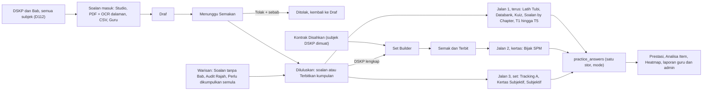

# Aliran kerja Bank Soalan dan Bijak SPM (R1), disahkan

**Status:** versi disahkan dan diperbaiki daripada dokumen Team B (PR #522) pada 4 Nov 2026, sebelum dimuktamadkan dan dilipat ke dalam PRD. Setiap langkah disemak terhadap kod pada tip e34e0a52d (`feature/v3-bijak-r1`), pemerhatian pelayar di UAT dan V3 lokal, tangkapan skrin V2, analisis jurang 4 Nov dan keputusan D112. Pembangunan belum bermula. Tujuh soalan Team B sudah dijawab oleh D112 (lihat "Keputusan (D112)").

**Isi:** 36 proses dan 150 langkah (asal: 29 proses dan 114 langkah; tambahan: 7 proses dan 36 langkah baharu, ditanda [BARU]). Setiap langkah menunjukkan siapa buat, skrin atau API sebenar, keadaan pada e34e0a52d dan UAT, sumber bukti, dan lajur "PRD/kad" yang memaut kepada FR, AC dan kad pelan. Langkah yang diubah ditanda [Ubah A=siapa, R=laluan atau API, S=status, C=isi]; tanda ini boleh dibuang apabila dilipat ke PRD. Senarai penuh perubahan dan buktinya ada dalam fail log pengesahan.

**Rujukan:** PRD di `docs/prd/r1/` (terutama `30-admin-pusat.md` dan `45-question-authoring-flow.md`), pelan `docs/plan/r1-development-plan.md`, cara bekerja `R1-START-HERE.md`. Dokumen ini tidak menggantikan kad pelan. Dalam dokumen ini "Admin Pusat" ialah peranan admin (satu-satunya peranan yang menulis dalam skrin soalan); tiada peranan Penyemak berasingan. Kerja kandungan (Bab, rajah, kumpulan semula, kertas Bijak) dilakukan oleh Admin Pusat dalam skrin (D110). Pembangun UAT yang dilantik hanya menjalankan data dry-run dengan kelulusan pengguna bagi setiap tulis.

## Gambaran besar

Satu stor soalan, tiga jalan ke murid. Kumpulan rangsangan diterbitkan dan dihidangkan sebagai satu unit.

Lapor Soalan pula pulang ke bank: Admin Pusat putuskan, soalan boleh diarkib atau disunting sebagai draf.

## Masalah pendua

Pada kefahaman Team B, kerja sejak 31 Oktober menambah skrin di sebelah skrin yang sudah ada, bukan membaiki skrin itu. PRD menyelesaikannya dengan satu skrin kekal bagi setiap fungsi; fungsinya tidak dibuang. Menu Pentadbiran MUKTAMAD (D107). Senarai pendua penuh (34 entri) ada dalam `V3-DUPLICATES-REGISTER.md`; jadual ini ialah bahagian yang berkaitan Bank Soalan dan Bijak SPM, disahkan terhadap `menu.ts` dan analisis jurang.

| Fungsi | Hari ini | Yang kekal | Yang lain jadi apa |
|---|---|---|---|
| Senarai soalan | BS-01 "Bank Soalan" /admin/questions, BS-08 "Bank Soalan (Studio)" /admin/studio, KS-02 "Bank Soalan SPM" /admin/spm/soalan (tiga nama, satu stor) | Bank Soalan (Studio) | /admin/questions jadi "Senarai Soalan" di bawah Bank Lama (Legasi). /admin/spm/soalan dialih ke /admin/spm/databank selepas jalur KPI, pratonton dan Sunting versi n+1 ada di Studio. |
| Borang soalan | Borang rata lama /admin/questions/create dan /:id/edit, wizard Studio, Sunting Pantas | Wizard Studio (Sunting Pantas kekal untuk laluan SPM, dibaiki) | Borang lama dialih ke Studio. |
| Import | Import & Semakan (BS-02), Senarai Ekstrak (KS-14), skrin sama | Import & Semakan, 3 tab (Kelompok Item, Kertas Diimport, Kiriman Guru) | Muat Naik Kertas, Tulis Soalan Manual, Import CSV dan Kontrak ialah butang, bukan destinasi menu. |
| Barisan semakan | Studio Menunggu Semakan, Baris Gilir Semakan /admin/spm/semakan (dua angka berbeza) | Jubin Menunggu Semakan dalam Studio | Senarai /admin/spm/semakan dialih ke /admin/studio?status=review; ruang kerja semakan /admin/spm/semakan/:key kekal dibuka dari Studio. |
| Kertas | Pembina Kertas /admin/spm/kertas (KS-09), Set Builder /admin/studio/sets (KS-17), satu endpoint | Set Builder | Senarai dan /kertas/baharu dialih. /admin/spm/kertas/:id kekal sebagai Semak Kertas (semak dan Terbit). |
| Kontrak | Item menu KS-08 sendiri | Tiada item menu | Dibuka dari Set Builder dan Semak Kertas. |
| Kualiti, Laporan, Soalan Berstruktur, Kiriman Guru | Item menu atau laluan sendiri | Tab dalam Senarai Soalan dan Import & Semakan | Skrin sama, tempat berubah. |
| Hub SPM murid | /spm/history (Databank), /spm/bijak/sejarah (Bijak), /spm-mock (enjin kedua) | /spm/bijak (satu enjin) | /spm-mock dialih ke /spm/bijak. |

## Maksud status

| Status | Maksud | Asal Team B | Kini (114 asal) | Kini (semua 150) |
|---|---|---|---|---|
| Jalan | Berfungsi, ada bukti ujian. | 25 | 20 | 20 |
| Separuh | Ada, tetapi tidak lengkap atau perlu kerja-keliling. | 39 | 46 | 51 |
| Rosak | Ada, tetapi salah atau melanggar keputusan. | 13 | 16 | 17 |
| Tiada | Belum dibina. | 17 | 18 | 37 |
| Belum diuji | Kod atau PRD ada, belum nampak ia berjalan. | 20 | 14 | 25 |
| Jumlah | | 114 | 114 | 150 |

Sumber: "Uji UAT" dan "Uji lokal" ialah ujian pelayar. "PRD E2E" ialah laporan ujian 3 Nov. "Kod" bermaksud dibaca dalam e34e0a52d. "PRD" bermaksud hanya tulisan PRD. "Data UAT" ialah pertanyaan atau paparan data UAT. Mengikut D110, penerimaan rasmi hanya di UAT, jadi Uji lokal bukan bukti penerimaan. Status "Jalan" untuk data contoh tidak bermaksud UAT sudah ada isinya. Status Rosak juga dipakai untuk langkah yang melanggar keputusan (contoh: Bab belum wajib walaupun D112 mewajibkannya).

## Bahagian A: Asas sebelum soalan

Soalan tidak boleh ditag tanpa bahagian ini.

### A1 Kurikulum dan DSKP

Sediakan Bab, Topik, SP dan TP supaya soalan ada tempat untuk ditag. Mengikut D112, DSKP dimuatkan untuk semua subjek SPM yang ditawarkan, bukan T4 dan T5 sahaja.

Rujukan PRD: R1-ADM-C-01 hingga C-04, U-OP-01, U-OP-03, D109, D112

| # | Siapa | Langkah | Skrin atau API | Status | Sumber | PRD/kad | Catatan |
|---|---|---|---|---|---|---|---|
| A1.1 | Pembangun UAT yang dilantik (D110), dengan kelulusan pengguna bagi setiap tulis | Muat DSKP T4 dan T5 untuk 13 subjek yang sudah ada fail DSKP | `npm run dskp:load (docs/ops/dskp-loader.md)` | Jalan | Data UAT | U-OP-01 · S4-T02, S4-T08 | [Ubah A,C] Team B menemui 2,844 nod, 1,394 TP dan 13 subjek di UAT; dokumen jurang 3-4 Nov menulis 0 nod (dari dokumen, bukan pemerhatian). Dua angka ini perlu didamaikan dengan laporan dry-run pemuat. Di UAT, skrin Tahap Pendidikan menunjukkan subjek hanya dipaut pada T5 (14 subjek); T1 hingga T4 tertulis 0 subjek. |
| A1.2 | Admin Pusat | Semak Bab dan Topik setiap subjek: pilih Subjek dan Tahap, tekan Tapis | `/admin/curriculum` `/admin/curriculum/chapters/create` `/admin/curriculum/topics/create` | Separuh | Data UAT | R1-ADM-C-01 · S4-T07 | [Ubah C] Skrin "Pengurusan Kurikulum" kosong sehingga Subjek dan Tahap dipilih. 686 Bab T4 dan T5 wujud (Team B). Bab T1 hingga T3 belum diketahui (E-03); T1 hingga T3 tertulis 0 subjek. |
| A1.3 | Admin Pusat | Semak senarai Subjek dan penetapan Teras atau Elektif | `/admin/subjects` | Separuh | Data UAT | R1-ADM-C-02 · S4-T07 | [Ubah S; dahulu Belum diuji] "Pengurusan Subjek": 33 subjek, 31 aktif, 7 teras; skrin jalan. Setiap baris papar "Tingkatan 5" sahaja, jadi pemilih Subjek pada T4 perlu diuji di Studio. |
| A1.4 | Admin Pusat (togol Aktif); pembangun UAT jika perlu data | Matikan Darjah 1 hingga 6 supaya hanya Tingkatan 1 hingga 5 aktif | `/admin/education-levels` | Separuh | Data UAT | R1-ADM-C-03, D96 · S4-T05 | [Ubah S; dahulu Rosak] Senarai admin UAT sudah papar 5 tahap (T1 hingga T5, semua aktif). Statistik awam masih dilaporkan 11 tahap (dokumen jurang 3-4 Nov); percanggahan belum diselesaikan, perlu semak laman awam. |
| A1.5 | Pembangun UAT (jalankan dry-run), Admin Pusat (semak dan sahkan) | Bina DSKP T1 hingga T3 daripada Bab dan Topik sedia ada | skrip dry-run S4-T09; Admin Pusat sahkan di /admin/curriculum | Tiada | PRD | D109, U-OP-03 · S4-T09, S4-T07 | [Ubah A] Sebelum siap, soalan T1 hingga T3 diluluskan tanpa tag (lihat C1.4). UAT ada 73,179 / 77,781 / 100,140 soalan T1 / T2 / T3. |
| A1.6 | Pembangun UAT (D110) | Muat DSKP baki lebih kurang 20 subjek SPM yang belum ada nod (Kimia, Biologi, Geografi, Perniagaan, Prinsip Perakaunan, Ekonomi dan lain-lain) daripada dokumen DSKP rasmi KPM | `npm run dskp:load (laporan dry-run dahulu)` | Tiada | PRD | D112 · S4-T02 | [BARU] BARU. Sehingga dimuatkan, SP dan TP hanya wajib jika nod DSKP wujud (A1.7) dan Kontrak tidak boleh dibuat (E1.2). |
| A1.7 | Sistem | SP dan TP diwajibkan hanya apabila nod DSKP wujud bagi Subjek dan Tingkatan itu; Bab diwajibkan hanya apabila Subjek dan Tingkatan ada Bab | `apps/api/src/modules/questions/publish-gate.ts:26-34 (checkTagGate)` | Rosak | Kod | FR-ADM-QE4.5, QE4.6, D112 · S1-T02, S4-T02 | [BARU] BARU. Kod meminta unit dan SP untuk setiap kelulusan tanpa syarat. Subjek tanpa nod (dan T1 hingga T3) tidak boleh Terbit sama sekali. |

> Mengikut D112, subjek tanpa nod DSKP (kira-kira 20, termasuk Kimia, Biologi, Geografi, Perniagaan, Prinsip Perakaunan dan Ekonomi) mendapat DSKP daripada dokumen rasmi KPM melalui kad S4-T02. Sehingga dimuatkan, SP dan TP wajib hanya bila nod wujud, dan Kontrak hanya untuk subjek yang DSKP-nya dimuatkan.

## Bahagian B: Soalan masuk

Pintu masuk: wizard Studio, kumpulan rangsangan, PDF, CSV dan kiriman guru, serta editor skema dan borang mengikut mod jawapan. Semuanya berakhir sebagai Draf; tiada yang terus kepada murid.

### B1 Tulis satu soalan dalam Studio

Jalan utama V2 untuk cipta soalan. V2 meminta Kertas dahulu dan senarai "Bab"nya sebenarnya ayat SP; V3 mengumpul tag DSKP dahulu.

Rujukan PRD: R1-ADM-QE-03, QE-04, Q-04, 45 bahagian 2

| # | Siapa | Langkah | Skrin atau API | Status | Sumber | PRD/kad | Catatan |
|---|---|---|---|---|---|---|---|
| B1.1 | Admin Pusat | Tekan Cipta baharu dan pilih Soalan tunggal atau Kumpulan rangsangan | `/admin/studio/questions/create` `/admin/studio/questions/:id/sunting` | Separuh | Kod | FR-ADM-QE3.1, FD-QE-1 · S2-T01 | [Ubah R] Wizard wujud (butang "Cipta baharu"). Pilihan dua hala Soalan tunggal atau Kumpulan rangsangan belum ada; kumpulan dicipta dari halaman kumpulan. Laluan sunting ialah /sunting (laluan V2 /edit ialah alias). |
| B1.2 | Admin Pusat | Isi tag dahulu mengikut susunan DSKP: Subjek, Tingkatan, Tajuk DSKP, SP (1 hingga 3), TP dan aras pemikiran bagi setiap bahagian, KBAT, kemudian Bab. Tahap kesukaran (1 hingga 5) ialah medan berasingan | Tab "Tag" wizard | Separuh | PRD | FR-ADM-QE3.1, QE3.7 (D-A6), AC-QE3.1 · S2-T01, S1-T02 | [Ubah C] Susunan lama V2 meminta Kertas dahulu. Susunan tab selepas pindah belum dinyatakan. Pemilih Bab ialah Bab buku teks (bukan Tajuk DSKP). |
| B1.3 | Admin Pusat | Pilih Kertas (1 hingga 4) dan Bahagian, atau simpan sebagai soalan bank | Tab "Kertas" wizard | Jalan | PRD E2E | FR-ADM-QE3.1, D-QA-10, DM-08 · S2-T01 | [Ubah C] Kertas ialah 1 hingga 4 (kontrak API 4.1 masih tulis 1 hingga 3, perlu dibetulkan). Kertas wajib hanya untuk soalan terikat SPM (T4 dan T5). |
| B1.4 | Admin Pusat | Isi sub-bahagian: jenis soalan, jenis jawapan, markah, kunci dan skema | Tab "Sub-bahagian" wizard | Separuh | Kod | FR-ADM-QE3.2, FD-QE-2, AC-ADM-QE3.2, 45 §2.3 · S1-T09, S2-T01 | [Ubah C] 8 jenis soalan (bukan 14 mod V2). Aneka pilihan 2 hingga 8 pilihan (kod hari ini minimum 3: parts.ts:182). Markah bahagian mesti sama dengan jumlah poin skema (publish-gate.ts:65). Penyunting skema penuh belum ada (lihat B6). |
| B1.5 | Admin Pusat | Baca panel belum lengkap yang menamakan setiap medan | `GET /api/questions/:id/gate-check` | Separuh | Kod | FR-ADM-QE4.4, Q-04 · S1-T02 | API wujud (lifecycle.controller.ts:32). Skrin hanya tunjuk bilangan ("5 belum lengkap"), tidak menamakan medan. |
| B1.6 | Admin Pusat | Tekan Simpan draf | `POST /api/questions` | Jalan | PRD E2E | FR-ADM-QE4, Q-04 · S2-T01 | Status jadi Draf. Murid tidak nampak ("Belum dipaparkan kepada pelajar"). |
| B1.7 | Admin Pusat | Pulihkan atau buang draf yang belum disimpan apabila membuka wizard semula | Sepanduk "Pulihkan" / "Buang" (lib/studio/recovery.ts) | Belum diuji | Kod | Q-04 (V09) · S2-T01 | [BARU] BARU. Fungsi V2 wujud dalam kod, belum diuji pelayar. |

### B2 Tulis kumpulan rangsangan

Satu rajah, petikan atau jadual dikongsi 1 hingga n soalan (D90, D108). Satu kumpulan boleh ada 1 hingga 3 rangsangan. Rangsangan bukan soalan dan tidak pernah dipisahkan daripada ahlinya.

Rujukan PRD: R1-ADM-QE-01, QE-02, Q-05, 45 bahagian 2.4

| # | Siapa | Langkah | Skrin atau API | Status | Sumber | PRD/kad | Catatan |
|---|---|---|---|---|---|---|---|
| B2.1 | Admin Pusat | Cipta kumpulan, isi Label, Jenis, Kapsyen, Teks alternatif, Sumber, dan muat naik rangsangan sekali | `/admin/studio/groups/:id` `POST /api/stimulus-groups` | Separuh | Uji lokal | FR-ADM-QE1, QE2.1, Q-05, D90 · S1-T01, S2-T01 | [Ubah C] Skrin jalan dan gambar sampai kepada murid. Tiada pautan dari halaman soalan, editor di situ terkunci. Tujuh jenis rangsangan (Petikan, Rajah, Jadual, Graf, Peta, Carta atau Infografik, Imej); had 1 hingga 3 rangsangan. |
| B2.2 | Admin Pusat | Tambah soalan 1, 2, 3 tanpa muat naik semula | `POST /api/stimulus-groups/:id/questions` `POST /api/stimulus-groups/:id/members` | Belum diuji | Kod | FR-ADM-QE2.3, API-Q-08 · S1-T01 | [Ubah R] Kedua-dua laluan wujud (stimuli.controller.ts:135, 174). Belum diuji pelayar. |
| B2.3 | Admin Pusat | Susun dengan Naik dan Turun, buang atau pautkan ahli, pindah ke kumpulan lain | `PUT /api/stimulus-groups/:id/members/order` `DELETE /api/stimulus-groups/:id/members/:questionId` | Belum diuji | Kod | FR-ADM-QE2.3, Q-05 · S1-T01 | [Ubah C] Belum diuji. Pindah terus antara kumpulan tiada: kod menjawab memberTaken (group-members.ts:130-136); mesti buang kemudian tambah, dan disekat jika ahli sedang disajikan. |
| B2.4 | Sistem | Benarkan kumpulan 1 soalan dalam kertas (D108 butir 1) | `packages/contract/src/questions/stimuli.ts:41` | Rosak | Kod | D108(1), FR-X1-4, AC-QE7.3 · S1-T06 | Kod masih tolak: "Kumpulan perlu sekurang-kurangnya 2 soalan." (stimuli.ts:41, builder.service.ts:1207); amaran smallGroup juga bercanggah (group-members.ts:41). Jadual satu soalan gagal Terbit. |

### B3 Muat naik kertas PDF

Tukar kertas sebenar kepada soalan draf dan, mengikut PRD, satu kertas draf. Pengekstrakan guna OCR Tesseract dalaman dan peraturan, tanpa AI luar (D112); admin sentiasa menyemak sebelum apa-apa Terbit.

Rujukan PRD: R1-ADM-QE-05, Q-07, Q-08, Q-09, D112

| # | Siapa | Langkah | Skrin atau API | Status | Sumber | PRD/kad | Catatan |
|---|---|---|---|---|---|---|---|
| B3.1 | Admin Pusat | Isi Subjek, Tingkatan, Kertas, Tahun, Negeri atau badan, Jenis, Set, Kod, Sumber dan Status hak cipta (sekali bagi satu kelompok), serta skema PDF pilihan | `/admin/spm/soalan/muat-naik` | Separuh | Uji UAT | FR-ADM-QE5, Q-07, Q-08, D99 · S2-T02, S1-T03 | [Ubah C] Borang jalan di UAT. Ujian lokal: hanya 6 subjek boleh dipilih. Kertas yang dipilih tidak dibawa ke soalan (E2E F2). Menu: "Muat Naik Kertas". |
| B3.2 | Sistem | Baca PDF dengan OCR Tesseract dalaman dan ekstrak soalan mengikut peraturan (nombor soalan, Rajah, Jadual, Petikan, Sumber) | `POST /api/intake/batches/:id/extract` | Separuh | Uji UAT | FR-ADM-QE5, U-OP-02 (D112), AC-ADM-Q18.1 · S0-T03, S1-T03 | [Ubah C] Jalan di UAT dengan OCR dan AI mock. D112: Tesseract sebenar (OCR_ENGINE=tesseract), tiada AI luar; mock hanya dalam ujian CI. |
| B3.3 | Sistem | Tamat dengan Selesai atau Gagal beserta sebab, ada Cuba lagi | tab Kelompok Item | Rosak | Uji lokal | FR-ADM-Q07.x · S1-T04 | [Ubah S; dahulu Belum diuji] Ekstrak tersangkut "Sedang diproses" melebihi 2 minit tanpa ralat atau tamat masa (JOBS_WORKER_ENABLED=false, OCR_ENGINE=none). Kad S1-T04 ialah pembaikan ini. |
| B3.4 | Sistem | Jadikan rajah objek rangsangan dan pautkan kepada semua soalan yang menyebutnya, dalam satu kumpulan | `apps/api/src/modules/intake/workflow/figure-links.ts` | Separuh | Uji lokal | FR-X1-4, FR-QA-12 (45), G7 · S1-T03 | [Ubah C] Rajah dipaut ikut nombor ("Rajah 3"); rujukan tanpa nombor ("Rajah di atas", "Maklumat di bawah", "Sumber") tidak dikesan dan satu soalan hanya masuk satu kumpulan (memberTaken). Jadual tidak dipaut. Rajah tanpa imej menyekat Hantar (gate.ts:92) dan tiada butang muat naik imej; muat naik dibuat di Audit Rajah (D7). |
| B3.5 | Admin Pusat | Semak satu per satu: Sumber PDF di kiri; Terima, Tolak, Simpan Sunting | `/admin/spm/soalan/ekstrak/:batchId` `PATCH /api/intake/items/:id` `POST /api/intake/items/:id/accept` `POST /api/intake/items/:id/reject` | Jalan | Uji UAT | FR-ADM-Q09.1 hingga Q09.5, FR-ADM-QE5.4, Q-09 · S2-T02 | [Ubah R,C] Halaman V2 ini tidak pernah dirakam (E-21), jadi spesifikasi ikut kod V2 (Item i/n, "Terima semua yang belum disemak", Terima (A), Tolak (R), Simpan Sunting (E)). Tindakan Tolak pada rangsangan atau ahli belum ditakrif (Q-09.5). |
| B3.6 | Admin Pusat | Laras julat kumpulan, contoh Rajah 3 kepada soalan 5 hingga 8 | `POST /api/intake/stimuli/:id/link-references` | Belum diuji | Kod | FR-ADM-QE5.4 · S2-T02 | [Ubah R] Laluan wujud (intake-workflow.controller.ts:103). Skrin belum diuji. |
| B3.7 | Admin Pusat | Tag Unit, SP dan TP setiap bahagian; pilih Bab apabila Subjek dan Tingkatan ada Bab | Panel tag skrin Semak Ekstrak | Separuh | Uji UAT | FR-ADM-Q09, QE3.1, D-A5 · S1-T03, S2-T02 | [Ubah S; dahulu Jalan] A4 sahkan Unit, SP dan TP tersimpan di UAT. Tiada medan Bab di skrin ini; D112 mewajibkan Bab bila ada, jadi setiap soalan yang diterima akan gagal Terbit. |
| B3.8 | Admin Pusat | Tekan Terima, soalan draf dicipta | `POST /api/intake/items/:id/accept (to-question.ts)` | Separuh | Uji lokal | FR-ADM-Q09, Q-09 · S1-T03, S1-T09 | [Ubah C] Penukar mengendalikan match_letter dan table_fill (to-question.ts:115-126); dakwaan "tidak boleh diterima" belum dapat disahkan dan mungkin berpunca daripada penyunting item. short_text dan numeric dengan skema poin gagal jika tiada jawapan akhir. Kapsyen hilang. |
| B3.9 | Admin Pusat (tekan Hantar untuk semakan); Sistem cipta kertas draf | Hantar untuk semakan: sistem cipta kertas draf ikut Bahagian dan susunan; tab Kertas Diimport dengan Semak dan Terbit | `POST /api/intake/batches/:id/paper` | Tiada | Kod | FR-ADM-Q07.6, API-Q-25 · S1-T10 | Tiada dalam kod (tiada laluan /batches/:id/paper). Tab Kertas Diimport juga tiada; V2 menunjukkannya kosong. |

> Selepas Terima: soalan berstruktur bermarkah tidak boleh disunting lagi dalam Studio (draft.ts:352). Pembetulan memerlukan penyunting skema (B6) dan borang mengikut mod (B7).

### B4 Import CSV

Masukkan banyak soalan sekali gus. Menjadi butang "Import CSV" dan sejarah import.

Rujukan PRD: R1-ADM-QE-06, Q-11

| # | Siapa | Langkah | Skrin atau API | Status | Sumber | PRD/kad | Catatan |
|---|---|---|---|---|---|---|---|
| B4.1 | Admin Pusat | Muat naik CSV | `/admin/questions/import` `/admin/questions/import-history` | Separuh | Uji lokal | FR-ADM-QE6, Q-11 · S1-T05, S2-T05 | [Ubah R] Jalan: "Import selesai: 2 soalan diimport, 0 gagal." Tiada lajur DSKP, Bab, kesukaran, kertas atau group_key; templat guna ID mentah. Soalan perlu disunting tangan. |
| B4.2 | Sistem | Tolak baris salah beserta nombor baris, simpan baris sah sebagai Draf | `POST /api/question-imports` | Belum diuji | Uji lokal | FR-ADM-QE6.1, Q-11 · S1-T05 | Lajur salah ditolak dengan mesej "Fail CSV mesti mempunyai kolum ...". Penolakan baris demi baris belum diuji. |
| B4.3 | Admin Pusat | Terbitkan tanpa buka wizard jika semua lajur lengkap | tiada | Tiada | PRD | FR-ADM-QE6 · S1-T05 | Bergantung pada lajur baharu. Hari ini soalan CSV tidak boleh Terbit (4 sebab: unit, SP, aras, kertas). |

### B5 Kiriman Guru

Guru sumbang soalan atau kertas, Admin Pusat lengkapkan dan terbitkan. Guru hanya menghantar dan melihat status.

Rujukan PRD: R1-ADM-Q-12, R1-GUR-44, AC-CHAIN-6

| # | Siapa | Langkah | Skrin atau API | Status | Sumber | PRD/kad | Catatan |
|---|---|---|---|---|---|---|---|
| B5.1 | Guru | Hantar satu soalan, guru nampak Menunggu Semakan | `/guru/soalan/cipta` `POST /api/guru/questions` | Jalan | PRD E2E | R1-GUR-44, Q-12 · S1-T08 | [Ubah R] Masuk Studio sebagai Menunggu Semakan (bukan dalam Baris Gilir Semakan lama). |
| B5.2 | Guru | Hantar kertas PDF | `POST /api/guru/question-papers` | Rosak | Kod | R1-GUR-44, Q-12 · S1-T08, S6-T06 | Balas 503. provideIntake tidak pernah dipanggil (question-sets.ports.ts:46, 63). |
| B5.3 | Admin Pusat | Buka tab Kiriman Guru: jumlah, Pending, Processing, Selesai, penapis status, jadual Guru atau Sekolah, Tajuk, Fail, Status, Tarikh | `/admin/question-submissions` | Rosak | Uji lokal | Q-12 · S1-T08, S2-T02 | [Ubah C] Papar "Fungsi ini belum tersedia dalam demo"; BE /api/question-submissions tiada dan tiada dalam menu. V2: kad Jumlah, Pending, Processing, Selesai; status Pending, Processing, Selesai, Ditolak; kosong: "Tiada kertas soalan dihantar oleh guru lagi." |
| B5.4 | Admin Pusat | Buka dalam wizard yang telah terisi, lengkapkan DSKP, Terbitkan | Studio wizard | Separuh | PRD | Q-12.6 · S2-T02 | Terbitkan biasa jalan. Isian awal belum diuji. |
| B5.5 | Guru | Nampak Diluluskan (guru sudah boleh melihat status) | skrin Sumbang Soalan guru | Belum diuji | PRD | AC-CHAIN-6 · S1-T08 | [Ubah C] Belum diuji. |
| B5.6 | Guru | Nampak Ditolak beserta sebab | skrin Sumbang Soalan guru | Tiada | Kod | AC-CHAIN-6, DM-58 (45) | [BARU] BARU. Status Ditolak dan sebab belum wujud dalam kod (lihat C2). |

### B6 Editor skema pemarkahan

BARU. Tanpa editor skema, kertas berstruktur (K2) tidak boleh dimasukkan dengan setia. D-QA-3: editor penuh dibina dalam R1. Kunci mata ada dalam kontrak (working, drawing, essay) tetapi Studio tidak boleh menyuntingnya (draft.ts:352).

Rujukan PRD: D-QA-3, 45 bahagian 3.1.7, API-Q-30, DM-54, G-01

| # | Siapa | Langkah | Skrin atau API | Status | Sumber | PRD/kad | Catatan |
|---|---|---|---|---|---|---|---|
| B6.1 | Admin Pusat | Buka tab Jawapan atau Skema pemarkahan bagi satu bahagian; chip "{n} markah skema / {m} markah bahagian" dan sekatan Hantar jika tidak sama | tab Skema pemarkahan wizard | Separuh | Kod | D-QA-3, G-01 · S2-T01, S1-T09 | [BARU] Sekatan jumlah ada dalam kod ("Jumlah markah tidak sepadan dengan skema." publish-gate.ts:65); antaramuka penyunting belum ada. |
| B6.2 | Admin Pusat | Isi mata skema: Kod (K, N, P, B, M, F, C), Markah, Teks, Jawapan diterima (@), Mesti ada semua (&), Dilihat, Tersirat, Bergantung pada (pelbagai), Tidak diterima, Unit, Toleransi | penyunting skema | Tiada | PRD | G-01, API-Q-30 · S2-T01 | [BARU] Skema bahasa Matematik dan Fizik K2 bergantung pada nota ini (contoh: "Mesti tunjuk operasi", "dilihat"). |
| B6.3 | Admin Pusat | Kumpulan mata: Mana-mana N daripada M, had maksimum kumpulan, bonus jika semua betul, pasangan Ciri dan Sebab, kaedah alternatif (ATAU) | penyunting skema | Tiada | PRD | G-01 · S2-T01 | [BARU] Contoh Fizik 9(d) dan Sejarah Aras (maksimum 4). |
| B6.4 | Admin Pusat | Rubrik band keseluruhan atau markah setiap kriteria (BI Kertas 2: Content, Communicative Achievement, Organisation, Language) dan potongan peringkat soalan (salin = 0, tolak 1 setiap kesilapan) | penyunting skema | Tiada | PRD | G-01, G-03, DM-54 · S2-T01 | [BARU] BM K1 dan BI K2 tidak boleh dimarkah dengan setia tanpa ini. |
| B6.5 | Admin Pusat | Jawapan model, Panduan pemarkah dan Kesilapan lazim (staf sahaja) | penyunting skema | Tiada | PRD | G-01 · S2-T01 | [BARU] Tidak dipaparkan kepada murid. |

### B7 Dwibahasa dan borang mengikut mod jawapan

BARU. Kertas sebenar (Matematik, Mat Tambahan, Fizik) dwibahasa; mod lukisan dan isi jadual dibenarkan dengan swa-markah (D-QA-2); esei pilih satu dihidangkan (D-QA-4).

Rujukan PRD: D-QA-1, D-QA-2, D-QA-4, 45 bahagian 2.7 dan 3.1.5-3.1.6, G-02..G-14

| # | Siapa | Langkah | Skrin atau API | Status | Sumber | PRD/kad | Catatan |
|---|---|---|---|---|---|---|---|
| B7.1 | Admin Pusat | Pilih Bahasa soalan (Bahasa Melayu, English, BM + English dwibahasa); setiap medan teks papar dua penyunting BM dan English | medan "Bahasa soalan" wizard | Tiada | PRD | D-QA-1, G-07 · S2-T01, S8-T02 | [BARU] Kontrak hanya ada teks { ms, en? } pada bahagian; ERD stem_ms dan body_ms tiada _en; wizard tiada medan. Murid nampak BM di atas English seperti bercetak. |
| B7.2 | Admin Pusat | Aneka pilihan: 2 hingga 8 pilihan, satu betul (atau berbilang), Betul atau Salah, pilihan bergambar | jenis Aneka Pilihan | Separuh | Kod | FR-ADM-QE3.2, D-QA-10 · S1-T09 | [BARU] Kontrak minimum 3 pilihan (parts.ts:182); Betul atau Salah memerlukan 2. Kunci dengan dua pilihan diterima (G-14) belum ada. |
| B7.3 | Admin Pusat | Lukisan atau Graf dan Isi Jadual: templat jawapan, senarai semak markah, sel kosong dan kunci | jenis Lukisan / Graf dan Isi Jadual | Tiada | PRD | D-QA-2, G-13 · S1-T09, S8-T03 | [BARU] Mod drawing dan table_fill wujud dalam kontrak; borang admin dan widget murid table_fill belum ada. Tanpa ini Matematik K2, Fizik K2 dan Mat Tambahan K2 tidak boleh diduduki. |
| B7.4 | Admin Pusat | Esei: julat patah perkataan (min, max), Had keras; esei pilih satu daripada 2 hingga 6 tajuk | jenis Karangan / Respons Terbuka | Separuh | Kod | D-QA-4, G-02, G-01b · S1-T09, S8-T03 | [BARU] essay_choice wujud dalam kontrak (topics 2 hingga 6). Medan Had perkataan V2 dan julat belum ada dalam wizard. |
| B7.5 | Admin Pusat | Bank pilihan A hingga H dengan teks, gambar dan pengganggu; Rangsangan peringkat bahagian ("Bahan 2"); ruang kosong sebaris {{gap:N}} | skrin kumpulan; baris sub-bahagian | Tiada | PRD | G-04, G-08, G-09 · S1-T09, S8-T03 | [BARU] Diperlukan oleh BI Bahagian 4 dan 5, Sejarah 5(c) dan BM K2 Bahan 1 hingga 3. |
| B7.6 | Admin Pusat | Format teks kaya: garis bawah, garis tengah, baris puisi, dua lajur, kotak "Sumber" | penyunting teks kaya | Tiada | PRD | G-05 · S2-T01 | [BARU] Bar alat hari ini: B, I, senarai, kod, jadual, matematik. |

## Bahagian C: Semakan dan terbitan soalan

Satu kitar hayat untuk semua soalan, dari mana pun datangnya: Draf, Menunggu Semakan, Diluluskan, Ditolak, Diarkibkan.

### C1 Dari Draf ke Diluluskan

Diluluskan bermaksud murid boleh dapat soalan ini (D80, D85). Label status ikut V2: Draf, Menunggu Semakan, Diluluskan, Ditolak, Diarkibkan. Hanya Admin Pusat meluluskan.

Rujukan PRD: R1-ADM-QE-04, Q-03, Q-04, Q-06, 45 bahagian 2.8

| # | Siapa | Langkah | Skrin atau API | Status | Sumber | PRD/kad | Catatan |
|---|---|---|---|---|---|---|---|
| C1.1 | Admin Pusat | Hantar untuk semakan. Syarat: medan wajib, subjek, tahap, tiada bendera duplikat | `POST /api/questions/:id/status` | Separuh | Uji lokal | FR-ADM-QE4, Q-04 · S1-T02, S2-T01 | Jalan, tetapi satu per satu selepas Terima, dan skrin tidak beritahu langkah ini masih perlu. Bendera duplikat menyekat tanpa skrin penyelesaian. |
| C1.2 | Admin Pusat | Lihat satu barisan Menunggu Semakan | `/admin/studio?status=review` | Separuh | Uji lokal | Q-03, FR-Q03.6 · S2-T03 | [Ubah A,R,C] Hari ini dua barisan berlainan angka (Studio 3, Baris Gilir Semakan 0). Nilai penapis sebenar ialah review. Label "Diterbitkan" masih dipakai di Studio; V2 dan PRD guna "Diluluskan". |
| C1.3 | Admin Pusat | Terbitkan. Syarat: kunci dan skema, Unit, SP, TP dan aras setiap bahagian, Kertas (soalan terikat SPM), Bab (jika wujud) | `POST /api/questions/:id/status` | Jalan | Uji lokal | FR-ADM-QE4.4, Q-04 · S1-T02 | [Ubah A] T4 dan T5 yang lengkap sampai kepada murid (E2E F1). Terbit pertama ditolak 422 dengan senarai medan. Belum ada Terbit baharu di UAT. |
| C1.4 | Sistem | Benarkan T1 hingga T3 lulus tanpa tag DSKP | `apps/api/src/modules/questions/publish-gate.ts:26-34 (checkTagGate)` | Rosak | Kod | D109, D101, D80 · S1-T02 | [Ubah R] checkTagGate meminta unit dan SP untuk setiap kelulusan; kebenaran tanpa tag hanya untuk soalan lama yang tidak disentuh (dskp-gate.ts). D109 mahu T1 hingga T3 lulus. |
| C1.5 | Sistem | Wajibkan Bab jika subjek dan tingkatan ada Bab (D112, D-A5) | `apps/api/src/modules/questions/workflow/lifecycle/gates.ts:36-41 (submitGate)` | Rosak | Kod | FR-ADM-QE4.5, D-A5, D112 · S1-T02 | [Ubah C] Kod ikut Q17 dan tidak meminta Bab. Keputusan D112 menggantikan Q17: Bab wajib bila wujud. |
| C1.6 | Admin Pusat | Baca "Dilihat murid di n daripada 6 aktiviti" beserta sebab | `POST /api/admin/servability/questions/batch` `GET /api/admin/servability/questions/:id` | Separuh | Uji UAT | R1-B11, Q-03 · S1-T07 | [Ubah C,R] Kod ada 6 aktiviti (Databank, Latih Tubi SPM, Latihan Bab, Simulasi kertas, Simulasi Kuiz, Jana Kertas); UAT papar 0 daripada 6 pada setiap baris walaupun Latih Tubi menyajikan soalan T5. PRD dan Team B tulis 7. Penunjuk tidak boleh dipercayai. |
| C1.7 | Admin Pusat | Sunting soalan Diluluskan melalui Edit sebagai draf (versi n+1) | `POST /api/questions/:id/edit-as-draft` | Jalan | Uji lokal | Q-03.3, 45 §2.10 · S2-T01 | [Ubah R] MCQ jalan: v1 kekal sehingga v2 terbit. Soalan berstruktur bermarkah tiada jalan sunting (lihat E6.2). |
| C1.8 | Sistem | Halang Terbit soalan yang menyebut "Rajah n" tetapi tiada rangsangan, atau yang hanya mengandungi rangsangan | bendera stimulus_missing dan figure_only | Tiada | Kod | FR-QA-12 (45), QE4.2, G7.1 · S1-T07 | [BARU] BARU. Bendera hanya wujud dalam gate intake (intake/workflow/gate.ts:89). Soalan bank tidak disekat; penunjuk "Dilihat murid" tidak memilikinya. |

### C2 Tolak dengan sebab

BARU. Ditolak ialah Draf dengan sebab (4 status tersimpan); sebab 5 hingga 500 aksara.

Rujukan PRD: 45 bahagian 2.8, DM-58, R1-GUR-44, AC-CHAIN-6

| # | Siapa | Langkah | Skrin atau API | Status | Sumber | PRD/kad | Catatan |
|---|---|---|---|---|---|---|---|
| C2.1 | Admin Pusat | Tekan Tolak pada soalan Menunggu Semakan dan isi sebab | `POST /api/questions/:id/status (tolak)` | Tiada | Kod | DM-58 · kad belum dipetakan (cadangan S1-T02) | [BARU] Tiada rejection_reason dalam apps, packages dan src. |
| C2.2 | Sistem | Maklumkan pemilik (guru) dan papar sebab | skrin Sumbang Soalan guru | Tiada | PRD | AC-CHAIN-6 | [BARU] Lihat B5.6. |
| C2.3 | Admin Pusat | Sunting soalan Ditolak, atau Hantar untuk semakan semula (sebab dikosongkan) | Studio wizard | Tiada | PRD | DM-58 | [BARU] Bergantung pada C2.1. |

### C3 Kumpulan rangsangan sebagai satu unit

BARU. Kumpulan diterbitkan, dihidangkan, disunting dan diarkibkan sebagai SATU unit (D-QA-5, B1 hingga B3). Hari ini setiap soalan diluluskan seorang demi seorang dan murid boleh mendapat kumpulan separa.

Rujukan PRD: D-QA-5, FR-QA-02, API-Q-31 hingga Q-33, DM-51, AC-QE7.3

| # | Siapa | Langkah | Skrin atau API | Status | Sumber | PRD/kad | Catatan |
|---|---|---|---|---|---|---|---|
| C3.1 | Admin Pusat | Tekan Terbitkan kumpulan: semua ahli diluluskan dalam satu transaksi; Terbitkan setiap ahli dilumpuhkan | `POST /api/stimulus-groups/:id/publish (baharu)` | Tiada | Kod | D-QA-5, FR-QA-02, API-Q-31 · S1-T01, S1-T07 | [BARU] Kod melulus soalan satu per satu dan membenarkan menambah ahli draf semasa ahli pertama sudah disajikan (group-members.ts header). Murid boleh mendapat kumpulan 1 daripada 4. |
| C3.2 | Sistem | Kumpulan belum lengkap tidak dihidangkan di mana-mana (7 permukaan); setiap ahli papar "Kumpulan belum lengkap - {n} soalan belum diluluskan." | serving/rules.ts (group_servable) | Tiada | Kod | D-QA-5, AC-QE7.3 · S1-T07 | [BARU] Kod hari ini mengecualikan soalan berkumpulan daripada Latih Tubi, Databank dan Bab (has_stimulus, rules.ts:81); tiada kebolehhidangan peringkat kumpulan. |
| C3.3 | Admin Pusat | Sunting kumpulan yang sudah terbit melalui salinan draf; Terbitkan kumpulan menukar secara atomik | `POST /api/stimulus-groups/:id/edit-as-draft (baharu)` | Tiada | Kod | D-QA-5, API-Q-32, DM-51 · S1-T01 | [BARU] Kod menjawab 409 groupServed atau stimulusServed bila ada ahli disajikan (group-members.ts:46, 68, 135). Tanpa laluan draf, AC-QE1.2 dan AC-Q05.1 tidak boleh dilulus. |
| C3.4 | Admin Pusat | Arkibkan kumpulan: semua ahli diarkibkan bersama | Tindakan Arkibkan kumpulan | Tiada | PRD | D-QA-5, 45 §2.9 · S1-T01 | [BARU] Murid dalam percubaan kekal pada versi tersemat (pin-servable.ts). |

## Bahagian D: Urus bank soalan

Kerja harian dan kerja data selepas soalan ada dalam bank.

### D1 Satu menu Soalan

Hapuskan pendua tanpa hilang fungsi (D107). Menu ialah MUKTAMAD (D107).

Rujukan PRD: PRD 30 bahagian 3.2 dan 3.3, M-01 hingga M-11 (V3-DUPLICATES-REGISTER)

| # | Siapa | Langkah | Skrin atau API | Status | Sumber | PRD/kad | Catatan |
|---|---|---|---|---|---|---|---|
| D1.1 | Pembangun | Ubah menu kepada 8 item di bawah kumpulan Soalan, redirect laluan lama, dan simpan Kontrak sebagai butang (bukan item menu) | `src/shells/pentadbiran/menu.ts` | Tiada | Kod | D107, URS-ADM-32 · S0-T07, S2-T03 | Hari ini 3 nama "Bank Soalan": BS-01 /admin/questions (:95), BS-08 Studio /admin/studio (:103), KS-02 /admin/spm/soalan (:116); 2 senarai kertas (KS-09 Pembina Kertas, KS-17 Set Builder); 2 baris gilir; BS-02 dan KS-14 ialah skrin sama. |

### D2 Senarai dan tindakan pukal

Cari, tapis dan tindak ke atas soalan di Studio (senarai kanonik).

Rujukan PRD: R1-ADM-Q-03, Q-20, Q-21

| # | Siapa | Langkah | Skrin atau API | Status | Sumber | PRD/kad | Catatan |
|---|---|---|---|---|---|---|---|
| D2.1 | Admin Pusat | Tapis ikut Subjek, Status, Tahun, Negeri atau badan, Kertas, Jenis; Tapis dan Set Semula | `/admin/studio` | Separuh | Uji UAT | Q-03, FR-Q03 · S2-T01 | [Ubah C] Status, subjek, jenis dan carian teks jalan. Carian ikut ID soalan beri 0. Senarai SPM berhenti pada 50 baris setiap subjek tanpa notis. Tahun dan Negeri ialah kotak teks bebas. |
| D2.2 | Admin Pusat | Tapis ikut Tingkatan, Bab, Tajuk DSKP | `/admin/studio (belum)` `/admin/questions (Semua Tahap sahaja)` | Tiada | Uji UAT | Q-03.7, FR-ADM-Q03.7 · S2-T01, S2-T08 | [Ubah S; dahulu Separuh] Studio tiada penapis Tingkatan, Bab atau DSKP; senarai lama ada "Semua Tahap" dan "Lagi Penapis" (Source dan Compliance kosong). Perlu bagi kerja Soalan tanpa Bab (D3). |
| D2.3 | Admin Pusat | Hantar untuk semakan, Luluskan atau Arkib secara pukal, atau atas hasil tapisan (Luluskan Hasil Tapisan, Arkib Semua) | `POST /api/questions/bulk-action` `POST /api/questions/bulk-action/filter` | Belum diuji | Kod | Q-20, Q-21 · S2-T06 | [Ubah R] Kedua-dua API wujud (admin.controller.ts:75, 93; dryRun dan expectedCount, had satu larian). Senarai lama UAT ada butang V2 yang sama. Tidak diuji. |
| D2.4 | Admin Pusat | Arkib dan Pulihkan sebagai draf, dengan amaran kertas Terbit yang terjejas | `POST /api/questions/:id/status` | Separuh | Uji lokal | Q-03.4, Q-21 · S2-T06 | Jalan. Pulih melalui draf, semakan, terbit. Kertas terjejas beri 403 tetapi butang Mula masih ada. Arkib pukal tiada amaran. |
| D2.5 | Admin Pusat | Buka tab Kualiti Soalan dan Laporan | `/admin/questions/quality` `/admin/question-reports` | Belum diuji | Uji lokal | Q-21, Q-22 · S2-T06 | [BARU] BARU. Halaman dibuka dalam sapuan; fungsi belum diuji. Angka kualiti V2 bercanggah; V3 mengira. |

### D3 Tetapkan Bab secara pukal (Soalan tanpa Bab)

Admin Pusat memilih Bab sendiri; tiada pemetaan automatik (D89). Ini kerja kandungan oleh Admin Pusat dalam skrin (D110), bukan kerja pembangun.

Rujukan PRD: R1-ADM-C-05, FR-ADM-Q03.7, U-OP-07, API-DSKP-10

| # | Siapa | Langkah | Skrin atau API | Status | Sumber | PRD/kad | Catatan |
|---|---|---|---|---|---|---|---|
| D3.1 | Admin Pusat | Buka paparan Studio "Soalan tanpa Bab" (penapis chapter=none) dengan kiraan | `/admin/studio?chapter=none` `GET /api/admin/curriculum/chapter-coverage` | Tiada | Kod | R1-ADM-C-05, API-DSKP-10 · S2-T08, S4-T03 | [Ubah R] Tiada dalam kod. Kod hanya menyediakan sebab no_chapter dalam penunjuk kebolehhidangan (serving/rules.ts:143). |
| D3.2 | Admin Pusat | Tapis, lihat bilangan, pilih Bab, tekan Tetapkan Bab | `POST /api/admin/curriculum/questions/bulk-chapter` | Tiada | Kod | FR-ADM-Q03.7, U-OP-07 · S4-T03, S2-T08 | Tiada dalam kod. Baris yang subjeknya tidak padan dilangkau dan disenaraikan. |
| D3.3 | Admin Pusat | Ulang untuk setiap Bab sehingga kiraan Soalan tanpa Bab sifar | skrin D3.1 | Tiada | Data UAT | D110, U-OP-07 | [Ubah A] Kerja manusia: 85,504 soalan T4 dan T5 tiada Bab (Team B). UAT papar 339,112 soalan "Belum ditanda DSKP". |

### D4 Kuarantin dan kumpul semula soalan migrasi

Soalan "Rajah 14 menunjukkan..." tanpa gambar tidak boleh sampai kepada murid. Di UAT, soalan Sains T4 (id 812791) Diterbitkan tanpa rajah dengan teks diulang.

Rujukan PRD: R1-ADM-QE-08, FR-ADM-G7, U-OP-05, U-OP-17, FR-QA-12, FR-QA-13

| # | Siapa | Langkah | Skrin atau API | Status | Sumber | PRD/kad | Catatan |
|---|---|---|---|---|---|---|---|
| D4.1 | Sistem | Kesan stimulus_missing, figure_only, stem_duplicated (rujukan bernombor dan tanpa nombor) | tiada | Tiada | Kod | FR-ADM-G7.1, FR-QA-12 · S1-T07 | [Ubah C] Tiada untuk soalan bank. Hanya gate intake (gate.ts:89) dan sebab image_missing dan stimulus_shared_ungrouped dalam kebolehhidangan. Pratonton UAT menunjukkan soalan tanpa rajah; penunjuk menulis 0 daripada 6 jadi belum terbukti ia disajikan kepada murid (perlu ujian murid T4 Sains). |
| D4.2 | Admin Pusat | Dalam tab "Perlu dikumpulkan semula" Senarai Soalan: pautkan rangsangan atau kumpulkan baris; ubah struktur dengan audit dan boleh dibatalkan | `/admin/questions (tab)` `POST /api/admin/questions/regroup` | Tiada | Kod | QE-08, API-Q-24, FR-QA-13, D-QA-7 · S2-T04, S4-T04 | [Ubah R] Tiada dalam kod. Kumpul semula soalan yang sedang disajikan ialah perubahan struktur beraudit (bukan versi baharu) supaya tidak terkena gate DSKP (B3). |
| D4.3 | Admin Pusat | Tandakan Bukan masalah | Tindakan baris | Tiada | Kod | QE-08 · S2-T04 | Tiada dalam kod. |

### D5 Sunting Pantas

Betulkan cepat satu soalan MCQ. Keputusan D112: Keep ditukar kepada Fix.

Rujukan PRD: R1-ADM-Q-24 (Fix, D112)

| # | Siapa | Langkah | Skrin atau API | Status | Sumber | PRD/kad | Catatan |
|---|---|---|---|---|---|---|---|
| D5.1 | Admin Pusat | Buka Sunting dari senarai, simpan | `/admin/spm/soalan/:qid/sunting` | Rosak | Kod | Q-24, D112 · S2-T05 | Mati pada API sebenar: getBankEditable, reviseQuestion dan reviseQuestionFull mengembalikan unavailable (http-admin.ts:1053-1055). D112: ubah kepada Fix. |

### D6 Hub Kandungan SPM

Satu pintu ke enam laluan, dengan angka perhatian. V2: Databank Soalan, Tracking A, Subjektif, Bijak SPM, Latih Tubi, Kertas Subjektif.

Rujukan PRD: R1-ADM-Q-01, Q-02 · S3-T03

| # | Siapa | Langkah | Skrin atau API | Status | Sumber | PRD/kad | Catatan |
|---|---|---|---|---|---|---|---|
| D6.1 | Admin Pusat | Buka hub "Kandungan SPM", nampak kad dan angka perhatian | `/admin/spm` | Separuh | Uji UAT | Q-01 · S3-T03 | [Ubah C] 2 daripada 6 kad: Databank Soalan ("223913 tidak boleh ditanda...") dan Bijak SPM ("Semua elok" walaupun 0 kertas dan 0 kontrak, mengelirukan). |
| D6.2 | Admin Pusat | Buka senarai setiap laluan | `/admin/spm/databank` `/admin/spm/simulasi` | Separuh | Kod | Q-02 · S3-T03 | [Ubah R] Hanya dua laluan. Tracking A, Subjektif, Latih Tubi dan Kertas Subjektif tiada. |

### D7 Audit Rajah (gambar tiada)

BARU. Soalan yang menyebut rajah tetapi tiada gambar dihantar ke sini; admin muat naik gambar sekali kepada rangsangan kumpulan.

Rujukan PRD: R1-ADM-QE-08, API-Q-21, FR-QA-12, U-OP-17 · S2-T04, S6-T18

| # | Siapa | Langkah | Skrin atau API | Status | Sumber | PRD/kad | Catatan |
|---|---|---|---|---|---|---|---|
| D7.1 | Admin Pusat | Buka senarai "Soalan Perlu Gambar Rajah" | `/admin/soalan-gambar` `GET /api/diagram-audit` | Separuh | Kod | API-Q-21, M5 · S2-T04 | [BARU] Skrin dan API wujud; tiada item menu Pentadbiran (laluan hanya untuk role admin). Audit sebelum ini menulis /admin/diagram-audit; laluan sebenar ialah /admin/soalan-gambar. |
| D7.2 | Admin Pusat | Muat naik gambar sekali kepada rangsangan | `POST /api/diagram-audit/:kind/:id/image` | Belum diuji | Kod | API-Q-21 · S2-T04 | [BARU] Belum diuji. |
| D7.3 | Admin Pusat | Tandakan Bukan masalah | `POST /api/diagram-audit/:kind/:id/dismiss` | Belum diuji | Kod | API-Q-21 · S2-T04 | [BARU] Belum diuji. |

### D8 Soalan PKSK (admin)

BARU. Item menu BS-06 wujud; PRD tiada spesifikasi skrin (V53).

Rujukan PRD: menu 3.1 dan 3.3 sahaja; cadangan R1-ADM-Q-25 (wizard-vs-v2.md M8)

| # | Siapa | Langkah | Skrin atau API | Status | Sumber | PRD/kad | Catatan |
|---|---|---|---|---|---|---|---|
| D8.1 | Admin Pusat | Buka Soalan PKSK: Bahagian A Insaniah, B Intelek, C Esei; Tambah Soalan | `/admin/pksk/questions` | Belum diuji | Kod | BS-06 (menu); Q-25 cadangan | [BARU] Skrin wujud dan dibuka dalam sapuan. Soalan PKSK tidak masuk kumpulan rangsangan dan tidak tertakluk pada peraturan DSKP. |

## Bahagian E: Kertas dan set

Murid hanya nampak kertas yang Terbit.

### E1 Kontrak Simulasi

Peraturan bagi satu subjek dan kertas (JSU dalam bentuk mesin), bukan satu set soalan. Mengikut D112, Kontrak hanya boleh dibuat bagi subjek yang DSKP-nya sudah dimuatkan.

Rujukan PRD: R1-ADM-Q-16, U-OP-04, D95, D112 · S3-T01

| # | Siapa | Langkah | Skrin atau API | Status | Sumber | PRD/kad | Catatan |
|---|---|---|---|---|---|---|---|
| E1.1 | Admin Pusat | Buka Kontrak dari Set Builder dan Semak Kertas (bukan dari menu) | `/admin/spm/kontrak` | Separuh | Uji UAT | Q-16 · S3-T01, S0-T07 | [Ubah C] Skrin "Kontrak Simulasi" jalan, tetapi masih dalam menu (KS-08). Di UAT: 0 kontrak, 0 Disahkan, 0 Spec, 0 Draf. |
| E1.2 | Admin Pusat | Baharu: Subjek, Kertas. Isi Kod, Tempoh, Markah, Bahagian (peraturan Jawab Semua, Pilih N, Wajib), kuota Unit, profil TP, kuota KBAT | `/admin/spm/kontrak/:subjek/:kertas` | Separuh | Uji lokal | Q-16, G-10, G-17 · S3-T01 | [Ubah S; dahulu Jalan] Jalan secara lokal (9 Kontrak). Di UAT tiada kontrak dan belum ada bukti kontrak dicipta. 20 subjek tanpa DSKP: pemilih Unit kosong, simpan gagal. Senarai markah setiap soalan belum ada (G-17). |
| E1.3 | Admin Pusat | Lihat Pratonton Kolam | `/admin/spm/kontrak/:subjek/:kertas/kolam` | Separuh | Uji lokal | Q-16 · S3-T01 | Angka betul. Id unit mentah dipapar. Pautan Lihat soalan hilang semua tapisan. |
| E1.4 | Admin Pusat | Isi bukti daripada 2 badan atau lebih, tekan Sahkan | tab Pengesahan | Jalan | Uji lokal | Q-16, D95 · S3-T01 | [Ubah C] Jalan secara lokal. Belum ada Kontrak Disahkan sebenar di UAT; hanya 6 blueprint rujukan wujud (1249-2, 1449-1, 1449-2, 3472-1, 3472-2, 4531-2); BM, BI dan Sejarah K1 kekal Spec atau Draf. |
| E1.5 | Sistem | Kunci Disahkan. Suntingan struktur jadi versi baharu | builder.service.ts:803 | Separuh | Uji lokal | Q-16 · S3-T01 | Banner "Murid menggunakan v1" jalan. Bacaan kod: draf boleh tersangkut (builder.service.ts:803) dan murid boleh nampak Spec (papers.service.ts:130). Belum dibuktikan dalam pelayar. |
| E1.6 | Sistem | Semak kuota Unit, profil TP dan kuota KBAT ketika Terbit (JSU) | builder.service.ts:788-793 | Separuh | Kod | Q-15, Q-16, AC-R1-16.2 · S3-T02 | [BARU] BARU. Kuota, profil dan KBAT hanya menjadi nota dan "Blueprint perlu semakan" (bukan penyekat); hanya Kontrak tidak Disahkan menyekat dan boleh dilepaskan dengan pengecualian beraudit. |

> Dropdown subjek dalam Pembina diambil daripada senarai Kontrak, bukan senarai subjek (http-admin.ts:355).

### E2 Bina kertas dalam Set Builder

Tiga cara mula: kosong, Jana set, atau dari import. Kumpulan rangsangan ialah satu unit dalam kertas dan tidak dipecahkan.

Rujukan PRD: R1-ADM-QE-07, Q-13, Q-14 · S3-T02

| # | Siapa | Langkah | Skrin atau API | Status | Sumber | PRD/kad | Catatan |
|---|---|---|---|---|---|---|---|
| E2.1 | Admin Pusat | Buka satu senarai kertas | `/admin/studio/sets` | Separuh | PRD E2E | Q-13 · S3-T02, S2-T03 | Dua senarai hari ini (/admin/spm/kertas dan Set Builder, satu endpoint). |
| E2.2 | Admin Pusat | Mula kosong: Tajuk, Subjek | `/admin/studio/sets` | Jalan | Uji lokal | Q-13 · S3-T02 |  |
| E2.3 | Admin Pusat | Jana set: Bilangan, Kertas, Tahun, Negeri | `/admin/studio/sets` | Separuh | Uji lokal | FR-ADM-QE7.2, Q-13 · S3-T02 | [Ubah C] Butang mati pada semua 9 Kontrak kerana data KBAT tiada, dengan mesej "hanya 0" yang mengelirukan (precheck.ts:244). Jalan selepas KBAT diubah. Tiada Tahun dan Negeri. Di UAT tiada kontrak, jadi tidak boleh dijana. Jana Kertas admin kekal (D112); versi murid keluar dari R1. |
| E2.4 | Admin Pusat | Tambah dari Bank: hanya Diluluskan dengan DSKP lengkap, kumpulan satu kad | `/admin/studio/sets/:paper/builder` | Jalan | Uji lokal | Q-14, FR-ADM-QE7 · S3-T02, S1-T06 | Soalan legasi tanpa tag tidak muncul (D80). Kolam berhenti pada 50 baris tanpa pager. Kumpulan satu ahli disekat (lihat B2.4). |
| E2.5 | Admin Pusat | Tetapkan Jawab Semua atau Pilih N dan Wajib dijawab, susun Naik dan Turun | `/admin/studio/sets/:paper/builder` | Separuh | Uji lokal | Q-14, G-10 · S3-T02 | [Ubah S; dahulu Belum diuji] Tiada kawalan; peraturan bahagian datang daripada Kontrak ("Jawab semua soalan."). Diperlukan oleh BM K1 (Bahagian A wajib), Fizik K2 (B pilih satu daripada dua). |

### E3 Semak dan Terbit kertas

Keputusan terakhir sebelum murid nampak.

Rujukan PRD: R1-ADM-Q-15, FR-ADM-Q07.7, Q07.8 · S3-T02

| # | Siapa | Langkah | Skrin atau API | Status | Sumber | PRD/kad | Catatan |
|---|---|---|---|---|---|---|---|
| E3.1 | Admin Pusat | Kemas kini metadata, kulit kertas, bahan rujukan | `/admin/spm/kertas/:id` | Jalan | Uji lokal | Q-15 · S3-T02 | Skrin "Semak Kertas Simulasi". |
| E3.2 | Admin Pusat | Pratonton seperti murid | `/admin/spm/kertas/:id` | Belum diuji | PRD | Q-15 · S8-T05 |  |
| E3.3 | Sistem | Senaraikan masalah: soalan belum lulus, kumpulan pecah, jumlah tidak padan Kontrak | Isu import dan senarai penyekat | Jalan | Uji lokal | Q-15 · S3-T02 | Contoh: "Bahagian A: Kurang 9 soalan (perlu 10, ada 1)". |
| E3.4 | Admin Pusat | Terbit di bawah Kontrak Disahkan | Butang Terbit | Separuh | Uji lokal | Q-15, FR-ADM-Q07.7 · S3-T02 | Jalan secara lokal. Belum dibuat di UAT, yang ada 0 kertas dan 0 kontrak. |
| E3.5 | Admin Pusat | Tanpa Disahkan: tanda pengecualian, sebab 5 aksara atau lebih, Terbit kali kedua | Butang Terbit (pengecualian) | Jalan | Uji lokal | Q-15, FR-ADM-Q07.8 · S3-T02 | [Ubah C] Diuji pada e34e0a52d: "Diterbitkan dengan 1 pengecualian kontrak (direkodkan)." Semua Kontrak Spec, jadi setiap Terbit perlu pengecualian. |
| E3.6 | Sistem | Bekukan versi setiap soalan dalam kertas | `pin-servable.ts` | Belum diuji | Kod | Q-15, 45 §2.10 · S3-T02 | Kod ada, tidak diuji khusus. |
| E3.7 | Admin Pusat | Tarik balik ke draf, atau Salin set | `/admin/spm/kertas/:id` | Belum diuji | PRD | Q-15 · S3-T02 | Murid yang sedang menjawab kekal pada versi lama. |
| E3.8 | Admin Pusat | Lihat kad Isu import (n) dengan Lihat; cip Disematkan dan Tidak disajikan | `/admin/spm/kertas/:id` | Belum diuji | PRD | Q-14, Q-15 (m5) · S3-T02 | [BARU] BARU. Teks V2 ada tetapi tiada FR yang menyatakan kelakuan. |

### E4 Tracking A

Set objektif tetap, biasanya 40 soalan, diisi oleh Admin Pusat. Kumpulan dikira satu unit.

Rujukan PRD: R1-ADM-Q-17, U-OP-10 · S3-T05

| # | Siapa | Langkah | Skrin atau API | Status | Sumber | PRD/kad | Catatan |
|---|---|---|---|---|---|---|---|
| E4.1 | Admin Pusat | Senarai set ikut subjek, Tambah Set | `/admin/spm/tracking-a` | Tiada | Uji lokal | Q-17 · S3-T05 | Tiada laluan admin (404). |
| E4.2 | Admin Pusat | Isi set, tukar, buang, susun, Simpan | `/admin/spm/tracking-a/:set/sunting` | Tiada | PRD | Q-17 · S3-T05 | Migrasi 0104 dan API admin belum dibina. Tanpa ini murid nampak set kosong. |

### E5 Kertas Subjektif

Kertas 2, 3 dan 4 sebagai teks boleh sunting, bukan gambar halaman (D81, D104). V2 menyimpan imej halaman; V3 menambah baik mengikut PRD. D104: tiada bendera.

Rujukan PRD: R1-ADM-Q-18 · S3-T06

| # | Siapa | Langkah | Skrin atau API | Status | Sumber | PRD/kad | Catatan |
|---|---|---|---|---|---|---|---|
| E5.1 | Admin Pusat | Baharu: muat naik PDF kertas dan skema | `/admin/kertas-subjektif` | Tiada | Uji lokal | Q-18 · S3-T06 | Tiada laluan admin (404). V2: senarai dengan Halaman, Pratonton, Sembunyi, Padam, Baharu. |
| E5.2 | Sistem | OCR Tesseract msa+eng, tukar kepada teks dan kumpulan rangsangan | worker OCR | Tiada | PRD | Q-18, D112, E-05 · S0-T03, S3-T06 | Bake-off 5 kertas imbasan ialah syarat keluaran (E-05). Kebanyakan kertas sampel ialah imbasan. |
| E5.3 | Admin Pusat | Sunting, tag DSKP setiap bahagian, isi skema, Terbit | `/admin/kertas-subjektif/:id` | Tiada | PRD | Q-18, G-01 · S3-T06, S2-T01 | Tanpa skema tidak boleh Terbit; bergantung pada penyunting skema (B6). |

### E6 Soalan Berstruktur dan laluan Subjektif

Soalan esei dan struktur untuk latihan murid.

Rujukan PRD: R1-ADM-Q-23 · S2-T06, S1-T09

| # | Siapa | Langkah | Skrin atau API | Status | Sumber | PRD/kad | Catatan |
|---|---|---|---|---|---|---|---|
| E6.1 | Admin Pusat | Senarai dan butiran Soalan Berstruktur | `/admin/structured-questions` `/admin/structured-questions/:id` | Separuh | Kod | Q-23 · S2-T06 | Baca sahaja, tiada dalam menu. |
| E6.2 | Admin Pusat | Sunting di Studio dengan skema K, N, P | `/admin/studio/questions/:id/sunting` | Rosak | Uji lokal | Q-23.2, D4 · S2-T06, S1-T09 | Studio tidak membenarkan sunting soalan berstruktur bermarkah: "mempunyai tetapan yang belum boleh disunting di Studio" (draft.ts:352). V2 ada penyunting rubrik; V3 menggantikan dengan penyunting skema (B6). |

### E7 Sumber Kertas

BARU. Senarai dan butiran kertas sumber (V2 /admin/source-papers).

Rujukan PRD: R1-ADM-Q-19 (P2) · S2-T09

| # | Siapa | Langkah | Skrin atau API | Status | Sumber | PRD/kad | Catatan |
|---|---|---|---|---|---|---|---|
| E7.1 | Admin Pusat | Buka senarai Sumber Kertas dan butiran dengan Sunting di Studio | `/admin/source-papers` | Tiada | Kod | Q-19 · S2-T09 | [BARU] Tiada dalam V3 (item menu BS-03 tersembunyi). Dokumen jurang menulis "diputuskan tidak dibina (D-10)", PRD S2-T09 (P2) mahu dibina; perlu satu keputusan. |

## Bahagian F: Murid

Semua yang di atas wujud untuk bahagian ini.

### F1 Hub SPM (murid)

Satu pintu masuk untuk semua latihan SPM. V2: empat kad (Databank 408,197, Tracking A 1,744, Subjektif 4,061 set, Bijak SPM 69 set).

Rujukan PRD: R1-MUR-13 bahagian A · S3-T07, S3-T03

| # | Siapa | Langkah | Skrin atau API | Status | Sumber | PRD/kad | Catatan |
|---|---|---|---|---|---|---|---|
| F1.1 | Murid | Buka hub "Persediaan SPM", nampak jumlah dan kad | `/spm` | Separuh | Uji UAT | R1-MUR-13 A, D91 · S3-T07 | Kad Kertas Subjektif tiada. Tahun Tersedia 0. Angka mesti sama dengan yang boleh dijawab (D91). Databank UAT 24,163 menurut statistik awam. |
| F1.2 | Murid | Lihat Prestasi SPM Anda, buka Sejarah | `/spm/history` | Belum diuji | PRD | R1-MUR-13 A · S3-T07 | [Ubah R] Belum diuji. Sejarah Databank (/spm/history) berlainan daripada Sejarah Bijak SPM (/spm/bijak/sejarah). |

### F2 Bijak SPM: duduk kertas penuh

Macam peperiksaan sebenar, dari senarai hingga semakan. Murid hanya nampak kertas yang Terbit.

Rujukan PRD: R1-MUR-13 bahagian B, 4.6, 4.8, AC-CHAIN-2 · S3-T04, S8-T02 hingga T04

| # | Siapa | Langkah | Skrin atau API | Status | Sumber | PRD/kad | Catatan |
|---|---|---|---|---|---|---|---|
| F2.1 | Murid | Lihat Kertas Pilihan, tapis Subjek dan Kertas | `/spm/bijak` | Separuh | Uji UAT | R1-MUR-13 B · S3-T04 | [Ubah C] Skrin jalan secara lokal. UAT: "Tiada kertas tersedia buat masa ini" (0 kertas). Tab "Jana Kertas" masih kelihatan di UAT; D112 mahu ia dikeluarkan (F3.2). |
| F2.2 | Murid | Baca kulit kertas, pilih Mod Peperiksaan atau Mod Latihan | `/spm/bijak/kertas/:paperId` | Separuh | Uji lokal | R1-MUR-13 B · S8-T05 | [Ubah S; dahulu Jalan] Pada 375 px label "Mod Peperiksaan" hilang pada skrin menjawab. |
| F2.3 | Murid | Sambung atau Mula Semula percubaan lama | `/spm/bijak/kertas/:paperId` | Jalan | Uji lokal | R1-MUR-13 B · S3-T04 | Jawapan kekal selepas keluar dan masuk semula. V2: "Percubaan belum dihantar". |
| F2.4 | Murid | Jawab satu soalan atau kumpulan satu skrin, peta soalan, tanda soalan | `/spm/bijak/percubaan/:attemptId` | Separuh | Uji lokal | R1-MUR-13 B, 4.8 · S8-T04 | [Ubah S; dahulu Jalan] Peta soalan: petunjuk "Dijawab, Ditanda, Belum" tanpa tanda warna pada 1280 px. Matriks ditulis sebagai ayat ("matriks (5 1; 2 3)"). Pada 375 px skrin bawah hanya Peta dan Seterusnya. |
| F2.5 | Murid | Nampak rangsangan sekali. Telefon: Lihat Rajah. 1024 px ke atas: tetap di sisi | `/spm/bijak/percubaan/:attemptId` | Jalan | Uji lokal | FR-X1-4d, FR-MUR-QP-1 hingga 4 · S8-T02 | Kumpulan dengan gambar sampai, tetap pada 375 px. PRD: beberapa jenis rangsangan belum dibina (3 daripada 15 widget stimulus). |
| F2.6 | Murid | Jawab ikut mod: MCQ, jawapan pendek, nombor, langkah kerja, esei, esei pilih satu, padanan, lukisan, isi jadual | `/spm/bijak/percubaan/:attemptId` | Separuh | Uji lokal | 4.6, D-QA-2, D-QA-4 · S8-T03, S1-T09 | [Ubah C] MCQ, pendek, nombor, langkah kerja dan esei jalan. Lukisan jalan tanpa foto. match_letter dan table_fill tidak boleh dicipta. Murid menjawab pada skrin dan menanda sendiri terhadap skema (lukisan dan isi jadual, D-QA-2). Widget jawapan 8 daripada 14 (dokumen jurang, tidak diuji semula). |
| F2.7 | Sistem | Simpan sendiri dalam 1 saat, pulih selepas muat semula | `PUT /api/bijak/attempts/:id/answers` | Jalan | Uji lokal | 4.8 · S3-T04 | [Ubah R] Status simpan: menyimpan, disimpan, gagal simpan, luar talian. |
| F2.8 | Sistem | Pilih N: tolak pilihan lebih, kira N terbaik | attempts.service | Belum diuji | Kod | 4.6 · S3-T04 | Baca kod nampak betul. |
| F2.9 | Murid | Tekan Hantar; objektif ditanda di pelayan | `POST /api/bijak/attempts/:id/submit` | Separuh | Uji lokal | 4.8, R1-MUR-13 B · S8-T04 | [Ubah S,R; dahulu Jalan] Hantar tidak kelihatan pada 375 px pada soalan 1 (bar bawah: Peta 1/40 dan Seterusnya). Belum disahkan pada soalan terakhir atau lembaran Peta. V2 letak "Hantar" di bar atas dan "Hantar Jawapan" di hujung kertas. |
| F2.10 | Murid | Baca Semakan selepas Hantar: skor, keputusan setiap bahagian | `/spm/bijak/percubaan/:attemptId/keputusan` `GET /api/bijak/attempts/:id/result` | Separuh | Uji lokal | 4.8 · S3-T04 | [Ubah R] Esei papar "Salah 0/5" di sebelah "Guru akan menilai". Jawapan pendek dan lukisan kekal sementara, tiada skrin penyemak. Skrin selepas Hantar V2 tidak dirakam (E-6 sebenar ialah Databank, lihat Had kefahaman). |
| F2.11 | Murid | Beri markah kendiri bagi setiap mata skema, jumlah berubah | `POST /api/bijak/attempts/:id/self-mark` | Separuh | Uji lokal | D-QA-2, API-BIJAK-05, G-03 · S3-T06, S8-T03 | [Ubah R] Jalan untuk bahagian skema poin sahaja. Kad pelan S3-T06 menulis "tiada endpoint"; endpoint wujud, yang tiada ialah lorong Subjektif dan Kertas Subjektif. Pemarkahan setiap kriteria (BI Kertas 2) belum ada. Ganjaran markah kendiri belum disahkan. |
| F2.12 | Murid | Cuba Lagi, Lihat semakan lepas, Sejarah Bijak SPM | `/spm/bijak/sejarah` `POST /api/bijak/attempts/:id/retry` | Jalan | Uji lokal | R1-MUR-13 B · S3-T04 | [Ubah R]  |
| F2.13 | Sistem | Tamat masa automatik: hantar sendiri pada 0 dan pelayan tutup percubaan tidak dijaga | `attempt-sweeper.ts` AttemptPage.vue | Belum diuji | Kod | 4.8, 10-murid 13B · S8-T04 | [BARU] BARU. Kod ada: sweeper tutup selepas tempoh rahmat, status auto_submitted, toleransi 30 saat; amaran 5 minit. Belum diuji pelayar. |
| F2.14 | Murid | Sambung selepas terputus talian atau tutup pelayar: jawapan dan masa dipulihkan | `/spm/bijak/kertas/:paperId` | Belum diuji | Kod | 4.8 · S3-T04 | [BARU] BARU. Jawapan kekal selepas keluar masuk (F2.3); sambung ketika luar talian belum diuji. |
| F2.15 | Murid | Ambil atau muat naik foto jawapan (lukisan, langkah kerja) | `POST /api/bijak/attempts/:id/photos` | Belum diuji | Kod | D-QA-2, G-13 · S8-T03 | [BARU] BARU. API wujud (attempts.controller.ts:201) dan PartInput ada ruang foto; belum diuji. |
| F2.16 | Murid | Buka Skema Pemarkahan hanya selepas Hantar ("cuba jawab dahulu"); skema ikut jenis kunci | skrin keputusan | Belum diuji | PRD | D-QA-2, 4.8 · S3-T06 | [BARU] BARU. V2: butang "Tunjuk Skema Pemarkahan (cuba jawab dahulu)", panel "Skema Pemarkahan (dinilai sendiri)" dan "Markah dinilai sendiri (Bahagian B): / 100". |

### F3 Simulasi Kuiz dan Jana Kertas

Kuiz rawak objektif. Jana Kertas oleh murid KELUAR dari R1 (D112, D88).

Rujukan PRD: FR-MUR-13-16, FR-MUR-13-20, D112, FR-X2-2 · S3-T07

| # | Siapa | Langkah | Skrin atau API | Status | Sumber | PRD/kad | Catatan |
|---|---|---|---|---|---|---|---|
| F3.1 | Murid | Simulasi Kuiz: pilih 5, 10, 20 atau 40. Semak di pelayan, kunci tiada dalam halaman | `/simulasi/kuiz` `/simulasi/:paperId/kuiz` | Belum diuji | Kod | FR-MUR-13-16 · S3-T07 | Baca kod nampak betul. |
| F3.2 | Murid | Tab Jana Kertas: dikeluarkan dalam R1; tab disembunyi dan laluan memberi 404 | tab Jana Kertas /spm/bijak | Rosak | Uji UAT | D112, D88, FR-X2-2, FR-MUR-13-20 · S3-T07 | [Ubah C,S; dahulu Belum diuji] Tab masih kelihatan di UAT. V2 tiada fungsi ini. Jana Kertas admin kekal (E2.3). |

### F4 Databank

Soalan rawak ikut subjek, 5, 10 atau 20. V2: 408,197 soalan.

Rujukan PRD: R1-MUR-13 bahagian C · S3-T07

| # | Siapa | Langkah | Skrin atau API | Status | Sumber | PRD/kad | Catatan |
|---|---|---|---|---|---|---|---|
| F4.1 | Murid | Pilih subjek dan bilangan, Mula | `/spm/tahun-lepas` | Separuh | Data UAT | R1-MUR-13 C · S3-T07 | Jalan. Angka UAT 24,163. Tag kolam masih menghadkan. |
| F4.2 | Murid | Jawab, Semak Jawapan, Penjelasan, keputusan, gred, ganjaran | `/spm/tahun-lepas/:code/quiz` | Belum diuji | Kod | R1-MUR-13 C · S3-T07 | Skrin wujud. V2: "Kuiz Selesai!", skor, Ketepatan, Masa dan "Cuba Lagi". |
| F4.3 | Sistem | Sajikan soalan bergambar dan kumpulan penuh (D105) | serving/rules.ts | Tiada | Kod | D105, D91, FR-X1-4 · S3-T07, S1-T06 | Peraturan has_stimulus mengecualikan soalan berkumpulan (rules.ts:81). |

### F5 Tracking A (murid)

Set tetap yang telah lengkap sahaja.

Rujukan PRD: R1-MUR-13 bahagian D · S3-T05

| # | Siapa | Langkah | Skrin atau API | Status | Sumber | PRD/kad | Catatan |
|---|---|---|---|---|---|---|---|
| F5.1 | Murid | Lihat Tracking A Objektif dan Bahasa, Pilih Set, Mula | `/spm/ramalan` | Separuh | Kod | R1-MUR-13 D · S3-T05 | Skrin ada. UAT 0 set, menunggu E4. |

### F6 Subjektif dan Kertas Subjektif (murid)

Jawab, buka skema, tanda sendiri. D-A9: Subjektif disimpan sebagai percubaan Bijak.

Rujukan PRD: R1-MUR-13 bahagian E dan F, D-A9, D104 · S3-T06

| # | Siapa | Langkah | Skrin atau API | Status | Sumber | PRD/kad | Catatan |
|---|---|---|---|---|---|---|---|
| F6.1 | Murid | Pilih subjek, jawab struktur, Hantar dan Semak, tanda sendiri | `/spm/subjektif` `/latihan-berstruktur` `/latihan-berstruktur/:id/jawab` | Separuh | Kod | FR-MUR-13-19, D-A9 · S3-T06, S5-T11 | Skrin ada. UAT 0. Simpanan sebagai exam_attempts belum disahkan. |
| F6.2 | Murid | Baca kertas, Tunjuk Skema Pemarkahan, Markah dinilai sendiri | `/kertas-subjektif` | Tiada | Kod | FR-MUR-13, D104 · S3-T06 | Tiada laluan murid. V2: halaman kertas dengan Sebelum dan Seterusnya, skema dinilai sendiri. |

### F7 Latih Tubi

Latihan rawak ikut subjek. Tingkatan 1 hingga 5 dibuka (D101).

Rujukan PRD: R1-MUR-16 · S5-T03, S5-T01

| # | Siapa | Langkah | Skrin atau API | Status | Sumber | PRD/kad | Catatan |
|---|---|---|---|---|---|---|---|
| F7.1 | Murid | Pilih subjek, tahap, kesukaran, bilangan | `/practice` | Jalan | Uji UAT | R1-MUR-16 · S5-T03 | T5 jalan di UAT (Matematik 1,018, Sains 2,551, Sejarah 904, BI 805, BM 411). Murid T1 UAT lihat "akan datang". |
| F7.2 | Murid | Murid T1 hingga T3 buat perkara sama | `/practice` | Rosak | Kod | D101 · S5-T01, S4-T06 | [Ubah R] Masih "akan datang" (practice/rules.ts:43-45 OFFERED_LEVEL_CODES = T4, T5). D101 mahu dibuka. Soalan T1 hingga T3 wujud dalam UAT (251k). |
| F7.3 | Murid | Jawab, Semak, dapat Syiling dan XP mengikut kadar tetapan admin | `/practice/:code/quiz` | Separuh | PRD | R1-MUR-16, S-06 · S5-T03, S7-T04 | Jalan. Kadar tetapan admin belum disahkan (kod 3 syiling, tetapan 1). |
| F7.4 | Sistem | Jangan sajikan soalan "Rajah n" tanpa gambar | serving/rules.ts | Rosak | Data UAT | FR-QA-12, FR-X1-4 · S1-T07, S5-T03 | Soalan Sains T4 (contoh id 812791) wujud tanpa rajah dengan teks berulang. Studio menunjukkan 0 daripada 6, jadi belum terbukti ia sampai kepada murid; perlu ujian murid T4 Sains. |
| F7.5 | Sistem | Buang ayat "Bab seterusnya terkunci" | `src/modules/m05-practice/pages/PracticeListPage.vue:68` | Rosak | Kod | D98 · S5-T03 | Masih ada. D98: tiada kunci. |

### F8 Soalan by Chapter

Latihan bab demi bab, semua bab terbuka (D98).

Rujukan PRD: R1-MUR-9, AC-CHAIN-1 · S5-T02

| # | Siapa | Langkah | Skrin atau API | Status | Sumber | PRD/kad | Catatan |
|---|---|---|---|---|---|---|---|
| F8.1 | Murid | Pilih subjek | `/practice/chapter` | Separuh | Uji UAT | R1-MUR-9 · S5-T02, S4-T03 | Skrin jalan. UAT T5: "Tiada subjek bab tersedia untuk tahap ini" kerana 0 soalan ada Bab (menunggu D3). |
| F8.2 | Murid | Pilih Bab dan 5, 10, 15 atau 20 soalan | `/practice/chapter/:code/:chapterId/quiz` | Jalan | Uji lokal | R1-MUR-9 · S5-T02 | Hanya soalan yang ada Bab. Angka tepat. |
| F8.3 | Sistem | Sajikan T1 hingga T3 dan kumpulan penuh | serving/rules.ts | Rosak | Kod | D101, D105 · S5-T02, S4-T06 | Sama seperti F7.2 dan F4.3. |

### F9 Laporan Soalan

Murid lapor soalan salah, Admin Pusat putuskan. Laporan tidak mematikan soalan (D98).

Rujukan PRD: R1-MUR-54, R1-ADM-Q-22 · S5-T06, S2-T06

| # | Siapa | Langkah | Skrin atau API | Status | Sumber | PRD/kad | Catatan |
|---|---|---|---|---|---|---|---|
| F9.1 | Murid | Tekan Lapor Soalan, pilih sebab, komen, Hantar | butang dalam kuiz dan percubaan | Jalan | Uji lokal | R1-MUR-54 · S5-T06 | Sampai kepada admin. |
| F9.2 | Murid | Buka Laporan Soalan Saya: lima pembilang (Jumlah, Menunggu, Disemak, Diperbaiki, Ditolak) | `/laporan-soalan` | Rosak | Kod | R1-MUR-54 · S5-T06 | [Ubah C] Tersorok: laluan dialih ke Dashboard dan tiada dalam menu (prototype-scope.ts, D43). V2 papar 5 pembilang. |
| F9.3 | Admin Pusat | Lihat barisan dengan soalan dan kertas (tab Menunggu, Selesai, Semua) | `/admin/question-reports` | Separuh | Kod | R1-ADM-Q-22 · S2-T06 | [Ubah C] Barisan tiada maklumat kertas. V2: tab Menunggu, Selesai, Semua; kosong "Tiada laporan soalan untuk status ini." |
| F9.4 | Admin Pusat | Tetapkan status dan nota, atau Arkib dari baris | `/admin/question-reports` | Belum diuji | PRD | R1-ADM-Q-22 · S2-T06 | Amaran kertas Terbit belum disahkan. |
| F9.5 | Murid | Nampak status laporan selepas admin bertindak (Disemak, Diperbaiki, Ditolak) | `/laporan-soalan` | Belum diuji | PRD | R1-MUR-54 · S5-T06 | [BARU] BARU. Bergantung pada F9.2. |

## Bahagian G: Selepas murid menjawab

Inilah sebab satu stor jawapan penting.

### G1 Jawapan ke semua laporan

Satu baris jawapan, satu angka yang sama di semua skrin (D-A1: satu stor jawapan practice_answers dengan mode).

Rujukan PRD: FR-X4-5, AC-CHAIN-1 hingga 3, DM-44 · S5-T15, S10-T01 hingga T05

| # | Siapa | Langkah | Skrin atau API | Status | Sumber | PRD/kad | Catatan |
|---|---|---|---|---|---|---|---|
| G1.1 | Sistem | Tulis setiap jawapan ke practice_answers dengan mode, sekali sahaja | AnswerLogPort.record (S5-T15) | Rosak | Kod | FR-X4-5, D-A1, DM-44 · S5-T15 | [Ubah S; dahulu Belum diuji] Hari ini jawapan ditulis ke kira-kira sembilan jadual (practice_answers tanpa lajur mode, attempt_answers Bijak, structured_attempts, battle_answers dan lain-lain). Angka soalan satu sekolah yang sama papar 122, 30 dan 36 di tiga skrin Admin Sekolah. |
| G1.2 | Sistem | Prestasi, Analisa Item, Heatmap, Remedial, laporan guru dan admin membaca stor itu | S10-T01 hingga T05 | Rosak | Data UAT | FR-X4-5, AC-XS-4 · S10-T01 hingga T05, S6-T03 | [Ubah S; dahulu Belum diuji] Prestasi murid dialih ke "Dashboard Sekolah" (data seluruh sekolah, kebocoran); Analisa Item dan Headcount murid tiada menu atau 403; angka sekolah bercanggah (17, 16, 13). |
| G1.3 | Sistem | Tambah Syiling dan XP | practice/rules.ts (POINTS_PER_CORRECT, MISSION_COINS_PER_CORRECT) | Separuh | Kod | FR-X4-5, S-06 · S7-T04, S5-T15 | Asas jalan. Kadar (kod 3, tetapan 1) dan ganjaran markah kendiri perlu disahkan. |

## Keputusan (D112)

Menggantikan bahagian "Keputusan diperlukan" Team B. Tujuh soalan Team B dijawab oleh Delivery Lead berdasarkan prinsip pada 4 Nov 2026 (D112); keputusan lain yang berkaitan dicatat di bawahnya.

| # | Soalan Team B | Keputusan | Langkah yang terkesan | Kad |
|---|---|---|---|---|
| 1 | Bab wajib sebelum Terbit? | Bab WAJIB apabila Subjek dan Tingkatan itu ada Bab (D-A5). Subjek dan Tingkatan tanpa Bab tidak papar item Bab. Keputusan papan Q17 digantikan. | A1.7, B3.7, C1.5, D3 | S1-T02 |
| 2 | OCR dan AI sebenar atau mock? | OCR Tesseract dalaman sebenar (OCR_ENGINE=tesseract). Tiada AI luar dalam R1; ALESA dan AI kekal tersembunyi (D73, D102). Pengekstrakan berasaskan peraturan; admin sentiasa menyemak. Mock hanya dalam ujian CI, tidak pernah di UAT. | B3.2, B3.3, E5.2 | S0-T03, S1-T03 |
| 3 | 20 subjek tanpa DSKP? | DSKP dimuat untuk semua subjek SPM yang ditawarkan daripada dokumen rasmi KPM. Sehingga dimuat, SP dan TP wajib hanya bila nod wujud. Kontrak hanya untuk subjek yang DSKP-nya dimuat. | A1.6, A1.7, E1.2 | S4-T02 |
| 4 | Siapa isi kandungan Bijak? | Pengguna Admin (D110), bukan pembangun. Kelompok pertama: 6 subjek yang ada kertas sampel (BM, BI, Matematik, Matematik Tambahan, Fizik, Sejarah), Kertas 1 dahulu, Kertas 2 selepas penyunting skema siap. Nama pentadbir kandungan dinamakan oleh ketua pasukan dalam isu #502 atau #503 (tugasan operasi). | E1 hingga E3, F2 | S3-T01, S3-T02 |
| 5 | Sunting Pantas: Keep atau baiki? | Fix. R1-ADM-Q-24 bertukar daripada Keep kepada Fix ("mati pada API sebenar"). | D5.1 | S2-T05 |
| 6 | Jana Kertas murid? | KELUAR dari R1 (D88): tab disembunyi, laluan memberi 404 (FR-X2-2). Jana Kertas admin (FR-ADM-QE7.2) kekal. | F3.2, E2.3 | S3-T07 |
| 7 | Skop 24 jam? | "Slice 0": satu rantaian hujung ke hujung dahulu untuk membuktikan AC-CHAIN-1 dan AC-CHAIN-2. | lihat jadual di bawah | pelan 5A |

**Keputusan lain yang dipakai dalam dokumen ini.**

| Keputusan | Kesan | Langkah |
|---|---|---|
| D-A1 satu stor jawapan | Semua jawapan ditulis ke practice_answers dengan mode melalui satu pintu | G1.1, G1.2 |
| D-A5 dan D-A6 | "Bab" sentiasa Bab buku teks; "Tajuk DSKP" ialah peringkat DSKP; TP (1 hingga 6) dan Tahap kesukaran (1 hingga 5) ialah dua medan | B1.2, C1.5 |
| Aneka pilihan 2 hingga 8 | Kontrak hari ini minimum 3 pilihan | B1.4, B7.2 |
| Kertas 1 hingga 4 | API 4.1 masih tulis 1 hingga 3 | B1.3 |
| Label status V2 | Draf, Menunggu Semakan, Diluluskan, Ditolak, Diarkibkan; Studio UAT masih "Diterbitkan" | C1.2, C2 |
| Dwibahasa ms+en | Dua penyunting bertindan; murid nampak BM di atas English | B7.1 |
| Lukisan dan isi jadual dengan swa-markah | Murid jawab pada skrin, kemudian tanda sendiri terhadap skema | B7.3, F2.6, F2.11 |
| essay_choice dihidangkan | Esei pilih satu daripada 2 hingga 6 tajuk | B7.4, F2.6 |
| Kumpulan sebagai satu unit (B1 hingga B3 audit) | Terbitkan kumpulan, Sunting kumpulan (salinan draf), kumpul semula beraudit | C3, D4.2 |

**Slice 0 dan langkah dalam dokumen ini (pelan bahagian 5A).**

| Urutan Slice 0 | Langkah | Keadaan hari ini |
|---|---|---|
| 1. Kumpulan 1..n diterbit dan dihidang sebagai satu unit | B2.1 hingga B2.4, C3.1, C3.2 | B2.4 Rosak; C3.1 dan C3.2 Tiada |
| 2. Gate Bab dan SP bersyarat | A1.7, C1.5, B3.7, A1.1 | Rosak |
| 3. Latih Tubi hidang kumpulan penuh dan tulis practice_answers | F4.3, F7.4, G1.1, G1.2 | Tiada atau Rosak |
| 4. Satu kertas Sejarah Kertas 1 hujung ke hujung | E1.2, E1.4, E2, E3, F2.1 hingga F2.12, G1 | Separuh; UAT 0 kontrak dan 0 kertas |
| 4a. Mula PDF (AC-CHAIN-2) | B3.1 hingga B3.5, B3.9 | B3.3 Rosak; B3.9 Tiada |

## Jawapan kepada "Had kefahaman"

### 1. Skrin Bijak dan admin yang pendua

Daripada kod menu (`src/shells/pentadbiran/menu.ts`), `V3-DUPLICATES-REGISTER.md` dan analisis jurang 4 Nov:

| Skrin | Pendua dengan | Kekal | Rujukan |
|---|---|---|---|
| BS-01 /admin/questions, KS-02 /admin/spm/soalan (BankPage), BS-08 /admin/studio | Tiga senarai soalan satu stor | BS-08 Studio; BS-01 jadi Senarai Soalan (Bank Lama); KS-02 dialih ke /admin/spm/databank | M-01 |
| BS-02 Import & Semakan dan KS-14 Senarai Ekstrak | Satu skrin /admin/spm/soalan/ekstrak | BS-02 | M-02 |
| KS-15 Baris Gilir Semakan dan Studio Menunggu Semakan | Dua barisan, angka berbeza (0 dan 3 di lokal) | Studio | M-04 |
| KS-09 Pembina Kertas dan KS-17 Set Builder | Senarai kertas sama (satu endpoint) | Set Builder; /kertas/:id jadi Semak Kertas | M-05 |
| Borang rata lama, wizard Studio dan Sunting Pantas | Tiga penyunting satu soalan | Wizard Studio; Sunting Pantas dibaiki (D112) | M-06 |
| KS-03..KS-06, KS-10..KS-12 | Penanda tempat tersembunyi yang bertindan dengan kad lorong hub | Kad hub; KS-10..12 dibuang | M-08 |
| KS-13 Muat Naik, KS-16 Tulis Manual, KS-08 Kontrak | Tindakan disenarai sebagai destinasi menu | Butang dalam Import & Semakan, Studio, Set Builder | M-03 |
| /spm-mock dan /spm/bijak (pihak murid) | Dua enjin peperiksaan | /spm/bijak | M-10, P-07 |
| /spm/history dan /spm/bijak/sejarah | Dua senarai sejarah, tujuan berbeza (bukan pendua) | Kedua-dua | bahagian 6 daftar |

Di peringkat data: jawapan murid ditulis ke kira-kira sembilan jadual (S-02) dan satu rajah boleh dilampirkan tiga cara (S-04); kedua-dua mempengaruhi aliran ini.

### 2. Apa yang rosak selepas 31 Oktober

Analisis jurang 3 hingga 4 Nov tidak memberi tarikh pada setiap kerosakan; ia membandingkan V3 dengan V2 dan memberi audit parity 30 Okt sebagai asas. Yang dilaporkan rosak atau hilang sekarang (dengan bukti pelayar) ialah:
- Bijak SPM kosong di UAT (0 kontrak, 0 kertas); Soalan by Chapter, Topik dan Peta Belajar kosong kerana soalan tiada Bab.
- Aliran import: ekstrak PDF tersangkut tanpa tamat masa, CSV dan Tulis Manual tidak boleh Terbit, Kiriman Guru 503 dan skrin admin "belum tersedia".
- Dua barisan semakan, dua pembina kertas, tiga "Bank Soalan", hub SPM 2 daripada 6 kad.
- Tracking A dan Kertas Subjektif admin 404; Kontrak "Disahkan" tidak boleh dipilih tanpa bukti sehingga setiap Terbit perlu pengecualian.
- Prestasi murid membuka Dashboard Sekolah; Headcount, Analisa Item dan Laporan Soalan murid tersorok oleh skop prototaip (D43).
- Laporan Mingguan guru "Akses Ditolak", Analitik Adaptif guru dan admin sekolah menuju laluan salah.
- Soalan "Rajah 14" Diterbitkan tanpa rajah dan teks berulang di UAT.
- Murid T1 hingga T3 "akan datang"; skrin 375 px tiada Hantar.
Bukti: `.evidence/gap/GAP-ANALYSIS-FULL.md` bahagian 0, 2, 5 dan 5A; `FUNCTIONAL-E2E.md`. Selagi tidak ada log tarikh komit, "sejak 31 Oktober" kekal sebagai kefahaman Team B dan tidak dapat disahkan daripada bukti yang ada.

### 3. Di mana bukti V2

Bukti V2 ialah rakaman skrin langsung V2 oleh Delivery Lead pada 4 Nov 2026 (baca sahaja, pelayar kelihatan), disimpan secara tempatan dan peribadi dalam `.evidence/v2-screens/` (tidak masuk repo; admin, panel, murid, murid-data, guru, admin-sekolah). Setiap halaman ada fail .txt (teks tepat) dan .jpg (susun atur 1280 px); README.md ialah indeks. Nama orang diganti "Nama Contoh". Pembangun dan ejen awan tidak membuka V1 atau V2; isi pentingnya telah ditulis ke dalam teks PRD bahagian "Screen specification (from V2)". Tangkapan lama V2 ada di `.evidence/screenshots/v2/`.

### 4. E-6 dan E-21

- **E-6 (PRD 10-murid bahagian 6.2)** ialah skrin kuiz dan keputusan Databank, bukan skrin selepas Hantar Bijak. Daripada tangkapan V2: akhir kuiz papar "Kuiz Selesai!", "Tahniah, anda telah lengkapkan {subjek}.", skor "0/5 Markah", "0% Ketepatan", "Masa: 00:06" dan butang "Cuba Lagi". Skrin keputusan Simulasi selepas Hantar tidak dirakam (akaun ujian V2 baca sahaja, tiada penghantaran). Yang dirakam pada halaman duduk /simulasi/:id: pemasa, "Amaran: masa berbaki kurang 5 minit.", butang "Hantar" dan "Hantar Jawapan", "Tunjuk Skema Pemarkahan (cuba jawab dahulu)", panel "Skema Pemarkahan (dinilai sendiri)", "Markah dinilai sendiri (Bahagian B): / 100", "KERTAS PEPERIKSAAN TAMAT" dan peta Dijawab, Ditanda, Belum. Skrin Semakan V3 mengikut PRD 10-murid 13B (skor, keputusan setiap bahagian, skema, markah kendiri, Cuba Lagi).
- **E-21 (PRD 30)** ialah halaman semakan item V2 /admin/studio/imports/{batch}/review (dengan anak tetingkap PDF). Ia tidak pernah dirakam. Yang dirakam ialah senarai /admin/studio/imports: tab Kelompok Item, Kertas Diimport, Kiriman Guru; lajur Fail Sumber, Subjek, Bilangan Soalan, Disemak, Status (43 kelompok). Isi halaman semakan datang daripada kod V2: "Item i/n", "Terima semua yang belum disemak", "Terima (A)", "Tolak (R)", "Simpan Sunting (E)". Skrin V3 sebenar /admin/spm/soalan/ekstrak/:batchId sudah diuji di UAT (B3.5).

### 5. Lain-lain

- Pembangun UAT yang dilantik: nama masih ditunggu daripada pengguna (D110, pelan bahagian 10 item 6).
- Belum pernah diuji: tamat masa automatik, foto jawapan, rubrik, Terbit pukal, murid T1 hingga T3, dwibahasa, lukisan dan isi jadual. Ujian rantaian dibuat pada data contoh tempatan, dengan ubahan data tangan.
- Di luar dokumen ini: modul guru, admin sekolah dan gamifikasi, kecuali yang menyuap atau membaca Bank Soalan dan Bijak SPM.
