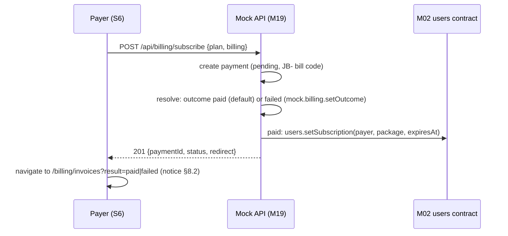

# M19 — Finance & Subscriptions — Software Requirements Specification

## 0. Document control

| Field | Value |
|---|---|
| Document | SRS — M19 Finance & Subscriptions |
| Version | 1.3 |
| Date | 2026-09-27 |
| Status | **Approved (G1) — v1.3.** G1 approved by user 2026-09-27 with amendment D14. |
| Decisions | **D14 (user, G1 2026-09-27, verbatim):** "payment gateway atau external platforms punya screen tak payah buat. tu nanti kita integrate saja. buat simulation success/failed je." — no payment-gateway or external-platform screen; simulated success / failed only (BR-M19-13). |
| Author | product-analyst (agent) for §1–§5, §8–§10, §12–§13; solution-architect (agent) for §6 data, datasets, named queries, reconciliation, seeds and owner requests, §7 mock API, §11 |
| Source URS | [urs/M19-finance.md](../urs/M19-finance.md) v1.3 (82 Functions, 21 stories, 84 ACs, coverage 395/395) |
| Source discovery | [M19-finance.md](../../discovery/M19-finance.md); inventory and seed snapshot `docs/discovery/inventory/M19/` (`_snapshot-2026-09-27.json`, captured 2026-09-27 04:23 MYT); screenshots `docs/discovery/img/M19/` |
| Related | [M01](M01-authentication.md) v1.11 (User base, guards, landing pages, global 404), [M02](M02-users-schools.md) v1.23 (SchoolSubscription — the 14 live rows since v1.19, `countByStatus` / `activeByPackage` (XR-M19-01 applied); the 30 payer anchors on active generated rows of 8102's "Belum login" cell (XR-M19-02 applied); `users.setSubscription` and BR-12 `billing.computeExpiry` (XR-M19-04 applied); M19 figures do not depend on BR-24 `used` / DV-M02-15; SchoolPackage; users dataset §6.15 with `subscriptionPackage`, `subscriptionExpiresAt`; BR-12; DV-M02-14), [M05](M05-practice.md) v1.16 (BR-07 trial, `PracticeProfile.trialQuestionsUsed`), [M07](M07-pksk.md) v1.7 (DATA-M07-03 PkskPackage, §7 #18), [M14](M14-gamification.md) v1.5 (wallets, cash-out S8 / S20), [M15](M15-rewards-shop.md) v1.3, [M17](M17-admin-dashboard.md) v1.6 (§7 #2 export, BR-M17-24), architecture [overview](../../architecture/overview.md) §6.6–§6.7 (datasets, repositories), §6.12 (clock), [design/shells.md](../../design/shells.md) |

**Change log**

| Version | Date | Change |
|---|---|---|
| 1.3 | 2026-09-27 | **G1 approved by user 2026-09-27 with amendment D14** (details in URS change log 1.3). Removed: the simulated gateway screen G1 (`/billing/checkout/{code}`, "ToyyibPay (Simulasi)", "Bayar" / "Gagal" / "Batal", final-state copy), endpoints #10–#12 (numbers not reused), the cancel outcome and notice, the §9 / §10 G1 rows. Replaced by BR-M19-13 simulated outcome (success default; failed via `mock.billing.setOutcome`; #9 resolves and returns the S7 redirect). Callback / signature / idempotency → backend-integration note (SEC-M19-02). FR-03 / 07 / 09 / 18 / 50–54, BR-01 / 02 / 13, V-04, §6.13, §7, §7.1, §8.2, SEC-01 / 02 / 03 / 08, E2E-12, 63–68, 78. `recon.cjs` 25 checks, 0 failures; trace 0 errors. |
| 1.2 | 2026-09-27 | **Audit round 2 (PASS) residuals** (details in URS change log 1.2). R2-01 / R2-02: split `personal` expiry — "Personal Bulanan" +1 month, "Personal Setahun" next 10 Jan (BR-14, FR-54, §6.5, Q-ENTITLED, §8.2, XR-04 note, E2E-44 / 57 / 70; R17, R25; payer 5600 = M02 anchor 2026-10-13 12:35, checked = paidAt + 1 month; URS DV-M19-18). R2-03: DV-M19-17 "46". R2-04: M02 v1.23. `recon.cjs` 25 checks, 0 failures; trace 0 errors. |
| 1.1 | 2026-09-27 | **Audit round 1 fixes** (`docs/qa/audit/M19-audit.md`; Delivery Lead decisions; details in URS change log 1.1). AUD-01: bill codes in the observed structure `JB-{REGULAR\|PERSONAL}-{MON\|ONE}-{userId}-{8 mixed-case}` and 8 lowercase gateway codes, random parts from PRNG stream `m19.codes` (BR-12, §6.2, §6.11 A all 59 regenerated, §8.2, E2E-27 / 38; R23). AUD-02: Sub ID = payer id OBSERVED (R24), seeded ids kept (URS DV-M19-17). AUD-03: FR-10 / 11, E2E-13 / 14. AUD-04: new FR-M19-62 (text transforms), FR-23 / 32 / 33 / 39, BR-09, E2E-38 / 42 / 50, new E2E-80. AUD-05: FR-16 / E2E-20 every width, ribbons. AUD-06: no `rel` (FR-47, E2E-61; SEC-09 backend only). AUD-07: S3 bill code (FR-33, §8.1). AUD-08: BR-14 = M02 BR-12 `computeExpiry` (personal → next 10 Jan for both plans; payer 5600 → 2027-01-10; R25; E2E-44 / 57 / 69–71). AUD-09: BR-03 labels. AUD-10: M02 v1.22, XR-01 / 02 / 04 applied. AUD-11: provisional flags. AUD-12: §3.1 regenerated from the FR and AC links. AUD-13–15: shared error elements, V-06 observed, M17 definition cited. `recon.cjs` 25 checks, 0 failures; trace 0 errors. |
| 1.0 | 2026-09-27 | First issue. 61 FRs, 20 business rules, 5 owned stores (Payment, DunningLog, PricingPlan, PkskPackage, Invoice read model) + 1 documented display constant, 15 named queries, 17 mock endpoints (#10–#12 and #16 PROPOSED for the D4 simulation), 79 E2E (every one at 375 / 768 / 1280), 10 SEC items, 10 owner requests. Reconciliation of every observed figure at the project clock by `recon.cjs` (v1.0: 22 checks; v1.1: 25). Traceability checked by `trace.cjs` (0 errors). |

### 0.1 Fidelity deviations referenced here

URS §7 is authoritative. Approved fixes: DV-M19-01 (`/admin/payments/create` → 404), 02 (S5 header), 03 (S6 header), 04 (S4 "Jenis" of #65 = "personal"), 06 (text ≥ 12 px), 07 (`GET /subscribe/*` → 404), 09 (fictitious WhatsApp number), 10 (simulated success / failed outcome, no gateway screen, D4 + D14). Rejected — replicate live: DV-M19-05, 08, 11, 12, 13, 15. Documented display constant: DV-M19-14 → DC-M19-01. Referred to its owner: DV-M19-16 (applied in M02 v1.19). Seeded payer ids: DV-M19-17 (the 24 non-chain payers keep 3301–3324; bill codes embed the seeded id).

---

## 1. Scope

The M19 prototype implements, against the mock service layer, the seven screens of URS §1 — the admin payment list S1, payment detail S2 and status edit S3, the billing dashboard S4, the dunning log S5, the pricing page S6 and the invoice history S7 — plus one PROPOSED surface of its own, the invoice PDF. No payment-gateway or external screen is built (D14): a new payment resolves by a simulated success / failed outcome (BR-M19-13). M19 owns (D12) the stores Payment (DATA-M19-01), DunningLog (DATA-M19-02), PricingPlan (DATA-M19-03), PkskPackage (DATA-M19-05, taken over from M07) and the Invoice read model (DATA-M19-04), and the rules for individual packages (price, activation, expiry, reminders, entitlement, trial). Every figure is computed per request from these stores and from the owners' contracts through the named queries of §6.8 at the shared mock clock, except the one documented display constant of §6.6.

**Out of scope:** URS §8 — M02 school subscriptions and the users store (M19 uses their contracts), M14 cash-out and wallets, M15 e-wallet rewards, M05 trial counter record, M07 PKSK access, notifications, real gateway / PDF / cron, backend security.

---

## 2. Screens & routes

Query names are kept as on live (`search`, `status`, `type`, `gateway`, `page`, `event`) so bookmarked links work unchanged.

| # | Route | Screen | Primary actor(s) | Shell · header / tab title | API (§7) |
|---|---|---|---|---|---|
| S1 | `/admin/payments` | Senarai Pembayaran | Admin | SHA · "Senarai Pembayaran" / "Pembayaran - Admin Panel" | #1, #4, #5 |
| S2 | `/admin/payments/{id}` | Butiran Pembayaran | Admin | SHA · "Butiran Pembayaran" / "Pembayaran #{id}" | #2, #4 |
| S3 | `/admin/payments/{id}/edit` | Edit Pembayaran | Admin | SHA · "Edit Pembayaran" / "Edit Pembayaran #{id}" | #2, #3 |
| S4 | `/admin/billing` | Billing Dashboard | Admin | SHA · "Billing Dashboard" / "Billing Dashboard - Admin Panel" | #6 |
| S5 | `/admin/dunning` | Dunning Log | Admin | SHA · "Dunning Log" (DV-M19-02) / "Dunning Log — Admin" | #7 |
| S6 | `/pricing` | Pilih Pakej Anda | All signed-in | SHU · "Pilih Pakej Anda" (DV-M19-03) / "Pilih Pakej Anda - PRESTASIPLUS" | #8, #9 |
| S7 | `/billing/invoices` | Sejarah Invois | All signed-in | SHU · "Sejarah Invois" / "Sejarah Invois - PRESTASIPLUS" | #15, #16 |
| PDF (PROPOSED) | `/billing/invoices/{paymentId}/pdf` | Invoice PDF (download) | The payer | — (file) | #16 |
| — | `/admin/payments/create`, `GET /subscribe/regular`, `GET /subscribe/personal`, the probed routes of URS §1 | Global 404 (M01) | All | standalone | — |

`{id}` and `{paymentId}` are integers; `{gatewayBillCode}` is the payment's gateway bill code (§6.2). The live form posts `/subscribe/regular` and `/subscribe/personal` map to #9; the live `PUT` / `DELETE /admin/payments/{id}` and `POST /admin/payments/bulk-delete` map to #3–#5; `/admin/export/payments` (M17 link) maps to #14.

---

## 3. Functional requirements

| ID | Requirement | FN | AC |
|---|---|---|---|
| FR-M19-01 | The admin shell SHALL show the collapsible sidebar group "Kewangan" (`fa-credit-card` → Lucide per design-system, key `kewangan`) with "Pembayaran" → `/admin/payments`, "Billing Dashboard" → `/admin/billing`, "Dunning Log" → `/admin/dunning` (icons `fa-credit-card`, `fa-chart-line`, `fa-bell-slash`); the group SHALL open and mark the item active on S1–S3 ("Pembayaran"), S4 and S5; the "Lagi" drawer SHALL list the same three links. The shell renders them; M19 registers the routes and their `activeGroup`. | 1.1.1 | 01.1, 01.2 |
| FR-M19-02 | The user shell account menu SHALL show "Pakej 💎" (`fa-crown`, "💎") → `/pricing` and "Invois Saya" (`fa-file-invoice`) → `/billing/invoices` for every signed-in user, and "Billing Dashboard" (`fa-chart-line`) → `/admin/billing` in the admin block for the admin only; the M17 "Pembayaran" CSV link SHALL download #14. | 1.1.2 | 01.3, 01.5 |
| FR-M19-03 | S1–S5 SHALL render in the admin-panel shell, S6 and S7 in the user-portal shell; no payment-gateway or external screen SHALL be rendered (D14). | 1.1.6 | 01.4 |
| FR-M19-04 | S1–S4 and S7 SHALL set the header title / subtitle of URS §1 exactly (S2 / S3 subtitle "Pembayaran #{id}"). | 1.1.3 | 02.1 |
| FR-M19-05 | S5 SHALL set the header "Dunning Log" / "Senarai peringatan langganan yang dihantar" and S6 "Pilih Pakej Anda" / "Tingkatkan pengalaman belajar anak anda dengan pakej yang bersesuaian" (route meta; DV-M19-02/03, DV-SH-03). | 1.1.4 | 02.2, 02.3 |
| FR-M19-06 | Each screen SHALL set the tab title of FN-M19-1.1.5 exactly. | 1.1.5 | 02.1, 02.2, 02.3 |
| FR-M19-07 | Every M19 route and endpoint SHALL require a session; a guest SHALL be redirected to `/login` (M01 guard); the API answers `401 UNAUTHORIZED`. | 1.2.1 | 03.1 |
| FR-M19-08 | S1–S5 and #1–#7, #14 SHALL be admin only: another role opening the page SHALL be sent to its M01 landing page and the API SHALL answer `403 FORBIDDEN`. | 1.2.2 | 03.2 |
| FR-M19-09 | S6, S7 and #8, #9, #13, #15 SHALL accept every signed-in role; #15 and #16 SHALL return only the viewer's own payments, answering `404 NOT_FOUND` for any other id (no 403, so ids cannot be probed). | 1.2.3 | 03.3, 03.4 |
| FR-M19-10 | An unknown numeric `{id}` on S2 / S3 (API 404) and every probed route of URS §1 SHALL render the M01 global 404 page with the copy of FN-M19-1.2.4. | 1.2.4 | 04.1, 04.4 |
| FR-M19-11 | `/admin/payments/create` and any non-numeric `{id}` (`/admin/payments/abc`, `/admin/payments/abc/edit`) SHALL render the global 404 page; the live 500 copy SHALL NOT be rendered (DV-M19-01). | 1.2.5 | 04.2 |
| FR-M19-12 | A navigation to `/subscribe/regular` or `/subscribe/personal` SHALL render the global 404 page and create nothing (DV-M19-07). | 1.2.6 | 04.3 |
| FR-M19-13 | Amounts SHALL be formatted "RM" + 2 decimals with "," thousands (BR-M19-19); S6 prices as the catalogue strings. | 1.3.1 | 05.1 |
| FR-M19-14 | Dates SHALL be shown in Asia/Kuala_Lumpur with the per-screen formats of BR-M19-19. | 1.3.2 | 05.2 |
| FR-M19-15 | S1 and S5 SHALL render the Laravel-style pager of FN-M19-1.3.3 (simple below 640 px, "Showing {a} to {b} of {n} results" and numbered links from 640 px; filters kept; S5 out-of-range variant "Showing 0 of {n} results"). | 1.3.3 | 05.3, 08.6, 14.4 |
| FR-M19-16 | No content text of S1–S7 SHALL render below 12 px at any of 375 / 768 / 1280 px — in particular the S1 stat labels, the S1 period and time sub-lines and the 11 S6 texts (hints, tile captions, ribbons) (DV-M19-06). | 1.3.4 | 05.4 |
| FR-M19-17 | Data views SHALL show the shell loading behaviour while a request is pending and the M01 error convention on failure. | 1.3.5 | 05.5 |
| FR-M19-18 | Every M19 screen SHALL have no horizontal page scroll at 375 / 768 / 1280 px; wide tables SHALL scroll inside their card; grids SHALL follow §10. | 1.3.6 | 21.1, 21.2 |
| FR-M19-62 | Every M19 screen SHALL apply the live CSS text transforms of FN-M19-1.3.7 (upper-case headers, S2 / S3 labels, S6 sub-labels and ribbons; capitalised S2 values, S3 "{type} · {gateway}", S4 "Jenis", S1 gateway) to the stored or catalogue text; displayed text is what E2E asserts. | 1.3.7 | 05.6 |
| FR-M19-19 | S1 SHALL show the five global cards from Q-M19-PAY-ALL, Q-M19-PAY-STATUS(paid \| pending \| failed) and Q-M19-REV-ALL, unaffected by filters and page. | 2.1.1 | 06.1, 06.2 |
| FR-M19-20 | S1 SHALL show the GET filter form of FN-M19-2.2.1 with the current values selected. | 2.2.1 | 07.1 |
| FR-M19-21 | #1 SHALL filter by BR-M19-05 (search on payer name, payer e-mail, bill code; exact status / type / gateway; AND; unknown value → no row). | 2.2.2 | 07.2, 07.3, 07.4 |
| FR-M19-22 | "Reset" SHALL show only while a filter or search is set and SHALL lead to `/admin/payments`. | 2.2.3 | 07.5 |
| FR-M19-23 | The S1 table SHALL show the columns (displayed upper case) and row content of FN-M19-2.3.1–2.3.2 (type badge "Biasa" / "Personal" / "PKSK", period "Monthly" / "Onetime", gateway displayed "Toyyibpay", status "Berjaya" / "Pending" / "Gagal"). | 2.3.1, 2.3.2 | 08.1, 08.2 |
| FR-M19-24 | Each S1 row SHALL link eye → S2, pen → S3, and the trash SHALL call `confirm('Padam pembayaran ini?')` and on OK call #4. | 2.3.3 | 08.4, 08.5 |
| FR-M19-25 | #1 SHALL order by `createdAt` desc, `id` desc, 20 per page, with `meta {page, perPage, total, from, to, lastPage}`. | 2.3.4, 2.3.5 | 08.3, 08.6 |
| FR-M19-26 | When the page has no row, S1 SHALL show the "Tiada Pembayaran" card and render neither table nor pager. | 2.3.6 | 07.3 |
| FR-M19-27 | S1 SHALL keep a page-local selection: row checkboxes, a header checkbox selecting / clearing the current page's ids, and the bar "{n} dipilih" + "Padam Dipilih" while n ≥ 1. | 2.4.1, 2.4.2 | 09.1, 09.2 |
| FR-M19-28 | "Padam Dipilih" SHALL call `confirm('Padam {n} pembayaran yang dipilih?')` and on OK call #5 with the selected ids. | 2.4.3 | 09.3 |
| FR-M19-29 | After #4 or #5 the admin SHALL land on S1 page 1 without filters and without flash text; every figure SHALL be recomputed (BR-M19-16). | 2.4.4 | 08.5, 09.3, 10.4 |
| FR-M19-30 | S2 SHALL show the top row of FN-M19-2.5.1 ("Padam" with the same confirm and #4). | 2.5.1 | 10.1, 10.4 |
| FR-M19-31 | S2 SHALL show the status banner by status (paid / pending OBSERVED copy; failed PROPOSED COPY "Pembayaran Gagal" / "Pembayaran tidak berjaya", red, `fa-times-circle`) with the amount. | 2.5.2, 2.5.4 | 10.1, 10.2, 10.3, 10.5 |
| FR-M19-32 | S2 SHALL show "Maklumat Pembayaran" with the fields of FN-M19-2.5.3 (labels displayed upper case; raw values displayed capitalised; bill code and gateway bill code monospace in the formats of §6.2; "—" for an empty gateway ref). | 2.5.3 | 10.1, 10.2, 10.3 |
| FR-M19-33 | S3 SHALL show the breadcrumb, the summary card (payer name and e-mail, **bill code** monospace, amount, "{type} · {gateway}" displayed capitalised, e.g. "Personal · Toyyibpay") and the status form of FN-M19-2.6.1–2.6.3 (label displayed "STATUS PEMBAYARAN") with the saved status checked; "Batal" → S2. | 2.6.1, 2.6.2, 2.6.3 | 11.1, 11.4 |
| FR-M19-34 | "Simpan" SHALL call #3; on 200 the admin SHALL land on S2; the status change SHALL follow BR-M19-02 and trigger BR-M19-14 on a transition to paid. | 2.6.4 | 11.2, 11.3 |
| FR-M19-35 | S4 SHALL show the hero and the cards "Langganan Sekolah Aktif" = Q-M19-SCH-ACTIVE and "Dalam Grace Period" = Q-M19-SCH-GRACE with their sub-lines. | 3.1.1, 3.1.2, 3.1.4 | 12.1, 12.2 |
| FR-M19-36 | S4 "Langganan Individu Aktif" SHALL show DC-M19-01 ("94") and no other M19 screen SHALL show a count of subscribed individuals. | 3.1.3 | 12.2, 12.5, 18.1 |
| FR-M19-37 | S4 "Hasil Bulan Ini" SHALL show Q-M19-REV-MONTH(now) and the month label "{Month} {yyyy}" (English); query strings SHALL be ignored. | 3.1.5, 3.1.8 | 12.2, 12.4, 12.5 |
| FR-M19-38 | S4 "Pecahan Pakej Aktif (Sekolah)" SHALL show Q-M19-SCH-BY-PACKAGE, one tile per package with ≥ 1 active row. | 3.1.6 | 12.3 |
| FR-M19-39 | S4 "Pembayaran Terkini" SHALL list Q-M19-RECENT(20) with the columns of FN-M19-3.1.7 (headers displayed upper case), the raw type of each row displayed capitalised ("Regular"; "Personal" for #65, DV-M19-04), status "Berjaya" / "Menunggu" / "Gagal", no row link, and "Lihat Semua" → S1. | 3.1.7 | 13.1, 13.2 |
| FR-M19-40 | S5 SHALL show the heading and the four global cards from Q-M19-DUN-ALL, Q-M19-DUN-7D(now), Q-M19-DUN-EVENT(reminder_3d), Q-M19-DUN-EVENT(expired). | 4.1.1, 4.1.2 | 14.1 |
| FR-M19-41 | S5 SHALL show the filter of FN-M19-4.1.3; #7 SHALL filter exactly by `type` and `event`; "Reset" only while a filter is set. | 4.1.3 | 14.3 |
| FR-M19-42 | S5 SHALL list the logs newest `sentAt` first (id desc) with the columns and badge labels of FN-M19-4.1.4; "Sub ID" as plain text. | 4.1.4 | 14.2, 15.3 |
| FR-M19-43 | S5 SHALL show "📭" "Tiada log dunning dijumpai." when the page has no row, with the out-of-range pager of FR-M19-15; page size 25 (INFERRED). | 4.1.5 | 14.4 |
| FR-M19-44 | The mock SHALL run the reminder job of BR-M19-11 at each 08:00 MYT passed after the seed clock (never back-filling), writing only `reminder_7d`, `reminder_3d`, `reminder_1d`. | 4.2.1 | 15.1, 15.2 |
| FR-M19-45 | A log's `subscriptionId` SHALL be the M02 school-subscription id (`school`) or the payer's user id (`individual`) (BR-M19-11). | 4.2.2 | 14.2, 15.2 |
| FR-M19-46 | S6 SHALL render the heading, the trial banner and the four package cards of FN-M19-5.1.1–5.1.6 from #8 (prices from DATA-M19-03). | 5.1.1, 5.1.2, 5.1.3, 5.1.4, 5.1.5, 5.1.6 | 16.1 |
| FR-M19-47 | S6 SHALL render the levels card, the school tiles, the comparison table and the gateway pill of FN-M19-5.1.7–5.1.10; the two WhatsApp links SHALL use the fictitious number of DV-M19-09 with `target="_blank"` and no `rel`, as live (D10; AUD-M19-06). | 5.1.7, 5.1.8, 5.1.9, 5.1.10 | 16.2, 16.3, 16.5 |
| FR-M19-48 | S6 "Soalan Lazim" SHALL be an accordion with at most one open answer (click toggles; opening one closes the other). | 5.1.11 | 16.4 |
| FR-M19-49 | S6 SHALL be identical for every viewer (no current-plan marker, buttons always enabled). | 5.1.12 | 16.6 |
| FR-M19-50 | Each "Langgan …" button SHALL call #9 with its plan and billing; every call SHALL create a new pending payment (BR-M19-12) and resolve it at once by BR-M19-13, then navigate to the returned S7 URL. | 5.2.1 | 17.1, 17.5 |
| FR-M19-51 | The simulated outcome SHALL be success by default and failed while `mock.billing.setOutcome('failed')` is in effect (dev / test builds); there SHALL be no cancelled outcome and no gateway or external page (D14). | 5.2.2 | 17.3, 17.4 |
| FR-M19-52 | The resolution SHALL apply BR-M19-13: `pending` → `paid` (`paidAt` = now, activation) or `failed`, once per payment; a repeated resolution SHALL change nothing. | 5.2.3 | 17.1, 17.2, 17.6 |
| FR-M19-53 | After #9 resolves, the payer SHALL land on S7 with the PROPOSED notice of the result (§8.2): paid or failed. | 5.2.4 | 17.1, 17.3 |
| FR-M19-54 | On the first transition of a payment to paid (simulated outcome or #3), the activation of BR-M19-14 SHALL write the payer's package and the expiry of `billing.computeExpiry` (monthly — `regular` and "Personal Bulanan" — +1 calendar month; one-time "Personal Setahun" next 10 January 23:59:59, the M02 BR-12 case) through `users.setSubscription` (XR-M19-04, applied). | 5.2.5 | 11.2, 18.1, 18.2 |
| FR-M19-55 | `billing.isSubscribed(userId, at)` and #13 SHALL implement BR-M19-15; M05 and the users repository SHALL use it (XR-M19-05, XR-M19-08). | 5.2.6 | 18.3 |
| FR-M19-56 | S7 SHALL show the header card with "Jumlah {n} invois dijumpai" = Q-M19-INV(viewer), the empty state when n = 0, and the note in every state. | 6.1.1, 6.1.2, 6.1.3 | 19.1 |
| FR-M19-57 | When n > 0, S7 SHALL list the viewer's invoices (BR-M19-17) with the PROPOSED row layout of FN-M19-6.1.4. | 6.1.4 | 19.2, 17.2 |
| FR-M19-58 | The row "PDF" link SHALL download #16 for a paid own payment; any other id SHALL render the 404 page. | 6.1.5 | 19.3, 03.4 |
| FR-M19-59 | The Payment store SHALL accept exactly the enums of DATA-M19-01; `bizappay` and `pksk` SHALL stay filter values with no payment in the seed. | 7.1.1 | 20.1 |
| FR-M19-60 | Q-M19-REV-ALL and Q-M19-REV-MONTH SHALL read only M19 paid payments; no M14 / M15 record SHALL enter them (XR-M19-07). | 7.1.2 | 20.2 |
| FR-M19-61 | A payment's `amount` SHALL be fixed at creation and never recomputed from the current price. | 7.1.3 | 20.3 |

### 3.1 Traceability (US → FR → E2E)

| US | FR | E2E |
|---|---|---|
| US-M19-01 | 01, 02, 03 | 01, 02, 03, 04, 05 |
| US-M19-02 | 04, 05, 06 | 06, 07, 08 |
| US-M19-03 | 07, 08, 09 | 09, 10, 11, 12 |
| US-M19-04 | 10, 11, 12 | 13, 14, 15, 16 |
| US-M19-05 | 13, 14, 15, 16, 17, 62 | 17, 18, 19, 20, 21, 33, 55, 80 |
| US-M19-06 | 19 | 22, 23 |
| US-M19-07 | 20, 21, 22 | 24, 25, 26, 27, 28 |
| US-M19-08 | 23, 24, 25, 26 | 26, 29, 30, 31, 32, 33 |
| US-M19-09 | 27, 28, 29 | 32, 34, 35, 36, 37, 40 |
| US-M19-10 | 30, 31, 32 | 38, 39, 40, 41 |
| US-M19-11 | 33, 34 | 42, 43, 44, 45 |
| US-M19-12 | 35, 36, 37, 38 | 46, 47, 48, 49, 69 |
| US-M19-13 | 39 | 50, 51 |
| US-M19-14 | 40, 41, 42, 43 | 52, 53, 54, 55 |
| US-M19-15 | 44, 45 | 53, 56, 57 |
| US-M19-16 | 46, 47, 48, 49 | 58, 59, 60, 61, 62 |
| US-M19-17 | 50, 51, 52, 53 | 63, 64, 65, 66, 67, 68 |
| US-M19-18 | 54, 55 | 43, 69, 70, 71 |
| US-M19-19 | 56, 57, 58 | 12, 63, 72, 73, 74 |
| US-M19-20 | 59, 60, 61 | 75, 76, 77 |
| US-M19-21 | 18 | 78, 79 |

---

## 4. Business rules

| ID | Rule | Source |
|---|---|---|
| BR-M19-01 | **Access.** S1–S5 and their APIs: `admin` only. S6, S7: every signed-in role. Invoices, invoice PDF and entitlement: the viewer's own payments / account only (another id → 404). Guest → `/login`. | OBSERVED (admin) / INFERRED |
| BR-M19-02 | **Status transitions.** A payment is `pending` at creation. The simulated outcome (BR-M19-13) moves `pending` → `paid` or `failed`; the admin (S3) may set any of `paid`, `pending`, `failed` from any status. `paidAt` is set to now on a transition **to** `paid` (S3 note), kept when a paid payment is saved as paid, and cleared on a transition **from** `paid` (PROPOSED). | OBSERVED (note) / PROPOSED |
| BR-M19-03 | **Amounts.** New payment amount = the plan price at creation: `regular` · `monthly` 10.00; `personal` · `monthly` 90.00; `personal` · `onetime` 200.00 (the S6 price; charging it is INFERRED / PROPOSED — every observed one-time payment is 90.00). Stored as a decimal string, never recomputed (the seven Apr–May `personal` · `onetime` rows stay 90.00). | OBSERVED (displayed prices, historical amounts) / INFERRED (charged amount of new payments = displayed price) |
| BR-M19-04 | **S1 cards** are global counts over the store: all, `paid`, `pending`, `failed`; "Hasil" = Σ `amount` of `paid` payments, all time. | OBSERVED |
| BR-M19-05 | **S1 filters.** `search` (trimmed): case-insensitive substring of the payer's name, the payer's e-mail or `billCode` (INFERRED fields from the placeholder); `status`, `type`, `gateway`: exact match on the enum value, empty = any, any other value matches nothing; conditions combine with AND; order `createdAt` desc, `id` desc; 20 per page; a page beyond the last returns no row. | OBSERVED / INFERRED |
| BR-M19-06 | **Revenue this month.** Σ `amount` of `paid` payments with `paidAt` in [first day of the current calendar month 00:00 MYT, now]; label = English full month name + year ("September 2026"). | OBSERVED (value, Sep label) / INFERRED (other labels) |
| BR-M19-07 | **School figures** (read through M02): active = subscriptions with `status = active`; grace = `status = grace`; breakdown = active rows grouped by `schoolPackageId`, labelled with `SchoolPackage.name`, ordered by package id, only groups with ≥ 1 row. | OBSERVED |
| BR-M19-08 | **Individual active** = DC-M19-01 (94), a documented display constant (§6.6). | OBSERVED (value) / DC |
| BR-M19-09 | **Recent payments** = the 20 newest by `createdAt` desc, `id` desc; "Jenis" = raw `type` displayed capitalised ("Regular", "Personal"; DV-M19-04); status label `paid` "Berjaya", `pending` "Menunggu", `failed` "Gagal" (INFERRED). | OBSERVED + DV-M19-04 |
| BR-M19-10 | **Dunning figures.** "Jumlah Log" = all logs; "7 Hari Lepas" = logs with `sentAt` in (now − 7 × 24 h, now]; "3-Hari Amaran" = logs with `event = reminder_3d` (all time); "Tamat Tempoh" = logs with `event = expired` (all time). Filters exact; order `sentAt` desc, `id` desc; 25 per page (INFERRED; any size ≥ 21 reproduces live). | OBSERVED / INFERRED |
| BR-M19-11 | **Reminder job** (mock, INFERRED from the 21 rows): at 08:00 MYT of each day D after the last run, for every **individual** entitlement (every user whose `subscriptionExpiresAt` is set — by an activation or by the M02 S3 manual package) and every **school** subscription with `status` `active` or `grace` (M02), let E = the end date in MYT (`subscriptionExpiresAt` / `endsAt`); if D = E − 7, E − 3 or E − 1 days, write `{type, subscriptionId, event: reminder_7d \| reminder_3d \| reminder_1d, sentAt: D 08:00}` with `subscriptionId` = the user id (individual) or the M02 subscription id (school), unless the same (type, subscriptionId, event, E) exists; within one run rows are written individual first by user id ascending, then school by subscription id ascending (ids in that order). It never writes `expired`, `grace_start`, `grace_end` (D-M19-08 replicated). The first run is the first 08:00 after the seed clock (no back-fill). "Sub ID" = payer user id is OBSERVED (the live bill codes of the six chain payments carry exactly those ids, R24). | OBSERVED (rows, Sub ID) / INFERRED (job) |
| BR-M19-12 | **Subscribe.** Each #9 call creates a new `pending` payment for the viewer (no de-duplication, as the live bursts) with `gateway = toyyibpay`, `billCode = "JB-" + upper(type) + "-" + (billing = monthly ? "MON" : "ONE") + "-" + userId + "-" + 8 mixed-case alphanumerics` and `gatewayBillCode` = 8 lowercase alphanumerics, the random parts from the seeded PRNG stream `m19.codes` (unique), `gatewayRef = null`. Allowed plans: `regular` + `monthly`; `personal` + `monthly` \| `onetime`. | INFERRED + D4 / OBSERVED (code structure) / PROPOSED (random parts) |
| BR-M19-13 | **Simulated outcome** (D4, D14): #9 creates the `pending` payment and resolves it in the same request — outcome `paid` (default) → `paidAt` = now, `gatewayRef` null, activation BR-M19-14; outcome `failed` (while `mock.billing.setOutcome('failed')` is set; test hook and dev-build toggle; reset by `mock.reset()`) → `failed`. Only a `pending` payment is resolved, once. No gateway page, callback endpoint or cancel outcome exists in the prototype. **Backend-integration note (not built):** the real gateway callback must be verified server-side (status re-query or signature), amount-checked against the stored amount, idempotent, and never trusted from the return URL (SEC-M19-02). | PROPOSED (D14) |
| BR-M19-14 | **Activation** (PROPOSED; not observed, supported by the dunning arithmetic): on the first transition to `paid`, set the payer's `subscriptionPackage` = `regular_monthly` (type `regular`) or `personal` (type `personal`) and `subscriptionExpiresAt` = `billing.computeExpiry(package, billing, paidAt)`: `regular` (`regular_monthly`) and `personal` · `monthly` ("Personal Bulanan") → `paidAt` + 1 calendar month (same time; last day of the month when shorter); `personal` · `onetime` ("Personal Setahun") → the next 10 January 23:59:59 MYT after `paidAt` (= M02 v1.23 BR-12, which defines the one-time case, label "(hingga 10 Jan)"). Payer 5600 (#65, `personal` · `monthly`, paid 2026-09-13 12:35) → 2026-10-13 12:35 = the M02 v1.23 anchor (R25). Rejected alternative: 10 January for both personal plans (a monthly plan paid in January would last 12 months against "/bulan"; URS DV-M19-18). Replaces any earlier expiry (no stacking); `pksk` writes nothing. A transition away from `paid` changes nothing on the user. | PROPOSED (one-time case = M02 BR-12) |
| BR-M19-15 | **Entitlement.** `isSubscribed(user, t)` ⇔ `subscriptionExpiresAt` > t (M05 BR-07 wording). Not subscribed → the one-time trial of 50 questions (limit owned here; counter `PracticeProfile.trialQuestionsUsed` owned by M05). A lapsed package keeps its value. | OBSERVED (copy) / INFERRED |
| BR-M19-16 | **Delete** (row, S2, bulk) removes the payment rows permanently; the user's package is not changed; S1, S4, S7 and the CSV recompute. | INFERRED |
| BR-M19-17 | **Invoice read model.** One invoice per payment of the viewer (all statuses), newest `createdAt` first; number "INV-{paymentId}-{yyyymmdd}" of `paidAt` (paid) or `createdAt` (unpaid); date "d M Y" of the same instant; package label `regular` "Pelajar", `personal` · `monthly` "Personal Bulanan", `personal` · `onetime` "Personal Setahun", `pksk` "PKSK"; status label `paid` "Dibayar", `pending` "Menunggu", `failed` "Gagal"; PDF only when `paid`. | INFERRED (note) / PROPOSED |
| BR-M19-18 | **Revenue boundary.** Only M19 `paid` payments count as revenue; M14 cash-outs, coins and M15 rewards never do. | INFERRED |
| BR-M19-19 | **Formats** (MYT): money "RM{n,nnn.nn}"; S1 "dd MMM yyyy" + "HH:mm"; S2 "dd MMM yyyy, HH:mm:ss" (created) and "Dibayar pada dd MMM yyyy, HH:mm"; S4 "dd/MM/yyyy HH:mm"; S5 "dd MMM yyyy HH:mm"; S7 / PDF "d MMM yyyy" (PROPOSED); English month abbreviations as live. | OBSERVED |
| BR-M19-20 | **Header titles** are route meta (DV-SH-03): S5 and S6 use their page titles (DV-M19-02/03). | DV |

---

## 5. Validation rules

| ID | Input | Rule | Error |
|---|---|---|---|
| V-M19-01 | #3 `status` | one of `paid`, `pending`, `failed` | 422 `VALIDATION_FAILED`, field `status`, message "Status tidak sah." (PROPOSED COPY; the form offers only valid values) |
| V-M19-02 | #5 `ids` | array of 1–20 distinct positive integers, each an existing payment | 422 `VALIDATION_FAILED` (nothing deleted) |
| V-M19-03 | #9 `plan`, `billing` | `plan` ∈ {`regular`, `personal`}; `billing` ∈ {`monthly`, `onetime`}; `regular` only with `monthly`; any other field (e.g. `amount`) is ignored | 422 `VALIDATION_FAILED` |
| V-M19-04 | resolution (#9, `mock.billing.resolve`) | applies only to a payment whose status is `pending`; otherwise a no-op | — (no error; nothing changes) |
| V-M19-05 | #1 query | `search` trimmed, ≤ 100 characters (longer cut); `page` integer ≥ 1 (else 1); other values accepted as they are (unknown → no row) | — |
| V-M19-06 | #7 query | `type`, `event` accepted as they are (unknown → no row with "Reset"; OBSERVED for `type=bogus`, audit; INFERRED for `event`); `page` as V-M19-05 | — |
| V-M19-07 | path `{id}`, `{paymentId}` | positive integer of an existing payment (own payment for #16) | 404 `NOT_FOUND` → global 404 page |

---

## 6. Data entities & fields

*(solution-architect)* JSON fields are camelCase; ids are integers. "Now" is the shared mock clock (ADR-0006, architecture §6.12). M19 reads the owners through their repository contracts (D12) and writes the user's package fields only through the M02 users contract. Everything is reset per E2E test (`mock.reset()`).

### 6.1 Referenced entities (owners; not redefined — D12)

| Entity | Owner | Fields M19 reads / writes |
|---|---|---|
| User | M01 DATA-M01-01 / M02 DATA-M02-01 (users virtual dataset §6.15) | read `id`, `name`, `email`, `role`; read / write (activation only, XR-M19-04) `subscriptionPackage`, `subscriptionExpiresAt` |
| SchoolSubscription | M02 DATA-M02-07 (the 14 live rows since v1.19) | `id`, `schoolId`, `schoolPackageId`, `status`, `endsAt` |
| SchoolPackage | M02 DATA-M02-06 | `id`, `name` ("Pakej SPM Tingkatan 5"), `priceAnnual` ("30.00", S6 school price), `maxRenewals` (S6 "sehingga {n} tahun" = maxRenewals + 1: 6 / 3 / 2 / 1) |
| PracticeProfile | M05 (`trialQuestionsUsed`; the rule is M19's) | `trialQuestionsUsed` |
| Wallets, cash-out, rewards | M14, M15 | none (boundary, XR-M19-07) |

### 6.2 DATA-M19-01 — Payment (owned by M19; repository `payments`; materialised table)

| Field | Type | Req | Notes |
|---|---|---|---|
| id | int | yes | Seed 7–65 (the live ids, contiguous); runtime from 66 (max + 1) |
| userId | int → User | yes | The payer (fictitious anchors §6.10) |
| type | enum `regular \| personal \| pksk` | yes | S1 labels "Biasa", "Personal", "PKSK" |
| billing | enum `monthly \| onetime` | yes | S1 "Monthly", "Onetime" |
| gateway | enum `toyyibpay \| bizappay` | yes | Filter labels "ToyyibPay", "BizAppay"; row label = capitalised raw |
| amount | decimal string (2 dp) | yes | BR-M19-03 |
| status | enum `pending \| paid \| failed` | yes | BR-M19-02 |
| billCode | string ≤ 40 | yes | `JB-{REGULAR\|PERSONAL}-{MON\|ONE}-{userId}-{8 mixed-case alphanumerics}` — structure OBSERVED on all live detail pages (audit AUD-M19-01; e.g. #65 "JB-PERSONAL-MON-5600-aU2oyL1S"); `userId` = the seeded payer id; random part fictitious (PRNG) |
| gatewayBillCode | string (8) | yes | 8 lowercase alphanumerics — shape OBSERVED; value fictitious (PRNG), unique |
| gatewayRef | string \| null | no | null on every seed row ("—") |
| paidAt | datetime \| null | no | set / cleared by BR-M19-02 |
| createdAt, updatedAt | datetime | yes | MYT offsets |

Read models: `PaymentListItem` = `{id, payer: {id, name, email}, type, billing, gateway, amount, status, createdAt}`; `PaymentDetail` = `PaymentListItem` + `{billCode, gatewayBillCode, gatewayRef, paidAt}`; `PaymentStats` = `{total, paid, pending, failed, revenue}`; `RecentPayment` = `{id, createdAt, payer: {name, email}, type, amount, status}`.

### 6.3 DATA-M19-02 — DunningLog (owned by M19; repository `dunning`; materialised table)

| Field | Type | Req | Notes |
|---|---|---|---|
| id | int | yes | Seed 3–23 (live ids); runtime from 24 |
| type | enum `school \| individual` | yes | badge "School" / "Individual"; filter "Sekolah" / "Individu" |
| subscriptionId | int | yes | M02 subscription id (school) or payer user id (individual) — BR-M19-11 |
| event | enum `reminder_7d \| reminder_3d \| reminder_1d \| expired \| grace_start \| grace_end` | yes | labels "7 Hari", "3 Hari", "1 Hari", "Tamat", "Grace Start", "Grace End" |
| sentAt | datetime | yes | 08:00 MYT |
| endsOn | date | yes (internal) | the end date E the reminder refers to (idempotency key; derived for the seed from the chain, §6.11 C) |

### 6.4 DATA-M19-03 — PricingPlan and catalogue (owned by M19; constant fixture served by #8)

| code | Card | type · billing | Price shown | Amount charged | Period rule | Question limit (copy) | Purchase |
|---|---|---|---|---|---|---|---|
| `regular_monthly` | "Pelajar" | `regular` · `monthly` | "RM10" "/bulan" | 10.00 | +1 month | "500 soalan sebulan" (copy only; enforcement not observed, not specified) | #9 |
| `school` | "Sekolah" | — | "RM30" "/sesi" | — (per pupil, M02 `priceAnnual` 30.00) | per session (M02) | "Unlimited" | WhatsApp only |
| `personal_monthly` | "Personal Bulanan" | `personal` · `monthly` | "RM90" "/bulan" | 90.00 | +1 month | "Unlimited" | #9 |
| `personal_onetime` | "Personal Setahun" | `personal` · `onetime` | "RM200" "/sesi" | 200.00 | to the next 10 January | "Unlimited" | #9 |
| `trial` | "Percuma" (comparison column) | — | — | — | once | 50 | automatic |

The fixture also holds every S6 text of URS FN-M19-5.1.1–5.1.11 (cards, ribbons, hints, levels, school tiles with `maxRenewals` from M02, comparison rows, FAQ), the gateway label "Toyyibpay" and the WhatsApp URL `https://wa.me/60000000000?text=Saya%20berminat%20dengan%20Pakej%20Sekolah%20PRESTASIPLUS` (DV-M19-09).

### 6.5 DATA-M19-04 — Invoice (owned by M19; read model over Payment, not stored)

`InvoiceItem` = `{paymentId, number, date, packageLabel, amount, status, statusLabel, pdfUrl | null}` per BR-M19-17. The PDF (#16) holds "INVOIS", the number, the date, the payer's name and e-mail, the package label, the period "{paidAt} – {expiry of BR-M19-14}" (`monthly` +1 month; `onetime` to 10 Jan {yyyy}), the amount, "Dibayar melalui Toyyibpay" and the bill code (PROPOSED, OQ-M19-04). No seed of its own: 8 paid payments give 8 PDFs.

### 6.6 DATA-M19-06 — Documented display constant (D11 exception)

| ID | Value | Where shown | Why no definition reproduces it | Beside a contradicting computed figure? |
|---|---|---|---|---|
| DC-M19-01 | 94 | S4 "Langganan Individu Aktif" only | The payments give 2 entitled payers at the clock (5600, 3318; R20); the live rule counts something the payment store does not hold (admin-set packages via M02 S3, complimentary pupils — M02 holds 90 — or lapsed packages; OQ-M19-01). Seeding 92 more subscribed users would invent records; computing 2 would change an observed value. | No. No M19 or other screen shows a count of individually subscribed users. M17 BR-M17-24 shows a per-user chip, not a count. M02 S12's figures are school subscriptions. |

### 6.7 DATA-M19-05 — PkskPackage (owned by M19; taken over from M07 DATA-M07-03, contract unchanged)

| id | name | level |
|---|---|---|
| 1 | "PKSK Tingkatan 1 (SBP/MRSM)" | `T1` |
| 2 | "PKSK Tingkatan 4 (SBP/MRSM)" | `T4` |
| 3 | "PKSK Kombo (T1 + T4)" | `ALL` |

No price is observed per package (M02 S3 shows the flag copy "RM20 — Akses penuh PKSK", owned by M02); no M19 screen sells PKSK (C9).

### 6.8 Named queries (every displayed count cites one)

Values at the project clock **2026-09-25T15:40:00+08:00**; the discovery reading (2026-09-27 04:23) is identical for every query (R10, R13).

| Query | Base (owner) | Definition | Value at the clock | Shown on |
|---|---|---|---|---|
| Q-M19-PAY-ALL | payments (M19) | count(*) | 59 | S1 "Jumlah", pager totals |
| Q-M19-PAY-STATUS(s) | payments | count(status = s) | paid 8 · pending 51 · failed 0 | S1 cards |
| Q-M19-REV-ALL | payments | Σ amount where status = paid | 240.00 | S1 "Hasil" |
| Q-M19-PAY-LIST(filter, page) | payments ⋈ users (name, e-mail) | BR-M19-05 | paid 8, pending 51, failed 0, regular 51, personal 8, pksk 0, toyyibpay 59, bizappay 0, paid + personal 2, "zzqxv" 0 | S1 table, pager |
| Q-M19-REV-MONTH(t) | payments | BR-M19-06 | 90.00 (Sep 2026: #65) | S4 "Hasil Bulan Ini" |
| Q-M19-RECENT(n) | payments ⋈ users | n newest by createdAt, id | ids 65 → 46 | S4 table |
| Q-M19-SCH-ACTIVE | M02 `schoolSubscriptions` | count(status = active) | 9 | S4 |
| Q-M19-SCH-GRACE | M02 `schoolSubscriptions` | count(status = grace) | 0 | S4 |
| Q-M19-SCH-BY-PACKAGE | M02 `schoolSubscriptions` ⋈ `schoolPackages` | active rows grouped by package | [{"Pakej SPM Tingkatan 5", 9}] | S4 tiles |
| Q-M19-DUN-ALL | dunning (M19) | count(*) | 21 | S5 "Jumlah Log", pager |
| Q-M19-DUN-7D(t) | dunning | count(sentAt ∈ (t − 7 d, t]) | 0 | S5 "7 Hari Lepas" |
| Q-M19-DUN-EVENT(e) | dunning | count(event = e) | reminder_3d 7 (also 7d 7, 1d 7), expired 0, grace_start 0, grace_end 0 | S5 "3-Hari Amaran", "Tamat Tempoh", filter |
| Q-M19-DUN-TYPE(k) | dunning | count(type = k) | school 3, individual 18 | S5 filter |
| Q-M19-INV(u) | payments | count(userId = u), all statuses | admin 0; 5600 5; 3318 5; pelajar 0 | S7 "Jumlah {n} invois dijumpai" |
| Q-M19-ENTITLED(u, t) | users (M02 fields) | BR-M19-15 | 5600 until 2026-10-13 12:35; 3318 until 2027-01-10 23:59:59; every other payer and canonical account not subscribed | #13, M05 trial |
| DC-M19-01 | constant | §6.6 | 94 | S4 |

### 6.9 Count reconciliation (every observed figure; `recon.cjs`, 25 checks, 0 failures)

Run from the author's scratchpad (`m19-writer/recon.cjs` over `seed.cjs`, which builds the seed from `_snapshot-2026-09-27.json`). Clock = 2026-09-25T15:40:00+08:00; discovery = 2026-09-27T04:23+08:00.

| ID | Check | Result at the clock (and at discovery where stated) | Status |
|---|---|---|---|
| R01 | ids contiguous 7–65 | "7,8,9,10,11,12,13,14,15,16,17,18,19,20,21,22,23,24,25,26,27,28,29,30,31,32,33,34,35,36,37,38,39,40,41,42,43,44,45,46,47,48,49,50,51,52,53,54,55,56,57,58,59,60,61,62,63,64,65" | PASS |
| R02 | Jumlah / Berjaya / Pending / Gagal | [59,8,51,0] | PASS |
| R03 | Hasil = Σ paid (all time) | "RM240.00" | PASS |
| R04 | filter counts paid,pending,failed,regular,personal,pksk,toyyibpay,bizappay,paid+personal | [8,51,0,51,8,0,59,0,2] | PASS |
| R05 | order createdAt desc = observed pages | ["65,64,63,62,61,60,59,58,57,56,55,54,53,52,51,50,49,48,47,46","45,44,43,42,41,40,39,38,37,36,35,34,33,32,31,30,29,28,27,26","25,24,23,22,21,20,19,18,17,16,15,12,14,13,11,10,9,8,7"] | PASS |
| R06 | S1 "Tarikh" of 59 rows = createdAt formatted | true | PASS |
| R07 | S1 Pakej cells = type/billing of the S2 detail pages (59) | true | PASS |
| R08 | S4 recent = 20 newest (date, amount, status) | ["13/09/2026 12:34\|RM90.00\|Berjaya","13/09/2026 12:23\|RM10.00\|Menunggu","13/09/2026 12:23\|RM10.00\|Menunggu","13/09/2026 12:23\|RM10.00\|Menunggu","01/07/2026 04:51\|RM10.00\|Menunggu","27/06/2026 12:18\|RM10.00\|Menunggu","27/06/2026 12:18\|RM10.00\|Menunggu","24/06/2026 10:37\|RM10.00\|Menunggu","22/06/2026 01:11\|RM10.00\|Berjaya","21/06/2026 15:13\|RM10.00\|Menunggu","21/06/2026 08:55\|RM10.00\|Menunggu","2… | PASS |
| R09 | S4 "Jenis": seed raw type differs from live only on #65 (DV-M19-04) | [65] | PASS |
| R10 | Hasil Bulan Ini at clock / at discovery | ["RM90.00","RM90.00"] | PASS |
| R11 | Langganan Sekolah Aktif / grace / by package | [9,0,["T5"]] | PASS |
| R12 | M02 live table: Σ active quota, id 4 = expired 22/05/2026 | [5738,"Tamat","22/05/2026"] | PASS |
| R13 | Jumlah Log / 7 Hari Lepas (clock, discovery) / 3-Hari Amaran / Tamat Tempoh | [21,0,0,7,0] | PASS |
| R14 | S5 filters school, individual, 7d, 3d, 1d, expired, grace_start, grace_end | [3,18,7,7,7,0,0,0] | PASS |
| R15 | individual dunning rows = reminder rule on all paid payments (monthly +1 month, onetime next 10 Jan; user id = Sub ID), none after the clock | ["3614\|reminder_1d\|2026-06-21T08:00:00+08:00","3614\|reminder_3d\|2026-06-19T08:00:00+08:00","3614\|reminder_7d\|2026-06-15T08:00:00+08:00","4373\|reminder_1d\|2026-06-06T08:00:00+08:00","4373\|reminder_3d\|2026-06-04T08:00:00+08:00","4373\|reminder_7d\|2026-05-31T08:00:00+08:00","5450\|reminder_1d\|2026-06-18T08:00:00+08:00","5450\|reminder_3d\|2026-06-16T08:00:00+08:00","5450\|reminder_7d\|2026-06-12T08:00:0… | PASS |
| R16 | school chain Sub 4: end 22/05/2026 → 15, 19, 21 May 08:00 | ["2026-05-15T08:00:00+08:00","2026-05-19T08:00:00+08:00","2026-05-21T08:00:00+08:00"] | PASS |
| R17 | reminders due after the clock (none before it is missing): #65 chain (end 13 Oct 2026) and #25 chain (end 10 Jan 2027) only | ["2026-10-06T08:00:00+08:00","2026-10-10T08:00:00+08:00","2026-10-12T08:00:00+08:00","2027-01-03T08:00:00+08:00","2027-01-07T08:00:00+08:00","2027-01-09T08:00:00+08:00"] | PASS |
| R18 | no record dated after the clock | [0,0] | PASS |
| R19 | payers: 30 distinct anchors; S2 paid-at within 1–3 min of creation | [30,true] | PASS |
| R20 | individually subscribed payers at the clock (not the 94 display constant) | [5600,3318] | PASS |
| R21 | S7 counts: admin 0; payer 5600 5 rows / 2 PDFs; payer 3318 5 / 1 | [0,5,2,5,1] | PASS |
| R22 | personal onetime payments recorded at RM90.00 (historical price) | ["90.00","90.00","90.00","90.00","90.00","90.00","90.00"] | PASS |
| R23 | bill codes: observed structure JB-{TYPE}-{MON\|ONE}-{userId}-{8 alphanumerics}, segments = type / billing / seeded payer id; gateway codes 8 lowercase alphanumerics; all unique | [true,true,59,59] | PASS |
| R24 | chain payments: bill-code user id = dunning Sub ID (#20, #31, #32, #35, #40, #57; observed live) | [4373,5450,5451,3614,5475,5600] | PASS |
| R25 | split personal rule: 5600 (#65 personal monthly, paid 2026-09-13 12:35) = paidAt + 1 month = M02 v1.23 anchor 2026-10-13 12:35; 3318 (#25 personal onetime) = next 10 Jan (M02 BR-12) | ["5600 2026-10-13T12:35:00+08:00","3318 2027-01-10T23:59:59+08:00"] | PASS |

**Classification.** (a) Computed from M19's store: R01–R10, R13–R19, R21–R24 (R23 / R24: the observed bill-code structure and the chain payer ids). (b) Read through M02 (v1.19 live table, unchanged in v1.22): R11, R12; R25 checks the expiry against M02 BR-12. (c) D9 fix: R09 (#65 "Jenis"). (d) Documented display constant: DC-M19-01 (R20 shows the computed alternative, 2). **Different definitions on different pages:** S5 "Tamat Tempoh" 0 (expired log events) vs M02 S12 "Tamat Tempoh" 1 (expired subscriptions); Q-M19-SCH-ACTIVE (`status = active`) vs M17 Q-M17-SUBSCRIBED (active and the period contains now) — both 9 at the clock, every active row runs to 2027 (AUD-M19-15). **Clock:** no seed record is dated after the clock (R18); the only reminders the rule produces after the last seeded log fall after the clock (R17), so the store at the clock = the 21 observed rows.

### 6.10 Dataset spec (D11; every count is a named query of §6.8)

| Store | Owner | Primitive | Total at the clock | Facets (count-relevant) | Anchors / evidence | Runtime ids |
|---|---|---|---|---|---|---|
| `payments` | M19 | materialised table (small; every row observed) | 59 | status (8 / 51 / 0), type (51 / 8 / 0), gateway (59 / 0), billing (52 monthly / 7 onetime), paid month | all 59 rows = snapshot `S1_payments` + `S2_paymentDetail` (§6.11 A) | 66 → |
| `dunning` | M19 | materialised table | 21 | type (3 / 18), event (7 / 7 / 7 / 0 / 0 / 0) | all 21 rows = snapshot `S5_dunning.default` (§6.11 C) | 24 → |
| `pricingPlans`, catalogue | M19 | constant fixture | 5 plans | — | S6 inventory | — |
| `pkskPackages` | M19 (from M07) | constant fixture | 3 | level | M07 DATA-M07-03 | — |
| payers (30 users) | **M02** users dataset (anchors placed by M02, XR-M19-02) | virtual dataset anchors | 30 of 4,533 students | `subscriptionPackage`, `subscriptionExpiresAt` | §6.10 payer table | — |
| `schoolSubscriptions` | **M02** | materialised (14 live rows) | 14 (active 9, grace 0, expired 1, cancelled 4) | status, package | M02 §6.14 v1.19 | M02 |

**Payer anchors (fictitious; placed by M02 v1.22, XR-M19-02 applied).** The six chain payers have their observed user ids (the dunning "Sub ID", confirmed by the live bill codes, FN-M19-4.2.2); the other 24 payers take the block 3301–3324 in discovery-token order — their live ids differ and four collide with other modules' anchors (DV-M19-17). `subscriptionPackage` / `subscriptionExpiresAt` are the result of BR-M19-14 applied to each payer's last paid payment (lapsed payers keep their package with the past expiry, BR-M19-15). Role `student` (INFERRED from the "Pelajar" column). M02 v1.22 places them on 30 **active generated grade-11 rows of 8102's "Belum login" cell** (no class, no answers, `isActive` and `lastLoginAt` = null kept), so no count of M02, M11, M17 or M18 changes (4,533 / 3,152 / 1,708 / every `used` value hold). M19 reads no per-school or platform user count, so its figures are independent of M02 BR-24 / DV-M02-15.

| Discovery token | User id | Name (fictitious) | E-mail (fictitious) | Payments | Paid | `subscriptionPackage` | `subscriptionExpiresAt` (MYT) |
|---|---|---|---|---|---|---|---|
| `<payer:1>` | 5600 | Pembayar Demo 01 | pembayar01@demo.test | 57, 62, 63, 64, 65 | 57, 65 | `personal` | 2026-10-13 12:35:00 |
| `<payer:2>` | 3301 | Pembayar Demo 02 | pembayar02@demo.test | 61 | — | `none` | null |
| `<payer:3>` | 3302 | Pembayar Demo 03 | pembayar03@demo.test | 59, 60 | — | `none` | null |
| `<payer:4>` | 3303 | Pembayar Demo 04 | pembayar04@demo.test | 58 | — | `none` | null |
| `<payer:5>` | 3304 | Pembayar Demo 05 | pembayar05@demo.test | 56 | — | `none` | null |
| `<payer:6>` | 3305 | Pembayar Demo 06 | pembayar06@demo.test | 54, 55 | — | `none` | null |
| `<payer:7>` | 3306 | Pembayar Demo 07 | pembayar07@demo.test | 52, 53 | — | `none` | null |
| `<payer:8>` | 3307 | Pembayar Demo 08 | pembayar08@demo.test | 50, 51 | — | `none` | null |
| `<payer:9>` | 3308 | Pembayar Demo 09 | pembayar09@demo.test | 46, 47, 48, 49 | — | `none` | null |
| `<payer:10>` | 3309 | Pembayar Demo 10 | pembayar10@demo.test | 42, 45 | — | `none` | null |
| `<payer:11>` | 3310 | Pembayar Demo 11 | pembayar11@demo.test | 43, 44 | — | `none` | null |
| `<payer:12>` | 3311 | Pembayar Demo 12 | pembayar12@demo.test | 34, 41 | — | `none` | null |
| `<payer:13>` | 5475 | Pembayar Demo 13 | pembayar13@demo.test | 39, 40 | 40 | `regular_monthly` | 2026-07-15 13:59:00 |
| `<payer:14>` | 3312 | Pembayar Demo 14 | pembayar14@demo.test | 37, 38 | — | `none` | null |
| `<payer:15>` | 3313 | Pembayar Demo 15 | pembayar15@demo.test | 10, 11, 36 | — | `none` | null |
| `<payer:16>` | 3614 | Pembayar Demo 16 | pembayar16@demo.test | 16, 35 | 35 | `regular_monthly` | 2026-06-22 09:34:00 |
| `<payer:17>` | 3314 | Pembayar Demo 17 | pembayar17@demo.test | 33 | — | `none` | null |
| `<payer:18>` | 5451 | Pembayar Demo 18 | pembayar18@demo.test | 32 | 32 | `regular_monthly` | 2026-06-19 11:04:00 |
| `<payer:19>` | 5450 | Pembayar Demo 19 | pembayar19@demo.test | 31 | 31 | `regular_monthly` | 2026-06-19 10:51:00 |
| `<payer:20>` | 3315 | Pembayar Demo 20 | pembayar20@demo.test | 30 | — | `none` | null |
| `<payer:21>` | 3316 | Pembayar Demo 21 | pembayar21@demo.test | 27, 28, 29 | — | `none` | null |
| `<payer:22>` | 3317 | Pembayar Demo 22 | pembayar22@demo.test | 26 | — | `none` | null |
| `<payer:23>` | 3318 | Pembayar Demo 23 | pembayar23@demo.test | 21, 22, 23, 24, 25 | 25 | `personal` | 2027-01-10 23:59:59 |
| `<payer:24>` | 4373 | Pembayar Demo 24 | pembayar24@demo.test | 19, 20 | 20 | `regular_monthly` | 2026-06-07 12:41:00 |
| `<payer:25>` | 3319 | Pembayar Demo 25 | pembayar25@demo.test | 17, 18 | — | `none` | null |
| `<payer:26>` | 3320 | Pembayar Demo 26 | pembayar26@demo.test | 14, 15 | — | `none` | null |
| `<payer:27>` | 3321 | Pembayar Demo 27 | pembayar27@demo.test | 12 | — | `none` | null |
| `<payer:28>` | 3322 | Pembayar Demo 28 | pembayar28@demo.test | 13 | — | `none` | null |
| `<payer:29>` | 3323 | Pembayar Demo 29 | pembayar29@demo.test | 9 | — | `none` | null |
| `<payer:30>` | 3324 | Pembayar Demo 30 | pembayar30@demo.test | 7, 8 | — | `none` | null |

### 6.11 Seed (every value observed unless marked; people and codes fictitious)

**A. Payments (59).** Source: snapshot `S1_payments.pages` (payer token, list date, amount, status) and `S2_paymentDetail` (type, billing, gateway, "Tarikh Dicipta" to the second, "Dibayar pada" to the minute). `paidAt` seconds are :00 (designed). Bill codes follow the observed structure `JB-{TYPE}-{MON\|ONE}-{userId}-{8}` with the seeded payer id; their 8-character random part and the 8-character gateway bill codes are fictitious, generated deterministically (mulberry32, seed 19000 + id and 29000 + id) — live values were never stored (privacy).

| id | userId (payer) | type | billing | amount | status | createdAt (MYT) | paidAt (MYT) | billCode | gatewayBillCode |
|---|---|---|---|---|---|---|---|---|---|
| 7 | 3324 | regular | monthly | 10.00 | pending | 2026-04-15 15:22:54 | — | JB-REGULAR-MON-3324-SeizxB65 | zo8gw4nb |
| 8 | 3324 | regular | monthly | 10.00 | pending | 2026-04-15 15:22:55 | — | JB-REGULAR-MON-3324-jkm4Zkab | 5b84u3mu |
| 9 | 3323 | regular | monthly | 10.00 | pending | 2026-04-15 16:12:39 | — | JB-REGULAR-MON-3323-8zuXc0Qp | lfqotbfn |
| 10 | 3313 | personal | onetime | 90.00 | pending | 2026-04-15 22:57:17 | — | JB-PERSONAL-ONE-3313-6RGgo6m0 | n72ntaqq |
| 11 | 3313 | regular | monthly | 10.00 | pending | 2026-04-15 22:57:33 | — | JB-REGULAR-MON-3313-vW1y0y4o | 6tlrpu7f |
| 12 | 3321 | personal | onetime | 90.00 | pending | 2026-04-22 17:28:21 | — | JB-PERSONAL-ONE-3321-jCzD5gNk | 98w67stz |
| 13 | 3322 | regular | monthly | 10.00 | pending | 2026-04-22 12:28:22 | — | JB-REGULAR-MON-3322-hiKQKlNE | 9bzup7i8 |
| 14 | 3320 | regular | monthly | 10.00 | pending | 2026-04-22 12:55:13 | — | JB-REGULAR-MON-3320-W77liOGr | oiu1pk0f |
| 15 | 3320 | regular | monthly | 10.00 | pending | 2026-04-23 14:19:02 | — | JB-REGULAR-MON-3320-DgvdmoB3 | 4srk9jr8 |
| 16 | 3614 | regular | monthly | 10.00 | pending | 2026-04-24 01:31:23 | — | JB-REGULAR-MON-3614-YbXeLzZj | xirkwy2a |
| 17 | 3319 | regular | monthly | 10.00 | pending | 2026-05-03 09:17:30 | — | JB-REGULAR-MON-3319-rGhcBv17 | c0yr0f5d |
| 18 | 3319 | regular | monthly | 10.00 | pending | 2026-05-03 09:17:31 | — | JB-REGULAR-MON-3319-kYVgryPi | 1xq8z5oy |
| 19 | 4373 | regular | monthly | 10.00 | pending | 2026-05-06 13:00:19 | — | JB-REGULAR-MON-4373-t1jealGp | 10mypx3p |
| 20 | 4373 | regular | monthly | 10.00 | paid | 2026-05-07 12:39:57 | 2026-05-07 12:41 | JB-REGULAR-MON-4373-4Ebpn9dL | 0tpba1k6 |
| 21 | 3318 | regular | monthly | 10.00 | pending | 2026-05-08 12:08:58 | — | JB-REGULAR-MON-3318-zd7JTQe4 | h8851jhx |
| 22 | 3318 | regular | monthly | 10.00 | pending | 2026-05-14 10:16:02 | — | JB-REGULAR-MON-3318-sEbIXlBp | lwlfcav3 |
| 23 | 3318 | personal | onetime | 90.00 | pending | 2026-05-16 11:31:23 | — | JB-PERSONAL-ONE-3318-iODU7mOn | wswbc1fj |
| 24 | 3318 | personal | onetime | 90.00 | pending | 2026-05-16 11:33:19 | — | JB-PERSONAL-ONE-3318-ikpx5kWS | i7pa93hd |
| 25 | 3318 | personal | onetime | 90.00 | paid | 2026-05-16 11:35:57 | 2026-05-16 11:37 | JB-PERSONAL-ONE-3318-3z2yLMh7 | 7bxgsqcw |
| 26 | 3317 | personal | onetime | 90.00 | pending | 2026-05-17 02:37:55 | — | JB-PERSONAL-ONE-3317-B6D1tdaz | ao5oc56x |
| 27 | 3316 | regular | monthly | 10.00 | pending | 2026-05-17 09:14:23 | — | JB-REGULAR-MON-3316-eZBLzcYf | 0oyv2erh |
| 28 | 3316 | regular | monthly | 10.00 | pending | 2026-05-17 09:14:24 | — | JB-REGULAR-MON-3316-Qigo0KAR | t8kkis7i |
| 29 | 3316 | regular | monthly | 10.00 | pending | 2026-05-17 09:19:24 | — | JB-REGULAR-MON-3316-T1vOBZoc | gv8n240d |
| 30 | 3315 | personal | onetime | 90.00 | pending | 2026-05-17 11:45:55 | — | JB-PERSONAL-ONE-3315-u2MOW7PJ | uwvuxs3g |
| 31 | 5450 | regular | monthly | 10.00 | paid | 2026-05-19 10:48:41 | 2026-05-19 10:51 | JB-REGULAR-MON-5450-ZSk79m9t | un62ufcg |
| 32 | 5451 | regular | monthly | 10.00 | paid | 2026-05-19 11:03:21 | 2026-05-19 11:04 | JB-REGULAR-MON-5451-h5ArVspT | e77et1r0 |
| 33 | 3314 | regular | monthly | 10.00 | pending | 2026-05-20 01:53:00 | — | JB-REGULAR-MON-3314-p2dA9mnW | mgete1fh |
| 34 | 3311 | regular | monthly | 10.00 | pending | 2026-05-21 13:32:21 | — | JB-REGULAR-MON-3311-gEJcJgxa | xrgg3hx3 |
| 35 | 3614 | regular | monthly | 10.00 | paid | 2026-05-22 09:33:22 | 2026-05-22 09:34 | JB-REGULAR-MON-3614-myJuryXN | qd10x7a8 |
| 36 | 3313 | regular | monthly | 10.00 | pending | 2026-05-23 05:37:52 | — | JB-REGULAR-MON-3313-YoXBe1iN | p9he4gsj |
| 37 | 3312 | regular | monthly | 10.00 | pending | 2026-06-13 07:19:05 | — | JB-REGULAR-MON-3312-Thzb91bo | tbt6hych |
| 38 | 3312 | regular | monthly | 10.00 | pending | 2026-06-13 07:20:25 | — | JB-REGULAR-MON-3312-AkT0YK7i | a5hhwkvy |
| 39 | 5475 | regular | monthly | 10.00 | pending | 2026-06-15 13:56:41 | — | JB-REGULAR-MON-5475-bbUDdVUZ | 1gskjhg7 |
| 40 | 5475 | regular | monthly | 10.00 | paid | 2026-06-15 13:56:43 | 2026-06-15 13:59 | JB-REGULAR-MON-5475-60mamDkt | n2gayip1 |
| 41 | 3311 | regular | monthly | 10.00 | pending | 2026-06-15 21:29:55 | — | JB-REGULAR-MON-3311-M0RiCV9I | pqivo7e2 |
| 42 | 3309 | regular | monthly | 10.00 | pending | 2026-06-16 02:47:31 | — | JB-REGULAR-MON-3309-ySs2SQvB | pzwx3231 |
| 43 | 3310 | regular | monthly | 10.00 | pending | 2026-06-16 11:20:48 | — | JB-REGULAR-MON-3310-ByInZGcW | 9x51oci2 |
| 44 | 3310 | regular | monthly | 10.00 | pending | 2026-06-16 11:20:50 | — | JB-REGULAR-MON-3310-tciGoFh2 | 8zde4qwm |
| 45 | 3309 | regular | monthly | 10.00 | pending | 2026-06-17 02:16:17 | — | JB-REGULAR-MON-3309-oSndfGPH | e40l7pdi |
| 46 | 3308 | regular | monthly | 10.00 | pending | 2026-06-17 03:18:24 | — | JB-REGULAR-MON-3308-HDNpWgDi | fdyz9klf |
| 47 | 3308 | regular | monthly | 10.00 | pending | 2026-06-17 03:18:26 | — | JB-REGULAR-MON-3308-CuBYccNU | yvfjov7y |
| 48 | 3308 | regular | monthly | 10.00 | pending | 2026-06-17 03:18:27 | — | JB-REGULAR-MON-3308-MRLUC1EZ | ua05ce65 |
| 49 | 3308 | regular | monthly | 10.00 | pending | 2026-06-17 03:18:30 | — | JB-REGULAR-MON-3308-SWysJI1U | rmq0qxjy |
| 50 | 3307 | regular | monthly | 10.00 | pending | 2026-06-17 05:08:38 | — | JB-REGULAR-MON-3307-dltR3Tjq | gskkt7s1 |
| 51 | 3307 | regular | monthly | 10.00 | pending | 2026-06-17 05:09:50 | — | JB-REGULAR-MON-3307-QvyTjfYQ | yklhi6bc |
| 52 | 3306 | regular | monthly | 10.00 | pending | 2026-06-17 06:08:28 | — | JB-REGULAR-MON-3306-EXYMB3BB | anf0cf8g |
| 53 | 3306 | regular | monthly | 10.00 | pending | 2026-06-17 23:50:08 | — | JB-REGULAR-MON-3306-HAZaAdEg | hjp6r44b |
| 54 | 3305 | regular | monthly | 10.00 | pending | 2026-06-21 07:02:02 | — | JB-REGULAR-MON-3305-aG7nMXau | 5zrqs6tc |
| 55 | 3305 | regular | monthly | 10.00 | pending | 2026-06-21 08:55:34 | — | JB-REGULAR-MON-3305-hSRvFlmB | dx8ft7s0 |
| 56 | 3304 | regular | monthly | 10.00 | pending | 2026-06-21 15:13:34 | — | JB-REGULAR-MON-3304-1d7lpcLh | cw6fl9f7 |
| 57 | 5600 | regular | monthly | 10.00 | paid | 2026-06-22 01:11:01 | 2026-06-22 01:12 | JB-REGULAR-MON-5600-YTfI7vyu | 60lr5zjc |
| 58 | 3303 | regular | monthly | 10.00 | pending | 2026-06-24 10:37:09 | — | JB-REGULAR-MON-3303-o2WPgWFv | esyar421 |
| 59 | 3302 | regular | monthly | 10.00 | pending | 2026-06-27 12:18:32 | — | JB-REGULAR-MON-3302-OT1ffyP7 | lv3enf60 |
| 60 | 3302 | regular | monthly | 10.00 | pending | 2026-06-27 12:18:34 | — | JB-REGULAR-MON-3302-oYPyepCe | wmf1zxgv |
| 61 | 3301 | regular | monthly | 10.00 | pending | 2026-07-01 04:51:30 | — | JB-REGULAR-MON-3301-s0UwLzQP | 2me9ylg4 |
| 62 | 5600 | regular | monthly | 10.00 | pending | 2026-09-13 12:23:56 | — | JB-REGULAR-MON-5600-5gKoyyM2 | s9nelx7j |
| 63 | 5600 | regular | monthly | 10.00 | pending | 2026-09-13 12:23:58 | — | JB-REGULAR-MON-5600-Rz4tdZq7 | acd5ode0 |
| 64 | 5600 | regular | monthly | 10.00 | pending | 2026-09-13 12:23:59 | — | JB-REGULAR-MON-5600-cUu7xnPx | yammsdqm |
| 65 | 5600 | personal | monthly | 90.00 | paid | 2026-09-13 12:34:29 | 2026-09-13 12:35 | JB-PERSONAL-MON-5600-aU2oyL1S | 0uzf0wc7 |

**B. Pricing / PKSK:** §6.4, §6.7. **Trial limit:** 50.

**C. Dunning logs (21).** Source: snapshot `S5_dunning.default`. Every row is reproduced by BR-M19-11 (R15, R16); `endsOn` = the chain end date.

| id | type | subscriptionId | event | sentAt (MYT) | Chain source (recon R15/R16) |
|---|---|---|---|---|---|
| 3 | school | 4 | reminder_7d | 2026-05-15 08:00 | M02 subscription 4 (8107) → 22 May |
| 4 | school | 4 | reminder_3d | 2026-05-19 08:00 | M02 subscription 4 (8107) → 22 May |
| 5 | school | 4 | reminder_1d | 2026-05-21 08:00 | M02 subscription 4 (8107) → 22 May |
| 6 | individual | 4373 | reminder_7d | 2026-05-31 08:00 | #20 paid 7 May → 7 Jun |
| 7 | individual | 4373 | reminder_3d | 2026-06-04 08:00 | #20 paid 7 May → 7 Jun |
| 8 | individual | 4373 | reminder_1d | 2026-06-06 08:00 | #20 paid 7 May → 7 Jun |
| 9 | individual | 5450 | reminder_7d | 2026-06-12 08:00 | #31 paid 19 May → 19 Jun |
| 10 | individual | 5451 | reminder_7d | 2026-06-12 08:00 | #32 paid 19 May → 19 Jun |
| 11 | individual | 3614 | reminder_7d | 2026-06-15 08:00 | #35 paid 22 May → 22 Jun |
| 12 | individual | 5450 | reminder_3d | 2026-06-16 08:00 | #31 paid 19 May → 19 Jun |
| 13 | individual | 5451 | reminder_3d | 2026-06-16 08:00 | #32 paid 19 May → 19 Jun |
| 14 | individual | 5450 | reminder_1d | 2026-06-18 08:00 | #31 paid 19 May → 19 Jun |
| 15 | individual | 5451 | reminder_1d | 2026-06-18 08:00 | #32 paid 19 May → 19 Jun |
| 16 | individual | 3614 | reminder_3d | 2026-06-19 08:00 | #35 paid 22 May → 22 Jun |
| 17 | individual | 3614 | reminder_1d | 2026-06-21 08:00 | #35 paid 22 May → 22 Jun |
| 18 | individual | 5475 | reminder_7d | 2026-07-08 08:00 | #40 paid 15 Jun → 15 Jul |
| 19 | individual | 5475 | reminder_3d | 2026-07-12 08:00 | #40 paid 15 Jun → 15 Jul |
| 20 | individual | 5475 | reminder_1d | 2026-07-14 08:00 | #40 paid 15 Jun → 15 Jul |
| 21 | individual | 5600 | reminder_7d | 2026-07-15 08:00 | payment #57 paid 22 Jun → end 22 Jul |
| 22 | individual | 5600 | reminder_3d | 2026-07-19 08:00 | payment #57 paid 22 Jun → end 22 Jul |
| 23 | individual | 5600 | reminder_1d | 2026-07-21 08:00 | payment #57 paid 22 Jun → end 22 Jul |

**D. School subscriptions:** M02 §6.14 (v1.19, the live table): 9 active (all T5; Σ quota 5,738), 0 grace, id 4 = 8107 SMK BANDAR SERI PUTRA expired 22/05/2026 (the school chain above). Not seeded by M19.

**E. Test-only fixtures** (never loaded with the observed-figure checks): `m19-failed` sets #64 to `failed` (failed banner / badge E2E); M02's `subscriptions-extra` profile (one grace row) is never loaded with the S4 checks (C4).

### 6.12 Cross-module requests (XR-M19-nn; applied through the XL gate — M19 does not edit the owners' stores)

| ID | To | Request | Why | Status |
|---|---|---|---|---|
| XR-M19-01 | M02 | Keep `schoolSubscriptions` = the 14 live rows (C1–C3; all 9 active rows T5, id 4 = 8107 expired 22/05/2026, 0 grace) and expose `schoolSubscriptions.countByStatus()` and `schoolSubscriptions.activeByPackage()`; keep `subscriptions-extra` out of observed checks (C4). | S4 figures and the school dunning chain read the owner's store (Q-M19-SCH-*). | Applied (table M02 v1.19; methods M02 v1.22) |
| XR-M19-02 | M02 | Place the 30 payer anchors of §6.10 (ids 3301–3324, 3614, 4373, 5450, 5451, 5475, 5600; role `student`; fictitious names / e-mails "Pembayar Demo NN" / `pembayarNN@demo.test`; package and expiry as the table) on active generated rows that no observed count reads, keeping each row's `isActive` and `lastLoginAt`. | Payments reference their payers (D12). | Applied (M02 v1.22: 8102 "Belum login" grade-11 rows; no collision; no count change) |
| XR-M19-03 | M02 | S3 label of `personal` against the S6 price (C5). | Contradictory copy. | Applied (M02 v1.19, DV-M02-14 "RM200") |
| XR-M19-04 | M02 (+ M01 base) | Provide `users.setSubscription(userId, {package, expiresAt})` for the activation (BR-M19-14), and let the M02 S3 manual package change compute its expiry with `billing.computeExpiry(package, billing, from)` (`regular_monthly` +1 month; `personal` on S3 — no billing on that form — → the one-time rule, next 10 January 23:59:59, matching the label "(hingga 10 Jan)"). M19 activation adds the monthly case: `personal` · `monthly` → +1 month (BR-M19-14, DV-M19-18). | M02 BR-12: "its expiry is computed automatically (owned by M19)". | Applied (M02 v1.22 BR-12, cited v1.23) |
| XR-M19-05 | M01 (users repository) + architecture §6.7 | `users.isSubscribed(userId, at)` delegates to `billing.isSubscribed` (BR-M19-15); the provisional row "Trial counter (M19)" of architecture §6.7 becomes "trial rule M19, counter record M05 PracticeProfile" (as M05 v1.16 already states). Route meta for the M19 admin routes (admin only) and the global 404 for DV-M19-01 / 07. | One entitlement rule for M05, M17 and M19. | Requested |
| XR-M19-06 | Global shell (design/shells.md) | SHA "Kewangan" group and drawer entries, SHU "Pakej 💎", "Invois Saya", admin "Billing Dashboard"; add DV-M19-02 / 03 to the DV-SH-03 list. | Shell renders the entries; header rule. | Requested |
| XR-M19-07 | M14 (and M15, informational) | Confirm that no M14 flow (cash-out S8 / S20, coin ledger, wallets) and no M15 reward writes to `payments` or calls `billing.*`, so "Hasil" and "Hasil Bulan Ini" never include them (C10). | Revenue boundary (BR-M19-18). | Requested (confirmation only) |
| XR-M19-08 | M05 | BR-07 cites BR-M19-15 as the rule source (limit 50, `isSubscribed`); OQ-17 (school / complimentary entitlement) stays open as OQ-M19-10. | Single rule owner. | Requested (text only) |
| XR-M19-09 | M07 | `PkskPackage` and `GET /api/pksk-packages` move to M19 unchanged (3 rows, §6.7); M07 keeps reading them. | D12: M07 SRS already names M19 the owner. | Requested |
| XR-M19-10 | M17 | The `/admin/export/payments` columns `id,pengguna,jumlah,status,tarikh` are accepted; M19 serves the rows through `payments.exportRows()` (#14). | M17 §7 #2 names the M19 contract. | Accepted by M19 |

### 6.13 Test hooks (dev / test builds only)

`mock.reset()`; `mock.setUser(id)`; `__mock.setNow(iso)` / `advanceTime(ms)` (architecture §6.13) — advancing past 08:00 MYT runs the reminder job for each day passed (BR-M19-11); `mock.billing.setOutcome('paid' \| 'failed')` selects the simulated outcome of the next resolutions (default `paid`; also the dev-build toggle; reset by `mock.reset()`) and `mock.billing.resolve(paymentId)` re-runs a resolution (idempotency tests); `mock.loadFixture('m19-failed')`.

---

## 7. Mock API endpoints

*(solution-architect)* Base `/api`; envelope and error format of SRS.md §7 (`{data, meta}`; errors `{error: {code, message, fields?}}`). Auth: **AD** admin; **U** any signed-in user. Guest → `401 UNAUTHORIZED` → `/login`; other roles on AD → `403 FORBIDDEN`. Unknown or foreign ids on U endpoints → `404 NOT_FOUND`. Every mutation requires the CSRF header of the mock client (SEC-M19-06). Configurable latency (architecture §6.13).

| # | Method | Path | Auth | Mut. | Request | Response (data) | Errors | Live equivalent |
|---|---|---|---|---|---|---|---|---|
| 1 | GET | `/api/admin/payments` | AD | no | `search?, status?, type?, gateway?, page?` | `{data: PaymentListItem[] (≤ 20), meta: {page, perPage: 20, total, from, to, lastPage}, stats: PaymentStats}` | 401, 403 | GET `/admin/payments` |
| 2 | GET | `/api/admin/payments/:id` | AD | no | — | `PaymentDetail` | 401, 403, 404 | GET `/admin/payments/{id}`, `/edit` |
| 3 | PUT | `/api/admin/payments/:id` | AD | yes | `{status}` | `PaymentDetail` (BR-M19-02, BR-M19-14) | 401, 403, 404, 422 | PUT `/admin/payments/{id}` |
| 4 | DELETE | `/api/admin/payments/:id` | AD | yes | — | 204 | 401, 403, 404 | DELETE `/admin/payments/{id}` |
| 5 | POST | `/api/admin/payments/bulk-delete` | AD | yes | `{ids: int[1..20]}` | `{deleted: n}` | 401, 403, 422 | POST `/admin/payments/bulk-delete` |
| 6 | GET | `/api/admin/billing` | AD | no | (query ignored) | `{schoolActive, schoolGrace, individualActive (DC-M19-01), revenueMonth, monthLabel, packages: [{packageId, name, count}], recent: RecentPayment[20]}` | 401, 403 | GET `/admin/billing` |
| 7 | GET | `/api/admin/dunning` | AD | no | `type?, event?, page?` | `{data: DunningLog[] (≤ 25), meta, stats: {total, last7Days, reminder3d, expired}}` | 401, 403 | GET `/admin/dunning` |
| 8 | GET | `/api/pricing` | U | no | — | `{plans: PricingPlan[], catalogue: {…S6 texts}, trialLimit: 50, whatsappUrl, gatewayLabel}` | 401 | GET `/pricing` |
| 9 | POST | `/api/billing/subscribe` | U | yes | `{plan: 'regular' \| 'personal', billing: 'monthly' \| 'onetime'}` | 201 `{paymentId, status: 'paid' \| 'failed', redirect: '/billing/invoices?result=paid\|failed'}` (created pending, resolved by BR-M19-13) | 401, 422 | POST `/subscribe/regular`, `/subscribe/personal` (→ ToyyibPay on live; simulated outcome, D14) |
| 13 | GET | `/api/billing/entitlement` | U (self) | no | — | `{subscribed, package, expiresAt, trial: {limit: 50, used, remaining}}` | 401 | server-side |
| 14 | GET | `/api/admin/export/payments` | AD | no | — | `text/csv; charset=utf-8`, `Content-Disposition: attachment; filename="pembayaran.csv"`, header `id,pengguna,jumlah,status,tarikh`, rows newest first (`tarikh` "yyyy-MM-dd HH:mm" MYT; values escaped against CSV injection) | 401, 403 | GET `/admin/export/payments` (M17 link) |
| 15 | GET | `/api/billing/invoices` | U (self) | no | — | `{data: InvoiceItem[], total}` | 401 | GET `/billing/invoices` |
| 16 | GET | `/api/billing/invoices/:paymentId/pdf` | U (self) | no | — | `application/pdf`, `INV-{id}-{yyyymmdd}.pdf` (own paid payment only) | 401, 404 | PDF link (PROPOSED) |
| 17 | GET | `/api/pksk-packages` | AD | no | — | `{data: PkskPackage[]}` (3) | 401, 403 | M07 #18 (moved, XR-M19-09) |

Endpoints #10–#12 of v1.0–v1.2 (simulated gateway page, its action, the callback) are withdrawn by D14; their numbers are not reused.

Repository contract (`@/modules/m19-finance/mock`): `payments.list(filter, page)`, `payments.get(id)`, `payments.count(name, …)` (Q-M19-PAY-*), `payments.revenue(window)`, `payments.recent(n)`, `payments.forUser(userId)`, `payments.exportRows()`; `dunning.list(filter, page)`, `dunning.count(name, …)`, `dunning.runDaily(at)`; `billing.isSubscribed(userId, at)`, `billing.entitlement(userId, at)`, `billing.computeExpiry(package, billing, from)`, `billing.trialLimit()`, `billing.resolve(paymentId, outcome)` (BR-M19-13); `pricing.plans()`, `pkskPackages.list()`.

### 7.1 Subscribe sequence with the simulated outcome (PROPOSED, D4 + D14)

No gateway or external screen appears in the flow (D14).

---

## 8. States & messages

### 8.1 Observed copy (exact)

- **S1:** cards "Jumlah", "Berjaya", "Pending", "Gagal", "Hasil"; placeholder "Cari nama, emel, bill code..."; options "Semua Status", "Berjaya", "Pending", "Gagal"; "Semua Jenis", "Biasa", "Personal", "PKSK"; "Semua Gateway", "ToyyibPay", "BizAppay"; "Cari", "Reset"; "{n} dipilih", "Padam Dipilih"; headers "Pelajar", "Pakej", "Gateway", "Jumlah", "Status", "Tarikh", "Tindakan"; "Monthly", "Onetime"; confirms "Padam pembayaran ini?" and "Padam {n} pembayaran yang dipilih?"; empty "Tiada Pembayaran" / "Transaksi pembayaran akan dipaparkan di sini apabila pelajar mula melanggan."; pager "« Previous", "Next »", "Showing {a} to {b} of {n} results".
- **S2:** "Senarai Pembayaran", "Edit", "Padam", "Pembayaran Berjaya", "Dibayar pada {…}", "Menunggu Pembayaran", "Pembayaran belum selesai", "Maklumat Pembayaran", "Pelajar", "Pakej", "Gateway", "Bill Code", "Gateway Bill Code", "Gateway Ref", "Tarikh Dicipta" (labels displayed upper case), "—"; values displayed capitalised ("Personal", "Monthly", "Toyyibpay").
- **S3:** "Edit", the bill code (monospace), "Status Pembayaran" (displayed "STATUS PEMBAYARAN"), "Berjaya", "Pending", "Gagal", "Tukar status ke "Berjaya" akan menetapkan tarikh bayaran ke sekarang.", "Simpan", "Batal", "{type} · {gateway}" (displayed capitalised, "Personal · Toyyibpay").
- **S4:** "Admin Panel", "Billing Dashboard", "Semua data langganan dan pembayaran platform PRESTASIPLUS", "Langganan Sekolah Aktif", "Sekolah berlangganan", "Langganan Individu Aktif", "Pelajar berlangganan", "Dalam Grace Period", "Perlu pembaharuan", "Hasil Bulan Ini", "Pecahan Pakej Aktif (Sekolah)", "Pembayaran Terkini", "20 transaksi terbaru platform", "Lihat Semua", "Tarikh", "Pengguna", "Jenis", "Jumlah", "Status", "Berjaya", "Menunggu".
- **S5:** "Dunning Log", "Senarai peringatan langganan yang dihantar", "Jumlah Log", "7 Hari Lepas", "3-Hari Amaran", "Tamat Tempoh", "Jenis", "Event", "Semua", "Sekolah", "Individu", "7 Hari", "3 Hari", "1 Hari", "Tamat", "Grace Start", "Grace End", "Tapis", "Reset", "ID", "Sub ID", "Dihantar", "Individual", "School", "📭", "Tiada log dunning dijumpai.", "Showing 0 of {n} results".
- **S6:** URS FN-M19-5.1.1–5.1.11 (every string).
- **S7:** "Sejarah Invois", "Jumlah {n} invois dijumpai", "Lihat Pakej", "Tiada Invois Dijumpai", "Anda belum mempunyai sebarang invois. Langgan pakej premium untuk mula belajar tanpa had.", "Terokai Pakej", "Invois PDF hanya tersedia untuk pembayaran yang berstatus **Dibayar**. Sekiranya ada pertanyaan mengenai bil anda, sila hubungi sokongan kami."
- **Global 404 (M01):** "404", "🔍", "Halaman Tidak Dijumpai", "Maaf, halaman yang anda cari tidak wujud atau telah dipindahkan. Mungkin URL salah taip?", "Halaman Utama", "Mula Latihan".

### 8.2 PROPOSED COPY and PROPOSED behaviour (report at G1; identical to URS OQ-M19-11)

| Item | PROPOSED value | Reason |
|---|---|---|
| Outcome selection | success by default; failed while `mock.billing.setOutcome('failed')` (test hook / dev toggle); no cancel; no gateway or external screen | D14 (OQ-M19-02) |
| Return notices on S7 | paid "Pembayaran berjaya. Terima kasih!"; failed "Pembayaran tidak berjaya." (green / red alert above the header card); the v1.2 cancelled notice is dropped (gateway-only) | OQ-M19-02 |
| S2 failed banner, S1 / S4 failed badge | "Pembayaran Gagal" / "Pembayaran tidak berjaya" (red, `fa-times-circle`); badge "Gagal" (red) | OQ-M19-08 |
| S3 save rules | `paidAt` only on the transition to paid; cleared when leaving paid; no deactivation; land on S2; no flash text | OQ-M19-03 |
| Activation | BR-M19-14 (package; expiry: `regular_monthly` and "Personal Bulanan" +1 calendar month, "Personal Setahun" next 10 Jan 23:59:59 = M02 BR-12; no stacking; alternative "10 Jan for both personal plans" rejected, DV-M19-18) | not observed |
| Charge of a new one-time payment | RM200.00 = the displayed S6 price (every observed one-time payment is RM90.00, made before that price) | INFERRED (AUD-M19-09) |
| S7 populated list and PDF | BR-M19-17, §6.5; "PDF" link with `fa-file-pdf` | OQ-M19-04 |
| Codes | random parts of new codes (structure OBSERVED: `JB-{TYPE}-{MON\|ONE}-{userId}-{8 mixed-case}`, gateway 8 lowercase) | fictitious, D4 |
| WhatsApp number | `60000000000` | DV-M19-09 |
| S5 page size | 25 | any value ≥ 21 reproduces live |
| Bulk-delete limit | 1–20 ids | the page holds at most 20 |
| V-M19-01 message | "Status tidak sah." | not reachable from the form |

### 8.3 Loading and errors

Data views use the shell loading behaviour; a failed request shows the M01 global error convention; unknown ids render the global 404 page; the confirms are the browser `confirm()` dialogs as live. No M19-specific loading or error copy exists on live.

---

## 9. Permissions matrix

| Route / endpoint | Admin | Pelajar | Ibu Bapa | Guru | Admin Sekolah | PPD / JPN | Penaja | Guest |
|---|---|---|---|---|---|---|---|---|
| S1–S5, #1–#7, #14, #17 | ✓ (OBSERVED) | → `/dashboard`, 403 | → landing, 403 | → landing, 403 | → landing, 403 | → landing, 403 | → landing, 403 | `/login` |
| S6 `/pricing`, #8, #9 (subscribe for self) | ✓ (OBSERVED page) | ✓ | ✓ | ✓ | ✓ | ✓ | ✓ | `/login` |
| S7, #15, #16 (own payments) | ✓ own (0) | ✓ own | ✓ own | ✓ own | ✓ own | ✓ own | ✓ own | `/login` |
| #13 entitlement (self) | ✓ | ✓ | ✓ | ✓ | ✓ | ✓ | ✓ | 401 |

Admin behaviour OBSERVED for the pages; every non-admin cell INFERRED (provisional, OQ-M19-05). Foreign ids on own-scope endpoints → 404.

---

## 10. Responsive behaviour

Measured on live by `tools/jobs/M19-measure.js` (snapshot `layout`); the rebuild keeps these layouts and fixes only DV-M19-06. Every row: no horizontal page scroll (`scrollWidth ≤ clientWidth`).

| Screen | 375 | 768 | 1280 |
|---|---|---|---|
| S1 | stats 2 columns (5th wraps); filter fields stacked; 896 px table scrolls in its card (318 px); simple pager; labels 12 px | stats 5 columns; table scrolls in its card (667 px); full pager | stats 5; table fits (910 px); full pager |
| S2 | breadcrumb and buttons on one row as live; info card 1 column | info card 2 columns | 2 columns |
| S3 | summary card stacked; status tiles 3 columns | 3 columns | 3 columns |
| S4 | cards 1 column; package tiles 1 column; 705 px table scrolls in its card | cards 2 columns; table scrolls (705 in 667) | cards 4 columns; table fits |
| S5 | stats 2 columns; filter stacked; 388 px table scrolls in 340 px | stats 4; table fits | stats 4; table fits |
| S6 | H1 20 px; cards 1 column; levels 1; school tiles 1; comparison table (394 px) scrolls in its card; hints 12 px | H1 30 px; cards 2; levels 3; tiles 2; table fits | cards 4; levels 3; tiles 4 |
| S7 | single column, header card and empty state stacked | same | same, centred max width |
| 404 | standalone M01 page | same | same |

Admin shell: sidebar drawer below `lg` (768 renders like 375 in the shell), bottom nav with "Lagi"; user shell as M01.

---

## 11. Non-functional requirements

| ID | Requirement |
|---|---|
| NFR-M19-01 | Performance: every M19 endpoint answers from the mock within the configured latency; S1 filters on 59 rows are instant (no pagination over the network beyond 20 rows). |
| NFR-M19-02 | Determinism: seeds, the random parts of bill codes (PRNG stream `m19.codes`), job runs and figures are identical for the same clock and actions (ADR-0006). |
| NFR-M19-03 | Localisation: copy as live (BM with the English terms of URS §0); money and dates per BR-M19-19 in MYT. |
| NFR-M19-04 | Accessibility: replicates live (D10) — native confirm dialogs, radio tiles with visually hidden radios, FAQ buttons; no enhancement. |
| NFR-M19-05 | Responsive: §10 at 375 / 768 / 1280, no horizontal page scroll (CLAUDE.md §7). |
| NFR-M19-06 | Privacy: fictitious payers, e-mails, codes and phone number only; payer identities appear only on admin screens and in the payer's own S7 / PDF. |

### 11.1 Security notes (backend phase; **security-engineer review required** — payments, personal data of minors, new external input, bulk delete)

| ID | Risk (live behaviour or rebuild surface) | Requirement for the rebuild / backend |
|---|---|---|
| SEC-M19-01 | **Payment tampering:** a client could send its own amount or plan price; the admin status override can create revenue and entitlement without money. | The server derives the amount from PricingPlan (V-M19-03 ignores any `amount`); activation only on a resolved transition (prototype) — when the real gateway is integrated, its callback amount must equal the stored amount (backend note); every admin status change is audit-logged (who, when, from → to) in the backend; consider a reason field (backend). |
| SEC-M19-02 | **Gateway callback (backend-integration note; not built in the prototype, D14).** The prototype has no callback endpoint: #9 resolves the outcome itself. | Recommendation for the integration: verify every gateway callback server-side (re-query the bill status server-to-server, since the ToyyibPay callback carries no signature), check the amount against the stored amount, accept only `pending` → `paid` / `failed` (idempotent), log rejected callbacks, and never trust the return URL's query for the status. |
| SEC-M19-03 | **IDOR on payments:** ids are sequential (7–65) and appear in URLs. | Admin endpoints check `role = admin` server-side; user endpoints (#13, #15, #16) filter by the session user and answer 404 for foreign ids. |
| SEC-M19-04 | **PII of payers and minors:** names and e-mails of students (many minors) on S1–S4 and in the CSV. | Admin-only screens; the CSV holds no e-mail, IC or phone (columns of #14) and is escaped against CSV injection (`=`, `+`, `-`, `@` prefixes); `Cache-Control: no-store` on #14 and #16; seeds fictitious; no payer data in logs or analytics. |
| SEC-M19-05 | **Bulk delete of financial records:** one confirm removes up to 20 payments permanently (live behaviour, replicated). | Admin only, CSRF, ids validated (V-M19-02), audit log of deleted rows; recommend soft delete / retention for financial records in the backend (legal retention of transaction records). |
| SEC-M19-06 | **CSRF** on subscribe, status change, delete and bulk delete (live forms carry `_token`). | Every mutation requires the CSRF token (mock client header); `SameSite` cookies in the backend. |
| SEC-M19-07 | **Subscribe flooding:** each click creates a pending payment (bursts of 2–4 on live). | Replicated (fidelity); backend recommendation: rate-limit #9 per user and expire stale pending payments. |
| SEC-M19-08 | **Open redirect** on a future gateway return (backend-integration note). | Prototype: #9 returns a fixed internal path `/billing/invoices`; the `result` parameter only selects a notice. Integration: keep a fixed return path. |
| SEC-M19-09 | **External links:** WhatsApp links open a third-party site with `target="_blank"` and no `rel` (live, replicated per D10). | Prototype: replicate (no `rel`), fictitious number (DV-M19-09). Backend recommendation only: add `rel="noopener noreferrer"` if the owner approves a deviation (modern browsers already imply `noopener`). |
| SEC-M19-10 | **Invoice PDFs** contain the payer's name and e-mail. | Own paid payments only (#16), `Content-Disposition: attachment`, no caching; generated on request, never stored in a public location. |

---

## 12. E2E test scenarios

Every scenario runs on the three Playwright projects mobile 375×812, tablet 768×1024 and desktop 1280×800 (master SRS §10); when a step is width-specific it names the width and the scenario still runs on all three. Default user: the admin (`mock.setUser(1)`); clock: the **project clock 2026-09-25T15:40:00+08:00** (architecture §6.12) unless the scenario sets another. Values are the seed of §6.11. **Provisional** scenarios assert INFERRED or PROPOSED behaviour (non-admin roles, the simulated outcome, activation, the populated S7, the failed state, the reminder job, the post-delete landing, the bulk-delete limit, the no-back-fill rule). Payer names, e-mails and bill codes are the M02 v1.22 anchors (XR-M19-02 applied), so naming a payer alone does not make a scenario provisional. Displayed text follows the transforms of FN-M19-1.3.7.

Provisional: 03, 10, 11, 12, 27, 32, 36, 37, 40, 41, 43, 44, 45, 49, 56, 57, 62, 63, 64, 65, 66, 67, 68, 69, 70, 71, 73, 74, 76 (29 of 80)

| ID | Scenario | FR | AC | Provisional |
|---|---|---|---|---|
| E2E-M19-01 | Admin at 1280 on S1: sidebar group "Kewangan" open with "Pembayaran" (active), "Billing Dashboard", "Dunning Log" and their targets; on S4 / S5 the matching item is active. | 01 | 01.1 | no |
| E2E-M19-02 | Admin at 375: bottom nav "Lagi" lists "Pembayaran", "Billing Dashboard", "Dunning Log" with targets. | 01 | 01.2 | no |
| E2E-M19-03 | Admin on S6: account menu shows "Pakej 💎" → `/pricing`, "Invois Saya" → `/billing/invoices`, "Billing Dashboard" → `/admin/billing`; pelajar sees the first two only. | 02 | 01.3 | yes (pelajar) |
| E2E-M19-04 | Admin opens S1–S5 (admin shell present, no user-shell chips) and S6, S7 (user shell present). | 03 | 01.4 | no |
| E2E-M19-05 | Admin downloads `/api/admin/export/payments`: `text/csv`, header `id,pengguna,jumlah,status,tarikh`, 59 rows, first row `65,Pembayar Demo 01,90.00,paid,2026-09-13 12:34`. | 02 | 01.5 | no |
| E2E-M19-06 | Header and tab titles of S1, S2 #65, S3 #65, S4, S7 as AC-02.1. | 04, 06 | 02.1 | no |
| E2E-M19-07 | S5 header "Dunning Log" / "Senarai peringatan langganan yang dihantar", tab "Dunning Log — Admin"; the texts "Selamat datang, Admin" absent from the header. | 05, 06 | 02.2 | no |
| E2E-M19-08 | S6 header "Pilih Pakej Anda" / subtitle, tab "Pilih Pakej Anda - PRESTASIPLUS"; "Selamat datang kembali" absent from the header. | 05, 06 | 02.3 | no |
| E2E-M19-09 | Guest opens each of the five routes → `/login`. | 07 | 03.1 | no |
| E2E-M19-10 | Pelajar opens `/admin/payments`, `/admin/payments/65`, `/admin/billing`, `/admin/dunning` → `/dashboard`; `GET /api/admin/payments` → 403. | 08 | 03.2 | yes |
| E2E-M19-11 | Pelajar, guru, ibubapa open `/pricing` and `/billing/invoices` → both render. | 09 | 03.3 | yes |
| E2E-M19-12 | Payer 3318 opens `/billing/invoices/65/pdf` → 404 page; `GET /api/billing/invoices/65/pdf` as 3318 → 404. | 09, 58 | 03.4 | yes |
| E2E-M19-13 | `/admin/payments/99999999`, `/99999999/edit` → 404 copy. | 10 | 04.1 | no |
| E2E-M19-14 | `/admin/payments/create`, `/abc`, `/abc/edit` → 404 page; "Ralat Pelayan" absent. | 11 | 04.2 | no |
| E2E-M19-15 | `/subscribe/regular`, `/subscribe/personal` typed → 404 page; S1 still 59 payments. | 12 | 04.3 | no |
| E2E-M19-16 | The 12 probed routes → 404 page each. | 10 | 04.4 | no |
| E2E-M19-17 | Money formats on S1 ("RM90.00", "RM10.00", "RM240.00") and S6 ("RM10", "RM30", "RM90", "RM200"). | 13 | 05.1 | no |
| E2E-M19-18 | Date formats of #65 on S1, S2, S4 and S5 row 1 (AC-05.2). | 14 | 05.2 | no |
| E2E-M19-19 | S1 pager: at 375 "« Previous" (disabled) and "Next »" only; at 768 / 1280 "Showing 1 to 20 of 59 results", links 1–3. | 15 | 05.3 | no |
| E2E-M19-20 | At 375, 768 and 1280: computed font size ≥ 12px for S1 stat labels, row period and time lines, S6 hints, tile captions and the ribbons "VIA PPD", "POPULAR", "TERBAIK NILAI". | 16 | 05.4 | no |
| E2E-M19-21 | Latency 2 s → loading behaviour then list; fault on #1 → M01 error convention. | 17 | 05.5 | no |
| E2E-M19-22 | S1 cards 59 / 8 / 51 / 0 / RM240.00. | 19 | 06.1 | no |
| E2E-M19-23 | S1 with `?status=paid`, `?search=zzqxv`, `?page=2`: cards unchanged. | 19 | 06.2 | no |
| E2E-M19-24 | Filter form controls, placeholder, options, "Cari". | 20 | 07.1 | no |
| E2E-M19-25 | Filters paid (8, no pager), pending ("Showing 1 to 20 of 51 results"), personal (8), paid + personal (#65, #25); values stay selected. | 21 | 07.2 | no |
| E2E-M19-26 | failed / pksk / bizappay / "zzqxv" / `status=bogus` / `page=99` → "Tiada Pembayaran" card, no table, no pager. | 21, 26 | 07.3 | no |
| E2E-M19-27 | Search "Pembayar Demo 01" → #65, #64, #63, #62, #57; "pembayar23@demo.test" → #25–#21; "JB-PERSONAL-MON-5600-aU2oyL1S" → #65; "JB-REGULAR-MON-5600-" → #64, #63, #62, #57. | 21 | 07.4 | yes (search fields INFERRED) |
| E2E-M19-28 | "Reset" absent without filter; present with one; click → `/admin/payments`, selects back to "Semua …". | 22 | 07.5 | no |
| E2E-M19-29 | Table headers displayed "PELAJAR" … "TINDAKAN" and row 1 (#65) content; row 2 (#64) content. | 23 | 08.1, 08.2 | no |
| E2E-M19-30 | Page 1 ids 65 → 46; page 3 order with #12 before #14. | 25 | 08.3 | no |
| E2E-M19-31 | Row 1 eye → S2 #65; pen → S3 #65. | 24 | 08.4 | no |
| E2E-M19-32 | Row 1 trash: Cancel keeps 59; OK → S1 58 / 7 / 51 / 0 / RM150.00; S4 "Hasil Bulan Ini" RM0.00. | 24, 29 | 08.5 | yes (post-delete landing INFERRED) |
| E2E-M19-33 | At 1280 pages 2 and 3 texts; `?status=pending` page-2 link keeps `status`. | 15, 25 | 08.6 | no |
| E2E-M19-34 | Tick #64 → "1 dipilih" bar; untick → hidden. | 27 | 09.1 | no |
| E2E-M19-35 | Header checkbox → "20 dipilih", all 20 ticked; untick → empty, bar hidden. | 27 | 09.2 | no |
| E2E-M19-36 | Tick #64, #63; "Padam Dipilih" → confirm "Padam 2 pembayaran yang dipilih?"; Cancel → 59; OK → 57 / 8 / 49 / 0 / RM240.00, page 1 65, 62, 61; payer 5600's S7 "Jumlah 3 invois dijumpai". | 28, 29 | 09.3 | yes (5600 view) |
| E2E-M19-37 | #5 with 21 ids or an unknown id → 422, nothing deleted. | 28 | 09.3 | yes (limit PROPOSED) |
| E2E-M19-38 | S2 #65 content: breadcrumb, buttons, green banner, labels displayed "PELAJAR" … "TARIKH DICIPTA", values "Personal" / "Monthly" / "Toyyibpay", bill code "JB-PERSONAL-MON-5600-aU2oyL1S", gateway bill code "0uzf0wc7" (monospace), "—", "13 Sep 2026, 12:34:29". | 30, 31, 32 | 10.1 | no |
| E2E-M19-39 | S2 #64 pending banner and fields; S2 #25 onetime paid fields. | 31, 32 | 10.2, 10.3 | no |
| E2E-M19-40 | S2 #64 "Padam" → confirm → S1 58 payments. | 30, 29 | 10.4 | yes (post-delete landing INFERRED) |
| E2E-M19-41 | Fixture `m19-failed`: S2 #64 red banner "Pembayaran Gagal" / "Pembayaran tidak berjaya" / "RM10.00"; S1 badge "Gagal" and card "Gagal" 1. | 31 | 10.5 | yes |
| E2E-M19-42 | S3 #65 content: summary with bill code "JB-PERSONAL-MON-5600-aU2oyL1S", "RM90.00", "Personal · Toyyibpay"; "STATUS PEMBAYARAN" with "Berjaya" checked; "#65" → S2; "Batal" on #64 → S2 unchanged. | 33 | 11.1, 11.4 | no |
| E2E-M19-43 | S3 #61 → "Berjaya" + "Simpan": S2 "Dibayar pada 25 Sep 2026, 15:40"; S1 59 / 9 / 50 / 0 / RM250.00; S4 RM100.00; entitlement of 3301 `regular_monthly` until 2026-10-25 15:40. | 34, 54 | 11.2 | yes |
| E2E-M19-44 | S3 #65 → "Pending" + "Simpan": S2 pending; S1 59 / 7 / 52 / 0 / RM150.00; S4 RM0.00; 5600 still `personal` until 2026-10-13 12:35. | 34 | 11.3 | yes |
| E2E-M19-45 | #3 with `status=bogus` → 422 "Status tidak sah."; payment unchanged. | 34 | 11.3 | yes |
| E2E-M19-46 | S4 hero and the four cards (9, 94, 0, RM90.00 "September 2026"). | 35, 36, 37 | 12.1, 12.2 | no |
| E2E-M19-47 | S4 package tiles: exactly one "9" "Pakej SPM Tingkatan 5". | 38 | 12.3 | no |
| E2E-M19-48 | `/admin/billing?month=2026-08` → same figures. | 37 | 12.4 | no |
| E2E-M19-49 | Clock 2026-10-01T09:00 → "Hasil Bulan Ini" RM0.00 "October 2026"; "94" unchanged. | 36, 37 | 12.5 | yes (label) |
| E2E-M19-50 | S4 recent: headers displayed "TARIKH" … "STATUS"; 20 rows = S1 page 1; row 1 "13/09/2026 12:34" badge "Personal" (DV-M19-04) "RM90.00" "Berjaya"; row 2 "Regular" "Menunggu"; row 9 "22/06/2026 01:11" "Regular" "Berjaya". | 39 | 13.1 | no |
| E2E-M19-51 | "Lihat Semua" → S1; clicking a row does not navigate. | 39 | 13.2 | no |
| E2E-M19-52 | S5 heading and cards 21 / 0 / 7 / 0. | 40 | 14.1 | no |
| E2E-M19-53 | S5 table 21 rows, no pager; row 1 "#23 Individual 5600 1 Hari 21 Jul 2026 08:00"; last "#3 School 4 7 Hari 15 May 2026 08:00"; Sub ID not a link. | 42, 45 | 14.2, 15.3 | no |
| E2E-M19-54 | Filters Sekolah 3, Individu 18, 7 Hari 7; cards unchanged; "Reset" shown. | 41 | 14.3 | no |
| E2E-M19-55 | Events Tamat / Grace Start / Grace End → "📭" "Tiada log dunning dijumpai."; `?page=2` → empty + "Showing 0 of 21 results" + "1". | 43, 15 | 14.4 | no |
| E2E-M19-56 | At the clock the log has 21 rows after boot and after a reload. | 44 | 15.1 | yes (job INFERRED) |
| E2E-M19-57 | Advance to 2026-10-06 08:00 → "#24 Individual 5600 7 Hari 06 Oct 2026 08:00", cards 22 / 1 / 7 / 0; to 10 Oct → "3-Hari Amaran" 8; to 12 Oct → "1 Hari" row; to 14 Oct → 24 rows, no "Tamat"; to 2027-01-03 08:00 → "#25 Individual 3318 7 Hari 03 Jan 2027 08:00". | 44, 45 | 15.2 | yes |
| E2E-M19-58 | S6 heading, trial banner, four cards with prices, ribbons, features, buttons and hints. | 46 | 16.1 | no |
| E2E-M19-59 | S6 levels card, four school tiles, comparison table cells, gateway pill. | 47 | 16.2, 16.3 | no |
| E2E-M19-60 | FAQ: open 1, open 4 (1 closes), click 4 again (closes). | 48 | 16.4 | no |
| E2E-M19-61 | WhatsApp links href = the fictitious URL, `target=_blank`, no `rel` attribute (as live). | 47 | 16.5 | no |
| E2E-M19-62 | Payer 5600 sees S6 identical to the admin's (no marker, buttons enabled). | 49 | 16.6 | yes |
| E2E-M19-63 | Pelajar, default outcome: "Langgan RM10/bulan" → #66 `regular` `monthly` RM10.00 paid at the clock, bill code "JB-REGULAR-MON-2-…"; lands on S7 with "Pembayaran berjaya. Terima kasih!", "Jumlah 1 invois dijumpai", "INV-66-20260925" "Dibayar" "PDF". | 50, 52, 53, 57 | 17.1 | yes |
| E2E-M19-64 | After E2E-63: admin S1 60 / 9 / 51 / 0 / RM250.00; S4 "Hasil Bulan Ini" RM100.00. | 52 | 17.2 | yes |
| E2E-M19-65 | `mock.billing.setOutcome('failed')`; pelajar "Langgan RM10/bulan" → S7 "Pembayaran tidak berjaya.", row "Gagal" without PDF; admin S1 60 / 8 / 51 / 1 / RM240.00. | 51, 53 | 17.3 | yes |
| E2E-M19-66 | For both outcomes, record every navigation and response: all on the app origin (S6 → S7), no page with "ToyyibPay (Simulasi)", "Bayar" or "Batal", no "Pembayaran dibatalkan."; S6 pill "Toyyibpay" present. | 51 | 17.4 | yes |
| E2E-M19-67 | Default outcome: "Langgan RM90/bulan" twice → two paid personal monthly RM90.00 (#66, #67); "Langgan RM200/sesi" → paid personal onetime RM200.00. | 50 | 17.5 | yes |
| E2E-M19-68 | After E2E-63, `mock.billing.resolve(66)` → `paidAt` and entitlement unchanged; #9 with `amount: "1.00"` → payment amount 10.00. | 52 | 17.6 | yes |
| E2E-M19-69 | After E2E-64 flow: #13 for pelajar → subscribed `regular_monthly` until 2026-10-25T15:40; S4 still "94". | 54, 36 | 18.1 | yes |
| E2E-M19-70 | Pelajar pays "Langgan RM200/sesi" (RM200.00) → #13 `personal` until 2027-01-10T23:59:59+08:00; in a fresh run "Langgan RM90/bulan" → `personal` until 2026-10-25T15:40:00+08:00. | 54 | 18.2 | yes |
| E2E-M19-71 | #13 at the clock for 5600, 3318, 4373, 3301 as AC-18.3. | 55 | 18.3 | yes |
| E2E-M19-72 | Admin S7: header, "Jumlah 0 invois dijumpai", links → `/pricing`, empty state, note with bold "Dibayar". | 56 | 19.1 | no |
| E2E-M19-73 | Payer 5600 S7: "Jumlah 5 invois dijumpai" and the five rows of AC-19.2. | 57 | 19.2 | yes |
| E2E-M19-74 | Payer 5600 downloads #65 PDF (name, content); `/billing/invoices/64/pdf` and `/25/pdf` → 404. | 58 | 19.3 | yes |
| E2E-M19-75 | Filters gateway "BizAppay" and type "PKSK" → empty state; options present. | 59 | 20.1 | no |
| E2E-M19-76 | M14 fixture: admin approves a teacher cash-out; S1 "Hasil" RM240.00 and S4 RM90.00 unchanged. | 60 | 20.2 | yes |
| E2E-M19-77 | #10 shows "RM90.00" on S1 and S2 while S6 shows "RM200". | 61 | 20.3 | no |
| E2E-M19-78 | S1–S7 at 375 / 768 / 1280: `scrollWidth ≤ clientWidth`; S1, S4 tables scroll in their card at 375 / 768; S5 and S6 tables at 375. | 18 | 21.1 | no |
| E2E-M19-79 | Grid columns per AC-21.2 at each width (S1, S2, S3, S4, S5, S6). | 18 | 21.2 | no |
| E2E-M19-80 | Displayed text transforms of AC-05.6 on S1, S2 #65, S3 #65, S4, S5, S6 (innerText upper-case / capitalised as listed). | 62 | 05.6 | no |

---

## 13. Open questions

Identical to URS §9 (OQ-M19-01 … OQ-M19-12). Non-blocking for G1: OQ-M19-01 (display constant), OQ-M19-02 / 03 / 04 / 08 (PROPOSED, reported at G1 via §8.2), OQ-M19-05 (provisional non-admin behaviour), OQ-M19-07 / 09 / 10 (INFERRED rules). OQ-M19-06 is closed (Sub ID = payer id, observed). OQ-M19-12: XR-M19-01 / 02 / 03 / 04 applied in M02; the other requests are text / confirmation items for the XL gate; no E2E is blocked.
